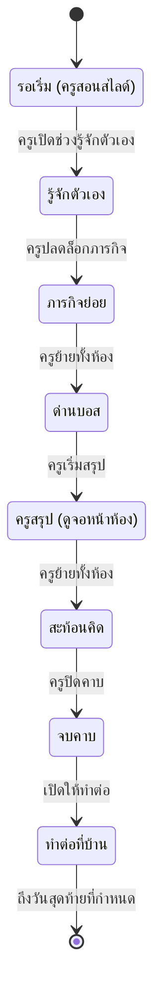
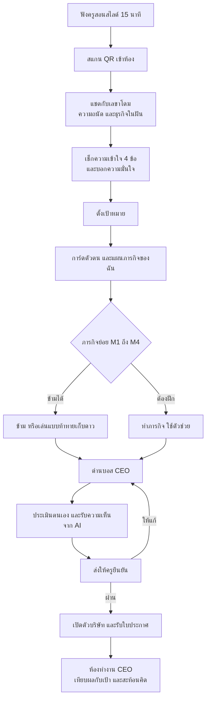
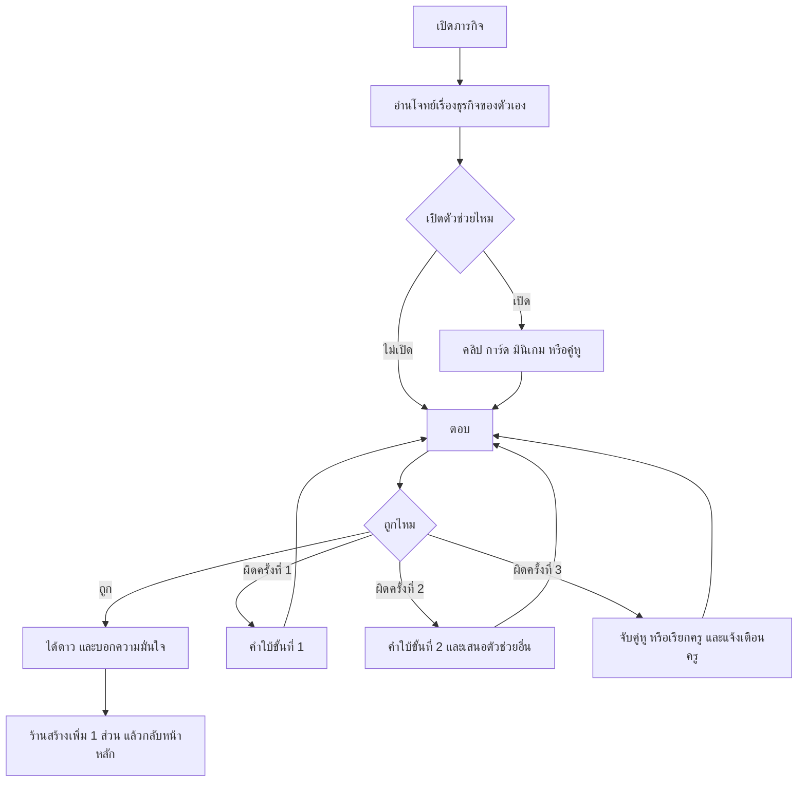
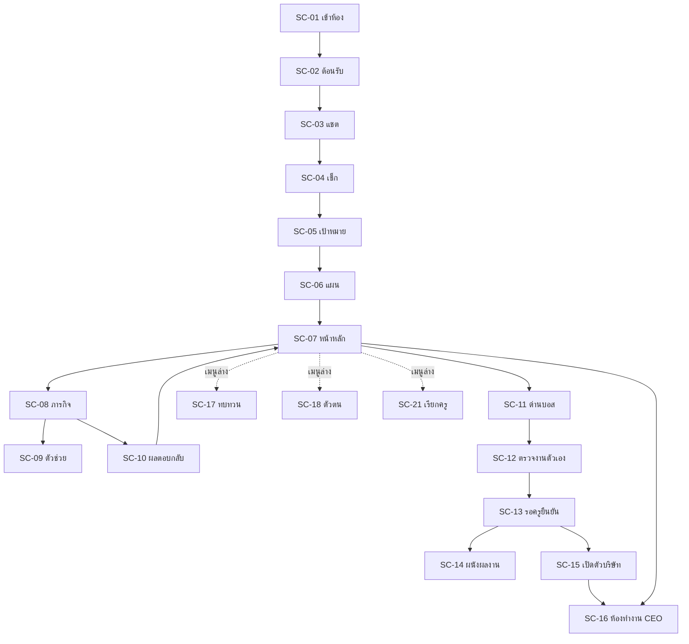
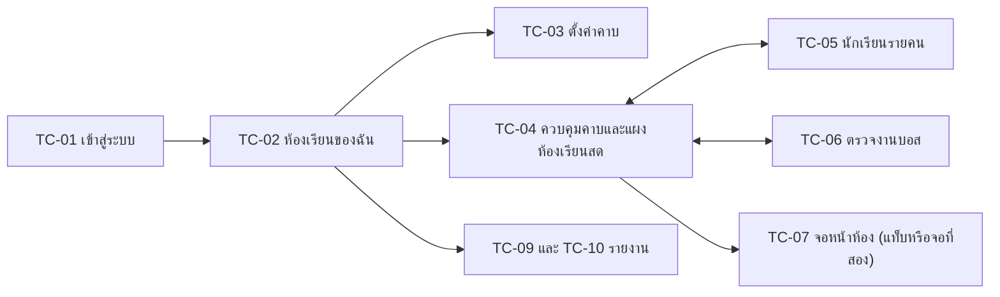
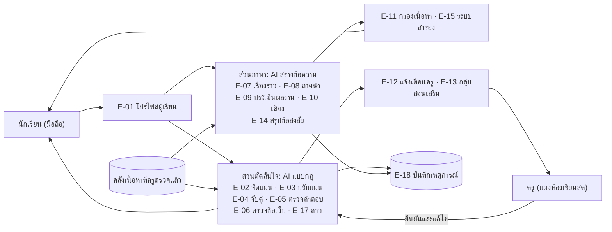
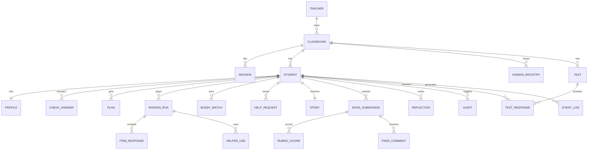

# CEO Domain Quest

### ข้อกำหนดฟีเจอร์ฉบับละเอียด (Feature Specification)

สื่อเว็บแอปพลิเคชันส่งเสริมการเรียนรู้ส่วนบุคคลด้วยปัญญาประดิษฐ์ เรื่อง **รู้จักกับโดเมนเนม** รายวิชาอินเทอร์เน็ตในงานธุรกิจดิจิทัล สำหรับนักเรียนระดับ ปวช.1

| รายการ | รายละเอียด |
|---|---|
| เวอร์ชันเอกสาร | 1.0 (ฉบับร่าง) |
| วันที่จัดทำ | 29 กันยายน 2569 |
| ใช้สำหรับ | พัฒนาสื่อ ทดลองใช้กับนักเรียน เขียนคู่มือประกอบสื่อ และเตรียมนำเสนอการแข่งขัน |
| สถานะ | รอยืนยันคำอธิบายรายวิชา และรอผลการทดลองใช้ |

---

## วิธีอ่านเอกสารนี้

**ป้ายลำดับความสำคัญ**

| ป้าย | ความหมาย |
|---|---|
| 🟢 ต้องมี | ต้องทำให้เสร็จก่อนทดลองกับนักเรียนและก่อนวันแข่ง |
| 🟡 ถ้าทัน | เพิ่มเมื่อส่วนที่ต้องมีเสร็จและเสถียรแล้ว |
| ⚪ ต่อยอด | เก็บไว้ทำในรุ่นถัดไป |

**รหัสที่ใช้ในเอกสาร**

| รหัส | ความหมาย | ตัวอย่าง |
|---|---|---|
| S-xx | ฟีเจอร์ฝั่งนักเรียน | S-05 เช็กความเข้าใจ |
| E-xx | ระบบและ AI ที่ทำงานเบื้องหลัง | E-02 กฎเลือกสื่อ |
| T-xx | ฟีเจอร์ฝั่งครู | T-05 แผงห้องเรียนสด |
| P-xx | ระบบพื้นฐาน | P-02 บันทึกอัตโนมัติ |
| SC-xx | หน้าจอนักเรียน | SC-08 หน้าภารกิจ |
| TC-xx | หน้าจอครู | TC-04 แผงห้องเรียนสด |
| M1–M4 | ภารกิจย่อย 1–4 | M2 แยกชิ้นส่วนชื่อเว็บ |
| B-T1–B-T6 | แม่แบบสถานการณ์ด่านบอส | B-T4 เรื่องการจดทะเบียน |
| C1–C4 | เกณฑ์ในรูบริกด่านบอส | C2 นามสกุลเหมาะกับธุรกิจ |

**นักเรียนสมมติที่ใช้เป็นตัวอย่างทั้งเอกสาร**

| ชื่อ | ธุรกิจในฝัน | ข้อมูลเด่น |
|---|---|---|
| พลอย | ร้านขนมบ้านยาย ลูกค้าในชุมชน ยังไม่จดทะเบียน | เรียนรู้ได้ดีเมื่อดูตัวอย่าง ถนัดพูด ตอบเช็กถูกข้อ 1 และ 3 |
| เก่ง | ทีมอีสปอร์ต แฟนคลับทั่วโลก จดทะเบียนแล้ว | เรียนรู้ได้ดีเมื่อลองทำ ถนัดเขียน ตอบเช็กถูกทุกข้อ |
| ต้น | ร้านเสื้อมือสอง ลูกค้าทั่วประเทศ ยังไม่จดทะเบียน | เรียนรู้ได้ดีเมื่อคุยกับเพื่อน ถนัดออกแบบ |

> ชื่อ **CEO Domain Quest** และผู้ช่วย AI **"เลขาโดม"** เป็นชื่อชั่วคราว เปลี่ยนได้ทั้งเอกสาร

---

## สรุปจำนวนฟีเจอร์

| กลุ่ม | 🟢 ต้องมี | 🟡 ถ้าทัน | ⚪ ต่อยอด | รวม |
|---|---|---|---|---|
| ฝั่งนักเรียน (S) | 36 | 5 | 0 | 41 |
| ระบบและ AI เบื้องหลัง (E) | 14 | 4 | 0 | 18 |
| ฝั่งครู (T) | 10 | 5 | 1 | 16 |
| ระบบพื้นฐาน (P) | 5 | 1 | 0 | 6 |
| **รวม** | **65** | **15** | **1** | **81** |

> เพิ่มจากรายการที่คุยกันก่อนหน้า 7 ฟีเจอร์ เพื่อให้ระบบทำงานได้ครบและเก็บผลทดลองได้ ได้แก่ S-40 แบบสอบถามความพึงพอใจ, S-41 รับคำขอเป็นคู่หู, E-17 คำนวณดาวและความก้าวหน้า, E-18 บันทึกเหตุการณ์การเรียนรู้, T-01 บัญชีครู, T-15 ส่งข้อความถึงทั้งห้อง และ P-06 มาตรฐานการเข้าถึงพื้นฐาน

---

## สารบัญ

1. ภาพรวมโครงการ
2. หลักการออกแบบ
3. การใช้งานในคาบ 60 นาที
4. แผนผังหน้าจอ
5. ฟีเจอร์ฝั่งนักเรียน (S-01 ถึง S-41)
6. ระบบและ AI เบื้องหลัง (E-01 ถึง E-18)
7. ฟีเจอร์ฝั่งครู (T-01 ถึง T-16)
8. ระบบพื้นฐาน (P-01 ถึง P-06)
9. รายงานและตัวชี้วัด
10. แบบจำลองข้อมูล
11. คลังเนื้อหา
12. แผนการพัฒนา
13. แผนทดสอบและเกณฑ์ตรวจรับ
14. การเชื่อมโยงกับเกณฑ์การแข่งขัน
15. บันทึกการใช้ AI ในการพัฒนาผลงาน
16. ความเสี่ยงและแนวทางรับมือ
17. ภาคผนวก: ตารางฟีเจอร์ทั้งหมด และเอกสารอ้างอิง

---

## 1. ภาพรวมโครงการ

### 1.1 ชื่อผลงาน

- **ชื่อผลงาน:** CEO Domain Quest
- **ชื่อภาษาไทย (ทางเลือก):** ภารกิจ CEO ตั้งชื่อเว็บ
- **ชื่อทางวิชาการ:** การพัฒนาสื่อการเรียนรู้แบบภารกิจเชิงโต้ตอบด้วยปัญญาประดิษฐ์ เพื่อส่งเสริมการเรียนรู้ส่วนบุคคล เรื่อง รู้จักกับโดเมนเนม รายวิชาอินเทอร์เน็ตในงานธุรกิจดิจิทัล สำหรับนักเรียนระดับประกาศนียบัตรวิชาชีพ ชั้นปีที่ 1

### 1.2 ข้อมูลการใช้งาน

| หัวข้อ | รายละเอียด |
|---|---|
| ประเภทสื่อ | สื่อซอฟต์แวร์ประเภทเว็บแอปพลิเคชัน แบบภารกิจเชิงโต้ตอบ ใช้องค์ประกอบของเกม (Gamification) |
| รายวิชา | 21910-2002 อินเทอร์เน็ตในงานธุรกิจดิจิทัล (ท-ป-น 1-2-2) หลักสูตรประกาศนียบัตรวิชาชีพ พุทธศักราช 2567 |
| เรื่อง | รู้จักกับโดเมนเนม |
| ผู้เรียน | นักเรียน ปวช.1 ห้องละประมาณ 20 คน |
| เวลา | 1 คาบ 60 นาที: ครูสอนด้วยสไลด์ 15 นาที ใช้สื่อประมาณ 40 นาที ครูสรุป 5 นาที |
| อุปกรณ์นักเรียน | มือถือหรือคอมพิวเตอร์ คนละ 1 เครื่อง (ใช้คู่ละ 1 เครื่องได้) |
| อุปกรณ์ครู | แท็บเล็ตหรือคอมพิวเตอร์ 1 เครื่อง และโปรเจกเตอร์ |
| การเข้าใช้ | ผ่านเว็บเบราว์เซอร์ สแกน QR ไม่ต้องติดตั้งแอป |
| อินเทอร์เน็ต | ต้องใช้ระหว่างเรียน มีระบบบันทึกและกู้คืนเมื่อสัญญาณหลุด |

> ⚠️ **ต้องทำก่อน:** ยืนยันว่าเรื่องโดเมนเนมอยู่ในคำอธิบายรายวิชา 21910-2002 ตามเอกสารหลักสูตรของวิทยาลัย เพราะคำสั่งการแข่งขันข้อ 2 กำหนดให้ใช้รายวิชาในหลักสูตร ปวช. พุทธศักราช 2567

### 1.3 แนวคิดหลัก

นักเรียนแต่ละคนสวมบทบาทเป็น **CEO ของธุรกิจในฝันของตัวเอง** หลังจากครูสอนเนื้อหาเรื่องโดเมนเนมด้วยสไลด์ นักเรียนสแกน QR เข้าสื่อ คุยกับผู้ช่วย AI "เลขาโดม" เพื่อบอกความถนัด ธุรกิจในฝัน ตอบคำถามเช็กความเข้าใจ และตั้งเป้าหมาย จากนั้นระบบจัด **แผนภารกิจของฉัน** ให้แต่ละคน ทั้งระดับความยาก ตัวช่วยเรียน และเรื่องราวในโจทย์ นักเรียนผ่าน **ภารกิจย่อย 4 ภารกิจ** ตามเรื่องที่เรียน แล้วเจอ **ด่านบอส CEO** ที่ต้องเสนอชื่อโดเมนให้ธุรกิจของตัวเองพร้อมเหตุผล ทุกครั้งที่ผ่านภารกิจ ร้านของนักเรียนบนหน้าจอจะสร้างเพิ่มขึ้นจนเปิดตัวได้ ปิดท้ายด้วยการเทียบผลกับเป้าหมายและสะท้อนคิด โดยครูทำหน้าที่เป็นโค้ชผ่านแผงห้องเรียนสด

**สรุปในประโยคเดียว:** ทุกคนผ่านด่านเดียวกันไปสู่เป้าหมายเดียวกัน แต่ได้โจทย์ ระดับ และตัวช่วยที่เหมาะกับตัวเอง

### 1.4 ปัญหาที่สื่อนี้แก้

| ปัญหาในห้องเรียนเดิม | สื่อแก้อย่างไร |
|---|---|
| นักเรียน 20 คนเข้าใจไม่เท่ากัน คนที่เข้าใจแล้วต้องรอ คนที่ยังไม่เข้าใจตามไม่ทัน | ภารกิจ 2 ระดับ ข้ามเรื่องที่เข้าใจแล้วได้ ทุกคนไปตามจังหวะของตัวเอง |
| เนื้อหาโดเมนเนมเป็นนามธรรม ดูไกลตัว | ทุกโจทย์เป็นเรื่องธุรกิจในฝันของนักเรียนเอง |
| ครูคนเดียววิเคราะห์ผู้เรียนและติดตามรายคนทุกคาบได้ยาก | ระบบเก็บข้อมูลและสรุปให้ครูเห็นทั้งห้องในจอเดียว |
| การสอนแบบบรรยายไม่ได้ฝึกการนำความรู้ไปใช้ | ด่านบอสให้ตัดสินใจเลือกชื่อเว็บให้ธุรกิจจริงพร้อมเหตุผล |
| นักเรียนไม่กล้าถามต่อหน้าเพื่อน | ตัวช่วย 4 แบบ ปุ่มเรียกครูแบบเงียบ และคู่หูช่วยอธิบาย |

### 1.5 รูปแบบการจัดการเรียนรู้และเหตุผลที่เลือก

**รูปแบบ:** การจัดการเรียนรู้เชิงรุก (Active Learning) โดยใช้เกมเป็นฐาน (Game-Based Learning และ Gamification) ร่วมกับแนวคิดการเรียนรู้ส่วนบุคคล (Personalized Learning)

| ด้าน | เหตุผล |
|---|---|
| วัตถุประสงค์ | จุดประสงค์ปลายทางคือ "เลือกโดเมนเนมให้ธุรกิจได้" ซึ่งเป็นทักษะการนำไปใช้ ต้องฝึกด้วยการลงมือทำ ไม่ใช่การจำ |
| เนื้อหา | โดเมนเนมเป็นเรื่องนามธรรม การได้ลองแยกส่วน จัดประเภท และตัดสินใจกับธุรกิจของตัวเอง ทำให้เข้าใจชัดขึ้น |
| ผู้เรียน | นักเรียน ปวช.1 เพิ่งเรียนเรื่องนี้ครั้งแรก พื้นฐาน ความถนัด และความสนใจต่างกัน สื่อจึงต้องปรับให้เหมาะกับแต่ละคน และบทบาท CEO ช่วยเรื่องแรงจูงใจของวัยรุ่นสายธุรกิจ |

### 1.6 จุดประสงค์การเรียนรู้ (KPA)

| ข้อ | ด้าน | จุดประสงค์ | วัดจาก | ถือว่าผ่านเมื่อ |
|---|---|---|---|---|
| 1 | K | บอกความหมายและประโยชน์ของโดเมนเนมได้ | M1, ด่านบอส | ผ่าน M1 (รวมการข้าม) |
| 2 | K | แยกส่วนประกอบของโดเมนเนมได้ | M2, ด่านบอส | ผ่าน M2 (รวมการข้าม) |
| 3 | K | จำแนกประเภทของโดเมนเนมได้ | M3, ด่านบอส | ผ่าน M3 (รวมการข้าม) |
| 4 | K | บอกเงื่อนไขและขั้นตอนการจดทะเบียนโดเมนเนมได้ | M4, ด่านบอส | ผ่าน M4 (รวมการข้าม) |
| 5 | P | เลือกโดเมนเนมให้เหมาะสมกับธุรกิจที่ตนเองสนใจได้ พร้อมให้เหตุผล | ด่านบอส (รูบริก C1–C4) | ครูยืนยันว่าได้ระดับ 3 ขึ้นไปทุกเกณฑ์ |
| 6 | A | มีความรับผิดชอบในการเรียนรู้ ตั้งเป้าหมายและติดตามความก้าวหน้าของตนเอง | การตั้งเป้า ประเมินตนเอง สะท้อนคิด บันทึกพฤติกรรม | ตั้งเป้า ประเมินตนเองในรูบริก และตอบสะท้อนคิดครบ 3 ข้อ |

### 1.7 ขอบเขตเนื้อหา

| เรื่อง | สาระสำคัญ | ระดับความลึกสำหรับ ปวช.1 |
|---|---|---|
| 1 โดเมนเนมคืออะไร มีไว้ทำไม | ชื่อที่ใช้แทนหมายเลข IP ที่จำยาก ระบบ DNS แปลงชื่อเป็นหมายเลข IP ประโยชน์ต่อธุรกิจ | ต้องรู้หน้าที่ของ DNS แต่ไม่ต้องรู้การทำงานภายใน |
| 2 ส่วนประกอบของโดเมนเนม | อ่านจากขวาไปซ้าย โดเมนระดับบนสุด โดเมนระดับรอง ชื่อ ส่วนนำหน้า และแยกชื่อโดเมนออกจากส่วนอื่นของที่อยู่เว็บ | ต้องรู้ |
| 3 ประเภทของโดเมนเนม | โดเมนสากล โดเมนประเทศ โดเมนนามสกุลใหม่ โดเมนภาษาไทย และหมวด .th ที่พบบ่อย | ต้องรู้หมวดที่พบบ่อย หมวด .th ครบ 7 หมวดเป็นเนื้อหาต่อยอด |
| 4 การจดทะเบียนโดเมนเนม | ชื่อห้ามซ้ำ ใครจดก่อนได้ก่อน ต้องต่ออายุ เงื่อนไขของแต่ละนามสกุล ขั้นตอนการจด | ต้องรู้เงื่อนไขหลักและขั้นตอนคร่าว ๆ |
| ประยุกต์ | เลือกชื่อและนามสกุลให้ธุรกิจตามเงื่อนไขและกลุ่มลูกค้า | ควรรู้ เป็นหัวใจของด่านบอส |
| เสริม (ไม่บังคับ) | จับเว็บปลอม โดเมนภาษาไทย โดเมนกับโฮสติ้งต่างกันอย่างไร | รู้ไว้ต่อยอด |

**ไม่อยู่ในขอบเขตของ ปวช.1:** ประเภทของระเบียน DNS การทำงานของเซิร์ฟเวอร์ DNS แต่ละชั้น การค้นข้อมูลเจ้าของโดเมน และองค์กรที่กำกับดูแลโดเมนระดับโลก

### 1.8 ขอบเขตของระบบ

| อยู่ในระบบ | อยู่นอกระบบ | ไม่ทำในรุ่นนี้ |
|---|---|---|
| รู้จักผู้เรียน จัดแผนภารกิจ ภารกิจย่อย ด่านบอส การประเมิน การสะท้อนคิด แผงครู รายงาน แบบทดสอบก่อนหลังเรียน แบบสอบถาม | สไลด์สอนของครู (ใช้โปรแกรมนำเสนอปกติ สไลด์สุดท้ายมี QR เข้าสื่อ) | จดโดเมนจริง เชื่อมต่อผู้ให้บริการโดเมนจริง แชตระหว่างนักเรียน กระดานจัดอันดับ แอปที่ต้องติดตั้ง |

### 1.9 ผู้ใช้ระบบ

| ผู้ใช้ | ทำอะไรในระบบ |
|---|---|
| นักเรียน | บอกข้อมูลตัวเอง ทำภารกิจ ใช้ตัวช่วย ช่วยเพื่อนในบทบาทคู่หู ส่งผลงาน ประเมินตนเอง สะท้อนคิด |
| ครู | สร้างห้อง ตั้งค่าคาบ ควบคุมเวลา ดูแผงห้องเรียนสด โค้ช แก้การตัดสินใจของ AI ยืนยันคะแนน ดูรายงาน |
| ผู้ดูแลเนื้อหา | แก้ไขคลังโจทย์ คำใบ้ แม่แบบ และรูบริก (เป็นครูคนเดียวกันได้) |
| ผู้ชม เช่น กรรมการ | ลองใช้ผ่านโหมดสาธิต โดยไม่กระทบข้อมูลจริง |

### 1.10 นิยามศัพท์

| คำ | ความหมาย |
|---|---|
| ภารกิจย่อย | โจทย์ฝึกทีละเรื่อง มี 4 ภารกิจ (M1–M4) ตรงกับจุดประสงค์ข้อ 1–4 |
| ด่านบอส CEO | ภารกิจรวบยอดที่ใช้ความรู้ทั้ง 4 เรื่อง ตรงกับจุดประสงค์ข้อ 5 |
| ระดับภารกิจ | 🟢 ฝึกพื้นฐาน (มีตัวช่วยมาก) หรือ 🔥 ท้าทาย (ตัวช่วยน้อย โจทย์ลึกขึ้น) |
| ข้ามได้ | ภารกิจที่ระบบอนุญาตให้ข้าม เพราะนักเรียนตอบเรื่องนั้นถูกและมั่นใจตอนเช็ก |
| ตัวช่วยเรียน | สิ่งที่เปิดดูได้ในภารกิจ มี 4 แบบ คือ คลิป การ์ด มินิเกม และคู่หู |
| คู่หู | เพื่อนในห้องที่ผ่านภารกิจนั้นแล้ว ระบบจับคู่ให้ช่วยอธิบาย |
| คู่คิด | เพื่อนที่กำลังทำภารกิจเดียวกัน ระบบจับคู่ให้ช่วยกันคิด เมื่อยังไม่มีคู่หูที่ผ่านแล้ว |
| เลขาโดม | ผู้ช่วย AI ประจำตัวนักเรียน พูดคุยและพาไปตลอดสื่อ |
| การ์ดตัวตน | สรุปความถนัด ธุรกิจในฝัน และเป้าหมายของนักเรียน |
| แผนภารกิจของฉัน | ระดับ การข้าม ภารกิจแนะนำ และตัวช่วยแรก ที่ระบบจัดให้นักเรียนแต่ละคน |
| โปรไฟล์ผู้เรียน | ข้อมูลทั้งหมดที่ระบบเก็บเกี่ยวกับนักเรียน ใช้ต่อข้ามคาบ |
| แม่แบบสถานการณ์ | โจทย์ที่ครูเขียนไว้ มีช่องว่างให้ระบบเติมข้อมูลธุรกิจของนักเรียน |
| ดาว | รางวัลของแต่ละภารกิจ 0–3 ดวง ขึ้นกับจำนวนครั้งที่ตอบยังไม่ถูก การเปิดตัวช่วยไม่ลดดาว |
| คะแนนความแม่นรายเรื่อง | คะแนน 0–4 ต่อเรื่อง ใช้หาเรื่องที่นักเรียนอ่อนที่สุดเพื่อเลือกด่านบอส |
| ผนังผลงาน | หน้ารวมใบเสนอชื่อเว็บของทั้งห้อง สำหรับให้ความเห็นกัน |
| ห้องสมุดทบทวน | การ์ดและคลิปสรุปเนื้อหา 4 เรื่อง เปิดได้ทุกเวลา |
| ห้องทำงาน CEO | หน้าเทียบผลกับเป้าหมายและสะท้อนคิดท้ายคาบ |
| ช่วงของคาบ | สถานะของห้องที่ครูควบคุม ได้แก่ รอเริ่ม รู้จักตัวเอง ภารกิจย่อย ด่านบอส ครูสรุป สะท้อนคิด และจบคาบ |

---

## 2. หลักการออกแบบ

### 2.1 ห้าขั้นของการเรียนรู้ส่วนบุคคล และการนำไปใช้ในระบบ

อ้างอิงขั้นตอนการออกแบบการเรียนรู้ส่วนบุคคลของ วิชัย วงษ์ใหญ่ และมารุต พัฒผล (2561)

| ขั้น | สาระตามหนังสือ | สิ่งที่เกิดขึ้นในระบบ | ฟีเจอร์หลัก |
|---|---|---|---|
| 1 วิเคราะห์ธรรมชาติและความต้องการของผู้เรียน | เข้าใจว่าผู้เรียนเรียนรู้ได้ดีที่สุดอย่างไร ใช้วิธีเรียนแบบไหน ชอบอะไร ถนัดอะไร เป็นขั้นที่สำคัญที่สุด | แชตกับเลขาโดมเรื่องความถนัดและธุรกิจในฝัน เช็กความเข้าใจ 4 ข้อ บอกความมั่นใจ ตั้งเป้าหมาย แล้วเก็บเป็นโปรไฟล์ | S-03, S-05, S-06, S-07, E-01 |
| 2 กำหนดช่องทางการเรียนรู้ | ออนไลน์ ลงมือทำ เรียนกับเพื่อน เรียนกับครู | ระบบเลือกตัวช่วยแรกตามความถนัด คลิปและการ์ด (ออนไลน์) มินิเกม (ลงมือทำ) คู่หูและคู่คิด (เรียนกับเพื่อน) ปุ่มเรียกครูและกลุ่มสอนเสริม (เรียนกับครู) | S-18, E-02, E-04, S-35, E-13 |
| 3 ออกแบบกิจกรรมตามช่องทาง | กิจกรรมเหมาะกับระดับความสามารถ ไม่ยากจนหมดกำลังใจ น่าสนใจ ท้าทาย ตอบผลการเรียนรู้ | ครูเตรียมคลังภารกิจ 2 ระดับ ระบบเลือกระดับ ใส่เรื่องธุรกิจของผู้เรียน เลือกสถานการณ์บอส และรูปแบบผลงาน | S-14, S-16, S-22, E-02, E-07 |
| 4 ดำเนินกิจกรรมแบบ Active Learning | ผู้เรียนเรียนตามความถนัด ใช้แอป แลกเปลี่ยนแบ่งปัน ครูเป็นโค้ช | ทำภารกิจ ใช้ตัวช่วย ช่วยกันในบทบาทคู่หู ให้ความเห็นบนผนังผลงาน ครูโค้ชผ่านแผงห้องเรียนสด | S-14 ถึง S-30, S-41, T-05, T-06 |
| 5 ประเมินผลแบบเสริมพลังตามสภาพจริง | ประเมินตามเป้าที่ผู้เรียนกำหนด หลายวิธี หลายผู้ประเมิน โดยเฉพาะประเมินตนเอง ต่อเนื่อง และให้ข้อมูลย้อนกลับ | ดาวทุกภารกิจ ความมั่นใจ รูบริกที่ประเมินโดย AI ตนเอง เพื่อน และครู เทียบผลกับเป้า สะท้อนคิด ความเห็นจากครู | S-19, S-21, S-26 ถึง S-33, E-09, T-08 |

ผลของขั้นที่ 5 ย้อนกลับไปอัปเดตโปรไฟล์ในขั้นที่ 1 ของคาบถัดไป ทำให้ห้าขั้นเป็นวงจรต่อเนื่อง

### 2.2 บทบาทครู 9 ข้อตามหนังสือ และสิ่งที่ระบบช่วย

| บทบาทครู | ครูทำ | ระบบช่วยอย่างไร |
|---|---|---|
| 1 สร้างบรรยากาศที่เอื้อต่อการเรียนรู้ | ตั้งกติกาว่าผิดได้ ไม่มีใครถูกเปรียบเทียบ | ไม่มีกระดานจัดอันดับ ตอบผิดไม่เสียอะไร ข้อความในระบบเป็นมิตร |
| 2 ใช้คำถามกระตุ้นให้คิด | ถามระหว่างเดินโค้ช | เลขาโดมถามนำแทนการเฉลย แผงครูมีคำถามโค้ชแนะนำตามเรื่องที่นักเรียนติด |
| 3 ส่งเสริมให้ใช้กระบวนการเรียนรู้ | ชวนวางแผน ลงมือ ตรวจ และปรับ | ตั้งเป้า แผนภารกิจ รูบริกให้ตรวจตัวเองก่อนส่ง |
| 4 ให้กำลังใจ ให้คิดหาทางออก | เข้าไปหานักเรียนที่ติด | คำใบ้ 3 ขั้น เสนอตัวช่วยอื่น แจ้งครูว่าใครทำได้ดีแต่ไม่มั่นใจ เพื่อให้ครูไปชม |
| 5 ดูแลช่วยเหลือให้ประสบความสำเร็จ | โค้ชรายคนตรงจุด | ตัวช่วยตามระดับ แจ้งเตือนเมื่อติดซ้ำ กลุ่มสอนเสริม |
| 6 ประสานงานเครือข่ายการเรียนรู้ | ชวนรุ่นพี่หรือผู้ประกอบการมาร่วม | คู่หูในห้อง และพื้นที่ใส่คลิปจากผู้ประกอบการจริงในห้องสมุดทบทวน (ต่อยอด) |
| 7 กำกับติดตามความก้าวหน้า | ชื่นชมเมื่อนักเรียนก้าวหน้า | แผงห้องเรียนสด รายงานรายคน |
| 8 ประเมินและให้ข้อมูลย้อนกลับ | ให้ความเห็นที่ไม่ทำให้เสียกำลังใจ | ตรวจทันที AI ร่างความเห็น ครูยืนยันและเขียนความเห็นรายคน |
| 9 ปรับปรุงกิจกรรมให้ทันสมัย | ปรับสื่อหลังจบคาบ | รายงานเรื่องที่พลาดบ่อย ตัวช่วยที่ได้ผล และข้อสงสัยของห้อง |

### 2.3 สี่องค์ประกอบของการเรียนรู้ส่วนบุคคล

| องค์ประกอบ | ความหมาย | ในระบบ |
|---|---|---|
| Learner Profile | ข้อมูลว่าผู้เรียนรู้อะไรแล้ว ขาดอะไร สนใจอะไร มีเป้าหมายอะไร | โปรไฟล์ผู้เรียน (E-01) การ์ดตัวตน (S-07) ตัวตนของฉัน (S-36) |
| Personal Learning Path | เส้นทางเรียนที่ต่างกันตามโปรไฟล์ โดยมีเป้าหมายชัดเจน | แผนภารกิจของฉัน (S-07) กฎเลือกสื่อ (E-02) เส้นทางภารกิจ (S-10) |
| Competency-Based Progression | เลื่อนระดับเมื่อเข้าใจจริง ไม่ใช่เมื่อครบเวลา | ผ่านเกณฑ์จึงไปต่อ ข้ามได้เมื่อแสดงว่าเข้าใจ ใบประกาศเมื่อผ่านรูบริกเท่านั้น ไม่มีการตก ทำต่อได้ |
| Flexible Learning Environment | จัดเวลา สถานที่ บทบาทครู และการจัดกลุ่มให้ยืดหยุ่น | ทำต่อที่บ้าน (S-37) คู่หูและคู่คิด (E-04) กลุ่มสอนเสริม (E-13) ครูเป็นโค้ช (T-05) |

### 2.4 หลักฐานงานวิจัยที่ใช้ออกแบบ

| หลัก | สาระสำคัญ | ใช้ในระบบอย่างไร |
|---|---|---|
| Expertise Reversal Effect (Kalyuga, 2007) | ผู้เรียนที่มีความรู้เดิมน้อยได้ประโยชน์จากตัวช่วยมาก ผู้เรียนที่มีความรู้เดิมมากเรียนได้ดีกว่าเมื่อลดตัวช่วย และระดับที่เหมาะเปลี่ยนไปตามเวลา | ภารกิจ 2 ระดับ ข้ามเรื่องที่เข้าใจแล้ว ประโยคช่วยเริ่มต้นเฉพาะระดับพื้นฐาน ปรับตัวช่วยระหว่างเรียน |
| Context Personalization (Walkington, 2013) | โจทย์ที่เนื้อหาเดิมแต่บริบทตรงกับความสนใจ ช่วยผลการเรียน โดยเฉพาะผู้เรียนที่เรียนอ่อน | ทุกโจทย์เป็นเรื่องธุรกิจในฝันของนักเรียน |
| การให้ทางเลือก (Patall, Cooper & Robinson, 2008) | การให้ทางเลือกเพิ่มแรงจูงใจภายใน ความพยายาม และผลการปฏิบัติงาน | เลือกธุรกิจ เลือกตัวช่วย ตั้งเป้าเอง ขอเปลี่ยนแผน เลือกรูปแบบผลงาน |
| UDL 3.0 (CAST, 2024) | ออกแบบหลายช่องทางการมีส่วนร่วม การรับเนื้อหา และการแสดงออก ไว้ตั้งแต่ต้น | ตัวช่วย 4 แบบ ส่งผลงาน 3 แบบ ช่วยการอ่าน |
| ข้อควรระวังเรื่องสไตล์การเรียน (Pashler et al., 2008) | ยังไม่มีหลักฐานเพียงพอว่าการสอนตรงกับสไตล์ที่ชอบทำให้เรียนได้ดีขึ้น | ใช้ความถนัดเป็นแค่จุดเริ่มต้น แล้วปรับจากผลจริง (E-03) และนักเรียนเปิดตัวช่วยแบบอื่นได้เสมอ |
| การเรียนรู้ส่วนบุคคล 4 องค์ประกอบ (Pane et al., 2015) | Learner Profile, Personal Learning Path, Competency-Based Progression, Flexible Learning Environment | ใช้เป็นกรอบตรวจความครบถ้วนของระบบ (ข้อ 2.3) |

### 2.5 หลักการออกแบบประสบการณ์ใช้งาน 10 ข้อ

1. **มือถือมาก่อน** ออกแบบจอแนวตั้ง กดด้วยนิ้วโป้งได้ถึงทุกปุ่ม
2. **หนึ่งหน้า หนึ่งเรื่อง** นักเรียนไม่ต้องคิดว่าต้องทำอะไรต่อ
3. **กดมากกว่าพิมพ์** พิมพ์เฉพาะตอนที่จำเป็นจริง
4. **ภาพนำ ตัวหนังสือน้อย** ภาษาเหมาะกับ ปวช.1 ประโยคสั้น
5. **ตอบกลับทันที** ทุกการกระทำมีผลตอบกลับภายในหนึ่งวินาที ยกเว้นงานที่ใช้ AI
6. **ตอบผิดไม่ถูกลงโทษ** การเปิดตัวช่วยไม่หักดาว ไม่ใช้สีแดงแรง ข้อความให้กำลังใจเสมอ
7. **ไม่มีกระดานจัดอันดับ** นักเรียนแข่งกับเป้าของตัวเอง
8. **ไม่ติดป้ายเก่งหรืออ่อนให้นักเรียน** นักเรียนเห็นแค่ระดับของภารกิจ ครูเท่านั้นที่เห็นภาพรวมการแบ่งกลุ่ม
9. **เห็นความก้าวหน้าตลอด** ร้านที่สร้างขึ้น ดาว และแถบเป้าหมาย
10. **ใช้จอเท่าที่จำเป็น** มีจังหวะให้คุยกับเพื่อนและครู และมีช่วงให้วางมือถือดูจอหน้าห้อง

### 2.6 หลักการใช้ AI ในตัวสื่อ 8 ข้อ

1. **กฎมาก่อน AI** ส่วนที่มีถูกผิดชัดเจน เช่น ตรวจคำตอบ ตรวจกฎการตั้งชื่อ และตรวจสิทธิ์จดนามสกุล ใช้กฎตรวจ เพราะแม่นยำและอธิบายได้
2. **AI ทำงานด้านภาษา** เขียนเรื่องราว ถามนำ อ่านเหตุผล และสรุปข้อสงสัย
3. **AI ไม่แต่งข้อเท็จจริงเรื่องโดเมนเอง** ข้อเท็จจริงและตัวโจทย์มาจากคลังที่ครูตรวจแล้ว AI เขียนได้เฉพาะส่วนเล่าเรื่อง
4. **AI ไม่เฉลยคำตอบ** ใช้คำถามนำ
5. **AI ไม่ตัดสินคะแนนสุดท้าย** ครูยืนยันเสมอ
6. **AI บอกเหตุผลทุกครั้งที่ตัดสินใจ** นักเรียนและครูเข้าใจได้ว่าทำไมได้แผนแบบนี้
7. **ครูแก้ได้ นักเรียนขอเปลี่ยนได้** การตัดสินใจของ AI ไม่ใช่คำสั่งสุดท้าย
8. **ทุกจุดที่ใช้ AI มีระบบสำรอง** ถ้า AI ช้าหรือขัดข้อง สื่อยังใช้งานต่อได้

### 2.7 สิ่งที่ตั้งใจไม่ทำ และเหตุผล

| ไม่ทำ | เหตุผล |
|---|---|
| กระดานจัดอันดับ | ทำให้นักเรียนที่ช้าหรือไม่มั่นใจท้อ ขัดกับการสร้างบรรยากาศที่ปลอดภัยทางจิตใจ |
| จับเวลาต่อข้อ | ทำให้นักเรียนรีบเดาแทนการคิด นาฬิกามีเฉพาะระดับช่วงกิจกรรม |
| ติดป้ายสไตล์การเรียนถาวร | ไม่มีหลักฐานรองรับ และทำให้นักเรียนถูกจำกัดอยู่กับสื่อแบบเดียว |
| ให้ AI ตัดสินคะแนนเอง | AI อาจประเมินภาษาไทยของนักเรียนพลาด ครูต้องยืนยัน |
| หักดาวเมื่อเปิดตัวช่วย | ต้องการให้นักเรียนกล้าใช้ตัวช่วยเพื่อเรียน |
| แชตระหว่างนักเรียน | ลดความเสี่ยงด้านความปลอดภัยและการใช้คำไม่เหมาะสม การคุยกับเพื่อนให้คุยต่อหน้ากันในห้อง |
| ทำเกม 3 มิติเต็มรูปแบบ | ใช้เวลาสร้างนาน เสี่ยงเรื่องความเสถียรบนมือถือในห้องเรียน และปรับเนื้อหาได้ยาก |

---

## 3. การใช้งานในคาบ 60 นาที

### 3.1 ลำดับเวลาในคาบ

| นาที | ช่วงของคาบ | ครู | นักเรียน | ระบบ |
|---|---|---|---|---|
| ก่อนคาบ | เตรียม | สร้างห้อง ตั้งค่าคาบ เปิดแบบทดสอบก่อนเรียน (ถ้าเก็บผลทดลอง) | ทำแบบทดสอบก่อนเรียน (ถ้าครูเปิด) | เตรียม QR และคลังเนื้อหา |
| 0–15 | รอเริ่ม | สอนสไลด์ เนื้อหาข้อ 1–4 มีกิจกรรมสั้นให้เดา ลองแยกชื่อเว็บในมือถือ และคุยกับเพื่อน | ฟัง ตอบ มีส่วนร่วมกับกิจกรรมในสไลด์ | ภารกิจยังล็อก |
| 15–20 | รู้จักตัวเอง | ขึ้น QR เปิดช่วงรู้จักตัวเอง | สแกน QR แชตกับเลขาโดม เช็กความเข้าใจ ตั้งเป้า ดูแผนภารกิจ | สร้างโปรไฟล์ จัดแผน สร้างเรื่องราวล่วงหน้าเบื้องหลัง |
| 20–40 | ภารกิจย่อย | ปลดล็อกภารกิจ ดูแผงห้องเรียนสด โค้ชคนที่ติด เรียกกลุ่มสอนเสริม | ทำภารกิจ ใช้ตัวช่วย ช่วยเพื่อนในบทบาทคู่หู | ตรวจคำตอบ ให้คำใบ้ ปรับตัวช่วย แจ้งเตือนครู |
| 40–50 | ด่านบอส | กด "ทุกคนไปด่านบอส" ตรวจยืนยันงานที่ส่งเข้ามา | ทำใบเสนอชื่อเว็บ ประเมินตนเอง ส่ง ให้ความเห็นเพื่อน | เลือกแม่แบบบอส ตรวจชื่อและสิทธิ์จด ประเมินเบื้องต้น |
| 50–55 | ครูสรุป | แชร์ผลงาน 2–3 ชิ้นบนจอหน้าห้อง แก้จุดที่เข้าใจผิดบ่อย | วางมือถือ ดูจอหน้าห้อง | แสดงสถิติเรื่องที่พลาดบ่อยให้ครู หน้าจอนักเรียนขึ้นว่า "ดูจอหน้าห้องนะ" |
| 55–60 | สะท้อนคิด | กด "ทุกคนไปห้องทำงาน CEO" | เทียบผลกับเป้า ตอบ 3 คำถาม ตั้งเป้าครั้งหน้า ทำแบบสอบถาม (ถ้าครูเปิด) | บันทึก อัปเดตโปรไฟล์ สรุปข้อสงสัย |
| หลังคาบ | จบคาบ และทำต่อที่บ้าน | ตรวจงานที่ค้าง ให้ความเห็น ดูรายงาน เปิดแบบทดสอบหลังเรียน | ทำภารกิจที่ค้าง ภารกิจเสริม อ่านความเห็นจากครู | เปิดให้ทำต่อถึงวันที่ครูกำหนด |

### 3.2 ช่วงของคาบที่ครูควบคุม



**กติกาสำคัญ: ช่วงของห้อง กับ ตำแหน่งของนักเรียน**

- **ช่วงของห้อง** คือขอบเขตสูงสุดที่ครูเปิดให้ทำ ครูเป็นคนเปลี่ยน
- **ตำแหน่งของนักเรียน** คือจุดที่นักเรียนแต่ละคนอยู่จริง ซึ่งอยู่ได้ทุกจุดที่ไม่เกินช่วงของห้อง
- ถ้าครูเปิดตั้งค่า **"เปิดบอสให้คนที่พร้อมก่อน"** (ค่าเริ่มต้นเปิด) นักเรียนที่ผ่านภารกิจที่ต้องทำครบแล้ว เข้าด่านบอสได้เลยแม้ห้องยังอยู่ช่วงภารกิจย่อย
- เมื่อครู **ย้ายทั้งห้อง** นักเรียนทุกคนไปที่ช่วงใหม่ งานที่ค้างถูกบันทึกไว้ และกลับไปทำต่อได้ภายหลัง
- ช่วง **ครูสรุป** หน้าจอนักเรียนเปลี่ยนเป็นหน้าพักที่ขึ้นว่า "ดูจอหน้าห้องนะ" เพื่อให้ทั้งห้องสนใจครู

### 3.3 เส้นทางของนักเรียนตลอดคาบ



### 3.4 วงจรในหนึ่งภารกิจ



### 3.5 ครูเตรียมอะไรก่อนคาบ

- [ ] สร้างห้องเรียนและตั้งค่าคาบ (T-02)
- [ ] ตรวจเนื้อหาภารกิจและแม่แบบบอสว่าเป็นฉบับล่าสุด (T-14)
- [ ] เตรียมสไลด์ 15 นาที และใส่ QR ของห้องในสไลด์สุดท้าย
- [ ] ทดสอบเข้าระบบด้วยมือถือหนึ่งเครื่องก่อนคาบ
- [ ] เปิดแผงห้องเรียนสดบนแท็บเล็ตหรือคอมพิวเตอร์ครู และเปิดจอหน้าห้องบนโปรเจกเตอร์ (ถ้ามี)
- [ ] ถ้าเก็บผลทดลอง ให้นักเรียนทำแบบทดสอบก่อนเรียนในคาบก่อนหน้า (T-12)
- [ ] สำรองแผน: ถ้าอินเทอร์เน็ตในห้องไม่เสถียร ให้นักเรียนจับคู่ใช้เครื่องที่ใช้ข้อมูลมือถือ

### 3.6 หลังคาบ

- นักเรียนที่ทำไม่ครบ กลับมาทำต่อจากจุดเดิมได้ถึงวันที่ครูกำหนด (S-37)
- นักเรียนที่ตั้งเป้า 🚀 หรือทำเสร็จเร็ว ทำภารกิจเสริมได้ (S-38)
- ครูตรวจงานบอสที่ยังรอยืนยัน เขียนความเห็นรายคน (T-08) และดูรายงาน (T-10, T-11)
- ครูใช้ข้อสงสัยที่พบบ่อยปรับสไลด์และแม่แบบก่อนคาบถัดไป
- ถ้าเก็บผลทดลอง ให้ทำแบบทดสอบหลังเรียนต้นคาบถัดไป (T-12)

### 3.7 ถ้าเวลาไม่พอ

| ทางเลือก | ทำอย่างไร | เวลาที่ใช้สื่อ |
|---|---|---|
| โหมดสั้น | ภารกิจละ 1 ข้อ ด่านบอสไม่มีรอบแก้ ปิดผนังผลงาน | ประมาณ 25 นาที |
| แบ่งสองคาบ | คาบแรก รู้จักตัวเอง และภารกิจ M1–M2 / คาบที่สอง ภารกิจ M3–M4 ด่านบอส และสะท้อนคิด | คาบละประมาณ 25–30 นาที |
| ให้ทำนอกคาบ | ภารกิจที่ข้ามได้หรือภารกิจเสริมให้ทำที่บ้าน | ขึ้นกับนักเรียน |

---

## 4. แผนผังหน้าจอ

### 4.1 หน้าจอนักเรียน

| รหัส | หน้าจอ | ใช้ในช่วง | ฟีเจอร์ที่อยู่ในหน้านี้ |
|---|---|---|---|
| SC-01 | เข้าห้อง | รู้จักตัวเอง | S-01 |
| SC-02 | ต้อนรับและวิธีใช้ | รู้จักตัวเอง | S-02 |
| SC-03 | แชตรู้จักตัวเอง | รู้จักตัวเอง | S-03, S-04 |
| SC-04 | เช็กความเข้าใจ | รู้จักตัวเอง | S-05 |
| SC-05 | ตั้งเป้าหมาย | รู้จักตัวเอง | S-06 |
| SC-06 | การ์ดตัวตนและแผนภารกิจ | รู้จักตัวเอง | S-07, S-08 |
| SC-07 | หน้าหลัก | ทุกช่วง | S-09, S-10, S-11, S-12, S-13 |
| SC-08 | ภารกิจ | ภารกิจย่อย | S-14 ถึง S-17, S-20 |
| SC-09 | ตัวช่วย (หน้าต่างซ้อน) | ภารกิจย่อย | S-18 |
| SC-10 | ผลตอบกลับ | ภารกิจย่อย | S-19, S-21 |
| SC-11 | ด่านบอส | ด่านบอส | S-22, S-23, S-24, S-25 |
| SC-12 | ตรวจงานตัวเอง | ด่านบอส | S-26, S-27 |
| SC-13 | รอครูยืนยัน | ด่านบอส | S-28 |
| SC-14 | ผนังผลงาน | ด่านบอส | S-29 |
| SC-15 | เปิดตัวบริษัท | ด่านบอส | S-30 |
| SC-16 | ห้องทำงาน CEO | สะท้อนคิด | S-31, S-32, S-33, S-40 |
| SC-17 | ห้องสมุดทบทวน | ทุกช่วงหลังรู้จักตัวเอง | S-34 |
| SC-18 | ตัวตนของฉัน | ทุกช่วงหลังรู้จักตัวเอง | S-36 |
| SC-19 | ภารกิจเสริม | หลังส่งงานบอส และทำต่อที่บ้าน | S-38 |
| SC-20 | ตั้งค่า | ทุกช่วง | S-39, P-03 |
| SC-21 | แผ่นเรียกครู | ทุกช่วง | S-35 |
| SC-22 | คำขอเป็นคู่หู | ภารกิจย่อย | S-41 |
| SC-23 | หน้าพัก "ดูจอหน้าห้อง" | ครูสรุป และเมื่อครูสั่งให้ดูจอ | T-03 |

### 4.2 หน้าจอครู

| รหัส | หน้าจอ | ฟีเจอร์ |
|---|---|---|
| TC-01 | เข้าสู่ระบบ | T-01 |
| TC-02 | ห้องเรียนของฉัน | T-02 |
| TC-03 | ตั้งค่าคาบ | T-02 |
| TC-04 | ควบคุมคาบและแผงห้องเรียนสด | T-03, T-05 |
| TC-05 | นักเรียนรายคน | T-06, T-07 |
| TC-06 | ตรวจงานบอส | T-08 |
| TC-07 | จอหน้าห้อง | T-04 |
| TC-08 | ดูแลผนังผลงาน | T-09 |
| TC-09 | รายงานรายคน | T-10 |
| TC-10 | รายงานรายห้อง | T-11 |
| TC-11 | แบบทดสอบก่อนและหลังเรียน | T-12 |
| TC-12 | ส่งออกข้อมูล | T-13 |
| TC-13 | จัดการเนื้อหา | T-14 |
| TC-14 | ส่งข้อความถึงทั้งห้อง | T-15 |

### 4.3 การนำทาง

**การนำทางของนักเรียน**



**การนำทางของครู**



- **แถบเมนูครู** ห้องเรียน · คาบสด · ตรวจงาน · รายงาน · เนื้อหา · ตั้งค่า

- **เมนูล่างของนักเรียน** 🏠 หน้าหลัก · 📚 ทบทวน · 👤 ตัวตน · ✋ เรียกครู
- **ปุ่มตั้งค่า** ⚙️ มุมบนขวาของหน้าหลัก
- **ปุ่มย้อนกลับ** มีทุกหน้า ยกเว้นระหว่างตอบข้อที่ส่งแล้ว
- **ครู** ใช้แท็บเล็ตแนวนอนหรือคอมพิวเตอร์ แถบเมนูอยู่ด้านซ้าย

### 4.4 องค์ประกอบที่อยู่ทุกหน้าของนักเรียน

| องค์ประกอบ | ตำแหน่ง | รายละเอียด |
|---|---|---|
| แถบช่วงและนาฬิกา | บนสุด | ชื่อช่วง เช่น "ช่วงภารกิจ" และเวลาที่เหลือ (S-11) |
| ป้ายข้อความจากครู | ใต้แถบนาฬิกา | ข้อความจากครูถึงทั้งห้อง (T-15) แสดง 10 วินาทีแล้วย่อเก็บ |
| ป้ายแจ้งสัญญาณ | ใต้แถบนาฬิกา | ขึ้นเมื่อสัญญาณหลุด "สัญญาณหลุด กำลังบันทึกงานไว้ให้" (P-02) |
| เลขาโดม | ในการ์ดข้อความ | ภาพตัวละครคู่กับข้อความของ AI ทุกครั้ง |
| เมนูล่าง | ล่างสุด | 4 ปุ่ม ซ่อนระหว่างทำโจทย์เพื่อเพิ่มพื้นที่ แตะขอบล่างเพื่อเรียกกลับ |

### 4.5 แนวทางภาพและสี

| หัวข้อ | ข้อกำหนด |
|---|---|
| สไตล์ภาพ | แฟลต เรียบ สะอาด มุมโค้ง เงานุ่ม ฉากร้านใช้ภาพมุมเฉียงแบบไอโซเมตริก |
| สีการเรียน | เขียวน้ำทะเล `#1D9E75` ใช้กับปุ่มหลัก ภารกิจ ความก้าวหน้า |
| สี AI | ม่วง `#7F77DD` ใช้กับเลขาโดมและข้อความจาก AI |
| สีรางวัล | ส้ม `#EF9F27` ใช้กับดาว ใบประกาศ การฉลอง |
| สีคำใบ้ | เหลืองอ่อน ใช้กับการ์ดคำใบ้ ไม่ใช้สีแดงกับคำตอบผิด |
| พื้นหลัง | ครีม `#FFF8EE` และขาว |
| ตัวอักษร | ฟอนต์ไทยที่ใช้ได้ฟรีตามสัญญาอนุญาต OFL เช่น Noto Sans Thai, Sarabun หรือ Prompt ขนาดเนื้อความไม่ต่ำกว่า 16px |
| ไอคอน | ไอคอนเส้นเรียบ ใช้คู่กับข้อความเสมอ ไม่สื่อความหมายด้วยสีอย่างเดียว |
| ตัวละคร | เลขาโดม หุ่นยนต์กลมสีม่วง หน้าจอยิ้ม ใส่หูฟังสีเขียวน้ำทะเล ผูกเนกไทสีส้ม |
| ลิขสิทธิ์ | ภาพ เสียง และฟอนต์ทุกชิ้นต้องสร้างเองหรือมีสัญญาอนุญาตให้ใช้ ห้ามใช้ภาพจากหนังสือเรียนหรือเกมของผู้อื่น |

---

## 5. ฟีเจอร์ฝั่งนักเรียน

ทุกฟีเจอร์เขียนในรูปแบบเดียวกัน คือ เพื่ออะไร สิ่งที่นักเรียนเห็น การทำงาน กฎและเงื่อนไข ข้อมูลที่บันทึก กรณีพิเศษ และเกณฑ์ตรวจรับ ตัวอย่างหน้าจอใช้ข้อมูลของ "พลอย"

### 5.1 เข้าใช้งาน

#### S-01 เข้าห้องด้วย QR

`🟢 ต้องมี` · หน้าจอ SC-01

**เพื่ออะไร** ให้นักเรียนเข้าสื่อได้ในไม่กี่วินาที ไม่ต้องสมัครสมาชิก และกลับมาทำต่อได้

**สิ่งที่นักเรียนเห็น**
```
CEO Domain Quest
ห้อง ปวช.1/1 · อินเทอร์เน็ตในงานธุรกิจดิจิทัล

ชื่อเล่น        [ พลอย ]
รหัสลับ 4 ตัว   [ •••• ]  (ไว้กลับมาทำต่อที่บ้าน)

               [ เริ่มเลย ]
```

**การทำงาน**
1. ครูเปิดช่วงรู้จักตัวเอง ระบบแสดง QR และรหัสห้อง 6 ตัวบนจอหน้าห้อง รหัสใช้ตัวอักษรพิมพ์ใหญ่และตัวเลข โดยตัดตัวที่สับสนง่ายออก เช่น O กับ 0 และ I กับ 1
2. นักเรียนสแกน QR ซึ่งมีรหัสห้องฝังอยู่แล้ว หรือเปิดเว็บแล้วพิมพ์รหัสห้องเอง
3. นักเรียนใส่ชื่อเล่นและตั้งรหัสลับ 4 หลัก
4. ระบบสร้างบัญชีนักเรียนในห้องนั้น แล้วพาไปหน้าต้อนรับ (SC-02)
5. ครั้งต่อไป ใส่ชื่อเล่นและรหัสลับเดิม ระบบพากลับไปหน้าล่าสุดที่ทำค้างไว้

**กฎและเงื่อนไข**
- ชื่อเล่นยาว 1–20 ตัวอักษร ภาษาไทยหรืออังกฤษ ห้ามซ้ำในห้องเดียวกัน ถ้าซ้ำ ระบบเสนอให้เติมตัวเลข เช่น "พลอย2"
- ชื่อเล่นต้องผ่านการกรองคำไม่เหมาะสม (E-11)
- รหัสลับเป็นตัวเลข 4 หลัก ถ้าเป็นเลขเดาง่าย เช่น 0000 1111 1234 ระบบเตือนแต่ไม่บังคับ
- ใส่รหัสลับผิด 5 ครั้งติดกัน ล็อก 1 นาที และแนะนำให้เรียกครูรีเซ็ตรหัส (T-06)
- เข้าได้เมื่อห้องไม่อยู่ในสถานะปิด
- ไม่ขออีเมล เบอร์โทร หรือชื่อจริง

**ข้อมูลที่บันทึก** ชื่อเล่น รหัสลับแบบเข้ารหัส รหัสห้อง เวลาเข้าครั้งแรก หน้าล่าสุด ประเภทเครื่อง (ไว้ช่วยแก้ปัญหา)

**กรณีพิเศษ**
- ห้องยังไม่เปิด แสดง "รอครูเปิดห้องนะ" พร้อมปุ่มลองใหม่
- สองคนใช้เครื่องเดียวกัน มีปุ่ม "เปลี่ยนผู้เล่น" ในหน้าตั้งค่า
- เปิดบัญชีเดียวกันสองเครื่องพร้อมกัน เครื่องล่าสุดใช้งานได้ เครื่องเก่าขึ้นว่า "บัญชีนี้เปิดอยู่ที่อีกเครื่อง"
- นักเรียนมาสาย เข้าได้ตามปกติ และระบบพาไปทำช่วงรู้จักตัวเองก่อนเสมอ

**เกณฑ์ตรวจรับ**
- [ ] สแกนแล้วเห็นหน้าใส่ชื่อภายใน 5 วินาทีบนเครือข่าย 4G
- [ ] ชื่อซ้ำในห้องเดียวกันถูกป้องกัน
- [ ] เข้าใหม่ด้วยชื่อและรหัสเดิม กลับไปหน้าล่าสุดได้ถูกต้อง
- [ ] ไม่มีช่องให้กรอกข้อมูลส่วนตัวอื่น

#### S-02 คำแนะนำการใช้งาน

`🟢 ต้องมี` · หน้าจอ SC-02 · ตอบคำสั่งการแข่งขันข้อ 7 (มีคำแนะนำการใช้งาน)

**เพื่ออะไร** ให้นักเรียนรู้วิธีใช้สื่อภายในหนึ่งนาที และรู้ว่าสื่อนี้ไม่มีการแข่งกับเพื่อน

**สิ่งที่นักเรียนเห็น** การ์ด 3 ใบ ปัดซ้ายขวาได้
```
[1/3] 🏢 คุณคือ CEO
      วันนี้คุณจะสร้างบริษัทในฝัน ผ่านภารกิจเรื่องชื่อเว็บ
      แล้วเปิดตัวบริษัทของคุณ

[2/3] 🧰 ติดตรงไหน ใช้ตัวช่วย
      มีคลิป การ์ด มินิเกม และเพื่อนคู่หูให้เลือก
      กด ✋ เรียกครูได้ตลอดเวลา

[3/3] 🎯 แข่งกับเป้าของตัวเอง
      ไม่มีการจัดอันดับ ตอบผิดไม่เสียอะไร
      ทุกคนมีเส้นทางของตัวเอง

[ข้าม]                           [ถัดไป] / [เริ่มรู้จักกัน]
```

**การทำงาน**
1. แสดงครั้งแรกหลังเข้าห้อง
2. นักเรียนปัดดูหรือกดข้ามได้
3. ครั้งแรกที่เปิดหน้าหลักและหน้าภารกิจ มีป้ายชี้ปุ่มสำคัญ 1–2 จุด เช่น "แตะวงกลมเพื่อเริ่มภารกิจ" และ "ตัวช่วยอยู่ตรงนี้"
4. เปิดดูซ้ำได้จาก ⚙️ ตั้งค่า > วิธีใช้

**ข้อมูลที่บันทึก** ดูคำแนะนำแล้วหรือยัง ดูป้ายชี้ปุ่มแล้วหรือยัง

**เกณฑ์ตรวจรับ**
- [ ] แสดงเฉพาะครั้งแรก และเปิดซ้ำได้จากตั้งค่า
- [ ] กดข้ามได้ทุกหน้า
- [ ] ป้ายชี้ปุ่มขึ้นครั้งเดียวต่อหน้าจอ

### 5.2 รู้จักตัวเอง (ขั้นที่ 1)

#### S-03 แชตกับเลขาโดม

`🟢 ต้องมี` · หน้าจอ SC-03 · ขั้นที่ 1

**เพื่ออะไร** วิเคราะห์ธรรมชาติและความต้องการของผู้เรียน ตามขั้นที่ 1 ของหนังสือ ด้วยบทสนทนาที่เป็นกันเอง ใช้เวลาไม่เกิน 2 นาที

**สิ่งที่นักเรียนเห็น**
```
🤖 เวลาอยากรู้วิธีทำอะไรใหม่ ๆ คุณมักจะ...
   [🎬 ดูคลิป] [📄 อ่านสรุป] [🎮 ลองทำเลย] [👥 ถามเพื่อน]
   ↳ พลอยกด 🎬 ดูคลิป
🤖 ถ้าต้องนำเสนอความคิด คุณถนัดแบบไหน
   [✍️ เขียน] [🎤 พูด] [🎨 วาดหรือออกแบบ]
   ↳ พลอยกด 🎤 พูด
🤖 คุณอยากเปิดบริษัทอะไร   [พิมพ์เอง] [💡 ขอไอเดีย]
   ↳ พลอยพิมพ์ "ร้านขนมไทย"
🤖 ตั้งชื่อแบรนด์ว่าอะไรดี
   ↳ พลอยพิมพ์ "ขนมบ้านยาย"
🤖 ลูกค้าของคุณอยู่ที่ไหน
   [🏘️ ในชุมชน] [🇹🇭 ทั่วประเทศ] [🌏 ทั่วโลก]
   ↳ พลอยกด 🏘️ ในชุมชน
🤖 บริษัทจดทะเบียนการค้าแล้วหรือยัง
   [ยังไม่จด] [จดแล้ว] [ไม่แน่ใจ อธิบายหน่อย]
   ↳ พลอยกด ยังไม่จด
```

**คำถามและค่าที่บันทึก**

| ข้อ | คำถาม | ตัวเลือก | ค่าที่บันทึก |
|---|---|---|---|
| 1 | เวลาอยากรู้วิธีทำอะไรใหม่ ๆ คุณมักจะ... | ดูคลิป / อ่านสรุป / ลองทำเลย / ถามเพื่อน | learning_pref = watch / read / try / talk |
| 2 | ถ้าต้องนำเสนอความคิด คุณถนัดแบบไหน | เขียน / พูด / วาดหรือออกแบบ | creation_pref = write / speak / design |
| 3 | คุณอยากเปิดบริษัทอะไร | พิมพ์เอง หรือการ์ดไอเดีย 8 ใบ | business.description, business.category |
| 4 | ตั้งชื่อแบรนด์ว่าอะไรดี | พิมพ์เอง 1–30 ตัวอักษร | brand_name |
| 5 | ลูกค้าของคุณอยู่ที่ไหน | ในชุมชน / ทั่วประเทศ / ทั่วโลก | customers = local / national / global |
| 6 | บริษัทจดทะเบียนการค้าแล้วหรือยัง | ยังไม่จด / จดแล้ว / ไม่แน่ใจ | registered = no / yes |

**การ์ดไอเดียในข้อ 3 (แตะเลือกแล้วแก้ข้อความได้)** 🍰 ร้านขนม · 👕 ร้านเสื้อผ้า · 🎮 ทีมเกมหรืออีสปอร์ต · 📱 ร้านซ่อมมือถือ · 🍜 ร้านอาหาร · 💄 ร้านความงาม · 🎨 รับออกแบบ · 🌱 สินค้าชุมชน

**การทำงาน**
1. เลขาโดมถามทีละข้อ ข้อที่มีตัวเลือกให้กดปุ่ม ข้อที่ต้องพิมพ์มีช่องพิมพ์
2. หลังแต่ละคำตอบ เลขาโดมตอบรับสั้น ๆ เช่น "ขนมบ้านยาย ชื่อน่ารักมากค่ะ!" ข้อความนี้ใช้ AI ถ้าใช้ไม่ได้ใช้ข้อความสำเร็จรูป เช่น "ชื่อดีเลยค่ะ!"
3. ถ้าตอบข้อ 6 ว่า "ไม่แน่ใจ" เลขาโดมอธิบายว่า "การจดทะเบียนการค้า คือการแจ้งหน่วยงานรัฐว่าเรามีธุรกิจ ในเกมนี้ เลือกได้เลยว่าบริษัทในฝันของคุณจดแล้วหรือยัง" แล้วถามใหม่ด้วยสองตัวเลือก
4. เมื่อตอบข้อ 3 และ 4 ระบบส่งข้อมูลให้ AI ทำงานเบื้องหลัง (E-07) คือจัดหมวดธุรกิจ สร้างชื่อภาษาอังกฤษของแบรนด์สำหรับใช้ในโจทย์ และเลือกตัวละครในเรื่อง
5. นักเรียนแตะคำตอบเดิมเพื่อแก้ได้ก่อนไปหน้าถัดไป

**กฎและเงื่อนไข**
- ข้อความที่พิมพ์ผ่านการกรองเนื้อหา (E-11) ถ้าไม่เหมาะสม เลขาโดมชวนเปลี่ยนอย่างสุภาพ
- ถ้าชื่อแบรนด์เป็นแบรนด์ดังของคนอื่น เลขาโดมเปลี่ยนเป็นโอกาสเรียนรู้ (ดู E-11)
- หมวดธุรกิจมี 9 ค่า คือ ขนม เสื้อผ้า เกม ซ่อมมือถือ อาหาร ความงาม ออกแบบ สินค้าชุมชน และอื่น ๆ
- ห้ามถามข้อมูลส่วนตัว เช่น ที่อยู่หรือรายได้ครอบครัว

**ข้อมูลที่บันทึก** ค่าจากตารางข้างต้น ชื่อภาษาอังกฤษของแบรนด์ หมวดธุรกิจ ตัวละครในเรื่อง เวลาที่ใช้

**กรณีพิเศษ**
- พิมพ์ว่างหรือพิมพ์ตัวอักษรเดียว เลขาโดมขอให้เล่าเพิ่มอีกนิด
- พิมพ์ยาวเกิน ตัดเหลือ 100 ตัวอักษรสำหรับคำอธิบายธุรกิจ
- AI ไม่ตอบภายใน 8 วินาที ใช้ข้อความสำเร็จรูปและหมวด "อื่น ๆ" แล้วไปต่อได้ทันที

**เกณฑ์ตรวจรับ**
- [ ] ตอบครบ 6 ข้อได้ภายใน 2 นาที
- [ ] บันทึกค่าได้ถูกต้องตามตาราง
- [ ] แก้คำตอบก่อนหน้าได้
- [ ] ใช้งานได้ครบแม้ AI ใช้ไม่ได้

#### S-04 ขอไอเดียธุรกิจ

`🟡 ถ้าทัน` · หน้าจอ SC-03 · ขั้นที่ 1

**เพื่ออะไร** ช่วยนักเรียนที่คิดไม่ออกว่าอยากทำธุรกิจอะไร โดยเริ่มจากสิ่งที่ชอบ

**การทำงาน**
1. นักเรียนกด 💡 ขอไอเดีย
2. เลขาโดมถามว่า "เวลาว่างคุณชอบทำอะไร" ให้เลือกได้ไม่เกิน 2 อย่าง: เล่นเกม ทำอาหาร แต่งตัว เล่นกีฬา ถ่ายรูป ดนตรี สัตว์เลี้ยง ช่วยงานที่บ้าน
3. AI เสนอไอเดียธุรกิจ 3 แบบ แต่ละแบบมีชื่อและคำอธิบายหนึ่งบรรทัด
4. นักเรียนเลือกหนึ่งแบบ ระบบเติมคำตอบข้อ 3 และเสนอชื่อแบรนด์ให้แก้ได้

**ระบบสำรอง** ถ้า AI ใช้ไม่ได้ ใช้ไอเดียสำเร็จรูปจากคลังเนื้อหา (ข้อ 11.11)

**เกณฑ์ตรวจรับ**
- [ ] ได้ไอเดียภายใน 8 วินาที หรือได้ไอเดียสำเร็จรูปแทน
- [ ] ไอเดียทุกแบบเหมาะกับวัยและถูกกฎหมาย

#### S-05 เช็กความเข้าใจ

`🟢 ต้องมี` · หน้าจอ SC-04 · ขั้นที่ 1

**เพื่ออะไร** รู้ว่านักเรียนเข้าใจเนื้อหาจากสไลด์ของครูแค่ไหนในแต่ละเรื่อง และมั่นใจแค่ไหน เพื่อใช้จัดระดับภารกิจ

**สิ่งที่นักเรียนเห็น**
```
เช็กความเข้าใจ  ข้อ 1/4  ▓░░░
🤖 ตอบผิดไม่เป็นไรนะคะ ฉันจะใช้คำตอบนี้จัดภารกิจให้พอดีกับคุณ

ทำไมเราพิมพ์ชื่อเว็บ แทนตัวเลข IP
( ) ชื่อจำง่ายกว่า และมีระบบ DNS แปลงชื่อเป็นตัวเลขให้
( ) ตัวเลข IP เลิกใช้แล้ว
( ) ชื่อเว็บทำให้เน็ตเร็วขึ้น

มั่นใจแค่ไหน   [😟 ไม่มั่นใจ] [🙂 พอมั่นใจ] [😎 มั่นใจมาก]
                                        [ถัดไป]
```

**การทำงาน**
1. มี 4 ข้อ ข้อละหนึ่งเรื่อง ตรงกับจุดประสงค์ข้อ 1–4
2. แต่ละข้อต้องเลือกคำตอบและความมั่นใจก่อนกดถัดไป
3. มีคำถาม 2 ชุด (ชุด A และชุด B ในข้อ 11.2) ระบบสลับให้นักเรียนคนที่เข้าห้องลำดับคี่ได้ชุด A คนลำดับคู่ได้ชุด B เพื่อลดการลอกกัน
4. สลับลำดับตัวเลือกทุกครั้ง
5. ย้อนแก้ได้จนกว่าจะกดส่งข้อสุดท้าย
6. ไม่เฉลยทันที เพราะภารกิจจะพาไปเรียนเรื่องที่ยังพลาด หลังกดส่งแสดง "เสร็จแล้ว! ฉันกำลังจัดภารกิจให้คุณ"

**กฎและเงื่อนไข**
- ความมั่นใจเก็บเป็นตัวเลข 😟 = 1, 🙂 = 2, 😎 = 3
- นักเรียนที่เข้าห้องสายต้องทำเช็กความเข้าใจก่อนเข้าภารกิจเสมอ
- ครูปิดการสลับชุดได้ในตั้งค่าคาบ

**ข้อมูลที่บันทึก** ชุดคำถาม รหัสคำถาม เรื่อง คำตอบที่เลือก ถูกหรือผิด ความมั่นใจ เวลาที่ใช้ต่อข้อ

**กรณีพิเศษ**
- ปิดแอปกลางคัน กลับมาทำต่อที่ข้อเดิม
- ตอบเร็วผิดปกติ (น้อยกว่า 2 วินาทีต่อข้อทุกข้อ) บันทึกไว้ให้ครูเห็นในรายงาน ไม่เตือนนักเรียน

**เกณฑ์ตรวจรับ**
- [ ] มีครบ 4 ข้อ ตรง 4 เรื่อง พร้อมความมั่นใจทุกข้อ
- [ ] สลับชุด A และ B ได้ถูกต้อง
- [ ] ไม่แสดงเฉลยในหน้านี้
- [ ] ผลถูกส่งต่อให้กฎเลือกสื่อ (E-02) ทันที

#### S-06 ตั้งเป้าหมาย

`🟢 ต้องมี` · หน้าจอ SC-05 · ขั้นที่ 1 และ 5 · จุดประสงค์ข้อ 6

**เพื่ออะไร** ให้นักเรียนกำหนดเป้าหมายของตัวเอง ตามหลักในหนังสือที่ประเมินว่าผู้เรียนบรรลุผลตามที่ตนกำหนดไว้หรือไม่

**สิ่งที่นักเรียนเห็น**
```
🤖 วันนี้คุณอยากไปให้ถึงไหน
   [🎯 ผ่านครบทุกภารกิจ]
   [⭐ ผ่านครบ และได้ 3 ดาวทุกภารกิจ]         ✨ แนะนำ
   [🚀 ผ่านครบ และทำภารกิจเสริมอย่างน้อย 1 ภารกิจ]
```

**เป้าหมายและค่าที่บันทึก**

| เป้าหมาย | ค่า | ความหมาย | ผลต่อแผน |
|---|---|---|---|
| 🎯 ผ่านครบทุกภารกิจ | pass_all | ผ่านภารกิจย่อยทั้ง 4 (รวมการข้าม) และผ่านด่านบอส | ข้ามภารกิจที่เข้าใจแล้วได้ |
| ⭐ ผ่านครบ และได้ 3 ดาวทุกภารกิจ | three_stars | ต้องเล่นทุกภารกิจเอง และได้ 3 ดาวทุกภารกิจรวมด่านบอส | ปิดการข้าม ภารกิจที่ข้ามได้เปลี่ยนเป็นเล่นแบบท้าทาย |
| 🚀 ผ่านครบ และทำภารกิจเสริม | extra | ผ่านครบ และผ่านภารกิจเสริมอย่างน้อย 1 ภารกิจ | เปิดภารกิจเสริม และถ้าแม่นทุกเรื่องได้บอสระดับท้าทาย |

**การทำงาน**
1. ระบบติดป้าย "แนะนำ" ให้หนึ่งเป้าหมายจากผลเช็กความเข้าใจ
   - ถูก 4 ข้อ และความมั่นใจเฉลี่ยตั้งแต่ 2.5 ขึ้นไป แนะนำ 🚀
   - ถูก 3–4 ข้อ แนะนำ ⭐
   - ถูก 0–2 ข้อ แนะนำ 🎯
2. นักเรียนเลือกเป้าหมายใดก็ได้ ไม่จำเป็นต้องเลือกตามที่แนะนำ
3. เมื่อเลือก ⭐ ระบบบอกว่า "เป้านี้ต้องเล่นทุกภารกิจเองนะคะ"
4. เปลี่ยนเป้าหมายได้จากหน้าตัวตนของฉัน (S-36) จนกว่าจะเริ่มด่านบอส

**ข้อมูลที่บันทึก** เป้าหมายที่เลือก เป้าหมายที่ระบบแนะนำ เวลาที่ตั้ง ประวัติการเปลี่ยนเป้าหมาย

**เกณฑ์ตรวจรับ**
- [ ] ป้ายแนะนำตรงตามกฎ
- [ ] เลือก ⭐ แล้วการข้ามถูกปิดในแผนภารกิจ
- [ ] บันทึกทั้งเป้าที่แนะนำและเป้าที่เลือก เพื่อใช้วิเคราะห์ในรายงาน

#### S-07 การ์ดตัวตนและแผนภารกิจ

`🟢 ต้องมี` · หน้าจอ SC-06 · ขั้นที่ 1, 2 และ 3

**เพื่ออะไร** สรุปให้นักเรียนรู้จักการเรียนรู้ของตัวเอง และแสดงเส้นทางที่ระบบจัดให้พร้อมเหตุผล

**สิ่งที่นักเรียนเห็น**
```
🤖 เรียบร้อยค่ะ CEO พลอย นี่คือแผนของคุณ

การ์ดตัวตน
ชอบเรียนจากคลิป · ถนัดพูด
บริษัท ขนมบ้านยาย · ลูกค้าในชุมชน · ยังไม่จดทะเบียน
เป้าหมาย ผ่านครบทุกภารกิจ

✅ ภารกิจ 1 ทำไมร้านต้องมีชื่อเว็บ
   ตอบถูกและมั่นใจแล้ว ข้ามได้ หรือเล่นแบบท้าทาย
👉 ภารกิจ 2 แยกชิ้นส่วนชื่อเว็บ · 🟢 ฝึกพื้นฐาน · เริ่มที่นี่
✅ ภารกิจ 3 เลือกนามสกุลให้ถูกประเภท
   ตอบถูกและมั่นใจแล้ว ข้ามได้ หรือเล่นแบบท้าทาย
🟢 ภารกิจ 4 ไปจดชื่อเว็บ · ฝึกพื้นฐาน
🔒 ด่านบอส CEO · เปิดเมื่อผ่านภารกิจ 2 และ 4

💬 ทำไมเริ่มภารกิจ 2: เรื่องส่วนประกอบของชื่อเว็บยังไม่แม่น
   และเป็นพื้นฐานของเรื่องอื่น
💬 ตัวช่วยที่แนะนำ: คลิป เพราะคุณบอกว่าเรียนรู้ได้ดีเมื่อดูตัวอย่าง

[ขอเปลี่ยนแผน]                    [เริ่มภารกิจ]
```

**การทำงาน**
1. ระบบสร้างแผนจากกฎเลือกสื่อ (E-02) ทันทีหลังตั้งเป้าหมาย
2. แสดงการ์ดตัวตน แผนภารกิจ และเหตุผลอย่างน้อย 2 ข้อ คือเหตุผลของภารกิจที่แนะนำให้เริ่ม และเหตุผลของตัวช่วยที่แนะนำ
3. ถ้าห้องยังไม่ถึงช่วงภารกิจ ปุ่ม "เริ่มภารกิจ" เป็นสีเทาพร้อมข้อความ "รอครูปลดล็อกภารกิจนะ"
4. นักเรียนแตะภารกิจใดก็ได้ที่ไม่ล็อก ไม่จำเป็นต้องทำตามลำดับที่แนะนำ

**แม่แบบเหตุผล**

| สถานการณ์ | ข้อความ |
|---|---|
| ภารกิจที่แนะนำให้เริ่ม | "เริ่มภารกิจ {n} เพราะเรื่อง{ชื่อเรื่อง}ยังไม่แม่น และเป็นพื้นฐานของเรื่องถัดไป" |
| ข้ามได้ | "ตอบถูกและมั่นใจแล้ว ข้ามได้ หรือเล่นแบบท้าทายเก็บดาว" |
| ถูกแต่ไม่มั่นใจ | "ตอบถูกแล้ว แต่ยังไม่มั่นใจ ลองเล่นแบบท้าทายเพื่อยืนยันความเข้าใจ" |
| ตัวช่วยที่แนะนำ | "แนะนำ{ตัวช่วย} เพราะคุณบอกว่าเรียนรู้ได้ดีเมื่อ{ความถนัด}" |
| ข้ามได้ทุกภารกิจ | "คุณเข้าใจทุกเรื่องแล้ว เลือกภารกิจไหนก่อนก็ได้ หรือไปด่านบอสได้เลย" |

**ข้อมูลที่บันทึก** แผนภารกิจฉบับแรก เหตุผลที่แสดง เวลาที่สร้าง

**เกณฑ์ตรวจรับ**
- [ ] แผนตรงตามกฎ E-02 ทุกกรณีในแผนทดสอบ (ข้อ 13)
- [ ] มีเหตุผลที่อ่านเข้าใจอย่างน้อย 2 ข้อ
- [ ] แตะภารกิจได้ตามสถานะ

#### S-08 ขอเปลี่ยนแผน

`🟢 ต้องมี` · หน้าจอ SC-06 และหน้ารายละเอียดภารกิจ · ตอบคำสั่งการแข่งขันข้อ 7 (ผู้เรียนเลือกเองได้)

**เพื่ออะไร** ให้ผู้เรียนเป็นเจ้าของการเรียนรู้ โดย AI ยังเป็นผู้จัดหลัก แต่นักเรียนมีสิทธิ์ขอเปลี่ยน

**ตัวเลือกการเปลี่ยน**

| คำขอ | มีผลทันทีหรือไม่ |
|---|---|
| อยากลองแบบท้าทาย (เปลี่ยนภารกิจจากฝึกพื้นฐานเป็นท้าทาย) | มีผลทันที |
| อยากฝึกพื้นฐานก่อน (เปลี่ยนจากท้าทายเป็นฝึกพื้นฐาน หรือยกเลิกการข้าม) | มีผลทันที |
| อยากใช้ตัวช่วยแบบอื่นเป็นหลัก | มีผลทันที |
| ขอข้ามภารกิจที่ระบบให้ฝึก | ต้องรอครูอนุมัติ เพื่อรักษาหลักไปต่อเมื่อเข้าใจจริง |

**เหตุผลให้เลือก** อยากท้าทายตัวเอง · ยังไม่มั่นใจ · ชอบวิธีอื่นมากกว่า · อื่น ๆ (พิมพ์ได้)

**การทำงาน**
1. นักเรียนกด "ขอเปลี่ยนแผน" เลือกภารกิจ เลือกคำขอ และเลือกเหตุผล
2. คำขอที่มีผลทันที ระบบปรับแผนและแสดงเส้นทางใหม่
3. คำขอข้าม ส่งไปที่กล่องแจ้งเตือนครู (E-12) และขึ้นสถานะ "รอครูตอบ" นักเรียนทำภารกิจอื่นระหว่างรอได้
4. ทุกคำขอบันทึกไว้ให้ครูเห็นในรายงาน

**เกณฑ์ตรวจรับ**
- [ ] คำขอที่มีผลทันทีเปลี่ยนแผนภายใน 1 วินาที
- [ ] คำขอข้ามไปถึงแผงครู และครูตอบได้
- [ ] ประวัติคำขอแสดงในรายงานรายคน

### 5.3 หน้าหลัก

#### S-09 บริษัทของฉัน

`🟢 ต้องมี` · หน้าจอ SC-07

**เพื่ออะไร** ให้นักเรียนเห็นความก้าวหน้าเป็นภาพที่จับต้องได้ และรู้สึกเป็นเจ้าของงาน

**สิ่งที่นักเรียนเห็น**
```
⏱ ช่วงภารกิจ เหลือ 18:00                                   ⚙️
┌──────────────────────────────────────┐
│  🏠 ขนมบ้านยาย                  ⭐ 3  │
│  (ภาพร้าน: ฐานรากและผนังเสร็จแล้ว)     │
│  เป้าหมาย ผ่านครบทุกภารกิจ  ▓▓░░░ 2/5 │
└──────────────────────────────────────┘
```

**ขั้นการสร้างร้าน**

| ขั้น | เกิดเมื่อ | ภาพ |
|---|---|---|
| 0 | เริ่มต้น | ที่ดินว่าง ป้าย "จองแล้ว: {แบรนด์}" |
| 1 | ผ่านภารกิจแรก (ภารกิจใดก็ได้ รวมการข้าม) | ฐานราก |
| 2 | ผ่านภารกิจที่สอง | ผนัง |
| 3 | ผ่านภารกิจที่สาม | หลังคาและป้ายร้านว่าง |
| 4 | ผ่านภารกิจที่สี่ | หน้าร้านตกแต่ง |
| 5 | ผ่านด่านบอส (ครูยืนยัน) | เปิดตัว ป้ายชื่อเว็บ ไฟสว่าง ลูกค้าเดินเข้า |

**หน้าตาร้านตามหมวดธุรกิจ** ขนม · เสื้อผ้า · บ้านเกมมิ่ง · ร้านซ่อมมือถือ · ร้านอาหาร · ร้านความงาม · สตูดิโอออกแบบ · ร้านสินค้าชุมชน · อาคารทั่วไป (หมวดอื่น ๆ)

**กฎและเงื่อนไข**
- ขั้นของร้านนับจากจำนวนภารกิจที่ผ่าน ไม่ขึ้นกับว่าทำภารกิจไหนก่อน
- ภารกิจที่ข้ามนับว่าผ่าน ร้านจึงสร้างเพิ่มด้วย
- ตัวเลขดาวแสดงดาวสะสมทั้งหมด (E-17)
- แถบเป้าหมายนับจำนวนสิ่งที่ผ่านจาก 5 อย่าง คือ ภารกิจ 4 และด่านบอส 1

**กรณีพิเศษ** กลับจากภารกิจที่เพิ่งผ่าน แสดงภาพเคลื่อนไหวการสร้างร้าน 1–2 วินาที ถ้าเปิดโหมดกราฟิกเบาแสดงเฉพาะภาพนิ่ง

**เกณฑ์ตรวจรับ**
- [ ] ร้านเพิ่มขึ้นหนึ่งขั้นต่อหนึ่งภารกิจที่ผ่าน
- [ ] ภาพตรงกับหมวดธุรกิจ
- [ ] ดาวและแถบเป้าหมายตรงกับข้อมูลจริง

#### S-10 เส้นทางภารกิจ

`🟢 ต้องมี` · หน้าจอ SC-07

**เพื่ออะไร** แสดงแผนภารกิจของฉันเป็นเส้นทางที่เห็นชัดว่าอะไรผ่านแล้ว อะไรควรทำต่อ

**สถานะของแต่ละวง**

| สัญลักษณ์ | ความหมาย |
|---|---|
| 🔒 | ล็อก เพราะห้องยังไม่ถึงช่วงนี้ หรือยังผ่านภารกิจที่ต้องทำไม่ครบ |
| 🟢 | ฝึกพื้นฐาน |
| 🔥 | ท้าทาย |
| ✅ | ข้ามได้ |
| ⭐⭐⭐ | ผ่านแล้ว แสดงจำนวนดาวที่ได้ |
| 👉 | แนะนำให้ทำก่อน |
| ⏳ | ทำค้างไว้ |

**การทำงาน**
1. แตะวงภารกิจ ขึ้นแผ่นรายละเอียด: ชื่อภารกิจ ระดับ สิ่งที่จะได้เรียน 1 บรรทัด เวลาโดยประมาณ และปุ่มที่เหมาะกับสถานะ
2. ปุ่มที่เป็นไปได้ [เริ่ม] [ทำต่อ] [ข้าม] [เล่นแบบท้าทาย] [ขอเปลี่ยนแผน]
3. วงด่านบอสปลดล็อกเมื่อผ่านภารกิจที่ระบบให้ฝึกครบ หรือครูย้ายทั้งห้องไปด่านบอส

**เกณฑ์ตรวจรับ**
- [ ] สถานะทุกวงตรงกับแผนและผลจริง
- [ ] ปุ่มในแผ่นรายละเอียดตรงกับสถานะ

#### S-11 นาฬิกาช่วงกิจกรรม

`🟢 ต้องมี` · ทุกหน้าจอ

**เพื่ออะไร** ให้ทั้งห้องรู้จังหวะเดียวกัน และครูคุมเวลาได้

**การทำงาน**
1. แสดงชื่อช่วงและเวลาที่เหลือแบบนาที:วินาที ตรงกับที่ครูตั้งบนแผงครู
2. เหลือ 2 นาที ขึ้นป้ายเบา ๆ "อีก 2 นาทีจะไปช่วงถัดไป ระบบบันทึกงานให้แล้ว"
3. หมดเวลา นาฬิกาแสดง 00:00 และรอครูย้ายช่วง ถ้าครูเปิดตั้งค่า "ย้ายช่วงอัตโนมัติ" ระบบย้ายให้ทันที
4. ครูขยายเวลา นาฬิกาอัปเดตทุกเครื่องภายใน 3 วินาที

**กฎและเงื่อนไข**
- ไม่มีการจับเวลาต่อข้อ
- ช่วงทำต่อที่บ้านไม่แสดงนาฬิกา
- สีนาฬิกาคงที่ ไม่เปลี่ยนเป็นสีแดงเมื่อใกล้หมด เพื่อลดความกดดัน

**เกณฑ์ตรวจรับ**
- [ ] เวลาบนเครื่องนักเรียนต่างจากแผงครูไม่เกิน 2 วินาที
- [ ] ครูขยายเวลาแล้วทุกเครื่องเปลี่ยนตาม

#### S-12 ตัวบอกจังหวะ

`🟡 ถ้าทัน` · หน้าจอ SC-07

**เพื่ออะไร** ช่วยนักเรียนกำกับเวลาของตัวเอง ตามจุดประสงค์ข้อ 6

**วิธีคำนวณ** จำนวนภารกิจที่ยังต้องทำ × 5 นาที เทียบกับเวลาที่เหลือในช่วงภารกิจ

| ผลการเทียบ | ข้อความ |
|---|---|
| เวลาพอ | "ไปได้ดี ทันเป้าวันนี้ 👍" |
| เวลาเริ่มไม่พอ | "ถ้าจะทันเปิดร้านวันนี้ ลองไปภารกิจถัดไปนะ" |
| ไม่ทันแน่นอน | "ไม่ต้องรีบนะ ภารกิจที่เหลือทำต่อที่บ้านได้" |

**กฎ** ไม่ใช้คำเชิงลบ ไม่เปรียบเทียบกับเพื่อน

#### S-13 เมนูล่าง

`🟢 ต้องมี` · ทุกหน้าจอหลังรู้จักตัวเอง

| ปุ่ม | ไปที่ |
|---|---|
| 🏠 หน้าหลัก | SC-07 |
| 📚 ทบทวน | SC-17 ห้องสมุดทบทวน |
| 👤 ตัวตน | SC-18 ตัวตนของฉัน |
| ✋ เรียกครู | SC-21 แผ่นเรียกครู |

- มีจุดแจ้งเตือนบนปุ่มเมื่อมีความเห็นใหม่จากครูหรือเพื่อน
- ระหว่างทำโจทย์ เมนูย่อเก็บเพื่อเพิ่มพื้นที่ แตะขอบล่างเพื่อเรียกกลับ

### 5.4 ภารกิจย่อย (ขั้นที่ 3 และ 4)

#### S-14 ภารกิจย่อย 4 ภารกิจ 2 ระดับ

`🟢 ต้องมี` · หน้าจอ SC-08 · ขั้นที่ 3 และ 4 · จุดประสงค์ข้อ 1–4

**เพื่ออะไร** ฝึกความรู้ทีละเรื่องในระดับที่พอดีกับความเข้าใจของแต่ละคน ก่อนไปใช้รวมกันในด่านบอส

**ภาพรวมภารกิจ** (โจทย์ฉบับเต็มอยู่ในข้อ 11.3)

| รหัส | ชื่อภารกิจ | จุดประสงค์ | 🟢 ฝึกพื้นฐาน | 🔥 ท้าทาย | เวลาโดยประมาณ |
|---|---|---|---|---|---|
| M1 | ทำไมร้านต้องมีชื่อเว็บ | 1 | เลือกคำอธิบายที่ถูก และเลือกประโยชน์ต่อธุรกิจ 2 ข้อ | อธิบายให้ตัวละครในเรื่องฟัง 2–3 ประโยค | 4 นาที |
| M2 | แยกชิ้นส่วนชื่อเว็บ | 2 | ลากป้ายวางบนชื่อเว็บของร้าน และแตะเลือกชื่อโดเมนจากลิงก์ | หาชื่อโดเมนจากลิงก์ยาว และออกแบบส่วนนำหน้า 2 ชื่อ | 5 นาที |
| M3 | เลือกนามสกุลให้ถูกประเภท | 3 | ปัดการ์ดนามสกุลเข้ากลุ่ม 6 ใบ และจับคู่หมวด .th 4 คู่ | เลือกประเภทชื่อเว็บให้ลูกค้ากลุ่มใหม่พร้อมเหตุผล | 5 นาที |
| M4 | ไปจดชื่อเว็บ | 4 | เรียงขั้นตอนการจด 6 ขั้น และเลือกเงื่อนไขที่ถูก 3 ข้อ | ตัดสินใจเรื่องการจดตามสถานะธุรกิจของตัวเอง พร้อมเหตุผล | 5 นาที |

**สิ่งที่นักเรียนเห็น** (ภารกิจ M2 ของพลอย ระดับฝึกพื้นฐาน · สัญญา active ตาม Padlet ล่าสุด)
```
← ภารกิจ 2 แยกชิ้นส่วนชื่อเว็บ      🟢 ฝึกพื้นฐาน · ข้อ 1/2

🤖 ลูกค้าประจำอยากสั่งขนมผ่านเว็บ พลอยเลยคิดชื่อเว็บไว้ว่า
   www.bankhanomyai.com
   แต่ยายถามว่า "แต่ละส่วนหมายความว่ายังไงลูก"
   ลากป้ายไปวางให้ถูกส่วน อธิบายให้ยายฟังหน่อย

   www  .  bankhanomyai  .  com
   [   ]   [           ]    [   ]

ป้าย: [นามสกุลโดเมน] [ชื่อธุรกิจ] [ส่วนนำหน้า]

ตัวช่วย: [🎬 คลิป ✨แนะนำ] [📄 การ์ด] [🎮 มินิเกม] [👥 คู่หู]

                                     [ส่งคำตอบ]
```

**การทำงาน**
1. นักเรียนแตะวงภารกิจบนหน้าหลัก ระบบเปิดโจทย์ตามระดับในแผน
2. ภารกิจระดับฝึกพื้นฐานมี 2 ข้อ ระดับท้าทายมี 1–2 ข้อ
3. แต่ละข้อตอบแล้วได้ผลทันที (S-19) ผิดได้คำใบ้ตามลำดับ (S-20)
4. ผ่านทุกข้อ ภารกิจผ่าน ได้ดาว (S-21) และกลับหน้าหลักพร้อมภาพร้านที่สร้างเพิ่ม
5. หลังผ่านระดับฝึกพื้นฐาน มีปุ่ม "ลองโจทย์ท้าทาย" ให้เล่นต่อได้ ดาวของภารกิจนับจากครั้งที่ได้ดาวมากที่สุด

**กฎและเงื่อนไข**
- ระดับของภารกิจมาจากกฎเลือกสื่อ (E-02) และปรับได้จากการขอเปลี่ยนแผน (S-08) หรือครู (T-06)
- เกณฑ์ผ่านของแต่ละข้ออยู่ในคลังเนื้อหา (ข้อ 11.3)
- ออกจากภารกิจกลางคันได้ ระบบบันทึกข้อที่ทำค้างไว้
- ถ้าครูย้ายทั้งห้องไปด่านบอส ภารกิจที่ค้างเปลี่ยนสถานะเป็น "ทำค้างไว้" และกลับมาทำต่อได้

**ข้อมูลที่บันทึก** สถานะภารกิจ (ยังไม่เริ่ม กำลังทำ ผ่าน ข้าม) ระดับ จำนวนครั้งที่ตอบ ดาว เวลาเริ่มและเวลาผ่าน ตัวช่วยที่เปิด คำใบ้ที่ได้รับ

**เกณฑ์ตรวจรับ**
- [ ] ทั้ง 4 ภารกิจมีโจทย์ครบทั้ง 2 ระดับ
- [ ] ออกกลางคันแล้วกลับมาที่ข้อเดิม
- [ ] ผ่านแล้วร้านสร้างเพิ่มและดาวถูกต้อง

#### S-15 ข้ามภารกิจได้

`🟢 ต้องมี` · หน้าจอ SC-07 และ SC-08 · หลัก Competency-Based Progression

**เพื่ออะไร** ไม่ให้นักเรียนที่เข้าใจแล้วเสียเวลากับสิ่งที่รู้แล้ว ตามหลักงานวิจัยเรื่องการลดตัวช่วยสำหรับผู้ที่มีความรู้เดิม

**ตารางตัดสินระดับและการข้าม**

| ผลเช็กเรื่องนั้น | ความมั่นใจ | ระดับภารกิจ | ข้ามได้ |
|---|---|---|---|
| ถูก | 🙂 หรือ 😎 | 🔥 ท้าทาย | ✅ ได้ |
| ถูก | 😟 | 🔥 ท้าทาย | ❌ ควรเล่นเพื่อยืนยันความเข้าใจ |
| ผิด | ระดับใดก็ได้ | 🟢 ฝึกพื้นฐาน | ❌ |

**ข้อยกเว้น**
- นักเรียนตั้งเป้า ⭐ ปิดการข้ามทั้งหมด
- ครูปิดการข้ามทั้งห้องได้ในตั้งค่าคาบ

**สิ่งที่นักเรียนเห็นเมื่อกดข้าม**
```
ข้ามภารกิจนี้ไหม
คุณตอบเรื่องนี้ถูกและมั่นใจแล้ว
ถ้าข้ามจะไม่ได้ดาว แต่ร้านยังสร้างต่อได้

[ข้าม]              [เล่นแบบท้าทาย]
```

**กฎและเงื่อนไข**
- ภารกิจที่ข้ามนับว่าผ่าน ได้ 0 ดาว และร้านสร้างเพิ่มหนึ่งขั้น
- ภารกิจที่ข้ามแล้ว กลับมาเล่นเก็บดาวภายหลังได้
- ในการเลือกแม่แบบบอส ภารกิจที่ข้ามนับคะแนนความแม่นเหมือนได้ 3 ดาว (E-02)

**ข้อมูลที่บันทึก** ภารกิจที่ข้าม เวลาที่ข้าม เหตุผลที่ข้ามได้ (ถูกและมั่นใจ)

**เกณฑ์ตรวจรับ**
- [ ] ข้ามได้เฉพาะกรณีในตาราง
- [ ] เป้า ⭐ และตั้งค่าของครูปิดการข้ามได้จริง
- [ ] ข้ามแล้วนับเป็นผ่าน 0 ดาว

#### S-16 โจทย์เรื่องธุรกิจของตัวเอง

`🟢 ต้องมี` · หน้าจอ SC-08 และ SC-11 · ขั้นที่ 3 · หลัก Context Personalization

**เพื่ออะไร** ทำให้ความรู้เดียวกันกลายเป็นเรื่องที่นักเรียนแคร์ เพราะเป็นธุรกิจของตัวเอง

**โครงสร้างโจทย์ทุกข้อ**

| ส่วน | ใครเขียน | ตัวอย่าง |
|---|---|---|
| ส่วนเล่าเรื่อง | AI เขียนจากข้อมูลธุรกิจ ไม่เกิน 60 คำ (E-07) | "ลูกค้าประจำอยากสั่งขนมผ่านเว็บ พลอยเลยคิดชื่อเว็บไว้ว่า..." |
| ส่วนคำสั่งและตัวเลือก | มาจากคลังที่ครูตรวจแล้ว เติมช่องว่างด้วยข้อมูลนักเรียน ห้าม AI แก้ | "ลากป้ายไปวางให้ถูกส่วน" |
| เฉลยและเกณฑ์ผ่าน | มาจากคลัง | ป้ายตรงทุกส่วน |

การแยกส่วนแบบนี้ทำให้ข้อเท็จจริงเรื่องโดเมนถูกต้องเสมอ แต่เรื่องราวยังเป็นของนักเรียนแต่ละคน

**ช่องที่ระบบเติมให้**

| ช่อง | ที่มา | ตัวอย่างของพลอย |
|---|---|---|
| {ชื่อ} | ชื่อเล่น | พลอย |
| {แบรนด์} | ชื่อแบรนด์ | ขนมบ้านยาย |
| {ชื่ออังกฤษ} | ชื่อภาษาอังกฤษของแบรนด์ที่ AI สร้าง (E-07) | bankhanomyai |
| {สินค้า} | คำอธิบายธุรกิจแบบสั้น | ขนมไทย |
| {ลูกค้า} | กลุ่มลูกค้า | ลูกค้าในชุมชน |
| {ตัวละคร} | ตัวละครตามหมวดธุรกิจ | ยาย |
| {โดเมนระดับรอง} | จดทะเบียนแล้วใช้ co ยังไม่จดใช้ in | in |

**ตัวละครตามหมวดธุรกิจ**

| หมวด | ตัวละคร | หมวด | ตัวละคร |
|---|---|---|---|
| ขนม | ยาย หรือแม่ | ความงาม | ลูกค้าประจำ |
| เสื้อผ้า | เพื่อนหุ้นส่วน | ออกแบบ | ลูกค้าคนแรก |
| เกม | โค้ชทีม | สินค้าชุมชน | ผู้ใหญ่บ้าน |
| ซ่อมมือถือ | พี่ชาย | อื่น ๆ | หุ้นส่วน |
| อาหาร | แม่ครัว | | |

**กรณีพิเศษ** AI ใช้ไม่ได้ ใช้ประโยคเล่าเรื่องสำเร็จรูป เช่น "{ตัวละคร}ของ{แบรนด์}มีเรื่องอยากให้ CEO {ชื่อ} ช่วยตัดสินใจ" (E-15)

**เกณฑ์ตรวจรับ**
- [ ] ชื่อแบรนด์ปรากฏในโจทย์ทุกภารกิจ
- [ ] คำสั่ง ตัวเลือก และเฉลยตรงกับคลังทุกตัวอักษร
- [ ] ส่วนเล่าเรื่องไม่เกิน 60 คำ และไม่มีข้อเท็จจริงเรื่องโดเมนที่ไม่อยู่ในคลัง

#### S-17 การตอบหลายแบบ

`🟢 ต้องมี` (อัดเสียง 🟡) · หน้าจอ SC-08 และ SC-11 · หลัก UDL

**ประเภทการตอบ**

| ประเภท | วิธีตอบ | ใช้ใน | ทางเลือกสำหรับคนที่ลากไม่สะดวก |
|---|---|---|---|
| เลือกหนึ่งข้อ | แตะตัวเลือก | เช็กความเข้าใจ, M1 | — |
| เลือกหลายข้อ | แตะตัวเลือกตามจำนวนที่กำหนด | M1, M4 | — |
| ลากป้าย | ลากป้ายไปวางบนส่วนของชื่อเว็บ | M2 | แตะป้ายแล้วแตะช่อง |
| แตะเลือกส่วน | แตะส่วนของข้อความ | M2 | — |
| เรียงลำดับ | ลากการ์ดขึ้นลง | M4 | ปุ่มลูกศรขึ้นลง |
| ปัดเข้ากลุ่ม | ปัดการ์ดไปกลุ่มที่ถูก | M3 | แตะการ์ดแล้วแตะกลุ่ม |
| จับคู่ | แตะฝั่งซ้ายแล้วแตะฝั่งขวา | M3 | — |
| พิมพ์สั้น | พิมพ์คำหรือวลี | M2 ท้าทาย, ด่านบอส | — |
| พิมพ์ยาว | พิมพ์ 2–3 ประโยค | M1, M3, M4 ท้าทาย, ด่านบอส | อัดเสียงแทน (🟡) |
| อัดเสียง 🟡 | กดค้างเพื่ออัด ไม่เกิน 90 วินาที | ด่านบอส และข้อพิมพ์ยาว | พิมพ์แทน |

**กฎและเงื่อนไข**
- ปุ่มและพื้นที่แตะขนาดไม่ต่ำกว่า 44×44 พิกเซล ใช้นิ้วโป้งได้
- ปุ่มส่งคำตอบเป็นสีเทาจนกว่าจะตอบครบ
- ทุกประเภทมีทางเลือกที่ไม่ต้องลาก

**เกณฑ์ตรวจรับ**
- [ ] ทุกประเภทใช้ได้บนมือถือจอ 360 พิกเซล
- [ ] ทางเลือกแตะแทนการลากใช้ได้ทุกข้อ

#### S-18 ตัวช่วย 4 แบบ

`🟢 ต้องมี` (คลิป 🟡) · หน้าจอ SC-09 · ขั้นที่ 2 · หลัก UDL

**เพื่ออะไร** ให้ช่องทางการเรียนรู้ที่หลากหลายตามขั้นที่ 2 ของหนังสือ นักเรียนที่ยังไม่เข้าใจจากสไลด์เรียนต่อได้ในแบบที่ตัวเองถนัด

**ตัวช่วยทั้ง 4 แบบ**

| ตัวช่วย | ช่องทางตามหนังสือ | รูปแบบ | ความยาว | สถานะ |
|---|---|---|---|---|
| 🎬 คลิป | เรียนจากแหล่งออนไลน์ | วิดีโอสั้นมีคำบรรยายใต้ภาพ | 60–90 วินาที | 🟡 ถ้ายังไม่มี ระบบแนะนำการ์ดแทน |
| 📄 การ์ด | เรียนจากแหล่งออนไลน์ | สรุปหนึ่งหน้าจอพร้อมภาพ | อ่านจบใน 1 นาที | 🟢 |
| 🎮 มินิเกม | เรียนจากการลงมือทำ | เกมฝึกสั้น ไม่นับคะแนน | 1–2 นาที | 🟢 |
| 👥 คู่หู หรือคู่คิด | เรียนร่วมกับเพื่อน | จับคู่เพื่อนในห้อง พร้อมการ์ดคำถามชวนคุย | 2–3 นาที | 🟢 |
| ✋ เรียกครู | เรียนกับผู้สอน | ส่งสัญญาณถึงแผงครู | — | 🟢 (S-35) |

**การทำงาน**
1. แถบตัวช่วยอยู่ด้านล่างของโจทย์ ตัวช่วยที่ระบบแนะนำเรืองแสงพร้อมป้าย "✨ แนะนำ"
2. แตะตัวช่วย เปิดเป็นหน้าต่างซ้อน ปิดแล้วกลับมาที่โจทย์เดิมโดยคำตอบที่ทำไว้ไม่หาย
3. การเปิดตัวช่วยก่อนตอบ ไม่ลดดาว
4. ระบบบันทึกทุกครั้งที่เปิด เพื่อหาว่าตัวช่วยไหนได้ผลกับนักเรียนคนนี้ (E-03)

**ขั้นตอนเมื่อเลือกคู่หู**
1. นักเรียนกด 👥 ระบบแสดง "กำลังหาคู่หู..." ไม่เกิน 10 วินาที
2. ระบบหาเพื่อนที่ผ่านภารกิจนี้แล้ว (E-04) แล้วส่งคำขอไปที่เครื่องของเพื่อน (S-41)
3. เพื่อนตอบรับภายใน 60 วินาที เครื่องผู้ขอขึ้น "ไปหาภูมิได้เลย ภูมิผ่านภารกิจนี้แล้ว" พร้อมการ์ดคำถามชวนคุย 3 ข้อ
4. คุยเสร็จ ผู้ขอกด "ขอบคุณภูมิ" แล้วกลับไปทำโจทย์
5. เพื่อนปฏิเสธหรือไม่ตอบ ระบบหาคนถัดไป ถ้าไม่มีใครผ่านภารกิจนี้เลย ระบบเสนอ **คู่คิด** คือเพื่อนที่กำลังทำภารกิจเดียวกันและชอบเรียนกับเพื่อน หรือเสนอให้เรียกครู

**ข้อมูลที่บันทึก** ตัวช่วยที่เปิด เวลาที่เปิด ระยะเวลาที่ดู (คลิปดูจบหรือไม่) ผลการตอบหลังเปิด คู่หูที่จับคู่และผลตอบรับ

**เกณฑ์ตรวจรับ**
- [ ] ตัวช่วยแนะนำตรงกับกฎ E-02 และ E-03
- [ ] เปิดและปิดตัวช่วยแล้วคำตอบที่ทำไว้ไม่หาย
- [ ] ไม่มีคลิป ระบบแนะนำการ์ดแทนโดยอัตโนมัติ
- [ ] ขั้นตอนคู่หูทำงานครบ รวมกรณีไม่มีคู่หู

#### S-19 ผลตอบกลับทันที

`🟢 ต้องมี` · หน้าจอ SC-10 · ขั้นที่ 5 (ข้อมูลย้อนกลับทันที)

**สิ่งที่นักเรียนเห็นเมื่อตอบถูก**
```
⭐⭐⭐ เยี่ยมมาก CEO พลอย! ยายเข้าใจแล้ว
ใช่เลย .th คือประเทศไทย และ .in คือบุคคลทั่วไป
🧱 ร้านขนมบ้านยายได้ฐานรากแล้ว

ตอนนี้มั่นใจเรื่องนี้แค่ไหน  [😟] [🙂] [😎]
                    [ไปภารกิจต่อไป]
```

**สิ่งที่นักเรียนเห็นเมื่อตอบยังไม่ถูก**
```
💡 เกือบแล้ว! .th ถูกแล้ว 👍
ลองดู .in อีกที ลองอ่านจากขวาไปซ้ายนะ
                         [ลองใหม่]
```

**กฎและเงื่อนไข**
- ข้อที่ระบบตรวจด้วยกฎ แสดงผลภายใน 0.3 วินาที
- ข้อที่ใช้ AI ตรวจ แสดง "เลขาโดมกำลังอ่านคำตอบ..." และต้องได้ผลภายใน 8 วินาที ถ้าไม่ได้ใช้การตรวจด้วยคำสำคัญแทน (E-15)
- บอกส่วนที่ถูกก่อนส่วนที่ผิดเสมอ เช่น ข้อลากป้าย ป้ายที่ถูกติดเครื่องหมายถูก ป้ายที่ผิดกลับไปที่กอง
- ข้อความเฉพาะตามตัวเลือกที่ผิดมาจากคลังเนื้อหา เช่น เลือก "ชื่อเว็บทำให้เน็ตเร็วขึ้น" ได้ข้อความ "ชื่อเว็บไม่ได้ทำให้เน็ตเร็วขึ้นนะ ลองคิดว่าลูกค้าได้อะไร"
- ไม่ใช้สีแดงและคำว่า "ผิด" ใช้สีเหลืองอ่อนและคำว่า "เกือบแล้ว" หรือ "ลองอีกทีนะ"

**เกณฑ์ตรวจรับ**
- [ ] ผลตอบกลับของข้อที่ตรวจด้วยกฎขึ้นทันที
- [ ] ทุกตัวเลือกที่ผิดมีข้อความเฉพาะ
- [ ] ไม่มีข้อความเชิงตำหนิ

#### S-20 คำใบ้ 3 ขั้น

`🟢 ต้องมี` · หน้าจอ SC-08 และ SC-10 · บทบาทครูข้อ 2 และ 4 (ถามให้คิด ให้กำลังใจ)

**ลำดับความช่วยเหลือเมื่อตอบยังไม่ถูกในข้อเดียวกัน**

| ครั้งที่ตอบยังไม่ถูก | ระบบทำ |
|---|---|
| 1 | แสดงคำใบ้ขั้นที่ 1 แบบกว้าง ชวนให้คิด |
| 2 | แสดงคำใบ้ขั้นที่ 2 ที่ชัดขึ้น และเสนอตัวช่วยแบบที่ยังไม่ได้เปิด |
| 3 | เสนอคู่หูหรือเรียกครู และส่งแจ้งเตือน "ติดซ้ำ" ไปที่แผงครู (E-12) |
| 4 | แสดงเฉลยพร้อมคำอธิบายทีละขั้น แล้วให้ทำ **ข้อสำรอง** ที่คล้ายกัน 1 ข้อ ผ่านข้อสำรองจึงผ่านข้อนี้ |

**กฎและเงื่อนไข**
- คำใบ้ไม่บอกคำตอบตรง ๆ
- ข้อสำรองอยู่ในคลังเนื้อหาคู่กับแต่ละข้อของระดับฝึกพื้นฐาน (ข้อ 11.3)
- ภารกิจที่ต้องใช้ข้อสำรองได้ 1 ดาว
- ข้อที่ใช้ AI ตรวจ (พิมพ์ยาว) คำใบ้ชี้ประเด็นที่ยังขาด เช่น "อธิบายได้ดีว่าชื่อเว็บช่วยให้จำง่าย ลองเพิ่มว่าใครเป็นคนแปลงชื่อเป็นตัวเลข"

**เกณฑ์ตรวจรับ**
- [ ] ลำดับความช่วยเหลือตรงตามตาราง
- [ ] ทุกข้อมีคำใบ้ 2 ขั้น และข้อระดับฝึกพื้นฐานทุกข้อมีข้อสำรอง
- [ ] แจ้งเตือนถึงครูเมื่อครบ 3 ครั้ง

#### S-21 ดาวและความมั่นใจ

`🟢 ต้องมี` · หน้าจอ SC-10 · ขั้นที่ 5

**วิธีให้ดาวของภารกิจย่อย** (นับจำนวนครั้งที่ตอบยังไม่ถูก รวมทุกข้อในภารกิจ)

| จำนวนครั้งที่ตอบยังไม่ถูก | ดาว |
|---|---|
| 0 | ⭐⭐⭐ |
| 1 | ⭐⭐ |
| 2 ขึ้นไป หรือใช้ข้อสำรอง | ⭐ |
| ข้ามภารกิจ | 0 (นับว่าผ่าน) |

**กฎและเงื่อนไข**
- การเปิดตัวช่วยไม่ลดดาว
- ดาวของภารกิจนับจากครั้งที่ได้มากที่สุด ถ้าเล่นซ้ำ
- หลังผ่านทุกภารกิจ ระบบถามความมั่นใจ 😟 🙂 😎 เพื่อใช้เทียบกับผลจริงในรายงาน และแจ้งครูเมื่อไม่ตรงกัน

**ข้อมูลที่บันทึก** ดาวต่อภารกิจ ความมั่นใจหลังภารกิจ

**เกณฑ์ตรวจรับ**
- [ ] ดาวคำนวณตรงตามตารางทุกกรณี
- [ ] ความมั่นใจถูกบันทึกทุกภารกิจที่ผ่าน

### 5.5 ด่านบอส CEO (ขั้นที่ 4 และ 5)

#### S-22 สถานการณ์บอสเฉพาะคน

`🟢 ต้องมี` · หน้าจอ SC-11 · ขั้นที่ 3 และ 4 · จุดประสงค์ข้อ 5

**เพื่ออะไร** ให้นักเรียนใช้ความรู้ทั้ง 4 เรื่องรวมกันกับธุรกิจของตัวเอง โดยสถานการณ์เน้นเรื่องที่ยังอ่อนที่สุด

**แม่แบบสถานการณ์บอส** (ข้อความเต็มในข้อ 11.4)

| แม่แบบ | ใช้เมื่อ | ระดับ | สถานการณ์ย่อ |
|---|---|---|---|
| B-T1 | อ่อนเรื่อง 1 ที่สุด | พื้นฐาน | ตัวละครไม่เห็นว่าทำไมต้องมีชื่อเว็บ CEO ต้องโน้มน้าวและเสนอชื่อ |
| B-T2 | อ่อนเรื่อง 2 ที่สุด | พื้นฐาน | บริษัทอยากมีหน้าเมนูหรือหน้าสั่งซื้อแยก ต้องเสนอชื่อหลักและออกแบบส่วนนำหน้า |
| B-T3 | อ่อนเรื่อง 3 ที่สุด | พื้นฐาน | ลูกค้ากลุ่มใหม่เข้ามา ต้องเลือกประเภทชื่อเว็บที่เหมาะ |
| B-T4 | อ่อนเรื่อง 4 ที่สุด | พื้นฐาน | ยังไม่จดทะเบียนแต่อยากได้ .co.th หรือจดทะเบียนแล้วต้องเตรียมเอกสาร |
| B-T5 | แม่นทุกเรื่อง และเป้าเป็น 🎯 | พื้นฐาน | พร้อมเปิดตัวเว็บ เสนอชื่อที่ดีที่สุด มีปุ่ม "รับความท้าทาย" |
| B-T6 | แม่นทุกเรื่อง และเป้าเป็น ⭐ หรือ 🚀 หรือกดรับความท้าทาย | ท้าทาย | ชื่อแรกที่อยากได้ถูกจดไปแล้ว ต้องเสนอชื่อสำรอง 2 ชื่อและเปรียบเทียบ |

**สิ่งที่นักเรียนเห็น** (พลอย ได้ B-T4)
```
🔥 ด่านบอส CEO

🤖 ข่าวดี! ขนมบ้านยายขายดีจนต้องเปิดเว็บจริงแล้ว
   ยายอยากได้ชื่อลงท้าย .co.th เพราะดูเป็นทางการ
   แต่ร้านยังไม่ได้จดทะเบียนการค้า
   CEO พลอย ช่วยเสนอชื่อเว็บที่ดีที่สุดให้ยายหน่อย

⭐ เรื่องสำคัญของสถานการณ์นี้: การจดทะเบียนและสิทธิ์ของแต่ละนามสกุล
```

**กฎและเงื่อนไข**
- ระบบเลือกแม่แบบเมื่อนักเรียนเปิดด่านบอส ตามกฎใน E-02 ไม่ใช่ตอนเริ่มคาบ เพื่อใช้ผลภารกิจล่าสุด
- ครูเปลี่ยนแม่แบบให้นักเรียนรายคนได้ (T-06)
- ทุกแม่แบบใช้รูบริกเดียวกัน (C1–C4)

**เกณฑ์ตรวจรับ**
- [ ] แม่แบบที่เลือกตรงกับกฎทุกกรณีในแผนทดสอบ
- [ ] ปุ่ม "รับความท้าทาย" ใน B-T5 เปลี่ยนเป็น B-T6 ได้

#### S-23 ตั้งชื่อเว็บพร้อมไฟตรวจกฎ

`🟢 ต้องมี` · หน้าจอ SC-11 · จุดประสงค์ข้อ 4 และ 5

**สิ่งที่นักเรียนเห็น**
```
1) ตั้งชื่อเว็บ
   ชื่อ     [ bankhanomyai        ]
   นามสกุล  [.com] [.shop] [.in.th] [.co.th] [.ไทย] [ดูเพิ่ม ▾]

   ตัวอย่าง: https://www.bankhanomyai.in.th

   💡 ไม่มีเว้นวรรค               ✅
   💡 ใช้เฉพาะ a–z 0–9 และขีด     ✅
   💡 ไม่ขึ้นต้นหรือลงท้ายด้วยขีด   ✅
   💡 ยาวไม่เกิน 63 ตัวอักษร       ✅
   ✨ ชื่อสั้นไม่เกิน 15 ตัว จำง่ายกว่า (คำแนะนำ)

   [🔍 ตรวจว่าชื่อว่างไหม]  →  ✅ ชื่อนี้ว่าง จดได้
```

**การทำงาน**
1. นักเรียนพิมพ์ชื่อ ไฟ 4 ดวงติดทันทีเมื่อผ่านกฎแต่ละข้อ (E-06)
2. นักเรียนเลือกนามสกุลจากการ์ด "ดูเพิ่ม" แสดงนามสกุลทั้งหมด 12 แบบ รวมแบบที่ธุรกิจทั่วไปจดไม่ได้ เช่น .ac.th และ .go.th เพื่อให้ได้ฝึกตัดสินใจ
3. เมื่อเลือกนามสกุล ระบบตรวจสิทธิ์จดเทียบกับข้อมูลธุรกิจ ถ้าไม่มีสิทธิ์ เลขาโดมถามกลับ เช่น "ร้านของคุณจดทะเบียนการค้าแล้วหรือยังคะ .co.th ต้องใช้เอกสารอะไร" นักเรียนเลือกใหม่หรือยืนยันต่อก็ได้ แต่เกณฑ์ C2 จะได้ระดับ 1
4. กด "ตรวจว่าชื่อว่างไหม" ระบบตรวจกับ **ทะเบียนชื่อของห้อง** และ **รายชื่อที่สงวนไว้**
   - ว่าง: "✅ ชื่อนี้ว่าง จดได้"
   - เพื่อนในห้องจดแล้ว: "ชื่อนี้เพื่อนในห้องจดไปแล้ว ใครจดก่อนได้ก่อนนะ ลองคิดชื่อใหม่"
   - ชื่อแบรนด์ของคนอื่น: "ชื่อนี้เป็นแบรนด์ของคนอื่น ถ้าเอาไปจดอาจผิดกฎหมาย ลองตั้งชื่อของคุณเอง"
5. แม่แบบ B-T6 ระบบแจ้งว่าชื่อแรกที่นักเรียนตั้ง "ถูกจดไปแล้วเมื่อปีที่แล้ว" เสมอ เพื่อเข้าสู่โจทย์ชื่อสำรอง

**กฎและเงื่อนไข**
- ระบบแปลงตัวพิมพ์ใหญ่เป็นตัวพิมพ์เล็กให้ และบอกว่า "ชื่อเว็บไม่แยกตัวพิมพ์ใหญ่เล็ก"
- ถ้านักเรียนพิมพ์ https:// หรือ www. ติดมาด้วย ระบบตัดออกและบอกว่า "ส่วนนี้ไม่ใช่ชื่อโดเมนนะ"
- นามสกุล .ไทย อนุญาตให้ใช้ตัวอักษรไทยในชื่อได้
- ชื่อที่ส่งเข้าด่านบอสถูกบันทึกลงทะเบียนชื่อของห้องทันทีที่ส่ง ตามหลักใครจดก่อนได้ก่อน ครูล้างทะเบียนได้ (T-02)
- การจดในสื่อนี้เป็นการจำลอง ไม่มีการจดจริง

**เกณฑ์ตรวจรับ**
- [ ] ไฟทั้ง 4 ดวงตรงกับกฎในทุกกรณีทดสอบ (ข้อ 13)
- [ ] ตรวจสิทธิ์จดครบ 12 นามสกุล
- [ ] ทะเบียนชื่อของห้องกันชื่อซ้ำได้จริง

#### S-24 หัวข้อช่วยคิด 4 เรื่อง

`🟢 ต้องมี` · หน้าจอ SC-11 · จุดประสงค์ข้อ 1–5

**เพื่ออะไร** ไกด์ให้นักเรียนอธิบายเหตุผลครบทั้ง 4 เรื่องที่เรียน

| หัวข้อ | ประโยคช่วยเริ่ม (เฉพาะระดับพื้นฐาน) |
|---|---|
| 1 ทำไมบริษัทต้องมีชื่อเว็บ | "บริษัทของฉันต้องมีชื่อเว็บ เพราะ..." |
| 2 ชื่อเว็บนี้มีส่วนอะไรบ้าง | "ส่วน ... คือ ... ส่วน ... คือ ..." |
| 3 เลือกนามสกุลแบบไหน เป็นประเภทอะไร เหมาะกับลูกค้าอย่างไร | "ฉันเลือก ... เพราะลูกค้าของฉัน..." |
| 4 จะจดอย่างไร ต้องเตรียมอะไร | "ขั้นแรกฉันจะ... และต้องเตรียม..." |

**กฎและเงื่อนไข**
- หัวข้อที่ตรงกับเรื่องที่อ่อนที่สุดติดป้าย "⭐ เรื่องสำคัญของสถานการณ์นี้"
- แม่แบบ B-T2 เพิ่มช่องออกแบบส่วนนำหน้า แม่แบบ B-T6 เพิ่มช่องชื่อสำรอง 2 ชื่อและช่องเปรียบเทียบ
- ระดับท้าทายไม่มีประโยคช่วยเริ่ม ตามหลักลดตัวช่วยสำหรับผู้ที่เข้าใจแล้ว
- ส่งแบบเขียน แต่ละหัวข้อมีช่องพิมพ์ของตัวเอง ต้องพิมพ์อย่างน้อย 15 ตัวอักษรต่อหัวข้อ
- ส่งแบบอัดเสียง หัวข้อแสดงเป็นรายการให้พูดตาม

**เกณฑ์ตรวจรับ**
- [ ] ประโยคช่วยเริ่มแสดงเฉพาะระดับพื้นฐาน
- [ ] ช่องเพิ่มเติมของ B-T2 และ B-T6 แสดงถูกต้อง

#### S-25 ส่งผลงาน 3 แบบ

`🟢 ต้องมี` (แบบเขียน) · `🟡 ถ้าทัน` (แบบอัดเสียงและแบบออกแบบ) · หน้าจอ SC-11 · หลัก UDL

| แบบ | นักเรียนทำอะไร | ข้อจำกัด | สิ่งที่ใช้ประเมิน |
|---|---|---|---|
| ✍️ เขียน | พิมพ์ในช่องของแต่ละหัวข้อ | รวมไม่เกิน 800 ตัวอักษร | ข้อความ |
| 🎤 อัดเสียง | พูดอธิบายตามหัวข้อ | ไม่เกิน 90 วินาที อัดใหม่ได้ 2 ครั้ง | ข้อความที่แปลงจากเสียง (E-10) และไฟล์เสียงให้ครูฟัง |
| 🎨 ออกแบบป้ายร้าน | เลือกแบบป้าย 3 แบบ สีแบรนด์ ไอคอน ชื่อเว็บแสดงตัวใหญ่อัตโนมัติ ลากป้ายแยกส่วนของชื่อเว็บ และพิมพ์เหตุผลสั้น 3 บรรทัด | เหตุผลบรรทัดละไม่เกิน 80 ตัวอักษร | ภาพป้ายและข้อความเหตุผล |

**กฎและเงื่อนไข**
- ระบบแนะนำแบบที่ตรงกับความถนัดในการสร้างงาน นักเรียนเลือกแบบอื่นได้
- ถ้าแบบที่แนะนำยังไม่เปิดใช้ ระบบแนะนำแบบเขียน
- ทุกแบบต้องมีชื่อเว็บที่ผ่านไฟตรวจกฎ

**เกณฑ์ตรวจรับ**
- [ ] แบบเขียนส่งได้ครบทุกแม่แบบ
- [ ] แบบที่ยังไม่เปิดใช้ไม่แสดงให้เลือก

#### S-26 ประเมินตนเองด้วยรูบริก

`🟢 ต้องมี` · หน้าจอ SC-12 · ขั้นที่ 5 (ประเมินตนเอง) · จุดประสงค์ข้อ 6

**สิ่งที่นักเรียนเห็น**
```
ก่อนส่ง ลองให้คะแนนตัวเองก่อนนะ (1–4)

ชื่อเว็บถูกกฎ          [1] [2] [3] [4]
นามสกุลเหมาะกับธุรกิจ   [1] [2] [3] [4]
ชื่อจำง่าย สื่อถึงธุรกิจ   [1] [2] [3] [4]
อธิบายครบ 4 เรื่อง       [1] [2] [3] [4]

แตะที่แต่ละเกณฑ์เพื่อดูว่าระดับ 4 เป็นอย่างไร
                          [ดูความเห็นจากเลขาโดม]
```

**กฎและเงื่อนไข**
- ต้องให้คะแนนตนเองครบก่อนเห็นความเห็นของ AI เพื่อฝึกประเมินตนเองโดยไม่ถูกชี้นำ
- คำอธิบายแต่ละระดับใช้ภาษาที่นักเรียนเข้าใจ (ข้อ 11.5)
- คะแนนตนเองถูกเก็บไว้เทียบกับคะแนนของครู เพื่อดูว่านักเรียนรู้จักการเรียนรู้ของตัวเองแค่ไหน

**เกณฑ์ตรวจรับ**
- [ ] ต้องให้คะแนนครบ 4 เกณฑ์ก่อนไปต่อ
- [ ] แตะดูคำอธิบายระดับได้ทุกเกณฑ์

#### S-27 ความเห็นจาก AI และแก้ได้ 1 ครั้ง

`🟢 ต้องมี` · หน้าจอ SC-12 · ขั้นที่ 5 (ข้อมูลย้อนกลับเพื่อพัฒนา)

**สิ่งที่นักเรียนเห็น**
```
🤖 ความเห็นจากเลขาโดม
   👍 อธิบายเรื่อง .co.th ได้ชัดมาก ว่าต้องจดทะเบียนก่อน
   💡 ลองเพิ่มอีกนิดว่าทำไมลูกค้าในชุมชนจำชื่อนี้ได้ง่าย

   เกณฑ์                    คุณให้   เลขาโดมเห็นว่า
   ชื่อเว็บถูกกฎ              4         4
   นามสกุลเหมาะกับธุรกิจ      4         4
   ชื่อจำง่าย สื่อถึงธุรกิจ      4         3
   อธิบายครบ 4 เรื่อง          3         3
   (ครูจะเป็นผู้ยืนยันคะแนนสุดท้าย)

[แก้อีกครั้ง]                         [ส่งให้ครู]
```

**กฎและเงื่อนไข**
- ความเห็นมีจุดแข็ง 1 ข้อ ข้อแนะนำ 1 ข้อ และคำถามชวนคิดได้ไม่เกิน 1 ข้อ รวมไม่เกิน 3 ประโยค
- แก้ได้ 1 ครั้ง หลังแก้ระบบประเมินใหม่ แล้วเหลือเฉพาะปุ่มส่งให้ครู
- โหมดสั้นไม่มีรอบแก้
- AI ใช้ไม่ได้ แสดง "ครูจะให้ความเห็นนะ" และส่งให้ครูได้ทันที เกณฑ์ C1 และ C2 ยังแสดงจากการตรวจด้วยกฎ

**เกณฑ์ตรวจรับ**
- [ ] ความเห็นตรงรูปแบบและไม่เกิน 3 ประโยค
- [ ] แก้ได้ 1 ครั้งเท่านั้น
- [ ] ส่งให้ครูได้แม้ AI ใช้ไม่ได้

#### S-28 ส่งให้ครูยืนยัน

`🟢 ต้องมี` · หน้าจอ SC-13

**สถานะของงานบอส**

| สถานะ | นักเรียนเห็น | ทำอะไรได้ |
|---|---|---|
| ส่งแล้ว รอครู | "ส่งให้ครูแล้ว ⏳ ระหว่างรอ ไปดูผนังผลงานหรือภารกิจเสริมได้นะ" | ดูผนังผลงาน ภารกิจเสริม ทบทวน |
| ผ่าน | ไปหน้าเปิดตัวบริษัท (S-30) | — |
| ให้แก้ | "ครูแนะนำให้แก้: {ข้อความจากครู}" | แก้และส่งใหม่ได้ไม่จำกัดจำนวนครั้งจนถึงวันสุดท้ายที่กำหนด |

**กฎและเงื่อนไข**
- ส่งแล้วแก้ไม่ได้จนกว่าครูจะตอบ
- ผลจากครูขึ้นเป็นการแจ้งเตือนบนเครื่องนักเรียนทันที
- ครูยังไม่ตอบเมื่อจบคาบ สถานะคงเป็นรอครู และนักเรียนเห็นผลภายหลัง

**เกณฑ์ตรวจรับ**
- [ ] สถานะเปลี่ยนตามการตัดสินของครูภายใน 3 วินาที
- [ ] ส่งใหม่หลังได้ "ให้แก้" ได้

#### S-29 ผนังผลงานของห้อง

`🟡 ถ้าทัน` · หน้าจอ SC-14 · ขั้นที่ 4 (แลกเปลี่ยนเรียนรู้) และ 5 (ผู้ประเมินหลายฝ่าย)

**สิ่งที่นักเรียนเห็น**
```
📌 ผนังผลงานของห้อง
ใบเสนอของ ต้น · ร้านเสื้อมือสอง · tonstyle.shop
(อ่านหรือฟังใบเสนอของต้น)

ชอบตรงไหน       [ ____________ ]
แนะนำอะไรเพิ่ม   [ ____________ ]
                            [ส่งความเห็น]

💬 มีความเห็นจากเพื่อนถึงคุณ 1 ข้อ
```

**กฎและเงื่อนไข**
- ระบบสุ่มผลงานเพื่อนให้ 1 ชิ้น ไม่ใช่ของตัวเอง กระจายให้ทุกคนได้รับความเห็นใกล้เคียงกัน
- ช่องละไม่เกิน 100 ตัวอักษร ผ่านการกรองเนื้อหา (E-11)
- แสดงชื่อผู้ให้ความเห็น เพื่อความรับผิดชอบ
- ครูซ่อนความเห็นที่ไม่เหมาะสมได้ (T-09)
- ไม่มีปุ่มกดถูกใจหรือการนับคะแนนนิยม

**เกณฑ์ตรวจรับ**
- [ ] ไม่สุ่มได้ผลงานของตัวเอง
- [ ] ความเห็นที่ไม่เหมาะสมถูกกรอง

#### S-30 เปิดตัวบริษัทและใบประกาศ

`🟢 ต้องมี` (ดาวน์โหลดใบประกาศ 🟡) · หน้าจอ SC-15

**สิ่งที่นักเรียนเห็น**
```
🎉 ขนมบ้านยายเปิดตัวแล้ว!
(ภาพร้านเต็มหลัง ไฟสว่าง ลูกค้าเดินเข้าร้าน พลุ)
ป้ายร้าน: bankhanomyai.in.th

🏅 ใบประกาศ
   CEO พลอย ผ่านภารกิจโดเมนเนม
   บริษัท ขนมบ้านยาย · bankhanomyai.in.th
   ⭐ 8 ดวง · 29 กันยายน 2569
   ผลงานในชั้นเรียน วิชาอินเทอร์เน็ตในงานธุรกิจดิจิทัล

[ดูผนังผลงานของห้อง]           [ไปห้องทำงาน CEO]
```

**กฎและเงื่อนไข**
- แสดงเมื่อครูยืนยันว่าผ่านเท่านั้น ตามหลักไปต่อเมื่อเข้าใจจริง
- ภาพเคลื่อนไหว 3–4 วินาที กดข้ามได้ โหมดกราฟิกเบาแสดงภาพนิ่ง
- ใบประกาศระบุชัดว่าเป็นผลงานในชั้นเรียน ไม่ใช่การจดโดเมนจริง
- ดาวน์โหลดเป็นภาพได้ ไม่มีปุ่มแชร์ออกนอกระบบ

**เกณฑ์ตรวจรับ**
- [ ] ไม่แสดงก่อนครูยืนยัน
- [ ] ข้อมูลในใบประกาศถูกต้องครบ

### 5.6 ห้องทำงาน CEO (ขั้นที่ 5)

#### S-31 เทียบผลกับเป้าหมาย

`🟢 ต้องมี` · หน้าจอ SC-16 · ขั้นที่ 5 · จุดประสงค์ข้อ 6

**เพื่ออะไร** ประเมินผลตามเป้าหมายที่นักเรียนตั้งเอง ตามหลักการประเมินแบบเสริมพลังในหนังสือ ให้นักเรียนเห็นว่าไปถึงเป้าแล้วหรือยัง ยังขาดอะไร และตัวเองพัฒนาขึ้นตรงไหน

**สิ่งที่นักเรียนเห็น**
```
🏢 ห้องทำงาน CEO พลอย

🎯 เป้าหมายวันนี้: ผ่านครบทุกภารกิจ
   ▓▓▓▓▓ 5/5   🎉 ถึงเป้าแล้ว!

ผลของฉัน
  ภารกิจ 1 ทำไมร้านต้องมีชื่อเว็บ      ✅ ข้าม
  ภารกิจ 2 แยกชิ้นส่วนชื่อเว็บ         ⭐⭐⭐
  ภารกิจ 3 เลือกนามสกุลให้ถูกประเภท   ✅ ข้าม
  ภารกิจ 4 ไปจดชื่อเว็บ               ⭐⭐
  ด่านบอส CEO                       ⭐⭐⭐ ครูยืนยันแล้ว

ความมั่นใจก่อนและหลัง
  เรื่อง 2  ตอนเช็ก 😟  →  หลังภารกิจ 😎
  เรื่อง 4  ตอนเช็ก 🙂  →  หลังภารกิจ 🙂

🤖 เก่งมากค่ะ! เรื่องที่คุณพัฒนาขึ้นชัดที่สุดคือส่วนประกอบของชื่อเว็บ
   ตอนเช็กยังตอบพลาด แต่ในภารกิจแยกได้ครบทุกส่วนตั้งแต่ครั้งแรก

                                  [ไปตอบคำถามสะท้อนคิด]
```

**วิธีตัดสินว่าถึงเป้าหรือยัง**

| เป้าหมาย | ถึงเป้าเมื่อ | ตัวอย่างข้อความเมื่อยังไม่ถึง |
|---|---|---|
| 🎯 ผ่านครบทุกภารกิจ | ผ่านภารกิจย่อยครบ 4 ภารกิจ (รวมการข้าม) และครูยืนยันว่าผ่านด่านบอส | "ไปได้ 4/5 แล้ว เหลือด่านบอสอีกด่านเดียว ทำต่อที่บ้านได้ถึง 6 ต.ค." |
| ⭐ ผ่านครบ และได้ 3 ดาวทุกภารกิจ | เล่นเองครบ 4 ภารกิจ ได้ 3 ดาวทุกภารกิจ และด่านบอสได้ 3 ดาว | "ได้ 3 ดาวแล้ว 3 ภารกิจ ภารกิจ 4 ได้ 2 ดาว เล่นซ้ำเก็บดาวได้นะ" |
| 🚀 ผ่านครบ และทำภารกิจเสริม | ถึงเป้า 🎯 และผ่านภารกิจเสริมอย่างน้อย 1 ภารกิจ | "ผ่านครบแล้ว! เหลือภารกิจเสริมอีก 1 ภารกิจ" |

**การทำงาน**
1. เปิดเมื่อครูย้ายห้องไปช่วงสะท้อนคิด หรือเมื่อนักเรียนกด "ไปห้องทำงาน CEO" จากหน้าเปิดตัวบริษัท
2. ระบบดึงเป้าหมาย ผลทุกภารกิจ และคะแนนที่ครูยืนยัน (E-17) มาเทียบกัน
3. แสดงแถบเป้าหมายเป็นจำนวนสิ่งที่ผ่านจาก 5 อย่าง และบอกสิ่งที่ยังขาดเป็นข้อ ๆ
4. แสดงความมั่นใจตอนเช็กเทียบกับหลังภารกิจ เฉพาะเรื่องที่เล่นจริง
5. เลขาโดมสรุป "เรื่องที่พัฒนาขึ้นชัดที่สุด" 1–2 ประโยค เลือกจากเรื่องที่ตอนเช็กตอบผิดแต่ผ่านภารกิจได้ดาวมากที่สุด ข้อความใช้ AI ถ้าใช้ไม่ได้ใช้แม่แบบ "เรื่องที่คุณพัฒนาขึ้นคือ{ชื่อเรื่อง} จากตอบพลาดตอนเช็ก วันนี้ผ่านภารกิจได้ {n} ดาว"
6. ถ้างานบอสยังรอครูยืนยัน แสดง "⏳ รอครูยืนยันด่านบอส ผลจะอัปเดตให้เอง" และคำนวณใหม่ทันทีที่ครูตัดสิน

**กฎและเงื่อนไข**
- ใช้เป้าหมาย ณ ตอนเริ่มด่านบอส ถ้าเคยเปลี่ยนเป้า แสดงประวัติสั้น ๆ เช่น "เปลี่ยนเป้าจาก ⭐ เป็น 🎯 เมื่อ 10:35"
- ใช้ภาษาเชิงบวกเสมอ ไม่ใช้คำว่า "ล้มเหลว" หรือ "ไม่ผ่าน" ใช้ "ยังไม่ถึงเป้า" พร้อมบอกทางไปต่อ
- ไม่แสดงผลของเพื่อน และไม่เทียบกับค่าเฉลี่ยของห้อง
- ถ้าตอนเช็กไม่มีเรื่องไหนตอบผิดเลย เลขาโดมชมเรื่องที่เล่นแบบท้าทายหรือเรื่องที่ได้ดาวมากที่สุดแทน

**ข้อมูลที่บันทึก** สถานะเป้าหมาย (ถึงแล้ว ยังไม่ถึง รอครู) สิ่งที่ยังขาด ความมั่นใจก่อนและหลังรายเรื่อง เวลาเปิดหน้า

**กรณีพิเศษ**
- นักเรียนที่ยังไม่ผ่านภารกิจใดเลย แสดงสิ่งที่ทำได้แล้ว เช่น "คุณรู้จักตัวเองและตั้งเป้าแล้ว" และชวนทำต่อที่บ้าน
- ครูให้แก้งานบอส แสดง "ครูให้แก้ด่านบอส อีกนิดเดียว" พร้อมปุ่มไปแก้

**เกณฑ์ตรวจรับ**
- [ ] ตัดสินถึงเป้าถูกต้องทั้ง 3 แบบ ทุกกรณีในแผนทดสอบ
- [ ] บอกสิ่งที่ยังขาดครบและถูกต้อง
- [ ] ผลอัปเดตเองภายใน 3 วินาทีหลังครูยืนยันงานบอส
- [ ] ไม่มีข้อความเชิงลบหรือการเปรียบเทียบกับเพื่อน

#### S-32 สะท้อนคิดและเป้าครั้งหน้า

`🟢 ต้องมี` · หน้าจอ SC-16 · ขั้นที่ 5 · จุดประสงค์ข้อ 6 · ตอบคำสั่งการแข่งขันข้อ 6 (สะท้อนผลหลังการเรียนรู้)

**เพื่ออะไร** ให้นักเรียนทบทวนสิ่งที่ได้เรียนรู้ บอกข้อสงสัย และคิดว่าจะนำไปใช้อย่างไร ครบ 3 ประเด็นตามคำสั่งการแข่งขันข้อ 6 และให้ครูนำข้อสงสัยไปปรับการสอน

**สิ่งที่นักเรียนเห็น**
```
💭 สะท้อนคิด 3 ข้อ (ใช้เวลาประมาณ 3 นาที)

1) วันนี้ได้เรียนรู้อะไรเกี่ยวกับชื่อเว็บบ้าง
   [ วันนี้ฉันรู้ว่า.......................... ]  🎤

2) ยังสงสัยหรือยังไม่แน่ใจเรื่องไหน
   [เรื่อง 1] [เรื่อง 2] [เรื่อง 3] [เรื่อง 4] [✅ ตอนนี้ยังไม่สงสัยอะไร]
   [ ฉันยังไม่แน่ใจว่า........................ ]  🎤

3) จะนำความรู้นี้ไปใช้ทำอะไร
   [ ฉันจะนำไปใช้............................ ]  🎤
   💡 ไอเดีย: ตั้งชื่อเว็บให้ร้านที่บ้าน · สังเกตเว็บปลอมก่อนซื้อของ
             · เลือกนามสกุลตอนเปิดร้านออนไลน์

🎯 ครั้งหน้าอยากพัฒนาเรื่องอะไร
   [ได้ 3 ดาวทุกภารกิจ] [ลองโจทย์ท้าทาย] [ใช้ตัวช่วยน้อยลง]
   [ช่วยเพื่อนเป็นคู่หู] [อื่น ๆ]
                                        [ส่ง]
```

**คำถามและตัวช่วยตอบ**

| ข้อ | คำถาม | ประเด็นตามคำสั่งข้อ 6 | ประโยคช่วยเริ่ม | ขั้นต่ำ |
|---|---|---|---|---|
| 1 | วันนี้ได้เรียนรู้อะไรเกี่ยวกับชื่อเว็บบ้าง | สิ่งที่ได้เรียนรู้ | "วันนี้ฉันรู้ว่า..." | 10 ตัวอักษร |
| 2 | ยังสงสัยหรือยังไม่แน่ใจเรื่องไหน | ปัญหาหรือข้อสงสัย | "ฉันยังไม่แน่ใจว่า..." | เลือกเรื่อง หรือกด "ตอนนี้ยังไม่สงสัยอะไร" |
| 3 | จะนำความรู้นี้ไปใช้ทำอะไร | แนวทางนำความรู้ไปใช้ | "ฉันจะนำไปใช้..." | 10 ตัวอักษร หรือแตะไอเดียแล้วเติมอย่างน้อย 5 ตัวอักษร |

**การทำงาน**
1. แสดงต่อจากหน้าเทียบผลกับเป้าหมาย (S-31)
2. นักเรียนพิมพ์หรืออัดเสียงตอบ (อัดเสียง 🟡 ใช้ E-10) ประโยคช่วยเริ่มแสดงเป็นข้อความจาง แตะแล้วเติมต่อได้
3. ข้อ 2 เลือกได้หลายเรื่อง ถ้ากด "ตอนนี้ยังไม่สงสัยอะไร" ช่องพิมพ์ย่อเก็บ
4. เลือกเป้าครั้งหน้า 1 ข้อ ระบบบันทึกลงโปรไฟล์ (E-01) และใช้แนะนำเป้าหมายในคาบถัดไป
5. กดส่ง เลขาโดมตอบรับ 1–2 ประโยคตามคำตอบ ถ้าข้อ 2 มีข้อสงสัย เลขาโดมชี้ไปที่การ์ดในห้องสมุดทบทวน เช่น "ลองเปิดการ์ดเรื่อง 4 ดูนะคะ แล้วครูจะอธิบายเพิ่มในคาบหน้า" โดยไม่ตอบเนื้อหาเอง
6. ข้อสงสัยทั้งหมดไปที่รายงานของครู (T-11) จัดกลุ่มตามเรื่อง ถ้าเปิดใช้ AI สรุปข้อสงสัย (E-14) ครูจะเห็นประเด็นที่ถามบ่อยเป็นข้อ ๆ

**กฎและเงื่อนไข**
- ต้องตอบครบ 3 ข้อและเลือกเป้าครั้งหน้าก่อนกดส่ง
- ข้อความผ่านการกรองเนื้อหา (E-11) แต่ไม่ตรวจถูกผิด เพราะเป็นความคิดของนักเรียน
- ถ้าคำตอบสั้นหรือกว้างเกินไป เช่น "ได้ความรู้" เลขาโดมถามต่อ 1 ครั้งว่า "ยกตัวอย่างสักเรื่องได้ไหมคะ" นักเรียนตอบเพิ่มหรือข้ามได้ การตรวจนี้ใช้ความยาวและรายการคำกว้าง ๆ ไม่ต้องใช้ AI
- หมดเวลาช่วงสะท้อนคิดก่อนส่ง ระบบบันทึกร่างไว้ และส่งต่อที่บ้านได้ (S-37)
- นักเรียนทุกคนสะท้อนคิดได้ แม้ยังไม่ผ่านด่านบอส

**การนำผลสะท้อนไปปรับปรุง** (ตอบคำสั่งข้อ 6 ส่วนที่ให้อธิบายแนวทางนำผลไปใช้)

| ผลสะท้อน | ใครใช้ | นำไปทำอะไร |
|---|---|---|
| ข้อสงสัยจัดกลุ่มตามเรื่อง | ครู | อธิบายซ้ำต้นคาบถัดไป ปรับสไลด์ และเพิ่มหรือแก้การ์ดในห้องสมุดทบทวน |
| เรื่องที่สงสัยบ่อยตรงกับเรื่องที่พลาดบ่อย | ครู | ปรับคำใบ้ ข้อสำรอง และข้อความตอบกลับของภารกิจนั้น (T-14) |
| แนวทางนำไปใช้ | ครู | เก็บเป็นตัวอย่างสถานการณ์จริงสำหรับแม่แบบบอสรุ่นถัดไป |
| เป้าครั้งหน้า | ระบบ | ใช้แนะนำเป้าหมายและระดับภารกิจในคาบถัดไป |
| สิ่งที่ได้เรียนรู้ | ครูและนักเรียน | ครูตรวจว่าตรงจุดประสงค์หรือไม่ นักเรียนเปิดอ่านย้อนหลังได้ในตัวตนของฉัน |

**ข้อมูลที่บันทึก** คำตอบ 3 ข้อ เรื่องที่สงสัย เป้าครั้งหน้า วิธีตอบ (พิมพ์หรือเสียง) เวลาที่ใช้ จำนวนครั้งที่เลขาโดมถามต่อ

**เกณฑ์ตรวจรับ**
- [ ] มีคำถามครบ 3 ประเด็นตามคำสั่งข้อ 6
- [ ] ส่งคำตอบว่างไม่ได้
- [ ] ข้อสงสัยปรากฏในรายงานครูภายใน 5 วินาที
- [ ] เป้าครั้งหน้าถูกบันทึกในโปรไฟล์
- [ ] เลขาโดมไม่ตอบเนื้อหาแทนครู

#### S-33 ความเห็นจากครู

`🟢 ต้องมี` · หน้าจอ SC-16 และการแจ้งเตือน · ขั้นที่ 5 (ผู้ประเมินหลายฝ่าย) · บทบาทครูข้อ 8

**เพื่ออะไร** ให้นักเรียนได้รับคะแนนที่ครูยืนยันและความเห็นรายคนจากครู และเห็นว่าคะแนนที่ตัวเองให้ใกล้กับครูแค่ไหน ซึ่งช่วยให้รู้จักการเรียนรู้ของตัวเอง

**สิ่งที่นักเรียนเห็น**
```
💬 ความเห็นจากครู
   "อธิบายเรื่องสิทธิ์จด .co.th ได้ชัดมาก และเลือก .in.th
    ได้เหมาะกับร้านที่ยังไม่จดทะเบียน ครั้งหน้าลองเล่าเพิ่มว่า
    ลูกค้าในชุมชนจะรู้จักชื่อเว็บนี้ได้อย่างไร"

คะแนนด่านบอสที่ครูยืนยัน
  เกณฑ์                     คุณ   เลขาโดม   ครู
  ชื่อเว็บถูกกฎ               4      4       4
  นามสกุลเหมาะกับธุรกิจ       4      4       4
  ชื่อจำง่าย สื่อถึงธุรกิจ       4      4       4
  อธิบายครบ 4 เรื่อง           3      3       3
  รวม 15/16 · ⭐⭐⭐ · ผ่าน

🤖 คุณให้คะแนนตัวเองตรงกับครูทุกเกณฑ์ แปลว่ารู้จักงานของตัวเองดีมาก

💬 ความเห็นจากเพื่อน
   ต้น: "ชอบที่ชื่อสั้น พิมพ์ง่าย" · "ลองบอกด้วยว่าส่งขนมถึงบ้านไหม"

                                              [👍 รับทราบ]
```

**การทำงาน**
1. เมื่อครูยืนยันคะแนนและเขียนความเห็นในหน้าตรวจงานบอส (T-08) เครื่องนักเรียนขึ้นการแจ้งเตือน และมีจุดแจ้งเตือนที่ปุ่มหน้าหลัก
2. ตารางแสดงคะแนน 3 แหล่ง คือ คะแนนที่นักเรียนให้ตัวเอง (S-26) คะแนนจากเลขาโดมรอบล่าสุด (S-27) และคะแนนที่ครูยืนยัน
3. เลขาโดมบอกความใกล้เคียงระหว่างคะแนนตนเองกับคะแนนครู ตามตารางข้างล่าง
4. ความเห็นจากเพื่อนบนผนังผลงาน (S-29) แสดงในส่วนเดียวกัน ถ้าครูเปิดผนังผลงาน
5. นักเรียนกด "รับทราบ" เพื่อบอกว่าอ่านแล้ว

**ข้อความเรื่องความใกล้เคียงของคะแนน**

| กรณี | ข้อความ |
|---|---|
| ต่างจากครูไม่เกิน 1 ระดับทุกเกณฑ์ | "คุณให้คะแนนตัวเองใกล้กับครูมาก แปลว่ารู้จักงานของตัวเองดี" |
| ให้ตัวเองสูงกว่าครูตั้งแต่ 2 ระดับในบางเกณฑ์ | "เกณฑ์{ชื่อเกณฑ์} ลองเปิดดูตัวอย่างระดับ 4 อีกครั้ง จะช่วยให้ตรวจงานตัวเองได้แม่นขึ้น" |
| ให้ตัวเองต่ำกว่าครูตั้งแต่ 2 ระดับในบางเกณฑ์ | "เกณฑ์{ชื่อเกณฑ์} คุณทำได้ดีกว่าที่คิดนะ มั่นใจในตัวเองได้เลย" |

**กฎและเงื่อนไข**
- แสดงเฉพาะคะแนนที่ครูยืนยันแล้ว ก่อนหน้านั้นแสดง "ครูกำลังตรวจ จะแจ้งเตือนเมื่อเสร็จ"
- ความเห็นของครูยาวไม่เกิน 300 ตัวอักษร
- ไม่มีช่องตอบกลับครูในระบบ ถ้าอยากถามเพิ่ม ใช้ปุ่มเรียกครูหรือฝากคำถาม (S-35)
- ถ้าครูให้แก้ แสดงข้อความของครูพร้อมปุ่ม "ไปแก้งาน" แทนตารางคะแนน

**ข้อมูลที่บันทึก** เวลาที่ครูส่งความเห็น เวลาที่นักเรียนเปิดอ่าน การกดรับทราบ ผลต่างคะแนนตนเองกับครูรายเกณฑ์

**เกณฑ์ตรวจรับ**
- [ ] การแจ้งเตือนขึ้นภายใน 3 วินาทีหลังครูยืนยัน
- [ ] ตารางคะแนน 3 แหล่งถูกต้อง
- [ ] ข้อความความใกล้เคียงตรงตามกฎ
- [ ] ไม่แสดงคะแนนก่อนครูยืนยัน

### 5.7 ทบทวนและขอความช่วยเหลือ

#### S-34 ห้องสมุดทบทวน

`🟢 ต้องมี` · หน้าจอ SC-17 · ตอบคำสั่งการแข่งขันข้อ 7 (เลือกเนื้อหา ทบทวนบทเรียน) · หลัก Flexible Learning Environment

**เพื่ออะไร** ให้นักเรียนเลือกทบทวนเนื้อหาเรื่องใดก็ได้ ในรูปแบบที่ตัวเองชอบ ได้ทุกเวลา ทั้งในคาบและที่บ้าน

**สิ่งที่นักเรียนเห็น**
```
📚 ห้องสมุดทบทวน
🔎 [ ค้นหาคำ เช่น DNS ]

เรื่อง 1 โดเมนเนมคืออะไร มีไว้ทำไม          [📄 การ์ด] [🎬 คลิป] [🎮 ฝึก]
เรื่อง 2 ส่วนประกอบของโดเมนเนม              [📄 การ์ด] [🎬 คลิป] [🎮 ฝึก]
เรื่อง 3 ประเภทของโดเมนเนม                  [📄 การ์ด] [🎬 คลิป] [🎮 ฝึก]
เรื่อง 4 การจดทะเบียนโดเมนเนม   ✨ แนะนำ    [📄 การ์ด] [🎬 คลิป] [🎮 ฝึก]

📘 สรุปทั้งเรื่องในหน้าเดียว
📖 คำศัพท์น่ารู้ 12 คำ
🖥️ สไลด์ของครูวันนี้
```

**สิ่งที่อยู่ในห้องสมุด**

| รายการ | รายละเอียด | ที่มา |
|---|---|---|
| การ์ดสรุป 4 เรื่อง | ชุดเดียวกับตัวช่วยการ์ดในภารกิจ | คลังเนื้อหา ข้อ 11.3 |
| คลิป 4 เรื่อง 🟡 | ชุดเดียวกับตัวช่วยคลิป | คลังเนื้อหา ข้อ 11.3 |
| มินิเกมโหมดฝึก | ชุดเดียวกับตัวช่วยมินิเกม เล่นได้ไม่จำกัด ไม่นับดาว | คลังเนื้อหา ข้อ 11.3 |
| สรุปทั้งเรื่องในหน้าเดียว | ภาพสรุปเรื่องโดเมนเนมทั้ง 4 เรื่องในหน้าเดียว | ครูสร้าง |
| คำศัพท์น่ารู้ 12 คำ | โดเมนเนม หมายเลข IP DNS ที่อยู่เว็บ โดเมนระดับบนสุด โดเมนระดับรอง ส่วนนำหน้า โดเมนสากล โดเมนประเทศ โดเมนภาษาไทย ผู้ให้บริการจดโดเมน การต่ออายุ | ครูสร้าง |
| สไลด์ของครู | ไฟล์สไลด์ที่ครูใช้สอนในคาบ ครูอัปโหลดเอง (ไม่บังคับ) | T-14 |

**การทำงาน**
1. เปิดได้จากเมนูล่าง 📚 ทุกช่วงหลังรู้จักตัวเอง รวมถึงระหว่างทำด่านบอส
2. ป้าย "✨ แนะนำ" ขึ้นที่เรื่องที่คะแนนความแม่นต่ำกว่า 3 (E-17) หรือเรื่องที่นักเรียนบอกว่าสงสัยในการสะท้อนคิด (S-32)
3. ช่องค้นหาค้นจากชื่อเรื่อง คำศัพท์ และข้อความในการ์ด
4. เปิดระหว่างทำโจทย์ได้ ปิดแล้วกลับมาที่โจทย์เดิมโดยคำตอบไม่หาย

**กฎและเงื่อนไข**
- เนื้อหาในห้องสมุดกับตัวช่วยในภารกิจเป็นชุดเดียวกัน แก้ที่เดียวเปลี่ยนทั้งสองที่ เพื่อไม่ให้ข้อมูลขัดกัน
- การเปิดห้องสมุดระหว่างภารกิจนับเป็นการใช้ตัวช่วย และไม่ลดดาวเช่นเดียวกับ S-18
- มินิเกมโหมดฝึกไม่มีผลต่อดาว แผนภารกิจ หรือคะแนนความแม่น
- ไม่มีเฉลยของโจทย์ในภารกิจอยู่ในห้องสมุด
- ต่อยอด: เพิ่มคลิปสัมภาษณ์ผู้ประกอบการจริงเรื่องการตั้งชื่อเว็บ ตามบทบาทครูข้อ 6

**ข้อมูลที่บันทึก** รายการที่เปิด เวลาที่ใช้ เปิดจากหน้าไหน คำที่ค้นหา

**เกณฑ์ตรวจรับ**
- [ ] เปิดได้ทุกช่วงหลังรู้จักตัวเอง ยกเว้นหน้าพัก "ดูจอหน้าห้อง"
- [ ] ป้ายแนะนำตรงตามกฎ
- [ ] เนื้อหาตรงกับตัวช่วยในภารกิจทุกตัวอักษร
- [ ] ค้นหาคำ "DNS" แล้วพบการ์ดเรื่อง 1 และคำศัพท์

#### S-35 ปุ่มเรียกครู

`🟢 ต้องมี` · หน้าจอ SC-21 · ขั้นที่ 2 (เรียนกับผู้สอน) · บทบาทครูข้อ 5

**เพื่ออะไร** ให้นักเรียนขอความช่วยเหลือจากครูได้โดยไม่ต้องยกมือต่อหน้าเพื่อน และให้ครูรู้ว่าต้องไปหาใคร เรื่องอะไร

**สิ่งที่นักเรียนเห็น**
```
✋ เรียกครู
อยากให้ครูช่วยเรื่องอะไร
[🤔 ไม่เข้าใจโจทย์] [📘 ไม่เข้าใจเนื้อหา]
[📱 เครื่องมีปัญหา] [✏️ อื่น ๆ          ]
                                  [ส่งถึงครู]
--------------------------------------------
⏳ ส่งถึงครูแล้ว (คิวที่ 2)
   ระหว่างรอ ลองเปิดการ์ดเรื่องนี้ หรือถามคู่หูก่อนได้นะ
   [📄 เปิดการ์ด] [👥 หาคู่หู] [ยกเลิก]
--------------------------------------------
🚶 ครูกำลังไปหาคุณ
--------------------------------------------
✅ ครูช่วยแล้ว                  [หายสงสัยแล้ว]
```

**สถานะของคำขอ**

| สถานะ | เกิดเมื่อ | นักเรียนเห็น |
|---|---|---|
| รอครู | นักเรียนกดส่ง | "ส่งถึงครูแล้ว (คิวที่ n)" พร้อมทางเลือกระหว่างรอ |
| ครูรับเรื่อง | ครูแตะรับบนแผงห้องเรียนสด | "ครูกำลังไปหาคุณ" |
| เสร็จแล้ว | ครูกดปิดเรื่อง หรือนักเรียนกด "หายสงสัยแล้ว" | ปุ่มกลับเป็นปกติ |
| ยกเลิก | นักเรียนกดยกเลิก | ปุ่มกลับเป็นปกติ |

**การทำงาน**
1. นักเรียนกด ✋ ที่เมนูล่าง เลือกเรื่อง ถ้าเลือก "อื่น ๆ" พิมพ์สั้นได้ไม่เกิน 60 ตัวอักษร
2. ระบบส่งแจ้งเตือนแบบ HELP_REQUEST ไปที่แผงครู (E-12) พร้อมบริบท คือ ภารกิจและข้อที่กำลังทำ จำนวนครั้งที่ตอบ และตัวช่วยที่เปิดแล้ว
3. แผงครูเรียงคิวตามเวลาที่ส่ง ครูแตะ "รับเรื่อง" แล้วสถานะบนเครื่องนักเรียนเปลี่ยนทันที
4. เลือก "เครื่องมีปัญหา" ระบบแนบข้อมูลเครื่อง สถานะสัญญาณ และหน้าล่าสุด ให้ครูแก้ปัญหาได้เร็วขึ้น

**กฎและเงื่อนไข**
- นักเรียนหนึ่งคนมีคำขอที่ยังไม่เสร็จได้ครั้งละ 1 คำขอ
- ไม่มีเสียงและไม่ขึ้นบนจอหน้าห้อง เพื่อไม่ให้นักเรียนอาย
- คำขอค้างอยู่แม้ครูย้ายช่วงของคาบ จนกว่าครูหรือนักเรียนจะปิด
- รอเกิน 3 นาทีแล้วครูยังไม่รับเรื่อง แผงครูเน้นคำขอนั้นเป็นสีส้ม
- ช่วงทำต่อที่บ้าน ปุ่มเปลี่ยนเป็น "ฝากคำถามถึงครู" ข้อความไปอยู่ในกล่องข้อความของครู และครูตอบกลับได้ในความเห็นรายคน (T-08)

**ข้อมูลที่บันทึก** เวลาที่ส่ง เรื่อง บริบท เวลาที่ครูรับเรื่อง เวลาที่เสร็จ ใครเป็นคนปิด

**เกณฑ์ตรวจรับ**
- [ ] คำขอถึงแผงครูภายใน 3 วินาที พร้อมบริบทครบ
- [ ] สถานะบนเครื่องนักเรียนเปลี่ยนตามที่ครูทำ
- [ ] ส่งซ้ำระหว่างมีคำขอค้างไม่ได้
- [ ] ช่วงทำต่อที่บ้านเปลี่ยนเป็นฝากคำถามได้

#### S-36 ตัวตนของฉัน

`🟢 ต้องมี` · หน้าจอ SC-18 · ขั้นที่ 1 · หลัก Learner Profile

**เพื่ออะไร** ให้นักเรียนเห็นข้อมูลที่ระบบรู้เกี่ยวกับตัวเอง แก้ไขได้เมื่อเปลี่ยนใจ และเข้าใจว่าข้อมูลแต่ละอย่างถูกนำไปใช้อย่างไร

**สิ่งที่นักเรียนเห็น**
```
👤 ตัวตนของฉัน · CEO พลอย

ชอบเรียนจาก     🎬 ดูคลิป            [แก้]
ถนัดนำเสนอแบบ   🎤 พูด              [แก้]
บริษัท           ขนมบ้านยาย · ร้านขนม  [แก้]
ลูกค้า           🏘️ ในชุมชน           [แก้]
จดทะเบียนการค้า  ยังไม่จด             [แก้]
เป้าหมายวันนี้    🎯 ผ่านครบทุกภารกิจ   [แก้]

⭐ ดาวสะสม 5 · ภารกิจที่ผ่าน 3/4
🤝 ช่วยเพื่อนเป็นคู่หูแล้ว 1 ครั้ง

🔍 ระบบรู้อะไรเกี่ยวกับฉัน และใช้ทำอะไร   ▾
📜 ประวัติการเปลี่ยนแปลง                 ▾
💭 การสะท้อนคิดของฉัน                   ▾
```

**ข้อมูลที่แก้ได้และผลของการแก้**

| ข้อมูล | แก้ได้ถึงเมื่อไร | ผลเมื่อแก้ |
|---|---|---|
| ชอบเรียนจาก | ตลอดเวลา | ตัวช่วยที่แนะนำเปลี่ยนทันที ระดับภารกิจไม่เปลี่ยน |
| ถนัดนำเสนอแบบ | ก่อนส่งงานบอส | รูปแบบผลงานที่แนะนำในด่านบอสเปลี่ยน |
| บริษัท ชื่อแบรนด์ ลูกค้า การจดทะเบียน | ก่อนเริ่มด่านบอส | AI สร้างเรื่องราวใหม่ให้โจทย์ที่ยังไม่ได้ทำ (E-07) และใช้ข้อมูลใหม่ตรวจสิทธิ์จด |
| เป้าหมาย | ก่อนเริ่มด่านบอส | แผนภารกิจเปลี่ยนตามเป้าใหม่ เช่น เลือก ⭐ แล้วการข้ามถูกปิด |

**ส่วน "ระบบรู้อะไรเกี่ยวกับฉัน และใช้ทำอะไร"**

| ข้อมูลที่ระบบเก็บ | ใช้ทำอะไร |
|---|---|
| วิธีที่ชอบเรียน | เลือกตัวช่วยที่แนะนำ |
| วิธีที่ถนัดนำเสนอ | แนะนำรูปแบบผลงานในด่านบอส |
| ธุรกิจในฝัน | สร้างเรื่องราวในโจทย์และสถานการณ์บอส |
| ผลเช็กความเข้าใจและความมั่นใจ | จัดระดับภารกิจและการข้าม |
| ผลภารกิจและดาว | เลือกสถานการณ์บอสและแนะนำเรื่องที่ควรทบทวน |
| เป้าหมาย | ปรับแผนและเทียบผลท้ายคาบ |

ข้อความท้ายส่วนนี้: "ข้อมูลนี้เห็นเฉพาะคุณและครู ระบบไม่เก็บชื่อจริง เบอร์โทร หรือที่อยู่"

**กฎและเงื่อนไข**
- ข้อมูลที่แก้ต้องผ่านการกรองเนื้อหา (E-11) เช่นเดียวกับตอนแชต
- หลังเริ่มด่านบอส ข้อมูลธุรกิจและเป้าหมายถูกล็อก ถ้าจำเป็นต้องแก้ ครูปลดล็อกได้ (T-06)
- ทุกการแก้ถูกบันทึกเป็นประวัติ และแสดงในรายงานรายคนของครู

**ข้อมูลที่บันทึก** ค่าก่อนและหลังการแก้ เวลาที่แก้

**เกณฑ์ตรวจรับ**
- [ ] แก้วิธีที่ชอบเรียนแล้วตัวช่วยที่แนะนำเปลี่ยนภายใน 1 วินาที
- [ ] แก้ข้อมูลธุรกิจแล้วโจทย์ที่ยังไม่ทำใช้เรื่องราวใหม่
- [ ] ข้อมูลธุรกิจและเป้าหมายถูกล็อกหลังเริ่มด่านบอส
- [ ] ส่วน "ระบบรู้อะไรเกี่ยวกับฉัน" ตรงกับข้อมูลที่เก็บจริง

#### S-37 ทำต่อที่บ้าน

`🟢 ต้องมี` · ทุกหน้าจอ · ตอบคำสั่งการแข่งขันข้อ 7 (เรียนรู้ตามความพร้อม) · หลัก Flexible Learning Environment

**เพื่ออะไร** ให้นักเรียนที่ทำไม่ทันในคาบหรืออยากเรียนต่อ ใช้สื่อได้ทุกที่ตามจังหวะของตัวเอง ไม่ถูกตัดสินด้วยเวลาในคาบ

**สิ่งที่นักเรียนเห็นตอนจบคาบ**
```
🏠 คาบนี้จบแล้ว ทำต่อที่บ้านได้ถึง อังคาร 6 ต.ค. 23:59

จดไว้นะ
  รหัสห้อง  K7Q2PX
  ชื่อเล่น   พลอย
  รหัสลับ   4 หลักที่คุณตั้งไว้

[📌 เพิ่มไว้ที่หน้าจอมือถือ]
```

**สิ่งที่ทำได้ที่บ้าน**

| ทำได้ | หมายเหตุ |
|---|---|
| ภารกิจย่อยที่ค้าง และเล่นซ้ำเก็บดาว | ใช้ระดับตามแผนล่าสุด |
| ด่านบอส ส่ง และแก้ตามที่ครูแนะนำ | ครูตรวจยืนยันภายหลัง |
| สะท้อนคิดและแบบสอบถาม ถ้ายังไม่ได้ทำ | — |
| ห้องสมุดทบทวน | — |
| ภารกิจเสริม 🟡 | — |
| อ่านความเห็นจากครูและเพื่อน | — |

**สิ่งที่เปลี่ยนไปเมื่อทำที่บ้าน**

| ในคาบ | ที่บ้าน |
|---|---|
| นาฬิกาช่วงกิจกรรม | ไม่มีนาฬิกา |
| ตัวช่วยคู่หู | เปลี่ยนเป็น "การ์ดคู่คิด" ให้ลองอธิบายตามคำถามชวนคิด หรือชวนคนที่บ้านช่วยฟัง |
| ปุ่มเรียกครู | เปลี่ยนเป็น "ฝากคำถามถึงครู" |
| แจ้งเตือนถึงครูทันที | รวมเป็นสรุปให้ครูเห็นเมื่อเข้าระบบ |
| ครูย้ายช่วงของคาบ | ไม่มีช่วง นักเรียนไปได้ทุกจุดที่ปลดล็อกแล้ว |

**กฎและเงื่อนไข**
- ครูกำหนดวันสุดท้ายในตั้งค่าคาบ (T-02) ค่าเริ่มต้น 7 วันหลังจบคาบ
- ด่านบอสที่ทำที่บ้านปลดล็อกตามกฎเดิม คือผ่านภารกิจที่ระบบให้ฝึกครบ
- งานที่ทำที่บ้านติดป้าย "ทำที่บ้าน" ในรายงาน ครูเลือกได้ว่าจะนับรวมในการคำนวณประสิทธิภาพของสื่อหรือไม่ (ข้อ 9)
- พ้นวันสุดท้าย ทุกอย่างเป็นแบบดูได้อย่างเดียว ข้อมูลยังอยู่ครบ

**กรณีพิเศษ**
- ลืมรหัสลับ แสดง "ขอให้ครูรีเซ็ตรหัสลับให้นะ" ครูรีเซ็ตได้ใน T-06
- เข้าจากเครื่องใหม่ ใช้รหัสห้อง ชื่อเล่น และรหัสลับ แล้วกลับไปหน้าล่าสุดได้เหมือนในคาบ

**เกณฑ์ตรวจรับ**
- [ ] เข้าจากเครื่องอื่นหลังจบคาบแล้วกลับไปหน้าล่าสุดได้
- [ ] ไม่มีนาฬิกา และคู่หูเปลี่ยนเป็นการ์ดคู่คิด
- [ ] ฝากคำถามถึงครูได้ และครูตอบกลับได้
- [ ] พ้นวันสุดท้ายแล้วแก้งานไม่ได้ แต่ดูได้

### 5.8 ส่วนเสริม ข้อมูลผลทดลอง และการช่วยเพื่อน

#### S-38 ภารกิจเสริม

`🟡 ถ้าทัน` · หน้าจอ SC-19 · จุดประสงค์ข้อ 6 (เป้า 🚀) · ต่อยอดความรู้

**เพื่ออะไร** ให้นักเรียนที่ทำเสร็จเร็วหรือตั้งเป้า 🚀 ได้ใช้ความรู้เรื่องโดเมนเนมกับสถานการณ์จริงที่กว้างขึ้น โดยไม่ต้องรอเพื่อน

**ภารกิจเสริม 3 ภารกิจ** (โจทย์เต็มในข้อ 11.7)

| รหัส | ชื่อ | นักเรียนทำอะไร | เชื่อมกับเรื่อง | เวลา |
|---|---|---|---|---|
| X1 | นักสืบเว็บปลอม | ระบบสร้างลิงก์ที่เลียนแบบชื่อเว็บของบริษัทนักเรียนเอง เช่น bankhanomyai-sale.com หรือ bankhanomyai.in.th.promo-ok.com ให้แยกว่าลิงก์ไหนเป็นของจริง พร้อมบอกจุดสังเกต | 2 อ่านจากขวาไปซ้าย และ 3 นามสกุล | 4 นาที |
| X2 | ชื่อเว็บภาษาไทย | ตั้งชื่อเว็บ .ไทย ให้บริษัท เช่น ขนมบ้านยาย.ไทย แล้วเลือกข้อดีและข้อควรระวัง | 3 โดเมนภาษาไทย | 3 นาที |
| X3 | โดเมนกับโฮสติ้ง | จัดการ์ดเข้ากลุ่ม "ชื่อเว็บ" หรือ "ที่เก็บเว็บ" และเลือกคำเปรียบเทียบที่ถูก | 1 ความหมาย และ 4 การจด | 3 นาที |

**การทำงาน**
1. ปลดล็อกเมื่อ (ก) ส่งงานบอสแล้ว หรือ (ข) ตั้งเป้า 🚀 และผ่านภารกิจย่อยครบ 4 ภารกิจ หรือ (ค) อยู่ในช่วงทำต่อที่บ้าน
2. แต่ละภารกิจมี 2–3 ข้อ ใช้ผลตอบกลับทันที คำใบ้ และดาวแบบเดียวกับภารกิจย่อย
3. ผ่านภารกิจเสริม ได้ "ดาวพิเศษ" แยกจากดาวหลัก และร้านได้ของตกแต่งเพิ่ม 1 ชิ้น เช่น ต้นไม้หน้าร้าน

**กฎและเงื่อนไข**
- ภารกิจเสริมไม่มีผลต่อการผ่านจุดประสงค์ข้อ 1–5 และไม่นับในการคำนวณประสิทธิภาพของสื่อ
- ผ่านอย่างน้อย 1 ภารกิจ นับว่าถึงเป้า 🚀 ในส่วนภารกิจเสริม
- X1 ใช้ชื่อบริษัทของนักเรียนเท่านั้น ไม่ใช้ชื่อแบรนด์จริงของผู้อื่น และติดป้าย "ลิงก์ตัวอย่าง ใช้จริงไม่ได้"
- ลิงก์ในภารกิจเป็นข้อความธรรมดา แตะแล้วไม่เปิดเว็บใด ๆ

**เกณฑ์ตรวจรับ**
- [ ] ปลดล็อกตามเงื่อนไขทั้ง 3 แบบ
- [ ] ลิงก์ใน X1 สร้างจากชื่อบริษัทของนักเรียนได้ถูกต้อง
- [ ] ผ่านภารกิจเสริมแล้วเป้า 🚀 อัปเดต

#### S-39 ช่วยการอ่าน

`🟡 ถ้าทัน` · หน้าจอ SC-20 · หลัก UDL · ต่อจาก P-06

**เพื่ออะไร** ช่วยนักเรียนที่อ่านช้า สายตาไม่ดี หรือเรียนรู้ได้ดีจากการฟัง ให้ใช้สื่อได้เท่าเทียมกับเพื่อน

**ตัวเลือก**

| ตัวเลือก | ค่า | ผล |
|---|---|---|
| ขนาดตัวอักษร | 100% / 115% / 130% | ขยายตัวอักษรทุกหน้า โดยหน้าไม่ล้นจอ |
| อ่านออกเสียง | เปิด / ปิด | มีปุ่ม 🔊 ข้างโจทย์ ข้อความตอบกลับ และการ์ด อ่านด้วยเสียงภาษาไทยของเครื่อง |
| สีตัดกันชัด | เปิด / ปิด | พื้นขาว ตัวอักษรดำ ขอบปุ่มหนา |
| ลดภาพเคลื่อนไหว | เปิด / ปิด | ใช้โหมดกราฟิกเบาของ P-03 |

**กฎและเงื่อนไข**
- ค่าที่เลือกบันทึกในบัญชีนักเรียน ใช้ได้ทุกเครื่อง
- ถ้าเครื่องไม่มีเสียงภาษาไทย ซ่อนปุ่ม 🔊 และแจ้ง "เครื่องนี้ยังไม่มีเสียงอ่านภาษาไทย"
- เสียงอ่านอ่านเฉพาะข้อความที่อยู่บนจอ ไม่อ่านเฉลยที่ยังไม่แสดง

**เกณฑ์ตรวจรับ**
- [ ] ขนาด 130% บนจอกว้าง 360 พิกเซล ไม่มีข้อความล้นหรือปุ่มทับกัน
- [ ] เสียงอ่านทำงานบนเครื่องที่มีเสียงภาษาไทย
- [ ] โหมดสีตัดกันมีอัตราความต่างของสีไม่น้อยกว่า 7:1

#### S-40 แบบสอบถามความพึงพอใจ

`🟢 ต้องมี` · หน้าจอ SC-16 · ใช้เก็บผลทดลองและปรับปรุงสื่อ

**เพื่ออะไร** เก็บความพึงพอใจของผู้เรียนต่อสื่อ เพื่อใช้เป็นผลการทดลองในเอกสารประกอบการแข่งขัน และนำความเห็นไปปรับปรุงสื่อ

**สิ่งที่นักเรียนเห็น**
```
📝 ช่วยบอกหน่อย ใช้เวลาไม่ถึง 2 นาที
คำตอบไม่มีผลต่อคะแนน และครูเห็นเป็นภาพรวมเท่านั้น

1. สื่อนี้ใช้งานง่าย
   [😣 1] [🙁 2] [😐 3] [🙂 4] [😍 5]
   ...
9. ชอบอะไรในสื่อนี้มากที่สุด     [ ____________ ]
10. อยากให้ปรับอะไร              [ ____________ ]
                                 [ส่ง]  [ทำภายหลัง]
```

**ข้อคำถาม** (มาตรประมาณค่า 5 ระดับ: 5 มากที่สุด ถึง 1 น้อยที่สุด)

| ข้อ | ข้อคำถาม | ด้าน |
|---|---|---|
| 1 | สื่อนี้ใช้งานง่าย | การใช้งาน |
| 2 | คำแนะนำการใช้งานชัดเจน | การใช้งาน |
| 3 | ภารกิจเกี่ยวกับสิ่งที่ฉันสนใจ | การปรับตามผู้เรียน |
| 4 | ความยากของภารกิจพอดีกับฉัน | การปรับตามผู้เรียน |
| 5 | ตัวช่วยช่วยให้ฉันเข้าใจมากขึ้น | การเรียนรู้ |
| 6 | ข้อมูลตอบกลับช่วยให้ฉันรู้ว่าต้องปรับอะไร | การเรียนรู้ |
| 7 | ฉันอยากเรียนเรื่องอื่นด้วยสื่อแบบนี้ | แรงจูงใจ |
| 8 | โดยรวมฉันพึงพอใจสื่อนี้ | ภาพรวม |
| 9 | ชอบอะไรในสื่อนี้มากที่สุด (ปลายเปิด) | — |
| 10 | อยากให้ปรับอะไร (ปลายเปิด) | — |

**เกณฑ์แปลผลค่าเฉลี่ย** 4.51–5.00 มากที่สุด · 3.51–4.50 มาก · 2.51–3.50 ปานกลาง · 1.51–2.50 น้อย · 1.00–1.50 น้อยที่สุด

**การทำงาน**
1. ครูเปิดแบบสอบถามในตั้งค่าคาบ (T-02) ค่าเริ่มต้นปิด เปิดเมื่อต้องการเก็บผลทดลอง
2. แสดงหลังส่งการสะท้อนคิด (S-32) นักเรียนกด "ทำภายหลัง" ได้ และทำต่อที่บ้านได้
3. ข้อ 1–8 ต้องตอบครบ ข้อ 9–10 ไม่บังคับ

**กฎและเงื่อนไข**
- ตอบได้ครั้งเดียวต่อนักเรียน
- เก็บคำตอบแยกจากชื่อนักเรียน ระบบจำเพียงว่าใครตอบแล้ว เพื่อให้นักเรียนกล้าตอบตามจริง
- ครูเห็นค่าเฉลี่ย ส่วนเบี่ยงเบนมาตรฐาน การแจกแจงรายข้อ และข้อความปลายเปิดทั้งหมดโดยไม่มีชื่อ (T-11)
- ข้อความปลายเปิดผ่านการกรองคำไม่เหมาะสมก่อนแสดงให้ครู แต่เก็บต้นฉบับไว้

**เกณฑ์ตรวจรับ**
- [ ] มีข้อคำถามครบ 10 ข้อ
- [ ] ตอบซ้ำไม่ได้
- [ ] รายงานไม่แสดงชื่อผู้ตอบ
- [ ] ค่าเฉลี่ยและส่วนเบี่ยงเบนมาตรฐานคำนวณถูกต้อง

#### S-41 รับคำขอเป็นคู่หู

`🟢 ต้องมี` · หน้าจอ SC-22 · ขั้นที่ 2 (เรียนร่วมกับเพื่อน) และขั้นที่ 4 (แลกเปลี่ยนแบ่งปัน)

**เพื่ออะไร** ให้นักเรียนที่เข้าใจแล้วได้ช่วยอธิบายให้เพื่อน ซึ่งช่วยให้ผู้อธิบายเข้าใจลึกขึ้นด้วย และทำให้การใช้มือถือในห้องยังมีการคุยกันต่อหน้า

**สิ่งที่นักเรียนเห็น** (ภูมิ ได้รับคำขอจากพลอย)
```
🤝 พลอยอยากให้ช่วยเรื่อง "แยกชิ้นส่วนชื่อเว็บ"
   คุณผ่านภารกิจนี้แล้ว ช่วยอธิบายหน่อยได้ไหม
   ⏱ ตอบภายใน 0:52
   [ช่วยได้]              [ตอนนี้ไม่สะดวก]
--------------------------------------------
การ์ดพี่เลี้ยง
   ✔ ถามก่อนว่าเพื่อนติดตรงไหน
   ✔ อย่าบอกคำตอบ ให้เพื่อนลองอ่านชื่อเว็บจากขวาไปซ้าย
   ✔ ยกตัวอย่างจากชื่อเว็บของบริษัทคุณเอง
   [ช่วยเสร็จแล้ว]
```

**การทำงาน**
1. เมื่อเพื่อนเลือกตัวช่วยคู่หู ระบบจับคู่ตาม E-04 แล้วส่งคำขอมาที่เครื่องเป็นแผ่นที่เลื่อนขึ้นจากด้านล่าง ไม่บังหน้าจอทั้งหมด
2. มีเวลาตอบ 60 วินาที กด "ช่วยได้" แล้วเครื่องของผู้ขอขึ้นชื่อผู้ช่วย ส่วนเครื่องของผู้ช่วยขึ้นการ์ดพี่เลี้ยงของภารกิจนั้น
3. กด "ตอนนี้ไม่สะดวก" หรือไม่ตอบภายใน 60 วินาที ระบบส่งคำขอไปที่ผู้ช่วยคนถัดไป
4. ช่วยเสร็จ ผู้ช่วยกด "ช่วยเสร็จแล้ว" ผู้ขอกด "ขอบคุณ" และเลือกได้ว่าช่วยได้ไหม 👍 หรือ 🙂
5. ผู้ช่วยได้ "ตราพี่เลี้ยง 🤝" เมื่อช่วยครั้งแรก และจำนวนครั้งที่ช่วยแสดงในตัวตนของฉัน

**กฎและเงื่อนไข**
- รับคำขอได้เฉพาะภารกิจที่ตัวเองผ่านแล้ว
- ผู้ช่วยหนึ่งคนช่วยได้พร้อมกันไม่เกิน 2 คน
- ไม่ส่งคำขอให้คนที่กำลังทำด่านบอส หรือกำลังรอครูจากปุ่มเรียกครู
- ปิดรับคำขอได้ในตั้งค่า การปฏิเสธไม่มีผลใด ๆ ต่อดาวหรือคะแนน
- ตราพี่เลี้ยงไม่ใช่ดาว และไม่นำไปเปรียบเทียบกับเพื่อน
- ครูเห็นว่าใครช่วยใคร เรื่องอะไร และผู้ขอตอบถูกหลังได้รับความช่วยเหลือหรือไม่ (T-05, T-10)

**ข้อมูลที่บันทึก** คำขอที่ได้รับ ตอบรับหรือปฏิเสธ เวลาตอบ ระยะเวลาที่ช่วย ผลตอบรับจากผู้ขอ ผลการตอบของผู้ขอหลังได้รับความช่วยเหลือ

**เกณฑ์ตรวจรับ**
- [ ] คำขอขึ้นบนเครื่องผู้ช่วยภายใน 3 วินาที
- [ ] ครบ 60 วินาทีแล้วส่งต่อคนถัดไปอัตโนมัติ
- [ ] ผู้ช่วยหนึ่งคนไม่ได้รับคู่พร้อมกันเกิน 2 คน
- [ ] ตราพี่เลี้ยงและจำนวนครั้งแสดงถูกต้อง

---

## 6. ระบบและ AI เบื้องหลัง

ส่วนนี้อธิบายสิ่งที่ผู้ใช้มองไม่เห็น แต่ทำให้สื่อปรับตามผู้เรียนได้ ฟีเจอร์ในส่วนนี้เขียนในรูปแบบ เพื่ออะไร ข้อมูลเข้า การทำงานและกฎ ข้อมูลออก ระบบสำรอง และเกณฑ์ตรวจรับ

### 6.1 เลขาโดมทำงานอย่างไร

เลขาโดมมี "สมอง" 2 ส่วนที่ทำงานคู่กัน

| ส่วน | เป็น AI แบบไหน | ทำอะไร | เหตุผลที่เลือก |
|---|---|---|---|
| ส่วนตัดสินใจ | AI แบบกฎ (Rule-based AI หรือระบบผู้เชี่ยวชาญ) ใช้กฎที่ครูออกแบบจากหลักการเรียนรู้ส่วนบุคคลและงานวิจัย | วิเคราะห์ผู้เรียน จัดแผนภารกิจ เลือกระดับ ตัวช่วย และสถานการณ์บอส ตรวจคำตอบที่มีถูกผิดชัดเจน ตรวจชื่อเว็บ ปรับแผนระหว่างเรียน | ข้อมูลเดียวกันได้ผลเหมือนเดิมทุกครั้ง อธิบายเหตุผลได้ ครูตรวจสอบได้ และไม่แต่งข้อมูลขึ้นเอง |
| ส่วนภาษา | AI สร้างข้อความ (Generative AI) | พูดคุย เขียนเรื่องราวเฉพาะคน อ่านและให้ความเห็นต่อคำตอบที่เป็นข้อความ แปลงเสียง สรุปข้อสงสัย | เข้าใจและเขียนภาษาไทยได้เป็นธรรมชาติ ทำให้นักเรียน 20 คนได้โจทย์ที่เป็นเรื่องของตัวเองโดยครูไม่ต้องเขียนเอง 20 แบบ |

ครูเป็นผู้ยืนยันสุดท้ายในเรื่องที่มีผลต่อคะแนน และแก้การตัดสินใจของระบบได้ทุกจุด



### 6.2 ใครตัดสินใจอะไร

| การตัดสินใจ | ผู้ตัดสิน | ฟีเจอร์ | ครูแก้ได้ | นักเรียนขอเปลี่ยนได้ |
|---|---|---|---|---|
| ระดับภารกิจ | ส่วนตัดสินใจ | E-02 | ✅ T-06 | ✅ S-08 |
| ข้ามภารกิจได้หรือไม่ | ส่วนตัดสินใจ | E-02 | ✅ T-06 | ขอข้ามต้องรอครูอนุมัติ |
| ภารกิจที่แนะนำให้เริ่ม | ส่วนตัดสินใจ | E-02 | — | ✅ ทำภารกิจอื่นก่อนได้ |
| ตัวช่วยที่แนะนำ | ส่วนตัดสินใจ และปรับตามผลจริง | E-02, E-03 | — | ✅ เปิดตัวช่วยอื่นได้เสมอ |
| เป้าหมายที่แนะนำ | ส่วนตัดสินใจ | S-06 | — | ✅ เลือกเป้าเอง |
| รูปแบบผลงานบอสที่แนะนำ | ส่วนตัดสินใจ | E-02 | — | ✅ |
| เรื่องราวในโจทย์ | ส่วนภาษา | E-07 | ✅ แก้ข้อความสำรองใน T-14 | ✅ แก้ข้อมูลธุรกิจ (S-36) |
| ตรวจคำตอบแบบเลือก ลาก จับคู่ เรียง | ส่วนตัดสินใจ | E-05 | ✅ ให้ผ่านรายข้อ | — |
| ตรวจคำตอบแบบพิมพ์ | ส่วนภาษา สำรองด้วยคำสำคัญ | E-05 | ✅ ให้ผ่านรายข้อ | — |
| ชื่อเว็บถูกกฎ และสิทธิ์จด | ส่วนตัดสินใจ | E-06 | ✅ | — |
| สถานการณ์บอส | ส่วนตัดสินใจ | E-02 | ✅ T-06 | ✅ กดรับความท้าทายใน B-T5 |
| คะแนนรูบริกเบื้องต้น | ส่วนภาษาร่วมกับส่วนตัดสินใจ | E-09 | — | — |
| **คะแนนรูบริกสุดท้าย และผ่านหรือไม่** | **ครู** | T-08 | ✅ | ✅ แก้งานแล้วส่งใหม่ |
| จับคู่คู่หู | ส่วนตัดสินใจ | E-04 | — | ✅ ปฏิเสธได้ทั้งสองฝ่าย |

### 6.3 ฟีเจอร์ระบบและ AI

#### E-01 โปรไฟล์ผู้เรียน

`🟢 ต้องมี` · ขั้นที่ 1 · หลัก Learner Profile

**เพื่ออะไร** เก็บทุกอย่างที่ระบบรู้เกี่ยวกับนักเรียนไว้ในที่เดียว ใช้ตัดสินใจทุกจุด และส่งต่อข้ามคาบ

**ข้อมูลในโปรไฟล์**

| กลุ่ม | ชื่อข้อมูล | ค่าที่เป็นไปได้ | มาจาก | ใช้ใน |
|---|---|---|---|---|
| ตัวตน | nickname | ข้อความ 1–20 ตัว | S-01 | ทุกหน้า |
| ตัวตน | room_id | รหัสห้อง 6 ตัว | S-01 | ทุกส่วน |
| ความถนัด | learning_pref | watch / read / try / talk | S-03 ข้อ 1 | E-02 ตัวช่วยแรก |
| ความถนัด | helper_effective | ตัวช่วยที่ได้ผลจริงกับนักเรียนคนนี้ | E-03 | ตัวช่วยที่แนะนำ |
| ความถนัด | creation_pref | write / speak / design | S-03 ข้อ 2 | รูปแบบผลงานบอส |
| ธุรกิจ | business.description | ข้อความไม่เกิน 100 ตัว | S-03 ข้อ 3 | E-07 |
| ธุรกิจ | business.category | ขนม เสื้อผ้า เกม ซ่อมมือถือ อาหาร ความงาม ออกแบบ สินค้าชุมชน อื่น ๆ | E-07 | ภาพร้าน ตัวละคร |
| ธุรกิจ | brand_name | ข้อความ 1–30 ตัว | S-03 ข้อ 4 | ทุกโจทย์ |
| ธุรกิจ | brand_slug | a–z 0–9 และขีด ไม่เกิน 20 ตัว | E-07 | ชื่อเว็บในโจทย์ |
| ธุรกิจ | character | ตัวละครตามหมวดธุรกิจ | E-07 | เรื่องราว |
| ธุรกิจ | customers | local / national / global | S-03 ข้อ 5 | E-06 ความเหมาะของนามสกุล |
| ธุรกิจ | registered | yes / no | S-03 ข้อ 6 | E-06 สิทธิ์จด และช่อง {โดเมนระดับรอง} |
| ความเข้าใจ | check[t].correct | จริง / เท็จ (t = เรื่อง 1–4) | S-05 | E-02 |
| ความเข้าใจ | check[t].confidence | 1 / 2 / 3 | S-05 | E-02 |
| ความเข้าใจ | check_set | A / B | S-05 | รายงาน |
| ความเข้าใจ | mastery[t] | 0–4 | E-17 | เลือกบอส ห้องสมุด |
| เป้าหมาย | goal | pass_all / three_stars / extra | S-06 | E-02, S-31 |
| เป้าหมาย | goal_recommended | ค่าเดียวกับ goal | S-06 | รายงาน |
| เป้าหมาย | next_goal | เป้าครั้งหน้า | S-32 | คาบถัดไป |
| แผนและผล | plan | ดู E-02 | E-02, E-03 | S-07, S-10 |
| แผนและผล | missions[m] | สถานะ ระดับ ดาว จำนวนครั้งที่ตอบ ตัวช่วยที่เปิด | S-14 | E-17 |
| แผนและผล | boss | แม่แบบ ผลงาน คะแนน 3 แหล่ง สถานะ | S-22 ถึง S-28 | รายงาน |
| สะท้อนคิด | reflection | คำตอบ 3 ข้อ เรื่องที่สงสัย | S-32 | T-11, E-14 |
| ตั้งค่า | settings | ขนาดตัวอักษร เสียงอ่าน สีตัดกัน ลดภาพเคลื่อนไหว รับคำขอคู่หู | S-39, S-41 | ทุกหน้า |
| สัญญาณถึงครู | flags | ตอบเช็กเร็วผิดปกติ ความมั่นใจไม่ตรงผล ข้ามแล้วยังไม่แม่น | S-05, E-03 | T-05, T-10 |

**การทำงาน**
1. สร้างโปรไฟล์เปล่าเมื่อนักเรียนเข้าห้องครั้งแรก (S-01)
2. เติมข้อมูลระหว่างช่วงรู้จักตัวเอง (S-03 ถึง S-06) และอัปเดตทุกครั้งที่มีเหตุการณ์ (E-18)
3. ทุกการเปลี่ยนค่าเก็บค่าเดิม ค่าใหม่ เวลา และผู้เปลี่ยน (นักเรียน ระบบ หรือครู)
4. คาบถัดไปในห้องเดียวกัน ระบบใช้โปรไฟล์เดิม เลขาโดมถามสั้น ๆ ว่า "ยังชอบเรียนจากคลิปเหมือนเดิมไหมคะ" นักเรียนยืนยันหรือแก้ได้ ไม่ต้องตอบใหม่ทั้งหมด

**กฎและเงื่อนไข**
- ไม่มีช่องเก็บชื่อจริง เลขประจำตัว เบอร์โทร อีเมล หรือที่อยู่
- ข้อมูลเห็นได้เฉพาะนักเรียนเจ้าของและครูของห้อง (P-04)
- ค่าที่ระบบคำนวณ เช่น mastery คำนวณใหม่จากข้อมูลดิบทุกครั้ง ไม่แก้ด้วยมือ

**เกณฑ์ตรวจรับ**
- [ ] ทุกช่องที่จำเป็นมีค่าหลังจบช่วงรู้จักตัวเอง
- [ ] ประวัติการเปลี่ยนค่าครบ ระบุผู้เปลี่ยนได้
- [ ] นักเรียนเปิดดูโปรไฟล์ของเพื่อนไม่ได้

#### E-02 กฎเลือกสื่อและจัดแผน

`🟢 ต้องมี` · ขั้นที่ 2 และ 3 · หลัก Personal Learning Path

**เพื่ออะไร** เป็นส่วนตัดสินใจของเลขาโดม นำข้อมูลจากขั้นที่ 1 มาจัดแผนภารกิจให้นักเรียนแต่ละคนภายใน 1 วินาที พร้อมเหตุผลที่อ่านเข้าใจได้

**ข้อมูลเข้า** ผลเช็กความเข้าใจ 4 เรื่อง วิธีที่ชอบเรียน วิธีที่ถนัดนำเสนอ เป้าหมาย ผลภารกิจ (ใช้ตอนเลือกบอส) ตั้งค่าคาบของครู และเนื้อหาที่มีในคลัง เช่น มีคลิปหรือยัง

**กฎข้อ 1 ระดับและการข้าม** (ทำทีละเรื่อง)

| ผลเช็กเรื่องนั้น | ความมั่นใจ | ระดับ | ข้ามได้เมื่อ |
|---|---|---|---|
| ถูก | 2 หรือ 3 | 🔥 ท้าทาย | เป้าไม่ใช่ ⭐ และครูเปิดให้ข้าม |
| ถูก | 1 | 🔥 ท้าทาย | ข้ามไม่ได้ |
| ผิด | ใดก็ได้ | 🟢 พื้นฐาน | ข้ามไม่ได้ |

**กฎข้อ 2 ภารกิจที่แนะนำให้เริ่ม**
1. ภารกิจระดับพื้นฐานที่เลขเรื่องน้อยที่สุด เพราะเรื่อง 1 ถึง 4 เรียงจากพื้นฐานไปหาการนำไปใช้
2. ถ้าไม่มีภารกิจพื้นฐาน เลือกภารกิจที่ข้ามไม่ได้ซึ่งเลขเรื่องน้อยที่สุด
3. ถ้าข้ามได้ทุกภารกิจ ไม่แนะนำ ให้นักเรียนเลือกเอง

**กฎข้อ 3 ตัวช่วยที่แนะนำ**

| วิธีที่ชอบเรียน | ตัวช่วยแรก | ถ้าไม่มี |
|---|---|---|
| ดูคลิป (watch) | 🎬 คลิป | 📄 การ์ด |
| อ่านสรุป (read) | 📄 การ์ด | — |
| ลองทำเลย (try) | 🎮 มินิเกม | 📄 การ์ด |
| ถามเพื่อน (talk) | 👥 คู่หู | คู่คิด แล้วจึงการ์ด (E-04) |

หลังเริ่มเรียน ตัวช่วยที่แนะนำเปลี่ยนตามผลจริงได้ (E-03 กฎ R3)

**กฎข้อ 4 รูปแบบผลงานบอสที่แนะนำ**

| ถนัดนำเสนอ | แบบที่แนะนำ | ถ้ายังไม่เปิดใช้ |
|---|---|---|
| เขียน | ✍️ เขียน | — |
| พูด | 🎤 อัดเสียง | ✍️ เขียน |
| วาดหรือออกแบบ | 🎨 ออกแบบป้ายร้าน | ✍️ เขียน |

**กฎข้อ 5 เงื่อนไขเปิดด่านบอส** ผ่านทุกภารกิจที่ข้ามไม่ได้ หรือครูย้ายทั้งห้องไปด่านบอส หรือครูเปิดให้รายคน (T-06)

**กฎข้อ 6 เลือกสถานการณ์บอส** (ทำตอนนักเรียนเปิดด่านบอส เพื่อใช้ผลล่าสุด)

คะแนนความแม่นของเรื่อง = ดาวของภารกิจเรื่องนั้น (ข้าม = 3, ยังไม่ผ่าน = 0) + 1 ถ้าตอบเช็กเรื่องนั้นถูก ได้ค่า 0–4

| กรณี | แม่แบบ | ระดับ |
|---|---|---|
| ทุกเรื่องได้ 4 และเป้าเป็น ⭐ หรือ 🚀 | B-T6 | ท้าทาย |
| ทุกเรื่องได้ 4 และเป้าเป็น 🎯 | B-T5 มีปุ่มรับความท้าทายเพื่อเปลี่ยนเป็น B-T6 | พื้นฐาน |
| นอกจากนั้น | แม่แบบของเรื่องที่คะแนนต่ำที่สุด ถ้าเท่ากันเลือกเลขเรื่องน้อยกว่า | พื้นฐาน |

**รหัสจำลองของกฎ**
```text
function buildPlan(profile, settings, content):
    plan = new Plan(rules_version = "1.0")
    for t in 1..4:
        c = profile.check[t]
        level = c.correct ? CHALLENGE : BASIC
        skippable = c.correct
                    and c.confidence >= 2
                    and profile.goal != THREE_STARS
                    and settings.allow_skip
        plan.mission[t] = { level, skippable }

    basics   = [t for t in 1..4 if plan.mission[t].level == BASIC]
    mustPlay = [t for t in 1..4 if not plan.mission[t].skippable]
    if basics not empty:        plan.first = min(basics)
    else if mustPlay not empty: plan.first = min(mustPlay)
    else:                       plan.first = NONE        // นักเรียนเลือกเอง

    plan.helper        = helperFor(profile.learning_pref, content)
    plan.format        = formatFor(profile.creation_pref, settings)
    plan.boss_requires = mustPlay
    plan.reasons       = makeReasons(plan, profile)      // แม่แบบเหตุผลใน S-07
    return plan

function chooseBoss(profile):
    for t in 1..4:
        m = profile.missions[t]
        stars = (m.status == SKIPPED) ? 3 : m.best_stars  // ยังไม่ผ่าน = 0
        mastery[t] = stars + (profile.check[t].correct ? 1 : 0)
    if all t: mastery[t] == 4:
        if profile.goal in [THREE_STARS, EXTRA]: return (B_T6, CHALLENGE)
        else: return (B_T5, BASIC, offer_challenge = true)
    weakest = t with the lowest mastery[t]              // เท่ากัน เลือก t น้อยสุด
    return (B_T[weakest], BASIC)
```

**ตัวอย่างผลของนักเรียนสมมติ**

| | พลอย | เก่ง | ต้น |
|---|---|---|---|
| ผลเช็ก (ถูกหรือผิด · ความมั่นใจ) | 1 ถูก 😎 · 2 ผิด 😟 · 3 ถูก 🙂 · 4 ผิด 🙂 | ถูกทุกข้อ · 😎 😎 🙂 😎 | 1 ผิด 🙂 · 2 ถูก 😟 · 3 ผิด 😟 · 4 ผิด 🙂 |
| เป้าที่แนะนำ / ที่เลือก | 🎯 / 🎯 | 🚀 / 🚀 | 🎯 / ⭐ |
| M1 | ท้าทาย · ข้ามได้ | ท้าทาย · ข้ามได้ | พื้นฐาน |
| M2 | พื้นฐาน | ท้าทาย · ข้ามได้ | ท้าทาย · ข้ามไม่ได้ (ยังไม่มั่นใจ) |
| M3 | ท้าทาย · ข้ามได้ | ท้าทาย · ข้ามได้ | พื้นฐาน |
| M4 | พื้นฐาน | ท้าทาย · ข้ามได้ | พื้นฐาน |
| เริ่มที่ | M2 | เลือกเอง | M1 |
| ตัวช่วยแรก | คลิป (ถ้าไม่มีใช้การ์ด) | มินิเกม | คู่หู |
| ผลงานบอสที่แนะนำ | อัดเสียง (ถ้ายังไม่เปิดใช้ ใช้เขียน) | เขียน | ออกแบบป้ายร้าน (ถ้ายังไม่เปิดใช้ ใช้เขียน) |
| ด่านบอสเปิดเมื่อผ่าน | M2 และ M4 | เปิดทันที | M1 ถึง M4 |
| ผลภารกิจ (ตัวอย่าง) | ข้าม · ⭐⭐⭐ · ข้าม · ⭐⭐ | ข้ามทั้งหมด | ⭐⭐ · ⭐⭐⭐ · ⭐ · ⭐⭐⭐ |
| คะแนนความแม่นเรื่อง 1–4 | 4 · 3 · 4 · 2 | 4 · 4 · 4 · 4 | 2 · 4 · 1 · 3 |
| สถานการณ์บอส | B-T4 เรื่องการจดทะเบียน | B-T6 ชื่อแรกถูกจดไปแล้ว | B-T3 ลูกค้ากลุ่มใหม่ |

ตัวอย่างนี้แสดงหัวใจของการเรียนรู้ส่วนบุคคลในสื่อ คือ นักเรียน 3 คนมีเป้าหมายการเรียนรู้เดียวกัน แต่ได้จุดเริ่ม ระดับ ตัวช่วย และสถานการณ์บอสต่างกัน

**ข้อมูลออก** แผนภารกิจ (ระดับ การข้าม ภารกิจแนะนำ ตัวช่วยแรก รูปแบบผลงาน เงื่อนไขเปิดบอส เหตุผล) และแม่แบบบอส บันทึกพร้อมเลขรุ่นของกฎ เพื่อย้อนตรวจได้ว่าตัดสินด้วยกฎรุ่นไหน

**ระบบสำรอง** กฎทำงานบนเครื่องแม่ข่ายและมีสำเนาบนเครื่องนักเรียน ถ้าเชื่อมต่อไม่ได้ เครื่องนักเรียนจัดแผนเองได้ทันที แล้วส่งผลขึ้นระบบเมื่อสัญญาณกลับมา

**เกณฑ์ตรวจรับ**
- [ ] ชุดทดสอบอัตโนมัติครบทุกชุดค่าที่เป็นไปได้ ได้แก่ ถูกหรือผิด 4 เรื่อง ความมั่นใจ 3 ระดับต่อเรื่อง เป้า 3 แบบ และการเปิดหรือปิดการข้าม (รวม 7,776 กรณี) ได้แผนตรงกับกฎทุกกรณี
- [ ] ตัวอย่างพลอย เก่ง และต้น ได้ผลตรงตามตาราง
- [ ] เลือกแม่แบบบอสถูกต้องทุกกรณี รวมกรณีคะแนนเท่ากัน
- [ ] จัดแผนเสร็จภายใน 1 วินาที

#### E-03 ปรับแผนระหว่างเรียน

`🟢 ต้องมี` · ขั้นที่ 4 และ 5 · หลัก Competency-Based Progression

**เพื่ออะไร** ให้แผนเปลี่ยนตามสิ่งที่นักเรียนทำได้จริงระหว่างเรียน ไม่ยึดผลเช็กตอนต้นอย่างเดียว เพราะงานวิจัยพบว่าระดับตัวช่วยที่เหมาะเปลี่ยนไปตามความรู้ที่เพิ่มขึ้น

**หลักสำคัญ** ระบบเสนอ นักเรียนเลือก การเปลี่ยนระดับเกิดเมื่อนักเรียนกดยอมรับเท่านั้น ยกเว้นลำดับความช่วยเหลือเมื่อตอบผิด (R4) ซึ่งทำงานอัตโนมัติ ทุกการปรับบันทึกไว้ และไม่มีกฎใดลดดาว

| กฎ | เงื่อนไข | ระบบทำ | นักเรียนเห็น | ครูเห็น |
|---|---|---|---|---|
| R1 ผ่านเร็ว | ผ่านภารกิจระดับพื้นฐานโดยไม่ตอบผิด และใช้เวลารวมไม่ถึง 90 วินาที | เสนอโจทย์ท้าทายของภารกิจนั้น | "เร็วมาก! ลองโจทย์ท้าทายไหม" [ลองเลย] [ไปภารกิจต่อไป] | สถิติการรับข้อเสนอ |
| R2 พลาดซ้ำที่ระดับท้าทาย | ตอบผิด 2 ครั้งในข้อเดียวกันของระดับท้าทาย | เพิ่มทางเลือกฝึกพื้นฐาน ถ้ารับ เปลี่ยนเป็นระดับพื้นฐาน ดาวคิดจากรอบพื้นฐาน | [ลองอีกครั้ง] [เปิดตัวช่วยอื่น] [ฝึกพื้นฐานก่อน] | ประวัติการเปลี่ยนระดับ |
| R3 ปรับตัวช่วยที่แนะนำ | ตัวช่วยที่แนะนำ "ไม่ได้ผล" 2 ครั้ง และมีตัวช่วยแบบอื่น "ได้ผล" อย่างน้อย 1 ครั้ง หรือนักเรียนเลือกเปิดตัวช่วยแบบอื่นก่อนเสมอ 2 ครั้ง | เปลี่ยนตัวช่วยที่แนะนำ และบันทึกใน helper_effective | "ดูเหมือนมินิเกมช่วยคุณได้ดี ครั้งต่อไปจะแนะนำมินิเกมก่อนนะ" | ตัวช่วยที่ได้ผลรายคน |
| R4 ลำดับความช่วยเหลือ | ตอบผิดในข้อเดียวกัน 1 ถึง 4 ครั้ง | ทำตามตารางใน S-20 และส่งแจ้งเตือนติดซ้ำเมื่อครบ 3 ครั้ง | คำใบ้ ตัวช่วย คู่หู หรือเฉลยพร้อมข้อสำรอง | แจ้งเตือน STUCK |
| R5 ไม่ขยับนาน | อยู่ในหน้าภารกิจโดยไม่แตะจอ 3 นาที | เลขาโดมชวน ถ้าครบ 5 นาที แจ้งเตือนครู | "ติดตรงไหนไหม ลองเปิดตัวช่วยดูนะ" | แจ้งเตือน IDLE |
| R6 ความมั่นใจไม่ตรงผล | หลังผ่านภารกิจ มั่นใจมากแต่ได้ 1 ดาว หรือไม่มั่นใจแต่ได้ 3 ดาว | แจ้งครู | กรณีได้ 3 ดาว: "คุณทำได้ 3 ดาวเลยนะ มั่นใจได้มากกว่านี้!" | CONFIDENCE_MISMATCH_HIGH หรือ LOW |
| R7 ข้ามแล้วยังไม่แม่น | ภารกิจที่ข้าม แต่ในด่านบอส AI พบว่ายังอธิบายเรื่องนั้นไม่ได้ | แนะนำการ์ดเรื่องนั้นในความเห็นของ AI ติดธงให้ครู และคาบถัดไปเรื่องนั้นข้ามไม่ได้ | "ลองเปิดการ์ดเรื่อง {t} ทบทวนอีกนิดนะ" | ธง "ข้ามแล้วยังไม่แม่น" |
| R8 หลายคนติดเรื่องเดียวกัน | ภายใน 5 นาที มีนักเรียนตั้งแต่ 3 คนติดซ้ำในเรื่องเดียวกัน หรือนักเรียนตั้งแต่ร้อยละ 30 ของห้องตอบผิดครั้งแรกในข้อเดียวกัน | เสนอครูเรียกกลุ่มสอนเสริม (E-13) | — | ข้อเสนอพร้อมรายชื่อ |

**นิยาม "ได้ผล" ของตัวช่วย** เปิดตัวช่วยแล้ว การตอบครั้งถัดไปในข้อนั้นถูก นับว่าได้ผล ถ้ายังผิด นับว่าไม่ได้ผล ถ้าเปิดหลายแบบก่อนตอบ นับให้แบบที่เปิดล่าสุด

**ข้อมูลออก** ข้อเสนอที่แสดง การตอบรับของนักเรียน ค่าที่เปลี่ยนในแผน สถิติความได้ผลของตัวช่วยรายคนและรายห้อง

**เกณฑ์ตรวจรับ**
- [ ] กฎทั้ง 8 ข้อทำงานตรงเงื่อนไขในแผนทดสอบ
- [ ] ระดับไม่เปลี่ยนเองโดยนักเรียนไม่ได้ยอมรับ
- [ ] การนับ "ได้ผล" ของตัวช่วยตรงตามนิยาม

#### E-04 จับคู่คู่หูและคู่คิด

`🟢 ต้องมี` · ขั้นที่ 2 (เรียนร่วมกับเพื่อน) · หลัก Flexible Learning Environment

**เพื่ออะไร** หาเพื่อนที่เหมาะที่สุดมาช่วยอธิบายภายใน 10 วินาที โดยกระจายภาระไม่ให้คนเก่งคนเดียวถูกขอตลอด

**ผู้ที่เป็นคู่หูได้** ต้องครบทุกข้อ
- อยู่ห้องเดียวกันและใช้งานอยู่ในช่วง 60 วินาทีที่ผ่านมา
- ผ่านภารกิจนั้นแล้ว (เล่นผ่าน หรือข้ามเพราะตอบถูกและมั่นใจ)
- ไม่ได้อยู่ในด่านบอส และไม่ได้รอครูจากปุ่มเรียกครู
- เปิดรับคำขอคู่หูไว้ และกำลังช่วยเพื่อนอยู่ไม่ถึง 2 คน
- ไม่ได้ปฏิเสธผู้ขอคนนี้ในช่วง 5 นาทีที่ผ่านมา

**คะแนนสำหรับเลือกคู่หู**

| เงื่อนไข | คะแนน |
|---|---|
| เล่นผ่านภารกิจนั้นได้ 3 ดาว | +3 |
| ข้ามภารกิจนั้นเพราะตอบถูกและมั่นใจ | +2 |
| เล่นผ่านได้ 2 ดาว | +1 |
| ชอบเรียนกับเพื่อน (talk) | +1 |
| นั่งโซนเดียวกัน (ถ้าครูกำหนดผังที่นั่ง) | +1 |
| ช่วยเพื่อนไปแล้วในคาบนี้ ครั้งละ | −1 |

เลือกคนที่คะแนนสูงสุด ถ้าเท่ากันสุ่ม ส่งคำขอทีละคน (S-41) ลองได้สูงสุด 3 คน

**เมื่อไม่มีคู่หู**
1. หา **คู่คิด** คือเพื่อนที่กำลังทำภารกิจเดียวกันอยู่ และไม่ได้อยู่ในคู่อื่น ให้ความสำคัญกับคนที่ชอบเรียนกับเพื่อน ส่งคำชวน "ช่วยกันคิดไหม" ให้ทั้งสองฝ่ายตอบรับ
2. ถ้าไม่มีคู่คิด แสดงการ์ดคู่คิดให้ลองอธิบายเองตามคำถามชวนคิด และเสนอปุ่มเรียกครู
3. ช่วงทำต่อที่บ้าน ข้ามไปขั้นที่ 2 ทันที

**กฎและเงื่อนไข**
- ผู้ขอมีคำขอคู่หูที่ยังไม่จบได้ครั้งละ 1 คำขอ
- ไม่มีแชตในระบบ การคุยเกิดขึ้นต่อหน้ากันในห้องเท่านั้น
- การ์ดคำถามชวนคุยของแต่ละภารกิจมาจากคลังเนื้อหา (ข้อ 11.3)

**ข้อมูลออก** คู่ที่จับได้ ลำดับผู้ที่ถูกขอ ผลการตอบรับ เวลาที่ใช้ ผลการตอบของผู้ขอหลังจบคู่

**เกณฑ์ตรวจรับ**
- [ ] ไม่จับคู่กับผู้ที่ไม่มีคุณสมบัติตามรายการ
- [ ] ผู้ที่ช่วยไปแล้วหลายครั้งถูกเลือกน้อยลง
- [ ] กรณีไม่มีคู่หูและคู่คิด แสดงการ์ดคู่คิดภายใน 10 วินาที

#### E-05 ตรวจคำตอบ

`🟢 ต้องมี` · ขั้นที่ 5 (ข้อมูลย้อนกลับทันที)

**เพื่ออะไร** ตรวจคำตอบทุกแบบได้ถูกต้องและเร็ว พร้อมบอกว่าส่วนไหนถูก ส่วนไหนยังไม่ถูก

**วิธีตรวจตามประเภทคำตอบ**

| ประเภท | วิธีตรวจ | ผลตอบกลับเมื่อยังไม่ถูก | ใช้ใน |
|---|---|---|---|
| เลือกหนึ่งข้อ | ตรงกับเฉลย | ข้อความเฉพาะของตัวเลือกที่เลือก | S-05, M1 |
| เลือกหลายข้อ | เลือกครบตามจำนวน และชุดคำตอบตรงกับเฉลย | "ถูกแล้ว 1 จาก 2 ข้อ" ข้อที่ถูกล็อกไว้ | M1, M4 |
| ลากป้าย | เทียบทีละช่อง | ช่องที่ถูกติดเครื่องหมายถูก ป้ายที่ผิดกลับกอง | M2 |
| แตะเลือกส่วน | ช่วงข้อความที่เลือกอยู่ในรายการคำตอบที่ยอมรับ | บอกว่าส่วนที่เกินมาคืออะไร เช่น "https:// เป็นวิธีเชื่อมต่อ ไม่ใช่ชื่อโดเมน" | M2 |
| เรียงลำดับ | ตรงกับลำดับที่ยอมรับได้ | บอกว่าตำแหน่งไหนถูกแล้ว | M4 |
| ปัดเข้ากลุ่ม | นับการ์ดที่อยู่ถูกกลุ่ม ผ่านตามเกณฑ์ของข้อ | การ์ดที่ถูกล็อกไว้ การ์ดที่ผิดเด้งกลับ | M3 |
| จับคู่ | เทียบทีละคู่ | คู่ที่ถูกล็อกไว้ | M3 |
| พิมพ์สั้น | ปรับรูปแบบ (ตัวพิมพ์เล็ก ตัดช่องว่างหัวท้าย ตัด https:// และ / ท้าย) แล้วเทียบกับรายการคำตอบที่ยอมรับ หรือกฎตรวจ | บอกส่วนที่ขาดหรือเกิน | M2 ท้าทาย |
| พิมพ์ยาว | AI ตรวจตามประเด็นที่คลังกำหนด สำรองด้วยคำสำคัญ | บอกประเด็นที่ทำได้แล้ว และชี้ประเด็นที่ยังขาด 1 ประเด็น | M1, M3, M4 ท้าทาย |

**การนับจำนวนครั้ง**
- กดส่งแล้วยังไม่ถูกทั้งหมด นับเป็นการตอบยังไม่ถูก 1 ครั้ง รวมกรณีถูกบางส่วน
- ส่วนที่ถูกแล้วถูกล็อกไว้ ลดการเดาสุ่ม
- จำนวนครั้งรวมทุกข้อในภารกิจใช้คำนวณดาว (E-17)

**การตรวจคำตอบพิมพ์ยาวด้วย AI**

ข้อมูลที่ส่งให้ AI คือ คำสั่งของข้อ ประเด็นที่ต้องมีพร้อมตัวอย่าง (จากคลัง) และคำตอบของนักเรียน ไม่ส่งข้อมูลส่วนตัวอื่น AI ต้องตอบกลับเป็นรูปแบบนี้เท่านั้น
```json
{
  "item_id": "M1-C1",
  "points": { "A": true, "B": false, "C": true },
  "evidence": { "A": "ชื่อจำง่ายกว่าตัวเลข", "C": "ลูกค้าหาร้านเจอง่าย" },
  "missing_hint": "ลองบอกด้วยว่าใครเป็นคนแปลงชื่อเป็นตัวเลขให้",
  "off_topic": false
}
```
- ระบบตรวจว่าข้อความใน evidence มีอยู่จริงในคำตอบ ถ้าไม่มี ถือว่าประเด็นนั้นยังไม่ได้
- ระบบตัดสินผ่านตามเกณฑ์ของข้อในคลัง เช่น M1-C1 ต้องได้อย่างน้อย 2 ประเด็น และต้องมีประเด็น A หรือ B
- missing_hint ต้องไม่บอกคำตอบตรง ๆ และผ่านการกรอง (E-11) ก่อนแสดง

**ระบบสำรองของคำตอบพิมพ์ยาว** แต่ละประเด็นมีกลุ่มคำสำคัญในคลัง เช่น ประเด็น B ของ M1-C1 คือ {DNS, แปลง, หมายเลข IP, ตัวเลข} ถ้าพบคำในกลุ่มอย่างน้อย 1 คำ ถือว่ามีประเด็นนั้น และติดป้ายให้ครูตรวจซ้ำในรายงาน

**เกณฑ์ตรวจรับ**
- [ ] ข้อที่ตรวจด้วยกฎให้ผลภายใน 0.3 วินาที
- [ ] คำตอบที่ยอมรับได้หลายแบบถูกตรวจว่าถูกทุกแบบตามคลัง
- [ ] ข้อพิมพ์ยาว ผลจาก AI กับครูตรงกันไม่น้อยกว่าร้อยละ 85 ในการทดลอง (ข้อ 9)
- [ ] AI ใช้ไม่ได้ ข้อพิมพ์ยาวยังตรวจได้ด้วยคำสำคัญ

#### E-06 ตรวจชื่อเว็บและสิทธิ์จด

`🟢 ต้องมี` · จุดประสงค์ข้อ 2 ถึง 5 · ใช้ใน S-23 และ C1–C2 ของรูบริก

**เพื่ออะไร** ตรวจชื่อเว็บที่นักเรียนตั้งตามกฎจริงของการตั้งชื่อโดเมน ตรวจสิทธิ์จดของแต่ละนามสกุลกับข้อมูลธุรกิจ และจำลองการตรวจว่าชื่อว่างหรือไม่

**ขั้นที่ 1 ปรับรูปแบบก่อนตรวจ**

| ถ้านักเรียนพิมพ์ | ระบบทำ | ข้อความที่แสดง | บันทึกไว้ใช้ใน C1 |
|---|---|---|---|
| ช่องว่างหน้าหรือหลัง | ตัดออก | — | ไม่ |
| http:// หรือ https:// ข้างหน้า | ตัดออก | "ส่วนนี้เป็นวิธีเชื่อมต่อ ไม่ใช่ชื่อโดเมนนะ" | ใช่ |
| www. ข้างหน้า | ตัดออก | "www เป็นส่วนนำหน้า ไม่ต้องใส่ในช่องชื่อนะ" | ใช่ |
| / หรือ ? และข้อความตามหลัง | ตัดออก | "ส่วนหลังเครื่องหมาย / เป็นหน้าในเว็บ ไม่ใช่ชื่อโดเมน" | ใช่ |
| นามสกุลติดมาในช่องชื่อ เช่น bankhanomyai.in.th | แยก .in.th ไปเลือกในช่องนามสกุลให้ | "แยกนามสกุลไปไว้อีกช่องให้แล้วนะ" | ไม่ |
| ตัวพิมพ์ใหญ่ | แปลงเป็นตัวพิมพ์เล็ก | "ชื่อเว็บไม่แยกตัวพิมพ์ใหญ่เล็ก" | ไม่ |

ช่องว่างกลางชื่อไม่ถูกตัดให้ เพื่อให้ไฟข้อ "ไม่มีเว้นวรรค" ได้สอนนักเรียน

**ขั้นที่ 2 ไฟตรวจกฎ 4 ดวง**

| ไฟ | กฎ | ตัวอย่างที่ไม่ผ่าน |
|---|---|---|
| L1 | ไม่มีเว้นวรรค | ban khanom |
| L2 | ใช้เฉพาะ a–z 0–9 และขีด (-) | ขนมบ้านยาย, bankhanom_yai |
| L3 | ไม่ขึ้นต้นหรือลงท้ายด้วยขีด | -bankhanom, bankhanom- |
| L4 | ยาวไม่เกิน 63 ตัวอักษร | ชื่อยาว 64 ตัวขึ้นไป |

ไฟแต่ละดวงตรวจแยกกัน เพื่อบอกนักเรียนได้ตรงจุด ไฟ L2 ไม่นับช่องว่าง เพราะตรวจแล้วในไฟ L1

กฎรวมในรูปแบบนิพจน์ปกติ สำหรับนามสกุลทั่วไป (ชื่อผ่านทั้ง 4 ดวงเมื่อตรงกับรูปแบบนี้)
```text
^[a-z0-9](?:[a-z0-9-]{0,61}[a-z0-9])?$
```
กฎเสริมที่ตรวจโดยไม่แสดงเป็นไฟ: ห้ามมีขีดสองตัวติดกันที่ตำแหน่งที่ 3 และ 4 เช่น ab--cd เพราะรูปแบบนี้สงวนไว้สำหรับชื่อภาษาอื่น ถ้าพบ แสดง "ชื่อแบบนี้สงวนไว้ ลองเปลี่ยนตำแหน่งขีดนะ"

**คำแนะนำ (ไม่ใช่กฎ)** ชื่อยาวไม่เกิน 15 ตัวจำง่ายกว่า มีขีดหรือตัวเลขไม่เกิน 1 จุด และระวังตัวที่ดูคล้ายกัน เช่น 0 กับ o

**ชื่อสำหรับนามสกุล .ไทย** ในสื่อนี้กำหนดให้ใช้ตัวอักษรไทย ตัวเลข และขีด ไม่ขึ้นต้นหรือลงท้ายด้วยขีด ไม่มีเว้นวรรค ระบบแปลงเป็นรูปแบบที่ระบบชื่อโดเมนใช้จริงเพื่อตรวจความยาวให้เอง ไฟ L2 เปลี่ยนข้อความเป็น "ใช้ตัวอักษรไทย ตัวเลข และขีด"

**ขั้นที่ 3 ตรวจสิทธิ์จด 12 นามสกุล**

| นามสกุล | ประเภท | ใครจดได้ (ข้อมูลจริงโดยสรุป) | ในสื่อนี้ |
|---|---|---|---|
| .com | โดเมนสากล | ทุกคน นิยมใช้กับธุรกิจ | ทุกธุรกิจจดได้ |
| .net | โดเมนสากล | ทุกคน เดิมตั้งใจใช้กับงานด้านเครือข่าย | ทุกธุรกิจจดได้ |
| .org | โดเมนสากล | ทุกคน นิยมใช้กับองค์กรที่ไม่แสวงหากำไร | ทุกธุรกิจจดได้ |
| .shop | โดเมนนามสกุลใหม่ | ทุกคน สื่อถึงร้านค้า | ทุกธุรกิจจดได้ |
| .ไทย | โดเมนภาษาไทย | บุคคลทั่วไปและองค์กร | ทุกธุรกิจจดได้ |
| .in.th | โดเมนประเทศไทย | บุคคลทั่วไปและองค์กร | ทุกธุรกิจจดได้ |
| .co.th | โดเมนประเทศไทย | ธุรกิจที่จดทะเบียนแล้ว หรือเจ้าของเครื่องหมายการค้าที่จดทะเบียน ต้องส่งเอกสาร และชื่อต้องตรงหรือย่อมาจากชื่อธุรกิจหรือเครื่องหมายการค้า | จดได้เมื่อ registered = yes |
| .or.th | โดเมนประเทศไทย | องค์กรที่มีใบอนุญาตจัดตั้ง เช่น สมาคม หอการค้า | จดไม่ได้ เพราะบริษัทในสื่อนี้เป็นธุรกิจ ไม่ใช่สมาคมหรือองค์กร (ครูปลดได้) |
| .ac.th | โดเมนประเทศไทย | สถานศึกษา | จดไม่ได้ |
| .go.th | โดเมนประเทศไทย | หน่วยงานราชการและหน่วยงานของรัฐ | จดไม่ได้ |
| .mi.th | โดเมนประเทศไทย | หน่วยงานทางทหาร | จดไม่ได้ |
| .net.th | โดเมนประเทศไทย | ผู้ประกอบกิจการโทรคมนาคมที่ได้รับใบอนุญาต | จดไม่ได้ |

> ⚠️ ข้อมูลสิทธิ์จดสรุปจากนโยบายการจดทะเบียนชื่อโดเมน .th และ .ไทย ของ THNIC (ตรวจเมื่อ 29 ก.ย. 2569) เช่น .co.th ใช้เอกสารอย่างหนังสือรับรองนิติบุคคล ทะเบียนการค้า หรือหนังสือสำคัญแสดงการจดทะเบียนเครื่องหมายการค้า ส่วน .ไทย มีหมวดย่อย เช่น .ธุรกิจ.ไทย ที่ใช้เงื่อนไขเดียวกับหมวดคู่กันของ .th ครูควรตรวจกับเว็บไซต์ของ THNIC อีกครั้งก่อนใช้จริง เพราะนโยบายอาจเปลี่ยนได้

**ขั้นที่ 4 ความเหมาะกับกลุ่มลูกค้า**

| นามสกุล | ลูกค้าในชุมชน | ลูกค้าทั่วประเทศ | ลูกค้าทั่วโลก | เหตุผลที่ใช้อธิบาย |
|---|---|---|---|---|
| .com | เหมาะ | เหมาะ | เหมาะ | คนทั่วไปคุ้นเคยที่สุด |
| .shop | เหมาะ | เหมาะ | เหมาะ | บอกทันทีว่าเป็นร้านค้า |
| .in.th | เหมาะ | เหมาะ | พอใช้ | บอกว่าเป็นเว็บในประเทศไทย คนไทยเชื่อใจ แต่ลูกค้าต่างชาติอาจไม่คุ้น |
| .co.th | เหมาะ | เหมาะ | พอใช้ | ดูเป็นทางการ บอกว่าเป็นธุรกิจที่จดทะเบียนในไทย |
| .ไทย | เหมาะ | เหมาะ | พอใช้ | คนไทยจำง่าย แต่ลูกค้าต่างชาติพิมพ์ภาษาไทยไม่ได้ |
| .net | พอใช้ | พอใช้ | พอใช้ | จดได้ แต่คนมักคิดว่าเกี่ยวกับเครือข่าย |
| .org | พอใช้ | พอใช้ | พอใช้ | จดได้ แต่คนมักคิดว่าเป็นองค์กรไม่แสวงหากำไร |

**ขั้นที่ 5 ตรวจว่าชื่อว่างไหม** (ตรวจชื่อเต็ม คือชื่อรวมนามสกุล)

| ลำดับ | ตรวจกับ | ผลและข้อความ |
|---|---|---|
| 1 | รายชื่อที่สงวนไว้ (ข้อ 11.13) | ชื่อแบรนด์ของผู้อื่น: "ชื่อนี้เป็นแบรนด์ของคนอื่น ถ้าเอาไปจดอาจผิดกฎหมาย ลองตั้งชื่อของคุณเอง" / คำไม่เหมาะสม: "ชื่อนี้ใช้ไม่ได้ ลองชื่ออื่นนะ" |
| 2 | ทะเบียนชื่อของห้อง | "ชื่อนี้เพื่อนในห้องจดไปแล้ว ใครจดก่อนได้ก่อนนะ" |
| 3 | แม่แบบ B-T6 ชื่อแรกเสมอ | "ชื่อนี้ถูกจดไปแล้วเมื่อปีที่แล้ว" |
| 4 | ผ่านทุกข้อ | "✅ ชื่อนี้ว่าง จดได้" |

- ชื่อเดียวกันแต่นามสกุลต่างกันนับเป็นคนละชื่อโดเมน เมื่อชื่อที่ต้องการไม่ว่าง ระบบเสนอว่า "bankhanomyai.com ยังว่างนะ ลองเทียบดู"
- ชื่อถูกบันทึกลงทะเบียนของห้องเมื่อส่งงานบอส ถ้าครูให้แก้แล้วนักเรียนเปลี่ยนชื่อ ชื่อเดิมถูกปล่อยคืน
- สองคนส่งชื่อเดียวกันใกล้กัน คนที่ส่งถึงระบบก่อนได้ชื่อ อีกคนเห็น "ชื่อนี้เพิ่งถูกจดไป" ตอนกดส่ง และต้องเปลี่ยนชื่อ โดยไม่มีผลต่อคะแนน C1

**ขั้นที่ 6 คำนวณ C1 และค่าตั้งต้นของ C2**

C1 ชื่อเว็บถูกกฎ คำนวณด้วยกฎทั้งหมด ชื่อหลักต้องผ่านไฟครบจึงส่งงานได้ ส่วนชื่อเพิ่มเติม (ส่วนนำหน้าใน B-T2 และชื่อสำรองใน B-T6) ส่งได้แม้ไฟไม่ครบ แต่มีผลต่อ C1

| ระดับ | เงื่อนไข |
|---|---|
| 4 | ชื่อทุกชื่อถูกกฎ ชื่อหลักว่าง และพิมพ์เฉพาะชื่อโดเมนได้เองโดยระบบไม่ต้องตัด https:// www. หรือ / ออกให้ |
| 3 | ชื่อทุกชื่อถูกกฎ ชื่อหลักว่าง แต่ระบบต้องช่วยตัด https:// www. หรือ / ออกให้ |
| 2 | ชื่อหลักถูกกฎ แต่ชื่อเพิ่มเติมผิดกฎ 1 ชื่อ |
| 1 | ชื่อหลักถูกกฎ แต่ชื่อเพิ่มเติมผิดกฎ 2 ชื่อขึ้นไป |

C2 นามสกุลเหมาะกับธุรกิจ ค่าตั้งต้นจากกฎ แล้วเพิ่มจากการอธิบายของนักเรียน (E-09)

| ขั้น | กฎ |
|---|---|
| ไม่มีสิทธิ์จดนามสกุลนั้น | C2 = 1 |
| มีสิทธิ์จด แต่ความเหมาะเป็น "พอใช้" | C2 = 2 (ถ้าอธิบายเหตุผลได้น่าสนใจ ติดป้ายให้ครูพิจารณา) |
| มีสิทธิ์จด และความเหมาะเป็น "เหมาะ" | C2 = 3 |
| ได้ 3 และอธิบายเงื่อนไขหรือเหตุผลของนามสกุลได้ถูกต้อง | C2 = 4 |

**เกณฑ์ตรวจรับ**
- [ ] ไฟทั้ง 4 ดวงถูกต้องกับชุดทดสอบชื่อไม่น้อยกว่า 40 ชื่อ (ข้อ 13)
- [ ] ปรับรูปแบบก่อนตรวจได้ครบทุกกรณีในตาราง
- [ ] สิทธิ์จดครบ 12 นามสกุล ตรงกับข้อมูลธุรกิจ
- [ ] ทะเบียนชื่อของห้องกันชื่อซ้ำได้ แม้ส่งพร้อมกัน
- [ ] C1 และค่าตั้งต้นของ C2 คำนวณตรงตามตาราง

#### E-07 AI สร้างเรื่องราวเฉพาะคน

`🟢 ต้องมี` · ขั้นที่ 3 · หลัก Context Personalization

**เพื่ออะไร** เขียนส่วนเล่าเรื่องของโจทย์ทุกข้อให้เป็นเรื่องธุรกิจของนักเรียนแต่ละคน โดยไม่แตะคำสั่ง ตัวเลือก และเฉลยที่ครูตรวจแล้ว

**ข้อมูลเข้า** ชื่อแบรนด์ คำอธิบายธุรกิจ กลุ่มลูกค้า การจดทะเบียน และแก่นเรื่องของแต่ละโจทย์จากคลัง (ข้อ 11.3 และ 11.4) ไม่ส่งชื่อเล่นของนักเรียนให้ AI โดย AI เขียนสัญลักษณ์ {ชื่อ} ไว้ แล้วเครื่องแทนด้วยชื่อเล่นตอนแสดงผล

**ข้อมูลออก** (AI ต้องตอบเป็นรูปแบบนี้เท่านั้น)
```json
{
  "category": "ขนม",
  "brand_slug": "bankhanomyai",
  "brand_slug_alternatives": ["khanombanyai", "bkyai"],
  "character": "ยาย",
  "product_short": "ขนมไทย",
  "intros": {
    "M1": "ลูกค้าหลายคนถามยายว่า...",
    "M2": "ลูกค้าประจำอยากสั่งขนมผ่านเว็บ...",
    "M3": "...",
    "M4": "...",
    "B-T1": "...", "B-T2": "...", "B-T3": "...",
    "B-T4": "...", "B-T5": "...", "B-T6": "..."
  },
  "safety": { "famous_brand": false, "inappropriate": false }
}
```

**คำสั่งหลักที่ส่งให้ AI** (ฉบับย่อ ฉบับเต็มเก็บในคลังเนื้อหา)
```text
คุณเขียน "ส่วนเล่าเรื่อง" ประกอบโจทย์ให้นักเรียน ปวช.1 ที่สวมบทบาทเป็น CEO
ข้อมูล: แบรนด์={brand_name} ธุรกิจ={description}
        ลูกค้า={customers_th} จดทะเบียนการค้า={registered_th}
กติกา
1. ภาษาไทยสุภาพ เป็นกันเอง ประโยคสั้น แต่ละเรื่องไม่เกิน 60 คำ
2. ใช้ชื่อแบรนด์อย่างน้อย 1 ครั้งต่อเรื่อง ใช้ตัวละครตามหมวดธุรกิจที่กำหนด
   และเรียกนักเรียนว่า {ชื่อ} ระบบจะแทนชื่อเล่นให้เอง
3. เขียนตามแก่นเรื่องของแต่ละรหัสเท่านั้น จบด้วยปัญหาที่ตัวละครอยากให้ CEO ช่วย
4. ห้ามเขียนข้อเท็จจริงหรือกฎเรื่องโดเมนเนม ห้ามพิมพ์ชื่อเว็บหรือนามสกุลเว็บใด ๆ
5. ห้ามเขียนคำสั่งหรือคำถามของโจทย์ ระบบจะเติมเอง
6. ห้ามเนื้อหารุนแรง การพนัน สุรา บุหรี่ ยาเสพติด เรื่องทางเพศ และแบรนด์จริงของผู้อื่น
7. brand_slug ใช้ a–z 0–9 และขีด ยาวไม่เกิน 15 ตัว อ่านแล้วนึกถึงแบรนด์
8. ตอบเป็น JSON ตามรูปแบบที่กำหนดเท่านั้น
แก่นเรื่อง: {story_seeds}
```

**การทำงาน**
1. เริ่มทำงานเบื้องหลังทันทีที่นักเรียนตอบข้อ 6 ของแชต (S-03) ระหว่างนักเรียนทำเช็กความเข้าใจและตั้งเป้า ซึ่งใช้เวลาประมาณ 1–2 นาที
2. เรียก AI 1 ครั้งต่อนักเรียน ได้เรื่องราวครบ 10 เรื่อง แล้วเก็บไว้ใช้ทั้งคาบ
3. ตรวจผลตามรายการตรวจด้านล่าง เรื่องที่ไม่ผ่านถูกแทนด้วยประโยคสำรองเป็นรายเรื่อง
4. ถ้านักเรียนแก้ข้อมูลธุรกิจ (S-36) สร้างใหม่เฉพาะโจทย์ที่ยังไม่ได้เปิด

**รายการตรวจผลจาก AI**
- [ ] อ่านเป็น JSON ได้ และมีครบทุกช่อง
- [ ] brand_slug ผ่านกฎ E-06 และยาวไม่เกิน 20 ตัว
- [ ] แต่ละเรื่องไม่เกิน 60 คำ
- [ ] มีชื่อแบรนด์ในทุกเรื่อง
- [ ] ไม่มีข้อความที่หน้าตาเหมือนชื่อเว็บหรือนามสกุลเว็บ เช่น .com หรือ .co.th
- [ ] ผ่านการกรองเนื้อหา (E-11)

**ระบบสำรอง**
- เรื่องราวไม่พร้อมหรือไม่ผ่านการตรวจ ใช้ประโยคสำรองของโจทย์นั้น เช่น "{ตัวละคร}ของ{แบรนด์}มีเรื่องอยากให้ CEO {ชื่อ} ช่วยตัดสินใจ" โดยไม่เปลี่ยนข้อความระหว่างที่นักเรียนกำลังอ่าน
- brand_slug ใช้ไม่ได้ เลขาโดมถามนักเรียนว่า "ชื่อภาษาอังกฤษของแบรนด์ใช้ว่าอะไรดีคะ" พร้อมไฟตรวจกฎ
- หมวดธุรกิจจัดไม่ได้ ใช้หมวด "อื่น ๆ" และตัวละคร "หุ้นส่วน"

**ต้นทุนการใช้ AI** ประมาณ 1 ครั้งต่อนักเรียนต่อคาบ ห้อง 20 คนจึงใช้ประมาณ 20–25 ครั้ง

**เกณฑ์ตรวจรับ**
- [ ] เรื่องราวพร้อมก่อนนักเรียนเปิดภารกิจแรก ไม่น้อยกว่าร้อยละ 95 ของนักเรียนในการทดลอง
- [ ] ไม่มีเรื่องราวที่มีข้อเท็จจริงเรื่องโดเมนหลุดไปถึงนักเรียน
- [ ] ระบบสำรองทำงานได้ทุกกรณีที่ AI ใช้ไม่ได้

#### E-08 AI ถามนำระหว่างทำภารกิจ

`🟡 ถ้าทัน` · ขั้นที่ 4 · บทบาทครูข้อ 2 (ใช้คำถามกระตุ้นให้คิด)

**เพื่ออะไร** ให้นักเรียนพิมพ์ถามเลขาโดมได้เมื่อติด โดยเลขาโดมตอบแบบถามนำ ไม่เฉลย และใช้เฉพาะข้อมูลจากการ์ดของเรื่องนั้น

**สิ่งที่นักเรียนเห็น**
```
💬 ถามเลขาโดม
พลอย: .in กับ .co ต่างกันยังไง
🤖 สองส่วนนี้บอกว่า "ใครเป็นผู้จด" ค่ะ ลองดูการ์ดเรื่อง 3 นะ
   ถ้าร้านขนมบ้านยายยังไม่ได้จดทะเบียนการค้า คิดว่าจะเป็นแบบไหน
(ถามได้อีก 2 ครั้งในข้อนี้)
```

**คำสั่งหลักที่ส่งให้ AI** (ฉบับย่อ)
```text
คุณคือเลขาโดม ผู้ช่วยเรียนของนักเรียน ปวช.1 ในภารกิจ {mission_name}
ใช้ได้เฉพาะข้อมูลในการ์ดนี้: {card_text}
โจทย์ที่นักเรียนทำอยู่: {item_instruction}
คำตอบล่าสุดของนักเรียน: {last_answer} ความเข้าใจผิดที่พบ: {misconception}
กติกา: ตอบไม่เกิน 2 ประโยค แล้วถามนำ 1 คำถาม ห้ามบอกคำตอบของโจทย์
ห้ามใช้ข้อมูลนอกการ์ด ถ้าคำถามไม่เกี่ยวกับบทเรียน ชวนกลับมาที่ภารกิจอย่างสุภาพ
```

**กฎและเงื่อนไข**
- ไม่ส่งเฉลยให้ AI เพื่อลดโอกาสที่ AI จะเผลอบอกคำตอบ
- ถ้าคำตอบของ AI มีข้อความของตัวเลือกที่ถูกหรือเฉลย ระบบไม่แสดง และแสดงคำใบ้ขั้นที่ 1 แทน
- ถามได้ไม่เกิน 3 ครั้งต่อข้อ และ 10 ครั้งต่อคาบ
- การถามเลขาโดมนับเป็นการใช้ตัวช่วย ไม่ลดดาว

**ระบบสำรอง** ปุ่มถามเลขาโดมเปลี่ยนเป็นคำใบ้ตามลำดับใน S-20

**เกณฑ์ตรวจรับ**
- [ ] ไม่เฉลยในชุดทดสอบคำถามล่อ 30 คำถาม
- [ ] ตอบไม่เกิน 2 ประโยคพร้อมคำถามนำ
- [ ] นับจำนวนครั้งถูกต้อง

#### E-09 AI ประเมินผลงานบอสเบื้องต้น

`🟢 ต้องมี` · ขั้นที่ 5 · ใช้ใน S-27 และ T-08

**เพื่ออะไร** อ่านใบเสนอชื่อเว็บของนักเรียน ให้ความเห็นทันทีเพื่อให้แก้ได้ 1 ครั้ง และร่างคะแนนให้ครูตรวจยืนยันเร็วขึ้น

**ข้อมูลเข้า** แม่แบบบอสและเรื่องที่อ่อนที่สุด ข้อมูลธุรกิจ ชื่อเว็บและนามสกุล ผลตรวจจาก E-06 (C1 สิทธิ์จด ความเหมาะ) ข้อความของผลงาน (หรือข้อความที่แปลงจากเสียง หรือเหตุผลบนป้ายร้าน) คำอธิบายรูบริก และงานเฉพาะของแม่แบบ

**ข้อมูลออก** (AI ต้องตอบเป็นรูปแบบนี้เท่านั้น)
```json
{
  "c2_condition_explained": true,
  "c3_relevance": "clear",
  "c4_points": { "why": true, "parts": true, "type": true, "register": false },
  "template_task_done": true,
  "evidence": {
    "why": "ลูกค้าจะหาร้านเจอในเน็ต",
    "parts": ".th คือประเทศไทย .in คือบุคคลทั่วไป",
    "type": "เป็นโดเมนประเทศ เหมาะกับลูกค้าในชุมชน",
    "register": ""
  },
  "strength": "อธิบายเรื่อง .co.th ได้ชัดมาก ว่าต้องจดทะเบียนก่อน",
  "suggestion": "ลองเพิ่มอีกนิดว่าทำไมลูกค้าในชุมชนจำชื่อนี้ได้ง่าย",
  "question": "",
  "flags": { "off_topic": false, "inappropriate": false }
}
```

**งานเฉพาะของแต่ละแม่แบบ (template_task_done)**

| แม่แบบ | งานที่ต้องมี |
|---|---|
| B-T1 | เหตุผลโน้มน้าวอย่างน้อย 2 ข้อว่าทำไมบริษัทต้องมีชื่อเว็บ |
| B-T2 | ส่วนนำหน้า 2 ชื่อ พร้อมบอกว่าแต่ละชื่อใช้กับหน้าไหน |
| B-T3 | บอกว่าลูกค้ากลุ่มใหม่เป็นใคร และนามสกุลที่เลือกเหมาะกับเขาอย่างไร |
| B-T4 | บอกว่ามีสิทธิ์จดนามสกุลที่เลือกหรือไม่ และต้องเตรียมอะไร |
| B-T5 | เหตุผลครบ 4 เรื่อง |
| B-T6 | ชื่อสำรอง 2 ชื่อ พร้อมเปรียบเทียบข้อดีข้อเสีย และเลือก 1 ชื่อ |

**วิธีแปลงผลจาก AI เป็นคะแนน** (AI ไม่ให้ตัวเลขคะแนนเอง ระบบคำนวณจากผลที่ AI ตอบ เพื่อให้ผลคงที่และตรวจสอบได้)

| เกณฑ์ | วิธีคำนวณ |
|---|---|
| C1 ชื่อเว็บถูกกฎ | กฎใน E-06 ทั้งหมด |
| C2 นามสกุลเหมาะกับธุรกิจ | ค่าตั้งต้นจาก E-06 และเพิ่มเป็น 4 เมื่อค่าตั้งต้นเป็น 3 และ c2_condition_explained เป็นจริง |
| C3 ชื่อจำง่าย สื่อถึงธุรกิจ | ตารางด้านล่าง |
| C4 อธิบายครบ 4 เรื่อง | ได้ 4 ประเด็น = 4 · 3 ประเด็น = 3 · 2 ประเด็น = 2 · 0–1 ประเด็น = 1 ถ้า template_task_done เป็นเท็จ ลดลง 1 ระดับ แต่ไม่ต่ำกว่า 1 |

| c3_relevance | ชื่อสั้นไม่เกิน 15 ตัว และมีขีดหรือตัวเลขไม่เกิน 1 จุด | ชื่อยาวกว่านั้น หรือมีขีดหรือตัวเลขมากกว่า 1 จุด |
|---|---|---|
| clear (สื่อถึงแบรนด์หรือสินค้าชัด) | 4 | 3 |
| partial (สื่อถึงบางส่วน) | 3 | 2 |
| none (ไม่เกี่ยวกับธุรกิจ) | 1 | 1 |

**กฎและเงื่อนไข**
- ข้อความใน evidence ต้องมีอยู่จริงในผลงาน ถ้าไม่มี ประเด็นนั้นเป็นเท็จ และติดป้าย "AI อ้างข้อความไม่ตรง" ให้ครู
- ความเห็นที่แสดงนักเรียนรวมไม่เกิน 3 ประโยค คือ จุดแข็ง ข้อแนะนำ และคำถามชวนคิด (ถ้ามี)
- ถ้า off_topic หรือ inappropriate เป็นจริง ไม่แสดงคะแนนจาก AI แสดง "ครูจะช่วยดูงานนี้นะ" และแจ้งครู
- ตั้งค่า AI ให้ตอบแบบคงที่ (ความสุ่มต่ำ) เพื่อให้งานเดิมได้ผลใกล้เดิม
- คะแนนจาก AI เป็นเพียงร่าง ครูยืนยันหรือแก้ทุกครั้ง (T-08)

**ระบบสำรอง**
- C1 และ C2 ยังคำนวณได้จากกฎ
- C4 ใช้คำสำคัญของแต่ละประเด็นจากคลัง (ข้อ 11.5)
- C3 ใช้ความยาวและความซับซ้อนของชื่อ และตั้ง relevance เป็น partial ให้ครูตรวจ
- นักเรียนเห็น "ครูจะให้ความเห็นนะ" และส่งให้ครูได้ทันที

**เกณฑ์ตรวจรับ**
- [ ] ได้ผลภายใน 8 วินาที หรือเข้าสู่ระบบสำรอง
- [ ] คะแนนร่างจาก AI ตรงกับครูพอดีไม่น้อยกว่าร้อยละ 70 และต่างกันไม่เกิน 1 ระดับไม่น้อยกว่าร้อยละ 95 ของเกณฑ์ทั้งหมดในการทดลอง
- [ ] ตรวจ evidence กับผลงานจริงทุกครั้ง
- [ ] ความเห็นไม่เกิน 3 ประโยค และไม่มีข้อความเชิงตำหนิ

#### E-10 แปลงเสียงเป็นข้อความ

`🟡 ถ้าทัน` · ใช้ใน S-17, S-25, S-32 · หลัก UDL

**เพื่ออะไร** ให้นักเรียนที่ถนัดพูดส่งผลงานและตอบสะท้อนคิดด้วยเสียง แล้วระบบแปลงเป็นข้อความเพื่อให้ AI และครูอ่านได้

**การทำงาน**
1. ครั้งแรกที่ใช้ ระบบขออนุญาตใช้ไมโครโฟน พร้อมบอกว่า "ใช้เฉพาะตอนที่คุณกดอัดเท่านั้น"
2. กดค้างที่ 🎤 เพื่ออัด ปล่อยเพื่อหยุด หรือแตะหนึ่งครั้งเพื่อเริ่มและแตะอีกครั้งเพื่อหยุด สำหรับคนที่กดค้างไม่สะดวก
3. ระหว่างอัดแสดงคลื่นเสียงและเวลาที่เหลือ อัดได้ไม่เกิน 90 วินาที
4. ฟังซ้ำได้ ด่านบอสอัดใหม่ได้ 2 ครั้ง
5. ระบบแปลงเสียงเป็นข้อความภาษาไทย แสดงให้นักเรียนตรวจและแก้คำที่แปลงผิดได้
6. ระบบเก็บทั้งข้อความที่แปลงได้ ข้อความหลังนักเรียนแก้ และไฟล์เสียง ครูฟังเสียงจริงได้ในหน้าตรวจงาน

**กฎและเงื่อนไข**
- ไม่อัดเสียงเบื้องหลังในทุกกรณี
- ถ้าเสียงรบกวนมากจนแปลงได้ไม่ชัด แนะนำ "ลองหาที่เงียบขึ้น หรือพิมพ์แทนได้นะ"
- ไฟล์เสียงเก็บถึงสิ้นภาคเรียนแล้วลบอัตโนมัติ (P-04)

**ระบบสำรอง** แปลงไม่ได้ เก็บไฟล์เสียงให้ครูฟังและข้ามการประเมินด้วย AI เครื่องที่ไม่มีไมโครโฟนหรือไม่อนุญาต ซ่อนตัวเลือกเสียง

**เกณฑ์ตรวจรับ**
- [ ] ข้อความที่แปลงได้อ่านเข้าใจและตรงกับเสียง ไม่น้อยกว่า 9 ใน 10 ชุดเสียงทดสอบ
- [ ] หยุดอัดเองเมื่อครบ 90 วินาที
- [ ] ครูฟังไฟล์เสียงได้ในหน้าตรวจงาน

#### E-11 กรองเนื้อหาและดูแลความปลอดภัย

`🟢 ต้องมี` · ใช้กับทุกช่องที่นักเรียนพิมพ์และทุกข้อความจาก AI · เกณฑ์ประเมินข้อ 11 (ปลอดภัย)

**เพื่ออะไร** ป้องกันคำไม่เหมาะสม ข้อมูลส่วนตัว และปัญหาเรื่องแบรนด์ของผู้อื่น โดยยังรักษาบรรยากาศที่เป็นมิตร

**ชั้นการกรอง**

| ชั้น | ตรวจอะไร | วิธี |
|---|---|---|
| 1 รายการคำ | คำหยาบ คำเกี่ยวกับเพศ การพนัน ยาเสพติด ความรุนแรง คำเหยียด ทั้งไทยและอังกฤษ | เทียบกับรายการคำ หลังตัดช่องว่าง จุด ตัวซ้ำ และตัวเลขที่ใช้แทนตัวอักษร |
| 2 ข้อมูลส่วนตัว | เบอร์โทร อีเมล เลขบัตรประชาชน 13 หลัก ที่อยู่ | รูปแบบข้อความ เช่น เลข 10 หลักขึ้นต้นด้วย 0 |
| 3 แบรนด์ของผู้อื่น | ชื่อแบรนด์ดังในชื่อแบรนด์หรือชื่อเว็บ | รายชื่อที่สงวนไว้ (ข้อ 11.13) และธง famous_brand จาก E-07 |
| 4 AI ตรวจความหมาย | ข้อความที่ไม่มีคำต้องห้ามแต่มีความหมายไม่เหมาะสม เช่น การกลั่นแกล้งเพื่อน | ใช้ AI เฉพาะช่องข้อความยาวและความเห็นบนผนังผลงาน |
| 5 ข้อความจาก AI | ทุกข้อความที่ AI สร้าง | ผ่านชั้น 1–3 ก่อนแสดง ถ้าไม่ผ่านใช้ข้อความสำรอง |

**การจัดการตามระดับ**

| ระดับ | ตัวอย่าง | นักเรียนเห็น | ครู |
|---|---|---|---|
| ข้อมูลส่วนตัว | พิมพ์เบอร์โทร | "ไม่ต้องใส่ข้อมูลส่วนตัวนะ ลบออกแล้วส่งใหม่ได้เลย" | ไม่แจ้ง |
| 1 เบา | คำไม่สุภาพทั่วไป | "ลองใช้คำอื่นที่สุภาพขึ้นนะ" | บันทึกสถิติ ไม่แจ้ง |
| 2 กลาง | คำหยาบรุนแรง การพนัน ยาเสพติด เรื่องทางเพศ | "ข้อความนี้ใช้ในห้องเรียนไม่ได้ ลองเขียนใหม่นะ" | แจ้ง CONTENT_FLAG ความสำคัญกลาง แสดงข้อความแบบปิดบางส่วน |
| 3 สูง | กลั่นแกล้งหรือพาดพิงเพื่อน สัญญาณว่าอาจทำร้ายตัวเองหรือผู้อื่น | ข้อความอ่อนโยน ชวนคุยกับครูหรือผู้ใหญ่ที่ไว้ใจ | แจ้ง CONTENT_FLAG ความสำคัญสูงทันที ให้ครูดูแลตามแนวทางดูแลนักเรียนของวิทยาลัย |

**เมื่อนักเรียนอยากเป็น CEO ของแบรนด์ดัง**

นักเรียนบางคนอยากเป็นเจ้าของแบรนด์ชื่อดัง สื่อไม่ห้ามความฝันนี้ แต่เปลี่ยนเป็นโอกาสเรียนเรื่องเครื่องหมายการค้า ซึ่งเชื่อมกับเงื่อนไขการจด .co.th
```
🤖 อยากเป็น CEO แบรนด์ดังเลย เท่มาก! 😎
   แต่ชื่อ "{แบรนด์ดัง}" เป็นเครื่องหมายการค้าของบริษัทอื่น
   คนที่จดชื่อเว็บชื่อนี้ได้คือเจ้าของแบรนด์เท่านั้น
   มาสร้างแบรนด์ดังของคุณเองกันไหม ขายสินค้าแบบเดียวกันได้เลย
   [💡 ขอชื่อแบรนด์แนวนี้ 3 ชื่อ] [✏️ ตั้งชื่อเอง]
```
- ถ้าชื่ออยู่ในรายชื่อที่สงวนไว้ ต้องเปลี่ยนชื่อ
- ถ้า AI สงสัยว่าเป็นแบรนด์ดังแต่ไม่อยู่ในรายชื่อ เลขาโดมถามว่า "ชื่อนี้คล้ายแบรนด์ที่มีอยู่แล้ว เป็นชื่อที่คุณคิดเองใช่ไหมคะ" นักเรียนยืนยันได้ และครูเห็นเป็นหมายเหตุ

**เกณฑ์ตรวจรับ**
- [ ] กรองคำในชุดทดสอบคำต้องห้ามได้ไม่น้อยกว่าร้อยละ 95 รวมรูปแบบที่เลี่ยงด้วยช่องว่างหรือจุด
- [ ] ข้อความปกติในชุดทดสอบถูกกันผิดพลาดไม่เกินร้อยละ 2
- [ ] เบอร์โทร อีเมล และเลขบัตรประชาชนถูกกันทุกกรณีทดสอบ
- [ ] ข้อความระดับ 3 ถึงแผงครูภายใน 3 วินาที

#### E-12 แจ้งเตือนครู

`🟢 ต้องมี` · ใช้ใน T-05 · บทบาทครูข้อ 4, 5 และ 7

**เพื่ออะไร** บอกครูว่าใครต้องการความช่วยเหลือ เรื่องอะไร ตอนไหน เพื่อให้ครูคนเดียวดูแลนักเรียน 20 คนได้ทั่วถึง

**ประเภทการแจ้งเตือน**

| ประเภท | เกิดเมื่อ | ความสำคัญ | แผงครูแสดง | ครูทำได้ |
|---|---|---|---|---|
| HELP_REQUEST | นักเรียนกดเรียกครู (S-35) | สูง | เรื่องที่ขอ ภารกิจและข้อ จำนวนครั้งที่ตอบ ตัวช่วยที่เปิด | รับเรื่อง ปิดเรื่อง |
| STUCK | ตอบผิดข้อเดียวกันครบ 3 ครั้ง (S-20) | สูง | ข้อที่ติด คำตอบล่าสุด ความเข้าใจผิดที่น่าจะเป็น คำถามโค้ชแนะนำ | ไปโค้ช ให้ผ่านข้อนี้ เปลี่ยนระดับ |
| CONTENT_FLAG | ข้อความไม่เหมาะสมระดับ 2 หรือ 3 (E-11) | สูงหรือกลาง | ข้อความแบบปิดบางส่วน และหน้าที่พิมพ์ | รับทราบ ซ่อนข้อความ บันทึกการดูแล |
| PLAN_CHANGE_REQUEST | นักเรียนขอข้ามภารกิจ (S-08) | กลาง | ภารกิจ เหตุผล ผลเช็กเรื่องนั้น | อนุมัติ ไม่อนุมัติ พร้อมข้อความสั้น |
| BOSS_SUBMITTED | นักเรียนส่งงานบอส (S-28) | กลาง | แม่แบบ คะแนนร่างจาก AI | เปิดหน้าตรวจงาน (T-08) |
| IDLE | ไม่แตะจอ 5 นาทีในหน้าภารกิจ (E-03 R5) | กลาง | หน้าที่ค้าง ระยะเวลา | ไปดู ปิดเรื่อง |
| CONFIDENCE_MISMATCH_HIGH | มั่นใจมากแต่ได้ 1 ดาว (E-03 R6) | ต่ำ | ภารกิจ ดาว ความมั่นใจ คำถามโค้ชแนะนำ | ถามนำเพื่อตรวจความเข้าใจ |
| CONFIDENCE_MISMATCH_LOW | ไม่มั่นใจแต่ได้ 3 ดาว (E-03 R6) | ต่ำ | ภารกิจ ดาว ความมั่นใจ | ไปชมให้กำลังใจ |

**กฎการแสดงผล**
- เรียงตามความสำคัญ แล้วตามเวลา
- ประเภทเดียวกันของนักเรียนคนเดียวกันภายใน 3 นาที รวมเป็นรายการเดียว
- IDLE ของนักเรียนคนเดียวกันขึ้นได้ไม่เกิน 1 ครั้งใน 10 นาที
- ครูปิดการแจ้งเตือนความสำคัญต่ำได้ในตั้งค่า
- เสียงแจ้งเตือนบนเครื่องครูเปิดหรือปิดได้ ค่าเริ่มต้นปิด
- ช่วงทำต่อที่บ้าน รวมเป็นสรุปให้ครูเห็นเมื่อเข้าระบบ ไม่ส่งแบบทันที

**ข้อมูลที่บันทึก** ประเภท นักเรียน บริบท เวลาเกิด เวลาที่ครูรับ เวลาที่เสร็จ สิ่งที่ครูทำ

**เกณฑ์ตรวจรับ**
- [ ] แจ้งเตือนถึงแผงครูภายใน 3 วินาทีหลังเกิดเหตุ
- [ ] เรียงลำดับและรวมรายการซ้ำถูกต้อง
- [ ] ทุกประเภทมีปุ่มสิ่งที่ครูทำได้ครบตามตาราง

#### E-13 กลุ่มสอนเสริม

`🟡 ถ้าทัน` · ขั้นที่ 2 (เรียนกับผู้สอน) · บทบาทครูข้อ 5

**เพื่ออะไร** เมื่อหลายคนติดเรื่องเดียวกัน ครูเรียกมาอธิบายพร้อมกัน 3 นาที แทนการเดินอธิบายซ้ำทีละคน

**การทำงาน**
1. เมื่อกฎ R8 ของ E-03 ทำงาน แผงครูแสดงการ์ด "เสนอกลุ่มสอนเสริมเรื่อง {ชื่อเรื่อง}" พร้อมรายชื่อ ข้อที่ติด และความเข้าใจผิดที่พบบ่อย
2. การ์ดมีบทอธิบาย 3 นาทีและคำถามชวนคิดจากคลัง (ข้อ 11.12)
3. ครูแตะ "เรียกกลุ่ม" เครื่องของนักเรียนในรายชื่อขึ้น "ครูชวนมาคุยเรื่อง{ชื่อเรื่อง}ที่โต๊ะหน้าห้อง 3 นาที" นักเรียนทำข้อที่ค้างให้จบก่อนได้
4. ครูแตะ "จบกลุ่ม" นักเรียนได้ข้อเช็กสั้น 1 ข้อ ถ้าถูก กลับไปทำภารกิจต่อ ถ้ายังผิด ครูเห็นชื่อเพื่อดูแลต่อรายคน
5. ครูสร้างกลุ่มเองได้โดยเลือกชื่อจากแผงครู

**เกณฑ์ตรวจรับ**
- [ ] ข้อเสนอขึ้นตามเงื่อนไข R8
- [ ] เครื่องนักเรียนในกลุ่มได้รับคำเชิญภายใน 3 วินาที
- [ ] ผลข้อเช็กหลังจบกลุ่มแสดงในรายงาน

#### E-14 AI สรุปข้อสงสัยของห้อง

`🟡 ถ้าทัน` · ขั้นที่ 5 · บทบาทครูข้อ 9 · ตอบคำสั่งการแข่งขันข้อ 6 (นำผลสะท้อนไปปรับปรุง)

**เพื่ออะไร** อ่านข้อสงสัยจากการสะท้อนคิดของทั้งห้อง แล้วสรุปเป็นประเด็นให้ครูใช้ปรับการสอนและปรับสื่อ

**ข้อมูลเข้า** คำตอบข้อ 2 ของการสะท้อนคิดพร้อมเรื่องที่นักเรียนเลือก สถิติข้อที่ตอบผิดบ่อยจาก E-05 และหมวดของการเรียกครู ไม่ส่งชื่อนักเรียนให้ AI

**ข้อมูลออก**
```json
{
  "themes": [
    { "topic": 4, "summary": "ยังสับสนว่าจด .co.th ต้องใช้เอกสารอะไร",
      "count": 6, "examples": ["ต้องใช้เอกสารอะไรบ้างถึงจะจด co.th ได้"] }
  ],
  "misconceptions": [
    { "topic": 2, "text": "คิดว่า https:// เป็นส่วนหนึ่งของชื่อโดเมน", "count": 4 }
  ],
  "suggested_actions": [
    "ต้นคาบหน้า ยกตัวอย่างร้านที่จดทะเบียนแล้วจด .co.th 1 ตัวอย่าง"
  ]
}
```

**กฎและเงื่อนไข**
- ตัวอย่างข้อความต้องยกมาจากคำตอบจริง ระบบตรวจทุกครั้ง และตัดชื่อคนออก
- ทำงานเมื่อจบช่วงสะท้อนคิด หรือเมื่อครูกด "สรุปใหม่" ในรายงาน
- ข้อเสนอแนะเป็นเพียงแนวทาง ครูเลือกใช้เอง

**ระบบสำรอง** จัดกลุ่มข้อสงสัยตามเรื่องที่นักเรียนเลือก นับคำที่พบบ่อย และแสดงข้อที่ตอบผิดบ่อยที่สุด 5 ข้อ

**เกณฑ์ตรวจรับ**
- [ ] ประเด็นที่สรุปตรงกับข้อสงสัยจริงเมื่อครูตรวจเทียบ
- [ ] ไม่มีชื่อนักเรียนในผลสรุป
- [ ] ระบบสำรองแสดงผลได้เมื่อ AI ใช้ไม่ได้

#### E-15 ระบบสำรองเมื่อ AI ขัดข้อง

`🟢 ต้องมี` · หลักการใช้ AI ข้อ 8 · เกณฑ์ประเมินข้อ 16 (เสถียรภาพ)

**เพื่ออะไร** ทำให้สื่อใช้ได้ครบทุกขั้นแม้ AI ช้า ขัดข้อง หรือถูกปิด ทั้งในห้องเรียนและบนเวทีแข่งขัน

**หลัก 3 ข้อ**
1. ไม่มีหน้าจอไหนที่นักเรียนต้องรอ AI เกิน 8 วินาที
2. งานที่นักเรียนรออยู่ใช้ระบบสำรองทันทีเมื่อครบเวลา ส่วนงานเบื้องหลังลองใหม่ได้ 1 ครั้ง
3. ปิด AI ทั้งหมดแล้ว สื่อยังทำงานครบทุกขั้น

**ตารางระบบสำรอง**

| จุดที่ใช้ AI | นักเรียนรออยู่หรือไม่ | รอสูงสุด | ลองใหม่ | ระบบสำรอง |
|---|---|---|---|---|
| S-03 ข้อความตอบรับในแชต | รอ | 8 วินาที | ไม่ | ข้อความสำเร็จรูป |
| S-04 ไอเดียธุรกิจ | รอ | 8 วินาที | ไม่ | ไอเดียสำเร็จรูป (ข้อ 11.11) |
| E-07 เรื่องราวเฉพาะคน | ไม่รอ | 20 วินาที | 1 ครั้ง | ประโยคสำรองรายโจทย์ และให้นักเรียนพิมพ์ชื่อภาษาอังกฤษของแบรนด์เอง |
| E-05 ตรวจคำตอบพิมพ์ยาว | รอ | 8 วินาที | ไม่ | ตรวจด้วยคำสำคัญ |
| E-08 ถามนำ | รอ | 8 วินาที | ไม่ | คำใบ้ตามลำดับ (S-20) |
| E-09 ประเมินผลงานบอส | รอ | 8 วินาที | 1 ครั้งเบื้องหลัง ผลที่มาภายหลังแสดงให้ครู | C1 C2 จากกฎ C3 C4 จากความยาวชื่อและคำสำคัญ ครูตรวจ |
| E-10 แปลงเสียงเป็นข้อความ | รอ | 15 วินาที | ไม่ | เก็บไฟล์เสียงให้ครูฟัง |
| E-11 ตรวจความหมายด้วย AI | รอ | 3 วินาที | ไม่ | ใช้ชั้นรายการคำอย่างเดียว |
| E-14 สรุปข้อสงสัย | ไม่รอ | 30 วินาที | 1 ครั้ง | จัดกลุ่มตามเรื่องและนับคำ |
| S-31 และ S-32 ข้อความของเลขาโดม | รอ | 8 วินาที | ไม่ | แม่แบบข้อความ |

**ตัวตัดวงจร** ถ้า AI ล้มเหลว 3 ครั้งติดกันภายใน 1 นาที ระบบเปลี่ยนทั้งห้องเป็น "โหมดไม่ใช้ AI" 5 นาที แล้วลองใหม่อัตโนมัติ แผงครูแสดงป้ายสถานะ และครูกดปิด AI ทั้งห้องเองได้ทุกเวลา

**จำกัดการใช้งาน** ตั้งเพดานจำนวนครั้งที่เรียก AI ต่อคาบ ค่าเริ่มต้น 400 ครั้งต่อห้อง เมื่อถึงเพดานใช้ระบบสำรอง เพื่อคุมค่าใช้จ่าย

**ความปลอดภัย** การเรียก AI ทำผ่านเครื่องแม่ข่ายเท่านั้น รหัสเข้าใช้ AI ไม่อยู่บนเครื่องนักเรียน (P-04)

**เกณฑ์ตรวจรับ**
- [ ] ปิด AI ทั้งหมดแล้ว นักเรียนทำได้ตั้งแต่เข้าห้องจนสะท้อนคิด
- [ ] จำลอง AI ช้า 10 วินาที ทุกจุดเข้าระบบสำรองภายใน 8 วินาที
- [ ] ตัวตัดวงจรทำงานตามเงื่อนไข และแผงครูแสดงสถานะ

#### E-16 โหมดสาธิต

`🟢 ต้องมี` · ใช้ในการนำเสนอผลงาน · เกณฑ์ประเมินข้อ 16 และ 18

**เพื่ออะไร** ให้ผู้นำเสนอและกรรมการเห็นการทำงานครบทุกส่วนภายในเวลานำเสนอ 15 นาที โดยไม่กระทบข้อมูลจริงและไม่ขึ้นกับความเร็วอินเทอร์เน็ตบนเวที

**สิ่งที่มีในโหมดสาธิต**

| ส่วน | รายละเอียด |
|---|---|
| ห้องสาธิต | แยกจากห้องจริง ข้อมูลไม่ปนกัน ล้างกลับค่าเริ่มต้นได้ด้วยปุ่มเดียว |
| นักเรียนจำลอง 20 คน | กระจายสถานะ: รู้จักตัวเอง 3 คน ภารกิจย่อย 9 คน (ติดซ้ำ 2 คน เรียกครู 1 คน) ด่านบอส 5 คน (รอครูยืนยัน 2 คน) สะท้อนคิดเสร็จ 3 คน แผงครูจึงมีข้อมูลให้ดูทันที |
| โปรไฟล์ด่วน 3 แบบ | พลอย เก่ง ต้น เปิดบน 3 เครื่องพร้อมกัน เพื่อให้เห็นว่าแผน ตัวช่วย และบอสต่างกัน |
| ปุ่มข้ามเวลา | ไปช่วงถัดไป จำลองครูยืนยัน จำลองเพื่อนตอบรับคู่หู |
| AI แบบบันทึกไว้ | โปรไฟล์ด่วนใช้ผล AI ที่บันทึกไว้ล่วงหน้า เพื่อความเสถียรบนเวที สลับเป็น AI จริงได้ |
| ให้กรรมการลอง | QR เฉพาะโหมดสาธิต ข้อมูลของผู้ลองถูกลบภายใน 24 ชั่วโมง |
| ป้ายสถานะ | มุมจอแสดง "โหมดสาธิต" ตลอด |

**เกณฑ์ตรวจรับ**
- [ ] ล้างกลับค่าเริ่มต้นเสร็จภายใน 10 วินาที
- [ ] โหมดสาธิตทำงานครบเมื่อปิด AI
- [ ] ข้อมูลโหมดสาธิตไม่ปรากฏในรายงานของห้องจริง

#### E-17 คำนวณดาวและความก้าวหน้า

`🟢 ต้องมี` · ใช้ใน S-09, S-12, S-21, S-31, T-10, T-11

**เพื่ออะไร** รวมสูตรคำนวณทั้งหมดไว้ที่เดียว ให้ทุกหน้าจอแสดงตัวเลขตรงกัน

**สูตร**

| ค่า | สูตร |
|---|---|
| ดาวภารกิจย่อย | ข้าม = 0 · เล่นแล้วตอบยังไม่ถูกรวม 0 ครั้ง = 3 · 1 ครั้ง = 2 · 2 ครั้งขึ้นไปหรือใช้ข้อสำรอง = 1 · ถ้าเล่นหลายรอบ ใช้รอบที่ได้มากที่สุด |
| ดาวด่านบอส | ครูยืนยันว่าผ่าน (ทุกเกณฑ์ได้ 3 ขึ้นไป) แล้วดูคะแนนรวม: 15–16 = 3 · 13–14 = 2 · 12 = 1 · ยังไม่ผ่าน = 0 |
| ดาวสะสม | ดาวภารกิจย่อยทั้ง 4 + ดาวด่านบอส (ดาวพิเศษจากภารกิจเสริมแยกแสดง) |
| คะแนนความแม่นเรื่อง t | ดาวภารกิจ t (ข้าม = 3, ยังไม่ผ่าน = 0) + 1 ถ้าตอบเช็กเรื่อง t ถูก |
| ขั้นของร้าน | จำนวนภารกิจย่อยที่ผ่าน (รวมข้าม) + 1 ถ้าผ่านด่านบอส |
| แถบเป้าหมาย | ขั้นของร้าน / 5 |
| ตัวบอกจังหวะ | จำนวนภารกิจที่ยังต้องทำ × 5 นาที เทียบกับเวลาที่เหลือในช่วงภารกิจ (S-12) |
| คะแนนระหว่างเรียนรายคน (ใช้หา E1) | (ผลรวมคะแนนภารกิจย่อย โดยข้าม = 3 และเล่นแล้วใช้ดาว + คะแนนรูบริกด่านบอสที่ครูยืนยัน 4–16 หรือ 0 ถ้ายังไม่ส่ง) ÷ 28 × 100 |

**ตัวอย่างของพลอย** ภารกิจ: ข้าม · 3 · ข้าม · 2 ดาว ด่านบอสครูยืนยัน 15 คะแนน
- ดาวสะสม = 0 + 3 + 0 + 2 + 3 = 8 ดวง (ตรงกับใบประกาศใน S-30)
- คะแนนระหว่างเรียน = (3 + 3 + 3 + 2 + 15) ÷ 28 × 100 = 92.86

**เกณฑ์ตรวจรับ**
- [ ] ทุกหน้าจอแสดงดาวและความก้าวหน้าตรงกัน
- [ ] ตัวอย่างของพลอยคำนวณได้ตรง
- [ ] เปลี่ยนผลจากครู เช่น ยืนยันคะแนนใหม่ ทุกค่าที่เกี่ยวข้องคำนวณใหม่ทันที

#### E-18 บันทึกเหตุการณ์การเรียนรู้

`🟢 ต้องมี` · ใช้ในรายงาน การวิจัย และการแก้ปัญหา

**เพื่ออะไร** บันทึกทุกการกระทำสำคัญของนักเรียนและครูอย่างเป็นระบบ เพื่อสร้างรายงาน ใช้เป็นหลักฐานผลการทดลอง และหาจุดที่ต้องปรับปรุงสื่อ

**รูปแบบของหนึ่งเหตุการณ์**
```json
{
  "event_id": "evt_000123",
  "time_server": "2026-10-20T10:24:31+07:00",
  "time_device": "2026-10-20T10:24:30+07:00",
  "room_id": "K7Q2PX",
  "session_id": "S01",
  "actor": "student",
  "student_id": "stu_07",
  "type": "item_submitted",
  "data": { "mission": "M2", "item": "M2-B1", "attempt": 2, "correct": true }
}
```

**ประเภทเหตุการณ์หลัก**

| กลุ่ม | เหตุการณ์ |
|---|---|
| เข้าใช้ | joined, rejoined, device_switched, offline, online |
| รู้จักตัวเอง | chat_answered, idea_requested, check_answered, goal_set, plan_created |
| แผน | plan_change_requested, plan_changed, offer_shown, offer_accepted |
| ภารกิจ | mission_opened, item_submitted, hint_shown, backup_item_used, mission_passed, mission_skipped, confidence_rated |
| ตัวช่วย | helper_opened, helper_closed, library_opened, tutor_asked |
| คู่หู | buddy_requested, buddy_offered, buddy_accepted, buddy_declined, buddy_timeout, buddy_done |
| ครู | help_requested, help_resolved, phase_changed, time_extended, broadcast_sent, plan_overridden, boss_confirmed, revision_requested |
| ด่านบอส | boss_opened, name_checked, availability_checked, self_assessed, ai_feedback_shown, boss_revised, boss_submitted |
| ท้ายคาบ | goal_reviewed, reflection_submitted, survey_submitted, feedback_read |
| ระบบ | ai_call (ประเภท เวลาที่ใช้ สำเร็จหรือใช้ระบบสำรอง), content_flagged, idle_detected |

**กฎและเงื่อนไข**
- เครื่องนักเรียนเก็บเหตุการณ์ไว้ในคิว และส่งเมื่อมีสัญญาณ ไม่มีเหตุการณ์หายเมื่อสัญญาณหลุด (P-02)
- ใช้รหัสนักเรียนแทนชื่อเล่นในบันทึก
- ไม่บันทึกข้อความที่ถูกกรองเพราะเป็นข้อมูลส่วนตัว
- ข้อมูลเก็บตามระยะเวลาใน P-04

**เกณฑ์ตรวจรับ**
- [ ] ทุกเหตุการณ์ในตารางถูกบันทึกเมื่อเกิดขึ้นจริง
- [ ] ปิดสัญญาณ 2 นาทีแล้วเปิด เหตุการณ์ที่เกิดระหว่างนั้นถูกส่งครบ
- [ ] รายงาน T-10 และ T-11 สร้างจากบันทึกนี้ได้ครบ

---

## 7. ฟีเจอร์ฝั่งครู

ฝั่งครูออกแบบให้ใช้บนแท็บเล็ตแนวนอนหรือคอมพิวเตอร์ หลักการคือ ครูเห็นทั้งห้องในจอเดียว รู้ทันทีว่าต้องไปหาใคร และแก้การตัดสินใจของระบบได้ทุกจุด ฟีเจอร์เขียนในรูปแบบ เพื่ออะไร สิ่งที่ครูเห็น การทำงาน กฎและเงื่อนไข และเกณฑ์ตรวจรับ

### 7.1 ก่อนคาบ

#### T-01 บัญชีครู

`🟢 ต้องมี` · หน้าจอ TC-01

**เพื่ออะไร** ให้ครูเข้าระบบอย่างปลอดภัย และจัดการห้องเรียนของตัวเองได้หลายห้อง

**การทำงาน**
1. สมัครด้วยอีเมลและรหัสผ่านอย่างน้อย 8 ตัว ยืนยันอีเมลก่อนใช้งาน
2. เข้าระบบแล้วไปหน้าห้องเรียนของฉัน (TC-02)
3. ลืมรหัสผ่าน ขอลิงก์ตั้งรหัสใหม่ทางอีเมล
4. อยู่ในระบบได้นาน 12 ชั่วโมงบนเครื่องเดิม เพื่อไม่ต้องเข้าใหม่ระหว่างคาบ

**บทบาทในระบบ**

| บทบาท | ทำได้ |
|---|---|
| ครู | สร้างห้อง ควบคุมคาบ ดูแผงสด ตรวจงาน ดูรายงาน ส่งออกข้อมูล |
| ผู้ดูแลเนื้อหา | แก้คลังเนื้อหา แม่แบบ รูบริก (เป็นคนเดียวกับครูได้) |
| ผู้ชม | ดูโหมดสาธิตแบบอ่านอย่างเดียว |

**เกณฑ์ตรวจรับ**
- [ ] ครูเห็นเฉพาะห้องของตัวเอง
- [ ] ใส่รหัสผ่านผิด 5 ครั้ง ล็อก 5 นาที
- [ ] รหัสผ่านถูกเก็บแบบเข้ารหัสที่ย้อนกลับไม่ได้

#### T-02 สร้างห้องและตั้งค่าคาบ

`🟢 ต้องมี` · หน้าจอ TC-02 และ TC-03

**เพื่ออะไร** ให้ครูเตรียมห้องเรียนและปรับการทำงานของสื่อให้เหมาะกับห้องของตัวเองภายใน 2 นาที

**การทำงาน**
1. กด "สร้างห้องใหม่" ใส่ชื่อห้อง เช่น "ปวช.1/1" ระบบเติมรายวิชา 21910-2002 และเรื่องรู้จักกับโดเมนเนมให้
2. ระบบสร้างรหัสห้อง 6 ตัว และ QR สำหรับใส่ในสไลด์สุดท้าย
3. ตั้งค่าคาบตามตารางด้านล่าง หรือกด "ใช้ค่าเริ่มต้น"
4. คัดลอกการตั้งค่าไปใช้กับห้องอื่นได้

**รายการตั้งค่าคาบ**

| ตั้งค่า | ค่าเริ่มต้น | มีผลกับ |
|---|---|---|
| เวลาแต่ละช่วง | รู้จักตัวเอง 5 · ภารกิจย่อย 20 · ด่านบอส 10 · ครูสรุป 5 · สะท้อนคิด 5 นาที | S-11 |
| ย้ายช่วงอัตโนมัติเมื่อหมดเวลา | ปิด | S-11 |
| เปิดบอสให้คนที่พร้อมก่อน | เปิด | ข้อ 3.2 |
| อนุญาตให้ข้ามภารกิจ | เปิด | E-02, S-15 |
| สลับชุดคำถามเช็ก A และ B | เปิด | S-05 |
| โหมดสั้น | ปิด | ข้อ 3.7 |
| รอบแก้ด่านบอสก่อนส่งครู | 1 ครั้ง | S-27 |
| ผนังผลงาน | เปิด | S-29 |
| แบบสอบถามความพึงพอใจ | ปิด | S-40 |
| ใช้ AI | เปิด | E-15 |
| ส่งผลงานแบบอัดเสียงและแบบออกแบบป้าย | เปิดเมื่อฟีเจอร์พร้อม | S-25 |
| วันสุดท้ายของการทำต่อที่บ้าน | 7 วันหลังจบคาบ | S-37 |
| นับงานที่ทำที่บ้านในการคำนวณประสิทธิภาพ | ไม่นับ | ข้อ 9 |
| ผังที่นั่งแบบโซน | ไม่ใช้ | E-04 |
| ล้างทะเบียนชื่อเว็บของห้อง | ปุ่ม | S-23 |

**สถานะของห้อง** เตรียม → เปิด (อยู่ในคาบ) → ทำต่อที่บ้าน → ปิด → เก็บถาวร

**เกณฑ์ตรวจรับ**
- [ ] สร้างห้องและได้ QR ภายใน 2 นาที
- [ ] ค่าทุกข้อในตารางมีผลกับฟีเจอร์ที่ระบุจริง
- [ ] รหัสห้องไม่ซ้ำกับห้องอื่นที่ยังเปิดอยู่

### 7.2 ในคาบ

#### T-03 ควบคุมช่วงของคาบและเวลา

`🟢 ต้องมี` · หน้าจอ TC-04 · ตอบความต้องการ "ต้องมีเวลาจับ เพื่อควบคุมห้องเรียน"

**เพื่ออะไร** ให้ครูกำหนดจังหวะของทั้งห้อง ย้ายทุกคนไปช่วงเดียวกันได้ในแตะเดียว และดึงความสนใจกลับมาที่จอหน้าห้องได้ทุกเวลา

**สิ่งที่ครูเห็น**
```
ช่วงของคาบ
[1 รู้จักตัวเอง] → [2 ภารกิจย่อย ●] → [3 ด่านบอส] → [4 ครูสรุป] → [5 สะท้อนคิด] → [ปิดคาบ]

⏱ ช่วงภารกิจ เหลือ 12:40     [+1 นาที] [+3 นาที] [+5 นาที] [⏸ หยุด] [ตั้งใหม่]
[📺 ให้ทุกคนดูจอหน้าห้อง]                        [↩ ย้อนการย้ายช่วง (25 วินาที)]
```

**ปุ่มควบคุม**

| ปุ่ม | ผลบนเครื่องนักเรียน |
|---|---|
| เปิดช่วงรู้จักตัวเอง | เข้าห้องได้ เริ่มแชตกับเลขาโดม |
| ปลดล็อกภารกิจ | ปุ่มเริ่มภารกิจใช้ได้ |
| ทุกคนไปด่านบอส | ทุกคนไปหน้าด่านบอส งานที่ค้างบันทึกเป็น "ทำค้างไว้" |
| เริ่มสรุป | ทุกเครื่องขึ้นหน้าพัก "ดูจอหน้าห้องนะ" (SC-23) |
| ทุกคนไปห้องทำงาน CEO | ทุกคนไปหน้าเทียบผลกับเป้าหมาย |
| ปิดคาบ | ขึ้นหน้าจบคาบพร้อมรหัสสำหรับทำต่อที่บ้าน |
| ให้ทุกคนดูจอหน้าห้อง | ขึ้นหน้าพักทันทีทุกช่วง กด "กลับไปทำต่อ" เพื่อให้กลับไปหน้าเดิม |
| +1 +3 +5 นาที หยุด ตั้งใหม่ | นาฬิกาทุกเครื่องเปลี่ยนตาม (S-11) |

**กฎและเงื่อนไข**
- ทุกการย้ายช่วงมีผลกับทุกเครื่องภายใน 3 วินาที
- ย้อนการย้ายช่วงล่าสุดได้ภายใน 30 วินาที เผื่อกดพลาด
- ปิดคาบต้องกดยืนยัน 2 ครั้ง
- ย้ายช่วงข้ามได้ เช่น จากภารกิจย่อยไปครูสรุปเลย เมื่อเวลาไม่พอ

**เกณฑ์ตรวจรับ**
- [ ] 25 เครื่องเปลี่ยนช่วงพร้อมกันภายใน 3 วินาที
- [ ] หน้าพักขึ้นและกลับไปหน้าเดิมได้ถูกต้อง
- [ ] ย้อนการย้ายช่วงได้ภายใน 30 วินาที

#### T-04 จอหน้าห้อง

`🟢 ต้องมี` · หน้าจอ TC-07 · บทบาทครูข้อ 1 (สร้างบรรยากาศ) · หลักไม่มีกระดานจัดอันดับ

**เพื่ออะไร** แสดงข้อมูลที่ทั้งห้องควรเห็นร่วมกันบนโปรเจกเตอร์ โดยไม่แสดงผลรายคน

**สิ่งที่แสดงในแต่ละช่วง**

| ช่วง | จอหน้าห้องแสดง |
|---|---|
| รอเริ่ม | ชื่อเรื่องและรายวิชา (ครูใช้สไลด์สอนตามปกติ) |
| รู้จักตัวเอง | QR ขนาดใหญ่ รหัสห้อง จำนวนคนที่เข้าแล้ว เช่น "เข้าแล้ว 18/20" |
| ภารกิจย่อย | นาฬิกา และ **เมืองของห้องเรา** ภาพเมืองที่สร้างขึ้นทีละส่วนทุกครั้งที่ใครในห้องผ่านภารกิจ ไม่มีชื่อคน เป็นเป้าหมายร่วมของทั้งห้อง |
| ด่านบอส | นาฬิกา และจำนวนผลงานที่ส่งแล้ว |
| ครูสรุป | ผลงานที่ครูเลือก 2–3 ชิ้น (ซ่อนชื่อได้) และกราฟเรื่องที่พลาดบ่อยแบบไม่มีชื่อ |
| สะท้อนคิด | คำถามสะท้อนคิด 3 ข้อ และนาฬิกา |
| ปิดคาบ | ข้อความทำต่อที่บ้านได้ถึงวันที่เท่าไร และ QR |

**กฎและเงื่อนไข**
- ไม่แสดงคะแนน ดาว หรือสถานะรายคนบนจอหน้าห้อง
- ตัวอักษรใหญ่ อ่านได้จากหลังห้อง ใช้กับจอ 1280×720 ขึ้นไป
- เปิดเป็นแท็บแยกหรือจอที่สองของเครื่องครู เปลี่ยนตามช่วงอัตโนมัติ

**เกณฑ์ตรวจรับ**
- [ ] จอเปลี่ยนตามช่วงภายใน 3 วินาที
- [ ] ไม่มีข้อมูลรายคนบนจอในทุกช่วง
- [ ] เมืองของห้องเราสร้างเพิ่มเมื่อมีคนผ่านภารกิจ

#### T-05 แผงห้องเรียนสด

`🟢 ต้องมี` · หน้าจอ TC-04 · บทบาทครูข้อ 5 และ 7

**เพื่ออะไร** ให้ครูเห็นนักเรียนทั้ง 20 คนในจอเดียว รู้ว่าใครไปได้ดี ใครต้องการความช่วยเหลือ และเรื่องไหนที่ทั้งห้องพลาดบ่อย

**สิ่งที่ครูเห็น**
```
ปวช.1/1 · ช่วงภารกิจ · เหลือ 12:40                         AI: ปกติ 🟢
เข้าแล้ว 20/20 · รู้จักตัวเอง 0 · ภารกิจ 14 · ด่านบอส 5 · เสร็จ 1

🔴 ต้น     M3 ข้อ 1 · ติดซ้ำ 3 ครั้ง              ⭐ 3
🔴 ฟ้า     M2 ข้อ 2 · ✋ ไม่เข้าใจโจทย์            ⭐ 2
🟣 เก่ง    ด่านบอส B-T6 · รอครูยืนยัน             ⭐ 0
🟡 มายด์   M4 ข้อ 1 · ตอบยังไม่ถูก 2 ครั้ง          ⭐ 5
⚪ ภูมิ    ไม่ได้ใช้งาน 3 นาที                     ⭐ 6
🟢 พลอย   M4 ข้อ 2                             ⭐ 3
...

📉 เรื่องที่พลาดบ่อย
   M3-B2 จับคู่หมวด .th · ตอบผิดครั้งแรก 45%
   M2-B2 แตะเลือกชื่อโดเมน · ตอบผิดครั้งแรก 30%
💡 เสนอกลุ่มสอนเสริมเรื่อง 3: ต้น ฟ้า มายด์          [เรียกกลุ่ม]
🔔 แจ้งเตือน 4 รายการ                               [ดูทั้งหมด]
```

**สีสถานะ** (มีไอคอนและข้อความกำกับเสมอ ไม่ใช้สีอย่างเดียว)

| สี | ความหมาย | เงื่อนไข |
|---|---|---|
| 🔴 | ต้องไปหาตอนนี้ | มีคำขอเรียกครูค้าง หรือแจ้งเตือนติดซ้ำที่ยังไม่ปิด หรือข้อความไม่เหมาะสมระดับ 3 |
| 🟣 | รอครูยืนยัน | ส่งงานบอสแล้ว |
| 🟡 | ควรจับตา | ตอบยังไม่ถูก 2 ครั้งในข้อปัจจุบัน หรือตัวบอกจังหวะขึ้นว่าเวลาเริ่มไม่พอ หรือไม่แตะจอ 3 นาที |
| ⚪ | ไม่ได้ใช้งาน | ไม่มีการใช้งานเกิน 2 นาที ออกจากแอป หรือสัญญาณหลุด |
| 🟢 | ไปได้ดี | นอกเหนือจากข้างบน |

ถ้าเข้าหลายเงื่อนไข ใช้สีตามลำดับ 🔴 🟣 🟡 ⚪ 🟢

**มุมมองอื่นในแผง**
- **ตารางภารกิจ** แถวคือนักเรียน คอลัมน์คือ M1–M4 และบอส แสดง ✅ ข้าม ⭐ จำนวนดาว ⏳ กำลังทำ ⬜ ยังไม่เริ่ม
- **กรอง** ตามสี ภารกิจ ระดับ และแม่แบบบอส
- **แตะชื่อ** เปิดหน้ารายคน (T-06)

**เกณฑ์ตรวจรับ**
- [ ] สถานะรายคนอัปเดตภายใน 3 วินาที
- [ ] สีตรงตามเงื่อนไขและลำดับ
- [ ] เรื่องที่พลาดบ่อยคำนวณจากการตอบครั้งแรกถูกต้อง
- [ ] ใช้งานได้ลื่นบนแท็บเล็ตเมื่อมีนักเรียน 25 คน

#### T-06 ดูและปรับแผนรายคน

`🟢 ต้องมี` · หน้าจอ TC-05 · หลักการใช้ AI ข้อ 7 (ครูแก้ได้)

**เพื่ออะไร** ให้ครูเข้าใจนักเรียนรายคน และแก้การตัดสินใจของระบบได้เมื่อเห็นว่าไม่เหมาะ

**สิ่งที่ครูเห็น**
```
พลอย · ขนมบ้านยาย · 🎯 ผ่านครบทุกภารกิจ
ชอบเรียนจากคลิป · ถนัดพูด · ลูกค้าในชุมชน · ยังไม่จดทะเบียน

เช็กความเข้าใจ (ชุด A)  1 ✅😎  2 ❌😟  3 ✅🙂  4 ❌🙂
แผน   M1 🔥ข้ามได้ · M2 🟢 · M3 🔥ข้ามได้ · M4 🟢
ผล    M1 ข้าม · M2 ⭐⭐⭐ (1:45) · M3 ข้าม · M4 ⏳ ข้อ 2 ตอบยังไม่ถูก 1 ครั้ง
ตัวช่วย คลิป 2 ครั้ง (ได้ผล 1) · การ์ด 1 ครั้ง (ได้ผล 1)
เหตุการณ์ล่าสุด  10:24 ผ่าน M2 · 10:26 เปิด M4 · 10:27 เปิดคลิปเรื่อง 4

[เปลี่ยนระดับ] [อนุญาตให้ข้าม] [ให้ผ่านข้อนี้] [เปลี่ยนแม่แบบบอส]
[เปิดด่านบอสให้] [ปลดล็อกข้อมูลธุรกิจ] [รีเซ็ตรหัสลับ] [บันทึกการโค้ช]
```

**สิ่งที่ครูแก้ได้**

| การแก้ | ผล | นักเรียนเห็น |
|---|---|---|
| เปลี่ยนระดับภารกิจ | แผนเปลี่ยนทันที | "ครูปรับภารกิจ {n} เป็นระดับ{ระดับ}ให้แล้ว" |
| อนุญาตหรือไม่อนุญาตให้ข้าม | ตอบคำขอจาก S-08 หรือตั้งเอง | ผลของคำขอพร้อมข้อความของครู |
| ให้ผ่านข้อนี้ | ข้อนั้นผ่าน ดาวคิดเหมือนใช้ข้อสำรอง (1 ดาว) | "ครูช่วยให้ผ่านข้อนี้แล้ว ไปต่อได้เลย" |
| เปลี่ยนแม่แบบบอส | ใช้แม่แบบที่ครูเลือก | สถานการณ์ใหม่ |
| เปิดด่านบอสให้ | ข้ามเงื่อนไขเปิดบอส | วงด่านบอสปลดล็อก |
| ปลดล็อกข้อมูลธุรกิจ | แก้ข้อมูลธุรกิจได้อีกครั้ง | ปุ่มแก้ในตัวตนของฉันกลับมา |
| รีเซ็ตรหัสลับ | ได้รหัสชั่วคราว 4 หลัก | ใช้รหัสชั่วคราวแล้วตั้งใหม่ |

**กฎและเงื่อนไข**
- ทุกการแก้ของครูต้องเลือกเหตุผลสั้น เช่น "โค้ชแล้วเข้าใจ" "ปัญหาเครื่อง" "เหมาะกับระดับอื่น" และถูกบันทึกในประวัติ
- การแก้ของครูมีผลเหนือกฎของระบบ แต่ไม่ลบข้อมูลเดิม

**เกณฑ์ตรวจรับ**
- [ ] การแก้ทุกแบบมีผลบนเครื่องนักเรียนภายใน 3 วินาที
- [ ] ประวัติการแก้แสดงในรายงานรายคน
- [ ] ข้อมูลในหน้านี้ตรงกับที่นักเรียนเห็น

#### T-07 คำถามโค้ชและบันทึกการโค้ช

`🟡 ถ้าทัน` · หน้าจอ TC-05 · บทบาทครูข้อ 2 และ 4 · ใช้เป็นหลักฐานจุดประสงค์ข้อ 6

**เพื่ออะไร** ช่วยครูโค้ชด้วยคำถามแทนการบอกคำตอบ และเก็บหลักฐานพฤติกรรมด้านความรับผิดชอบของผู้เรียน

**การทำงาน**
1. เมื่อเปิดหน้ารายคนของนักเรียนที่ติด ระบบแสดงคำถามโค้ช 2–3 ข้อตามความเข้าใจผิดที่พบ (ข้อ 11.12) เช่น ถ้าตอบว่า https:// เป็นส่วนหนึ่งของชื่อโดเมน คำถามโค้ชคือ "ถ้าเปลี่ยน https เป็น http ร้านยังเป็นร้านเดิมไหม"
2. หลังโค้ช ครูแตะผล: เข้าใจแล้ว · ยังต้องดูต่อ · ส่งต่อกลุ่มสอนเสริม
3. ครูบันทึกพฤติกรรมด้วยปุ่มลัด: ตั้งใจทำ · ช่วยเพื่อน · ขอความช่วยเหลือเหมาะสม · ใช้เวลาอย่างมีเป้าหมาย · ยังต้องกระตุ้น และพิมพ์เพิ่มได้ไม่เกิน 100 ตัวอักษร

**กฎและเงื่อนไข** บันทึกเห็นเฉพาะครู และแสดงในรายงานรายคน (T-10) เป็นหลักฐานประกอบจุดประสงค์ข้อ 6

**เกณฑ์ตรวจรับ**
- [ ] คำถามโค้ชตรงกับความเข้าใจผิดที่พบ
- [ ] บันทึกด้วยปุ่มลัดเสร็จภายใน 2 แตะ

#### T-08 ตรวจยืนยันงานบอสและเขียนความเห็น

`🟢 ต้องมี` · หน้าจอ TC-06 · ขั้นที่ 5 · บทบาทครูข้อ 8 · หลักการใช้ AI ข้อ 5 (AI ไม่ตัดสินคะแนนสุดท้าย)

**เพื่ออะไร** ให้ครูยืนยันคะแนนรูบริกและให้ความเห็นรายคนได้เร็ว โดยใช้ร่างจาก AI เป็นตัวช่วย เป้าหมายไม่เกิน 1 นาทีต่อชิ้น

**สิ่งที่ครูเห็น**
```
ตรวจงานบอส · รอ 2 งาน                                  งานที่ 1/2
พลอย · ขนมบ้านยาย · ลูกค้าในชุมชน · ยังไม่จดทะเบียน · B-T4
ชื่อเว็บ bankhanomyai.in.th   ไฟตรวจกฎ ✅✅✅✅   สิทธิ์จด ✅   ความเหมาะ: เหมาะ
ผลงาน อัดเสียง 0:58  [▶ ฟังเสียง]
"ร้านขนมบ้านยายต้องมีชื่อเว็บ เพราะลูกค้าจะหาร้านเจอในเน็ต ..."
 (ข้อความที่ AI ใช้เป็นหลักฐานถูกไฮไลต์)

เกณฑ์                      ตนเอง   AI    ครู
C1 ชื่อเว็บถูกกฎ              4      4    [1] [2] [3] [4●]
C2 นามสกุลเหมาะกับธุรกิจ      4      4    [1] [2] [3] [4●]
C3 ชื่อจำง่าย สื่อถึงธุรกิจ      4      4    [1] [2] [3] [4●]
C4 อธิบายครบ 4 เรื่อง          3      3    [1] [2] [3●] [4]
รวม 15 · ผ่าน · ⭐⭐⭐

ความเห็น  [อธิบายเหตุผลได้ชัด] [เลือกนามสกุลได้เหมาะ] [ลองเพิ่มเรื่อง...]
[ ....................................................... ]
[ให้แก้]                                  [ยืนยันผ่าน และถัดไป]
```

**การทำงาน**
1. งานเรียงตามเวลาที่ส่ง เก่าสุดก่อน
2. คะแนนของครูเติมจากร่างของ AI ไว้ก่อน ครูแตะเปลี่ยนได้ทีละเกณฑ์
3. ผลผ่านหรือให้แก้คำนวณจากคะแนนของครู: ทุกเกณฑ์ 3 ขึ้นไปจึงผ่าน ถ้ามีเกณฑ์ต่ำกว่า 3 ปุ่มยืนยันเปลี่ยนเป็น "ส่งกลับให้แก้"
4. ความเห็นเลือกจากปุ่มลัดแล้วแก้ต่อ หรือพิมพ์เอง ไม่เกิน 300 ตัวอักษร
5. แท็บ "คำถามที่ฝากไว้" รวมคำถามที่นักเรียนฝากจากที่บ้าน (S-35) ครูตอบแล้วคำตอบไปแสดงในส่วนความเห็นจากครู (S-33)

**กฎและเงื่อนไข**
- ระบบบันทึกความต่างระหว่างคะแนน AI กับครูรายเกณฑ์ เพื่อใช้คำนวณความตรงกันของ AI (ข้อ 9)
- ครูแก้คะแนนที่ยืนยันแล้วได้ภายหลัง ระบบบันทึกประวัติ และแจ้งนักเรียนใหม่
- งานที่ AI ติดธง เช่น อ้างข้อความไม่ตรง หรือนอกเรื่อง แสดงป้ายเตือนเด่นชัด

**เกณฑ์ตรวจรับ**
- [ ] ยืนยันงานหนึ่งชิ้นได้ภายใน 3 แตะ เมื่อครูเห็นด้วยกับร่าง
- [ ] ผลผ่านคำนวณตรงตามกฎ
- [ ] ผลถึงเครื่องนักเรียนภายใน 3 วินาที

#### T-09 ดูแลผนังผลงาน

`🟡 ถ้าทัน` · หน้าจอ TC-08

**เพื่ออะไร** ให้ครูเปิดปิดผนังผลงาน ดูแลความเห็นให้เหมาะสม และเลือกผลงานไปแสดงตอนสรุป

**การทำงาน**
1. เปิดหรือปิดผนังผลงานทั้งห้อง
2. ดูความเห็นทั้งหมด ซ่อนความเห็นที่ไม่เหมาะสม ระบบแจ้งผู้เขียนว่า "ความเห็นนี้ถูกซ่อน"
3. ปักหมุดผลงาน 2–3 ชิ้นเพื่อแสดงบนจอหน้าห้องตอนครูสรุป เลือกแสดงหรือซ่อนชื่อได้
4. ดูว่านักเรียนคนไหนยังไม่ได้รับความเห็นจากเพื่อน

**เกณฑ์ตรวจรับ**
- [ ] ซ่อนความเห็นแล้วหายจากเครื่องนักเรียนภายใน 3 วินาที
- [ ] ผลงานที่ปักหมุดแสดงบนจอหน้าห้องในช่วงครูสรุป

### 7.3 หลังคาบ

#### T-10 รายงานรายคน

`🟢 ต้องมี` · หน้าจอ TC-09 · บทบาทครูข้อ 7 และ 8

**เพื่ออะไร** สรุปการเรียนรู้ของนักเรียนแต่ละคนครบทุกจุดประสงค์ ใช้ให้คะแนน ให้ความเห็น และวางแผนช่วยเหลือ

**สิ่งที่อยู่ในรายงาน**

| ส่วน | รายละเอียด |
|---|---|
| ผลตามจุดประสงค์ | ข้อ 1–4 ผ่านเมื่อผ่านภารกิจเรื่องนั้น (รวมข้าม) · ข้อ 5 ผ่านเมื่อครูยืนยันด่านบอส · ข้อ 6 ผ่านเมื่อตั้งเป้า ประเมินตนเอง และสะท้อนคิดครบ 3 ข้อ |
| เส้นทางการเรียน | เช็กความเข้าใจ แผนภารกิจ ผลภารกิจ ดาว เวลาที่ใช้ การปรับแผนและเหตุผล |
| ตัวช่วย | ตัวช่วยที่เปิด จำนวนครั้ง และความได้ผล |
| ด่านบอส | แม่แบบ ชื่อเว็บ ผลงาน คะแนน 3 แหล่ง ความเห็นจากครูและเพื่อน |
| การรู้จักตนเอง | ความมั่นใจเทียบกับผลจริง คะแนนตนเองเทียบกับครู |
| สะท้อนคิดและเป้าหมาย | เป้าวันนี้ ผลเทียบเป้า คำตอบสะท้อนคิด เป้าครั้งหน้า |
| การมีส่วนร่วม | ช่วยเพื่อนเป็นคู่หูกี่ครั้ง ขอความช่วยเหลือกี่ครั้ง บันทึกการโค้ช (T-07) |
| แบบทดสอบ | คะแนนก่อนเรียน หลังเรียน และคะแนนที่เพิ่มขึ้น |
| ธงสำหรับครู | ตอบเช็กเร็วผิดปกติ ข้ามแล้วยังไม่แม่น ความมั่นใจไม่ตรงผล |

**เกณฑ์ตรวจรับ**
- [ ] ผลตามจุดประสงค์ตรงกับกฎทุกกรณี
- [ ] พิมพ์หรือบันทึกเป็น PDF ได้ 1–2 หน้าต่อคน

#### T-11 รายงานรายห้อง

`🟢 ต้องมี` · หน้าจอ TC-10 · บทบาทครูข้อ 9 · ใช้ทำเอกสารผลการทดลอง

**เพื่ออะไร** สรุปผลของทั้งห้องตามตัวชี้วัดในข้อ 9 เพื่อใช้ปรับปรุงการสอนและรายงานผลการใช้สื่อ

**สิ่งที่อยู่ในรายงาน**

| ส่วน | รายละเอียด |
|---|---|
| ภาพรวมจุดประสงค์ | ร้อยละของนักเรียนที่ผ่านจุดประสงค์ข้อ 1–6 |
| หลักฐานการปรับตามผู้เรียน | จำนวนรูปแบบแผนภารกิจที่ต่างกันในห้อง ร้อยละที่ข้ามแต่ละภารกิจ การกระจายของตัวช่วยแรกและตัวช่วยที่ได้ผล การกระจายของแม่แบบบอส |
| คุณภาพของโจทย์ | ร้อยละตอบผิดครั้งแรกรายข้อ ตัวเลือกผิดที่ถูกเลือกบ่อย ข้อที่ใช้ข้อสำรองบ่อย |
| ด่านบอส | คะแนนเฉลี่ยรายเกณฑ์ ร้อยละผ่านครั้งแรก ร้อยละผ่านเมื่อจบ |
| ความตรงกันของ AI กับครู | ร้อยละตรงกันพอดี และร้อยละต่างไม่เกิน 1 ระดับ รายเกณฑ์ |
| การรู้จักตนเอง | ความมั่นใจเทียบผลจริง และคะแนนตนเองเทียบครู |
| ประสิทธิภาพของสื่อ | E1 และ E2 (ข้อ 9.3) |
| แบบทดสอบ | ค่าเฉลี่ย ส่วนเบี่ยงเบนมาตรฐาน ผลการทดสอบค่าที ความยากรายข้อ |
| ความพึงพอใจ | ค่าเฉลี่ยรายข้อ การแปลผล ข้อความปลายเปิด |
| ข้อสงสัยของห้อง | จัดกลุ่มตามเรื่อง และสรุปจาก AI (E-14) |
| สิ่งที่ควรปรับปรุง | รายการอัตโนมัติ เช่น ข้อที่ตอบผิดครั้งแรกเกินร้อยละ 50 ตัวช่วยที่แทบไม่มีคนเปิด แม่แบบบอสที่คะแนนต่ำผิดปกติ |

**เกณฑ์ตรวจรับ**
- [ ] ทุกตัวเลขคำนวณตรงกับการคำนวณมือจากข้อมูลชุดทดสอบ
- [ ] เลือกดูเฉพาะงานในคาบ หรือรวมงานที่ทำที่บ้านได้

#### T-12 แบบทดสอบก่อนและหลังเรียน

`🟢 ต้องมี` · หน้าจอ TC-11 · ใช้วัดผลการทดลอง

**เพื่ออะไร** วัดความรู้ก่อนและหลังเรียนด้วยแบบทดสอบชุดเดียวกัน เพื่อหาผลสัมฤทธิ์และประสิทธิภาพของสื่อ

**การทำงาน**
1. แบบทดสอบ 10 ข้อ ปรนัย 4 ตัวเลือก ครอบคลุมจุดประสงค์ข้อ 1–5 (ข้อ 11.8)
2. ครูเปิดแบบทดสอบก่อนเรียนในคาบก่อนหน้า และแบบทดสอบหลังเรียนต้นคาบถัดไป เพื่อไม่กินเวลาคาบ 60 นาที
3. สลับลำดับข้อและลำดับตัวเลือกทุกครั้ง ใช้เวลาประมาณ 10 นาที ไม่จับเวลาต่อข้อ
4. แบบทดสอบก่อนเรียนไม่แสดงคะแนนและเฉลยแก่นักเรียน แบบทดสอบหลังเรียนแสดงคะแนนและเรื่องที่ควรทบทวนหลังครูปิดแบบทดสอบ
5. รายงานแสดงคะแนนรายคน ค่าเฉลี่ย ส่วนเบี่ยงเบนมาตรฐาน ผลการทดสอบค่าทีแบบกลุ่มตัวอย่างไม่อิสระ ความยากรายข้อ และคะแนนพัฒนาการ

**กฎและเงื่อนไข**
- ทำได้ครั้งเดียวต่อแบบทดสอบ ครูเปิดให้ทำใหม่รายคนได้ถ้ามีปัญหาเครื่อง
- ข้อสอบแยกจากคำถามเช็กความเข้าใจ (S-05) และโจทย์ภารกิจ เพื่อไม่ให้นักเรียนจำคำตอบมา

**เกณฑ์ตรวจรับ**
- [ ] คะแนนและค่าสถิติคำนวณถูกต้องเมื่อเทียบกับการคำนวณมือ
- [ ] สลับลำดับข้อและตัวเลือกได้

#### T-13 ส่งออกข้อมูล

`🟡 ถ้าทัน` · หน้าจอ TC-12

**เพื่ออะไร** นำข้อมูลไปวิเคราะห์ต่อ แนบในเอกสารประกอบการแข่งขัน และเก็บเป็นหลักฐาน

| ไฟล์ | รูปแบบ | เนื้อหา |
|---|---|---|
| สรุปรายคน | CSV หรือ Excel | 1 แถวต่อ 1 คน: แผน ผลภารกิจ ดาว คะแนนรูบริก ผลตามจุดประสงค์ คะแนนสอบ E1 รายคน |
| คะแนนสอบ | CSV หรือ Excel | คำตอบรายข้อของแบบทดสอบก่อนและหลังเรียน |
| บันทึกเหตุการณ์ | CSV | เหตุการณ์ทั้งหมดจาก E-18 |
| แบบสอบถาม | CSV หรือ Excel | คำตอบแบบไม่มีชื่อ |
| สะท้อนคิด | CSV หรือ Excel | คำตอบ 3 ข้อรายคน |
| รายงาน | PDF | รายงานรายคนและรายห้อง |

**กฎ** เลือกแทนชื่อเล่นด้วยรหัสได้ เมื่อจะนำข้อมูลไปใช้นอกห้องเรียน

**เกณฑ์ตรวจรับ**
- [ ] ไฟล์เปิดในโปรแกรมตารางคำนวณแล้วภาษาไทยไม่เพี้ยน
- [ ] ตัวเลขในไฟล์ตรงกับรายงานบนจอ

#### T-14 จัดการเนื้อหา

`🟡 ถ้าทัน` · หน้าจอ TC-13 · บทบาทครูข้อ 9 (ปรับปรุงกิจกรรมให้ทันสมัย)

**เพื่ออะไร** ให้ครูแก้และเพิ่มเนื้อหาได้เองโดยไม่ต้องเขียนโปรแกรม

**สิ่งที่แก้ได้** คำถามเช็กความเข้าใจ โจทย์ภารกิจ (คำสั่ง ตัวเลือก เฉลย เกณฑ์ผ่าน คำใบ้ ข้อสำรอง ข้อความตอบกลับรายตัวเลือก) การ์ด คลิป ค่าของมินิเกม การ์ดคู่หู แม่แบบบอสและแก่นเรื่อง คำอธิบายรูบริกและคำสำคัญ รายชื่อที่สงวนไว้ ข้อความสำรอง คำถามสะท้อนคิด ข้อคำถามแบบสอบถาม และไฟล์สไลด์ของครู

**การทำงาน**
1. แก้ในฉบับร่าง กด "ดูแบบนักเรียน" เพื่อทดลองก่อน
2. ระบบตรวจความครบถ้วนก่อนเผยแพร่ เช่น ข้อระดับพื้นฐานทุกข้อมีคำใบ้ 2 ขั้นและข้อสำรอง ตัวเลือกไม่ซ้ำกัน และเฉลยอยู่ในตัวเลือก
3. กดเผยแพร่ ระบบเก็บรุ่นเดิมไว้ ย้อนกลับได้
4. เนื้อหาที่แก้ระหว่างคาบมีผลกับข้อที่นักเรียนยังไม่เปิดเท่านั้น

**ก่อนมีหน้านี้** คลังเนื้อหาเก็บเป็นไฟล์ข้อมูลที่มีโครงสร้าง ผู้พัฒนาแก้ไฟล์โดยตรง

**เกณฑ์ตรวจรับ**
- [ ] แก้โจทย์แล้วเห็นผลในโหมดดูแบบนักเรียนทันที
- [ ] เผยแพร่ไม่ได้ถ้าเนื้อหาไม่ครบ
- [ ] ย้อนกลับรุ่นก่อนได้

#### T-15 ส่งข้อความถึงทั้งห้อง

`🟡 ถ้าทัน` · หน้าจอ TC-14

**เพื่ออะไร** ให้ครูสื่อสารกับทั้งห้องหรือบางกลุ่มได้ทันทีโดยไม่ต้องตะโกน

**ข้อความสำเร็จรูป**
- "อีก 5 นาทีไปด่านบอสนะ"
- "ใครติดเรื่อง .co.th ดูจอหน้าห้องแป๊บหนึ่ง"
- "เก่งมากทุกคน เมืองของห้องเราสร้างไปครึ่งเมืองแล้ว!"
- "ส่งงานบอสก่อนหมดเวลานะ ส่งแล้วแก้ตามครูแนะนำได้"

**กฎและเงื่อนไข**
- พิมพ์เองได้ไม่เกิน 80 ตัวอักษร
- ส่งถึงทั้งห้อง หรือเฉพาะกลุ่ม เช่น คนที่อยู่ในภารกิจ 3
- ขึ้นเป็นป้ายใต้แถบนาฬิกา 10 วินาทีแล้วย่อเก็บ (ข้อ 4.4)
- ส่งได้ไม่เกิน 1 ข้อความทุก 30 วินาที

**เกณฑ์ตรวจรับ**
- [ ] ข้อความถึงทุกเครื่องในกลุ่มที่เลือกภายใน 3 วินาที
- [ ] เปิดอ่านซ้ำได้จากประวัติข้อความ

#### T-16 แม่แบบสำหรับเรื่องอื่นและแบ่งปันให้ครูคนอื่น

`⚪ ต่อยอด` · เกณฑ์ประเมินข้อ 8 (นำไปต่อยอดได้จริง)

**เพื่ออะไร** นำโครงสร้างเดียวกัน คือ รู้จักตัวเอง ภารกิจ 4 เรื่อง 2 ระดับ ด่านบอสตามความสนใจ และห้องทำงาน CEO ไปใช้กับเรื่องอื่นในรายวิชา เช่น เว็บโฮสติ้ง หรืออีเมลธุรกิจ และแบ่งปันชุดเนื้อหาให้ครูคนอื่น

**แนวทาง**
1. คัดลอกชุดเนื้อหาเป็นแม่แบบเปล่าที่มีโครงสร้างครบ
2. ส่งออกและนำเข้าชุดเนื้อหาเป็นไฟล์
3. โปรไฟล์ผู้เรียนต่อเนื่องข้ามเรื่อง เพื่อให้ระบบรู้จักนักเรียนมากขึ้นทุกคาบ

---

## 8. ระบบพื้นฐาน

ข้อกำหนดที่ทุกส่วนของสื่อต้องมี เพื่อให้ใช้ได้จริงในห้องเรียนที่นักเรียนใช้มือถือหลายรุ่นและอินเทอร์เน็ตไม่แน่นอน

### 8.1 ข้อกำหนดพื้นฐาน 6 ข้อ

#### P-01 รองรับอุปกรณ์และเบราว์เซอร์

`🟢 ต้องมี`

| หัวข้อ | ข้อกำหนด |
|---|---|
| มือถือ | Android 9 ขึ้นไป (Chrome) และ iOS 15 ขึ้นไป (Safari) |
| คอมพิวเตอร์ | Chrome, Edge, Safari และ Firefox 2 รุ่นล่าสุด |
| ขนาดจอ | กว้าง 360 ถึง 1920 พิกเซล นักเรียนใช้จอแนวตั้งเป็นหลัก ครูใช้จอกว้าง 1024 พิกเซลขึ้นไป |
| เครื่องสเปกต่ำ | ใช้งานได้บนมือถือหน่วยความจำ 2 GB |
| การติดตั้ง | ไม่ต้องติดตั้ง เปิดผ่านเบราว์เซอร์ |

**เกณฑ์ตรวจรับ**
- [ ] ผ่านการทดสอบตามตารางอุปกรณ์ในข้อ 13.3

#### P-02 บันทึกอัตโนมัติและกู้คืน

`🟢 ต้องมี`

**ข้อกำหนด**
- บันทึกทุกคำตอบและทุกการเปลี่ยนแปลงทันที ไม่มีปุ่มบันทึก
- สัญญาณหลุด เก็บงานไว้ในเครื่อง แสดงป้าย "สัญญาณหลุด กำลังบันทึกงานไว้ให้" และส่งขึ้นระบบเมื่อสัญญาณกลับมา
- สัญญาณหลุดได้นานถึง 10 นาทีโดยไม่เสียข้อมูล
- เปิดใหม่หรือเปลี่ยนเครื่อง กลับไปหน้าล่าสุดพร้อมคำตอบที่ทำค้าง
- ข้อมูลขัดกัน ใช้การตัดสินของครูเป็นหลัก และใช้ฉบับล่าสุดสำหรับร่างของนักเรียน
- งานที่ต้องใช้อินเทอร์เน็ต เช่น AI และคู่หู แสดงว่า "ต้องใช้อินเทอร์เน็ต" และใช้ระบบสำรอง

**เกณฑ์ตรวจรับ**
- [ ] ปิดสัญญาณระหว่างทำภารกิจ 2 นาที แล้วเปิด ไม่มีคำตอบหาย
- [ ] ปิดเบราว์เซอร์แล้วเปิดใหม่ กลับไปข้อเดิม

#### P-03 ความเร็ว ความเสถียร และโหมดกราฟิกเบา

`🟢 ต้องมี` · เกณฑ์ประเมินข้อ 11 และ 16

| หัวข้อ | เป้าหมาย |
|---|---|
| ขนาดดาวน์โหลดครั้งแรก | ไม่เกิน 3 MB |
| เปิดครั้งแรกบน 4G | ใช้งานได้ภายใน 5 วินาที |
| ผลตอบกลับของข้อที่ตรวจด้วยกฎ | ภายใน 0.3 วินาที |
| งานที่ใช้ AI | ไม่เกิน 8 วินาที หรือเข้าระบบสำรอง (E-15) |
| แผงครูและการย้ายช่วง | อัปเดตภายใน 3 วินาที |
| ผู้ใช้พร้อมกัน | อย่างน้อย 3 ห้อง ห้องละ 25 คน รวม 75 คน โดยไม่ช้าลง |

**โหมดกราฟิกเบา** เปิดเองเมื่อเครื่องแสดงภาพเคลื่อนไหวได้ช้า หรือเครื่องอยู่ในโหมดประหยัดแบตเตอรี่ นักเรียนเปิดเองได้ในตั้งค่า เมื่อเปิด ภาพร้านเป็นภาพนิ่ง ไม่มีพลุ และไม่มีภาพเคลื่อนไหว

**เกณฑ์ตรวจรับ**
- [ ] ผ่านเป้าหมายทุกข้อในตารางเมื่อทดสอบบนมือถือสเปกต่ำ
- [ ] ทดสอบผู้ใช้พร้อมกัน 75 คน ไม่มีข้อผิดพลาด

#### P-04 ความเป็นส่วนตัวและความปลอดภัยของข้อมูล

`🟢 ต้องมี` · เกณฑ์ประเมินข้อ 11 (ปลอดภัย)

| หลัก | ข้อกำหนด |
|---|---|
| เก็บเท่าที่จำเป็น | ไม่เก็บชื่อจริง เลขประจำตัว เบอร์โทร อีเมล หรือที่อยู่ของนักเรียน |
| ใช้ตามวัตถุประสงค์ | ใช้ข้อมูลเพื่อการเรียนรู้และปรับปรุงสื่อเท่านั้น |
| แจ้งให้ทราบ | แจ้งนักเรียนก่อนใช้งานว่าเก็บข้อมูลอะไร ใช้ทำอะไร ถ้าเก็บข้อมูลเพื่อรายงานผลการทดลอง ขอความยินยอมตามแนวปฏิบัติของวิทยาลัย และแจ้งผู้ปกครองกรณีนักเรียนอายุต่ำกว่า 18 ปี |
| สิทธิ์เข้าถึง | นักเรียนเห็นเฉพาะข้อมูลตัวเอง ครูเห็นเฉพาะห้องของตัวเอง ผู้ชมเห็นเฉพาะโหมดสาธิต |
| การส่งข้อมูลให้ AI | ส่งเฉพาะข้อมูลที่จำเป็นต่องาน ไม่ส่งชื่อเล่น และเลือกผู้ให้บริการที่ไม่นำข้อมูลที่ส่งผ่านระบบไปฝึกโมเดล |
| การเข้ารหัส | รับส่งข้อมูลผ่าน HTTPS รหัสลับและรหัสผ่านเก็บแบบย้อนกลับไม่ได้ รหัสเข้าใช้ AI อยู่บนเครื่องแม่ข่ายเท่านั้น |
| ระยะเวลาเก็บ | ข้อมูลการเรียนเก็บถึงสิ้นภาคเรียนถัดไป แล้วลบหรือทำให้ระบุตัวตนไม่ได้ ไฟล์เสียงลบเมื่อสิ้นภาคเรียน ข้อมูลโหมดสาธิตลบภายใน 24 ชั่วโมง |
| สำรองข้อมูล | สำรองทุกวัน |

**เกณฑ์ตรวจรับ**
- [ ] ทดสอบแล้วนักเรียนเปิดข้อมูลของเพื่อนผ่านลิงก์โดยตรงไม่ได้
- [ ] ไม่พบรหัสเข้าใช้ AI ในโค้ดที่ส่งถึงเครื่องนักเรียน
- [ ] ลบข้อมูลตามระยะเวลาได้จริง

#### P-05 ติดตั้งเป็นไอคอนและเปิดได้เมื่อเน็ตช้า

`🟡 ถ้าทัน`

- เพิ่มไอคอนไว้ที่หน้าจอมือถือได้ เปิดแล้วเข้าห้องเดิม
- เก็บภาพ การ์ด และมินิเกมไว้ในเครื่องหลังเปิดครั้งแรก เปิดดูได้แม้สัญญาณหลุด
- งานที่ส่งระหว่างไม่มีสัญญาณเข้าคิวตาม P-02

**เกณฑ์ตรวจรับ**
- [ ] เปิดห้องสมุดทบทวนได้ขณะไม่มีสัญญาณ หลังเคยเปิดแล้ว 1 ครั้ง

#### P-06 มาตรฐานการเข้าถึงพื้นฐาน

`🟢 ต้องมี` · หลัก UDL · อ้างอิงแนวทาง WCAG 2.1 ระดับ AA เท่าที่ทำได้

| หัวข้อ | ข้อกำหนด |
|---|---|
| พื้นที่แตะ | ไม่ต่ำกว่า 44×44 พิกเซล |
| ความต่างของสี | ตัวอักษรปกติไม่ต่ำกว่า 4.5:1 ตัวอักษรใหญ่ไม่ต่ำกว่า 3:1 |
| ขนาดตัวอักษร | เนื้อความไม่ต่ำกว่า 16px |
| สี | ไม่สื่อความหมายด้วยสีอย่างเดียว มีไอคอนหรือข้อความกำกับ |
| ภาพ | ภาพที่มีความหมายมีคำอธิบายภาพ |
| คลิป | มีคำบรรยายใต้ภาพ |
| คีย์บอร์ด | ใช้บนคอมพิวเตอร์ด้วยคีย์บอร์ดได้ และเห็นตำแหน่งที่เลือกชัดเจน |
| ภาพเคลื่อนไหว | ลดลงเมื่อเครื่องตั้งค่าลดภาพเคลื่อนไหว |
| ภาษาและปุ่ม | ระบุภาษาของหน้าเป็นภาษาไทย ปุ่มทุกปุ่มมีชื่อที่โปรแกรมอ่านหน้าจออ่านได้ |

**เกณฑ์ตรวจรับ**
- [ ] ตรวจด้วยเครื่องมือตรวจการเข้าถึงอัตโนมัติ ไม่มีข้อผิดพลาดระดับร้ายแรง
- [ ] ทดสอบด้วยโปรแกรมอ่านหน้าจอของมือถือ ผ่านเส้นทางหลักได้

---

## 9. รายงานและตัวชี้วัด

### 9.1 ตัวชี้วัดความสำเร็จของผู้เรียน

| ที่ | ตัวชี้วัด | เป้าหมาย | วิธีวัด | ที่มาของข้อมูล |
|---|---|---|---|---|
| K1 | ผ่านจุดประสงค์ข้อ 1–4 | ไม่น้อยกว่าร้อยละ 80 ของนักเรียน ในแต่ละข้อ | ผ่านภารกิจเรื่องนั้น (รวมการข้าม) | S-14, S-15 |
| K2 | ผ่านจุดประสงค์ข้อ 5 | ไม่น้อยกว่าร้อยละ 80 | ครูยืนยันด่านบอสว่าได้ระดับ 3 ขึ้นไปทุกเกณฑ์ | T-08 |
| K3 | ผ่านด่านบอสในการส่งครั้งแรก | ไม่น้อยกว่าร้อยละ 70 | ผลการส่งครั้งแรก | T-08 |
| K4 | ผ่านจุดประสงค์ข้อ 6 | ไม่น้อยกว่าร้อยละ 90 | ตั้งเป้า ประเมินตนเอง และสะท้อนคิดครบ 3 ข้อ | S-06, S-26, S-32 |
| K5 | ผลสัมฤทธิ์หลังเรียนสูงกว่าก่อนเรียน | แตกต่างอย่างมีนัยสำคัญทางสถิติที่ระดับ .05 | การทดสอบค่าทีแบบกลุ่มตัวอย่างไม่อิสระ | T-12 |
| K6 | คะแนนพัฒนาการ | ค่าเฉลี่ยพัฒนาการแบบปรับมาตรฐานตั้งแต่ 0.30 ขึ้นไป | สูตรในข้อ 9.4 | T-12 |
| K7 | ประสิทธิภาพของสื่อ | E1/E2 ไม่ต่ำกว่า 80/80 | สูตรในข้อ 9.3 | E-17, T-12 |
| K8 | ความพึงพอใจ | ค่าเฉลี่ยรวมไม่ต่ำกว่า 4.00 และไม่มีข้อใดต่ำกว่า 3.51 | แบบสอบถาม 8 ข้อ | S-40 |
| K9 | ทำเสร็จในคาบ | ไม่น้อยกว่าร้อยละ 80 ส่งงานบอสภายในคาบ และไม่น้อยกว่าร้อยละ 95 ภายในวันสุดท้ายที่ครูกำหนด | เวลาส่งงานบอส | S-28 |

### 9.2 ตัวชี้วัดการปรับตามผู้เรียน

ตัวชี้วัดกลุ่มนี้ใช้ยืนยันว่าสื่อปรับตามผู้เรียนจริง ไม่ใช่ทุกคนได้สิ่งเดียวกัน

| ที่ | ตัวชี้วัด | เป้าหมาย | วิธีคำนวณ |
|---|---|---|---|
| PL1 | ความหลากหลายของแผน | ห้อง 20 คนมีรูปแบบแผนต่างกันอย่างน้อย 5 รูปแบบ | นับรูปแบบของ (ระดับและการข้ามของ M1–M4) ที่ไม่ซ้ำกัน |
| PL2 | ความหลากหลายของสถานการณ์บอส | ใช้แม่แบบอย่างน้อย 4 จาก 6 แบบ | นับแม่แบบที่ถูกเลือก |
| PL3 | การข้ามที่เชื่อถือได้ | ไม่น้อยกว่าร้อยละ 85 | ในเรื่องที่ข้าม นักเรียนอธิบายเรื่องนั้นในด่านบอสได้ (ประเด็นของ C4 เป็นจริงเมื่อครูยืนยัน) |
| PL4 | ความได้ผลของตัวช่วย | ไม่น้อยกว่าร้อยละ 60 | ร้อยละการตอบถูกในครั้งถัดไปหลังเปิดตัวช่วย แยกตามตัวช่วยที่แนะนำและไม่ได้แนะนำ |
| PL5 | การใช้สิทธิ์เลือกของผู้เรียน | ไม่น้อยกว่าร้อยละ 60 ของนักเรียน | ใช้การเลือกอย่างน้อย 1 อย่าง เช่น ขอเปลี่ยนแผน เปิดตัวช่วยที่ไม่ได้แนะนำ เลือกเป้าต่างจากที่แนะนำ เลือกรูปแบบผลงานต่างจากที่แนะนำ |
| PL6 | การรู้จักตนเอง | สัดส่วนหลังภารกิจสูงกว่าตอนเช็ก | สัดส่วนเรื่องที่ความมั่นใจสอดคล้องกับผล คือ มั่นใจ 2–3 และถูก หรือ มั่นใจ 1 และผิด |
| PL7 | ความตรงกันของคะแนนตนเองกับครู | ต่างไม่เกิน 1 ระดับ ไม่น้อยกว่าร้อยละ 80 ของเกณฑ์ | เทียบรายเกณฑ์ |
| PL8 | การเรียนรู้ร่วมกับเพื่อน | อย่างน้อย 5 คู่ต่อคาบ | นับคู่หูและคู่คิดที่ช่วยเสร็จ |

### 9.3 สูตรประสิทธิภาพของสื่อ E1/E2

**E1 ประสิทธิภาพของกระบวนการ** คะแนนระหว่างเรียนเฉลี่ยคิดเป็นร้อยละ

E1 = (ΣX ÷ N) ÷ A × 100

- X คือคะแนนระหว่างเรียนของนักเรียนแต่ละคน = คะแนนภารกิจย่อย 4 ภารกิจ (ข้าม = 3, เล่นแล้วใช้จำนวนดาว, สูงสุด 12) + คะแนนรูบริกด่านบอสที่ครูยืนยัน (สูงสุด 16)
- A คือคะแนนเต็มระหว่างเรียน = 28
- N คือจำนวนนักเรียน

**E2 ประสิทธิภาพของผลลัพธ์** คะแนนแบบทดสอบหลังเรียนเฉลี่ยคิดเป็นร้อยละ

E2 = (ΣF ÷ N) ÷ B × 100

- F คือคะแนนแบบทดสอบหลังเรียนของนักเรียนแต่ละคน
- B คือคะแนนเต็มของแบบทดสอบ = 10

**ตัวอย่างการคำนวณ** (ข้อมูลสมมติ นักเรียน 20 คน)
- ผลรวมคะแนนระหว่างเรียน 472 คะแนน เฉลี่ย 23.60 จาก 28 ได้ E1 = 84.29
- ผลรวมคะแนนหลังเรียน 166 คะแนน เฉลี่ย 8.30 จาก 10 ได้ E2 = 83.00
- สรุป E1/E2 = 84.29/83.00 สูงกว่าเกณฑ์ 80/80

> ข้อควรระวัง: การข้ามนับเป็น 3 คะแนนใน E1 เพราะนักเรียนแสดงความเข้าใจตั้งแต่ตอนเช็ก และกฎ PL3 ใช้ตรวจว่าการข้ามเชื่อถือได้ ควรรายงาน E1 แยกงานในคาบกับงานที่ทำที่บ้านด้วย

### 9.4 สถิติที่ใช้

| สถิติ | ใช้กับ | สูตรหรือเกณฑ์ |
|---|---|---|
| ค่าเฉลี่ยและส่วนเบี่ยงเบนมาตรฐาน | คะแนนทุกชนิด ความพึงพอใจ | สูตรมาตรฐาน |
| การทดสอบค่าทีแบบกลุ่มตัวอย่างไม่อิสระ | คะแนนก่อนและหลังเรียน | t = ค่าเฉลี่ยผลต่าง ÷ (ส่วนเบี่ยงเบนมาตรฐานของผลต่าง ÷ √n) องศาอิสระ n − 1 รายงานค่า t, df, p |
| ขนาดอิทธิพล | คะแนนก่อนและหลังเรียน | d = ค่าเฉลี่ยผลต่าง ÷ ส่วนเบี่ยงเบนมาตรฐานของผลต่าง |
| คะแนนพัฒนาการแบบปรับมาตรฐาน | คะแนนก่อนและหลังเรียน | g = (ร้อยละหลังเรียน − ร้อยละก่อนเรียน) ÷ (100 − ร้อยละก่อนเรียน) แปลผล: ตั้งแต่ 0.70 สูง · 0.30–0.69 ปานกลาง · ต่ำกว่า 0.30 ต่ำ |
| ความยากและอำนาจจำแนกรายข้อ | แบบทดสอบ | ความยาก 0.20–0.80 และอำนาจจำแนกตั้งแต่ 0.20 ขึ้นไป |
| ความสอดคล้องตามความเห็นผู้เชี่ยวชาญ | แบบทดสอบ แบบสอบถาม รูบริก | ดัชนีความสอดคล้องตั้งแต่ 0.50 ขึ้นไป จากผู้เชี่ยวชาญ 3 ท่าน |
| ร้อยละความตรงกัน | คะแนน AI กับครู คะแนนตนเองกับครู | ร้อยละตรงกันพอดี และร้อยละต่างไม่เกิน 1 ระดับ |

### 9.5 ตัวชี้วัดคุณภาพของระบบ

| ตัวชี้วัด | เป้าหมาย |
|---|---|
| ร้อยละการเรียก AI ที่ต้องใช้ระบบสำรองในคาบ | ไม่เกินร้อยละ 10 |
| เวลาตอบของ AI | ค่ากลางไม่เกิน 4 วินาที และร้อยละ 95 ไม่เกิน 8 วินาที |
| ความตรงกันของคะแนนร่างจาก AI กับครู | ตรงกันพอดีไม่น้อยกว่าร้อยละ 70 และต่างไม่เกิน 1 ระดับไม่น้อยกว่าร้อยละ 95 |
| ความตรงกันของการตรวจคำตอบพิมพ์ยาว | ไม่น้อยกว่าร้อยละ 85 |
| ข้อมูลหาย | 0 ครั้ง |
| หน้าจอผิดพลาดที่ทำให้นักเรียนไปต่อไม่ได้ | ไม่เกิน 1 ครั้งต่อคาบ และแก้ได้ด้วยการเปิดใหม่ |
| ความหน่วงของแผงครู | ไม่เกิน 3 วินาที |

### 9.6 ผลที่นำไปใช้ในเอกสารแข่งขัน

| เอกสาร | ผลที่นำไปใส่ |
|---|---|
| แผนการสอน | ขั้นตอนกิจกรรม บทบาทครูและนักเรียน วิธีวัดผลตามจุดประสงค์ (ข้อ 1.6 และข้อ 3) |
| คู่มือประกอบสื่อ | วิธีใช้ทั้งฝั่งนักเรียนและครู กฎการปรับตามผู้เรียน (E-02, E-03) การใช้ AI (ข้อ 6 และข้อ 15) |
| สไลด์นำเสนอ | ตัวอย่างพลอย เก่ง ต้น ผล K1–K9 และ PL1–PL8 กราฟก่อนและหลังเรียน E1/E2 ความพึงพอใจ ข้อสงสัยที่นำไปปรับปรุง |
| สื่อการสอน | ลิงก์ห้องจริงและโหมดสาธิต (E-16) |

---

## 10. แบบจำลองข้อมูล

### 10.1 ความสัมพันธ์ของข้อมูลหลัก



### 10.2 ตารางข้อมูล

| ตาราง | ความหมาย | ข้อมูลสำคัญ |
|---|---|---|
| TEACHER | ครู | teacher_id, email, password_hash, display_name, role |
| CLASSROOM | ห้องเรียน | room_id, teacher_id, name, subject_code, topic, status, settings |
| SESSION | คาบเรียน | session_id, room_id, date, phase, phase_started_at, timer_end_at, ai_enabled, home_deadline |
| STUDENT | นักเรียน | student_id, room_id, nickname, pin_hash, joined_at, last_screen, settings |
| PROFILE | โปรไฟล์ผู้เรียน | learning_pref, helper_effective, creation_pref, business, customers, registered, goal, goal_recommended, next_goal, flags |
| CHECK_ANSWER | คำตอบเช็กความเข้าใจ | student_id, set, topic, question_id, choice, correct, confidence, time_ms |
| PLAN | แผนภารกิจ | plan_id, student_id, version, rules_version, missions, first_mission, helper, format, boss_requires, reasons, created_by |
| MISSION_RUN | การเล่นภารกิจหนึ่งรอบ | run_id, student_id, mission, level, status, started_at, passed_at, wrong_count, used_backup, stars, place (ในคาบ/ที่บ้าน) |
| ITEM_RESPONSE | คำตอบรายข้อ | run_id, item_id, attempt_no, answer, correct, partial, graded_by (กฎ/AI/คำสำคัญ/ครู), latency_ms |
| HELPER_USE | การเปิดตัวช่วย | student_id, run_id, item_id, helper_type, opened_at, closed_at, effective |
| BUDDY_MATCH | การจับคู่ | match_id, requester_id, helper_id, mission, kind (คู่หู/คู่คิด), status, requested_at, accepted_at, done_at, feedback |
| HELP_REQUEST | การเรียกครู | student_id, category, note, context, status, created_at, ack_at, resolved_at |
| STORY | เรื่องราวเฉพาะคน | student_id, brand_slug, category, character, intros, source (AI/สำรอง), created_at |
| BOSS_SUBMISSION | ผลงานด่านบอส | sub_id, student_id, template, level, domain_name, extension, extra_names, format, text, audio_ref, poster, version, submitted_at, status |
| RUBRIC_SCORE | คะแนนรูบริก | sub_id, source (ตนเอง/AI/ครู), c1, c2, c3, c4, total, evidence, created_at |
| PEER_COMMENT | ความเห็นเพื่อน | sub_id, author_id, like_text, suggest_text, hidden |
| DOMAIN_REGISTRY | ทะเบียนชื่อเว็บของห้อง | room_id, full_domain, student_id, registered_at, released_at |
| RESERVED_NAME | รายชื่อที่สงวนไว้ | name, reason (แบรนด์/คำไม่เหมาะสม/สงวน) |
| REFLECTION | สะท้อนคิด | student_id, session_id, q1, q2_topics, q2_text, q3, next_goal, mode |
| SURVEY_RESPONSE | แบบสอบถาม (ไม่มีรหัสนักเรียน) | room_id, session_id, answers |
| SURVEY_DONE | สถานะว่าตอบแบบสอบถามแล้ว | student_id, session_id |
| TEST และ TEST_RESPONSE | แบบทดสอบและคำตอบ | test_id, kind (ก่อน/หลัง), opened_at, closed_at / student_id, item_no, choice, correct |
| ALERT | แจ้งเตือนครู | alert_id, student_id, type, priority, context, status, created_at, ack_at, resolved_at |
| TEACHER_NOTE | บันทึกการโค้ช | student_id, chips, text, created_at |
| OVERRIDE | การแก้ของครู | student_id, action, before, after, reason, created_at |
| BROADCAST | ข้อความถึงทั้งห้อง | session_id, target, text, sent_at |
| CONTENT_ITEM | คลังเนื้อหา | content_id, type, topic, level, version, status, body |
| EVENT_LOG | บันทึกเหตุการณ์ | ตามรูปแบบใน E-18 |

### 10.3 สิทธิ์เข้าถึงข้อมูล

| ข้อมูล | นักเรียนเจ้าของ | เพื่อนในห้อง | ครูของห้อง | ผู้ดูแลเนื้อหา |
|---|---|---|---|---|
| โปรไฟล์ แผน ผลภารกิจ | อ่าน | — | อ่านและแก้ | — |
| ผลงานบอส | อ่านและส่ง | อ่านเมื่อเปิดผนังผลงาน | อ่านและให้คะแนน | — |
| ความเห็นเพื่อน | อ่านที่ได้รับ | เขียน | อ่านและซ่อน | — |
| สะท้อนคิด | อ่านและเขียน | — | อ่าน | — |
| แบบสอบถาม | เขียน | — | อ่านแบบไม่มีชื่อ | — |
| แจ้งเตือน บันทึกการโค้ช การแก้ของครู | — | — | อ่านและเขียน | — |
| คลังเนื้อหา | อ่านเฉพาะที่แสดง | อ่านเฉพาะที่แสดง | อ่าน | อ่านและแก้ |

---

## 11. คลังเนื้อหา

คลังเนื้อหาคือข้อความทุกชิ้นที่ครูเขียนและตรวจแล้ว AI ไม่แก้ส่วนคำสั่ง ตัวเลือก เฉลย และเกณฑ์ผ่าน (S-16) ครูปรับได้ใน T-14

**ช่องที่ระบบเติมให้** ตามตารางใน S-16 ในข้อนี้ใช้ตัวย่อ **{slug}** แทน {ชื่ออังกฤษ} และ **{sld}** แทน {โดเมนระดับรอง} (จดทะเบียนแล้วเป็น co ยังไม่จดเป็น in)

**กลุ่มลูกค้าใหม่** ใช้ใน M3-C1 และ B-T3

| ลูกค้าเดิม | {กลุ่มลูกค้าใหม่} |
|---|---|
| ในชุมชน | ลูกค้าทั่วประเทศที่สั่งซื้อออนไลน์ |
| ทั่วประเทศ | ลูกค้าต่างชาติทั่วโลก |
| ทั่วโลก | ลูกค้าคนไทยที่ชอบพิมพ์ภาษาไทย |

### 11.1 บทพูดของเลขาโดม

**น้ำเสียง** สุภาพ เป็นกันเอง ใช้ "ค่ะ" และ "นะคะ" ประโยคสั้น ไม่เกิน 2 บรรทัดต่อครั้ง ชมความพยายาม ไม่ชมว่าเก่งหรือฉลาดเพียงอย่างเดียว ไม่ใช้คำว่า "ผิด"

| จังหวะ | ข้อความหลัก | สร้างโดย |
|---|---|---|
| ต้อนรับ | "สวัสดีค่ะ CEO {ชื่อ}! ฉันชื่อโดม เป็นเลขาของคุณ วันนี้เราจะสร้างบริษัทในฝันและตั้งชื่อเว็บให้บริษัทกัน ขอรู้จักคุณหน่อยนะคะ" | ข้อความคงที่ |
| ตอบรับหลังแต่ละคำตอบ | เช่น "ขนมบ้านยาย ชื่อน่ารักมากค่ะ!" | AI (สำรอง: "เยี่ยมเลยค่ะ!" "ชื่อดีมากค่ะ!" "น่าสนใจมาก!" "ได้เลยค่ะ!" "ฟังดูเท่มาก!" สุ่มไม่ซ้ำติดกัน) |
| ก่อนเช็กความเข้าใจ | "ต่อไปขอเช็กความเข้าใจจากที่ครูสอน 4 ข้อนะคะ ตอบผิดไม่เป็นไร ฉันจะใช้คำตอบนี้จัดภารกิจให้พอดีกับคุณ" | ข้อความคงที่ |
| หลังเช็ก | "เสร็จแล้ว! ฉันกำลังจัดภารกิจให้คุณ" | ข้อความคงที่ |
| ตั้งเป้า | "วันนี้คุณอยากไปให้ถึงไหน" | ข้อความคงที่ |
| แผนพร้อม | "เรียบร้อยค่ะ CEO {ชื่อ} นี่คือแผนของคุณ" | ข้อความคงที่ |
| รอครูปลดล็อก | "รอครูปลดล็อกภารกิจนะคะ ระหว่างนี้ดูแผนของคุณก่อนได้" | ข้อความคงที่ |
| เปิดภารกิจ | ส่วนเล่าเรื่องของโจทย์ | AI (E-07) |
| ไม่ขยับ 3 นาที | "ติดตรงไหนไหมคะ ลองเปิดตัวช่วยดูนะ" | ข้อความคงที่ |
| ผ่านภารกิจ | "เยี่ยมมาก CEO {ชื่อ}! {แบรนด์}ได้{ส่วนของร้าน}แล้ว" | ข้อความคงที่ |
| เปิดด่านบอส | "ถึงเวลาพิสูจน์ฝีมือ CEO แล้วค่ะ! สถานการณ์นี้ออกแบบมาเพื่อคุณโดยเฉพาะ" | ข้อความคงที่ |
| ส่งงานบอส | "ส่งให้ครูแล้วค่ะ ระหว่างรอ ไปดูผลงานของเพื่อนหรือภารกิจเสริมได้นะ" | ข้อความคงที่ |
| เปิดตัวบริษัท | "{แบรนด์}เปิดตัวแล้ว! ภูมิใจในตัวคุณมากค่ะ" | ข้อความคงที่ |
| สะท้อนคิด | "ก่อนกลับ มาทบทวนกันหน่อยนะคะ 3 ข้อสั้น ๆ" | ข้อความคงที่ |
| จบคาบ | "วันนี้เก่งมากค่ะ ทำต่อที่บ้านได้ถึง {วันที่} นะคะ" | ข้อความคงที่ |

**ชื่อส่วนของร้านตามขั้น** ขั้น 1 ฐานราก · ขั้น 2 ผนัง · ขั้น 3 หลังคาและป้ายร้าน · ขั้น 4 หน้าร้าน · ขั้น 5 เปิดตัว

### 11.2 คำถามเช็กความเข้าใจ

แต่ละข้อมี 3 ตัวเลือก ✔ คือคำตอบที่ถูก ไม่แสดงเฉลยในหน้าเช็ก (S-05)

**ชุด A**

| ข้อ | เรื่อง | คำถาม | ตัวเลือก |
|---|---|---|---|
| A1 | 1 | ทำไมเราพิมพ์ชื่อเว็บ แทนตัวเลข IP | ✔ ชื่อจำง่ายกว่า และมีระบบ DNS แปลงชื่อเป็นตัวเลขให้ · ✘ ตัวเลข IP เลิกใช้แล้ว · ✘ ชื่อเว็บทำให้เน็ตเร็วขึ้น |
| A2 | 2 | ในชื่อ www.vec.go.th ส่วนไหนบอกว่าเป็นเว็บของหน่วยงานราชการ | ✔ .go · ✘ www · ✘ vec |
| A3 | 3 | ข้อใดเป็นนามสกุลที่บอกประเทศ | ✔ .th · ✘ .com · ✘ .shop |
| A4 | 4 | ร้านที่ยังไม่ได้จดทะเบียนการค้า จดนามสกุลใดไม่ได้ | ✔ .co.th · ✘ .com · ✘ .in.th |

**ชุด B**

| ข้อ | เรื่อง | คำถาม | ตัวเลือก |
|---|---|---|---|
| B1 | 1 | DNS ทำหน้าที่อะไร | ✔ แปลงชื่อเว็บเป็นหมายเลข IP · ✘ เก็บรูปภาพของเว็บไซต์ · ✘ ป้องกันไวรัสในเว็บไซต์ |
| B2 | 2 | ในชื่อ www.moe.go.th ส่วน .th หมายถึงอะไร | ✔ ประเทศไทย · ✘ หน่วยงานราชการ · ✘ ภาษาไทย |
| B3 | 3 | ข้อใดเป็นโดเมนสากล | ✔ .com · ✘ .th · ✘ .jp |
| B4 | 4 | ข้อใดถูกต้องเกี่ยวกับการจดชื่อโดเมน | ✔ ต้องต่ออายุตามกำหนด ไม่เช่นนั้นอาจถูกคนอื่นจดไป · ✘ จดครั้งเดียวใช้ได้ตลอดไป · ✘ ชื่อซ้ำกับคนอื่นได้ ถ้าจ่ายแพงกว่า |

### 11.3 ภารกิจย่อย M1–M4

#### 11.3.1 M1 ทำไมร้านต้องมีชื่อเว็บ (จุดประสงค์ข้อ 1)

**แก่นเรื่องสำหรับ AI** ลูกค้าอยากเข้าเว็บของร้านแต่จำตัวเลขไม่ได้ หรือตัวละครยังไม่เข้าใจว่าชื่อเว็บมีไว้ทำไม

**ประโยคสำรอง** "ลูกค้าของ{แบรนด์}ถามหาเว็บของร้าน แต่{ตัวละคร}ยังไม่แน่ใจว่าชื่อเว็บมีไว้ทำไม CEO {ชื่อ} ช่วยอธิบายหน่อย"

**การ์ดสรุป**
```
📄 โดเมนเนมคืออะไร มีไว้ทำไม
• คอมพิวเตอร์ทุกเครื่องบนอินเทอร์เน็ตมีหมายเลข IP เช่น 203.0.113.10 ซึ่งจำยาก
• โดเมนเนม คือ ชื่อที่ใช้แทนหมายเลข IP เช่น www.vec.go.th
• เมื่อพิมพ์ชื่อเว็บ ระบบ DNS จะแปลงชื่อเป็นหมายเลข IP ให้
  เหมือนรายชื่อในมือถือที่เปลี่ยนชื่อเพื่อนเป็นเบอร์โทรให้เรา
• ประโยชน์ต่อธุรกิจ: ลูกค้าจำง่าย ค้นหาเจอ ร้านดูน่าเชื่อถือ
  เป็นตัวตนของแบรนด์ และใช้ทำอีเมลชื่อร้านได้
```

**บทคลิป (ประมาณ 75 วินาที)**

| ฉาก | ภาพ | เสียงบรรยาย |
|---|---|---|
| 1 | เลขาโดมถือป้ายตัวเลข 203.0.113.10 | "ถ้าต้องจำเลขนี้ทุกครั้งที่อยากเข้าเว็บร้านโปรด จำไหวไหม" |
| 2 | หน้าจอรายชื่อในมือถือ แตะชื่อ "แม่" แล้วโทรออก | "เราไม่จำเบอร์ เราจำชื่อ มือถือหาเบอร์ให้เอง" |
| 3 | พิมพ์ชื่อเว็บ ลูกศรวิ่งไปกล่อง DNS ได้ตัวเลข แล้วเว็บเปิด | "ชื่อเว็บก็เหมือนกัน เราพิมพ์ชื่อ แล้ว DNS แปลงเป็นหมายเลข IP ให้" |
| 4 | ร้านเล็ก ๆ มีป้ายชื่อเว็บ ลูกค้าเดินเข้า | "ร้านที่มีชื่อเว็บ ลูกค้าจำง่าย ค้นหาเจอ และดูน่าเชื่อถือ" |
| 5 | สรุปบนจอ | "โดเมนเนม คือชื่อที่ใช้แทนหมายเลข IP มี DNS ช่วยแปลง ทำให้ลูกค้าหาร้านเจอและจำได้" |

**มินิเกม "สมุดโทรศัพท์ DNS"** (1–2 นาที ไม่นับดาว)
1. ลูกค้า 4 คนอยากเข้าเว็บ 4 ร้าน นักเรียนลากชื่อเว็บไปใส่กล่อง DNS กล่องแสดงหมายเลข IP แล้วลากหมายเลขไปที่ร้านให้ถูก
2. รอบ "ถ้าไม่มี DNS" แสดงหมายเลข IP 3 ชุด 5 วินาที แล้วถามว่าร้านไหนเป็นเลขไหน เพื่อให้เห็นว่าตัวเลขจำยาก
3. จบด้วย "เห็นไหม ชื่อจำง่ายกว่าตัวเลขเยอะเลย"
- หมายเลข IP ในเกมใช้ชุดที่สงวนไว้สำหรับตัวอย่าง เช่น 192.0.2.x, 198.51.100.x และ 203.0.113.x

**การ์ดคู่หู (คำถามชวนคุย)**
1. ถ้าไม่มีชื่อเว็บ ลูกค้าจะเข้าเว็บร้านได้อย่างไร
2. DNS เหมือนอะไรในชีวิตประจำวันของเรา
3. ชื่อเว็บช่วยร้านของเราได้อย่างไรบ้าง

**การ์ดพี่เลี้ยง** ถามก่อนว่าเพื่อนติดตรงไหน · อย่าบอกคำตอบ ชวนเทียบกับรายชื่อในมือถือ · ยกตัวอย่างเว็บที่เพื่อนใช้บ่อย

**M1-B1 · พื้นฐาน · เลือกหนึ่งข้อ**
- คำสั่ง: "{ตัวละคร}ถามว่า 'ชื่อเว็บคืออะไร ทำไมไม่ใช้ตัวเลขไปเลย' ข้อไหนอธิบายได้ถูกต้อง"
- ตัวเลือก:
  - ✔ ชื่อเว็บใช้แทนหมายเลข IP ที่จำยาก และมีระบบ DNS แปลงชื่อเป็นหมายเลข IP ให้
  - ✘ ชื่อเว็บทำให้อินเทอร์เน็ตเร็วขึ้น → "ชื่อเว็บไม่ได้ทำให้เน็ตเร็วขึ้นนะ ลองคิดว่าลูกค้าได้อะไร"
  - ✘ ชื่อเว็บคือรหัสผ่านสำหรับเข้าร้านออนไลน์ → "ชื่อเว็บไม่ใช่รหัสผ่าน ใครก็พิมพ์เข้าได้ ลองดูว่ามันใช้แทนอะไร"
  - ✘ ชื่อเว็บคือที่เก็บรูปสินค้าของร้าน → "ที่เก็บรูปคือพื้นที่เก็บเว็บ ชื่อเว็บมีไว้ให้ลูกค้าเรียกหา"
- เกณฑ์ผ่าน: เลือกข้อที่ถูก
- คำใบ้ 1: "ลองนึกถึงรายชื่อในมือถือ เราโทรหาเพื่อนด้วยชื่อหรือด้วยเบอร์"
- คำใบ้ 2: "คอมพิวเตอร์คุยกันด้วยหมายเลข IP แต่คนจำชื่อได้ง่ายกว่า แล้วใครช่วยแปลงชื่อเป็นตัวเลข"
- เฉลยพร้อมคำอธิบาย: "ชื่อเว็บใช้แทนหมายเลข IP ที่จำยาก เหมือนเราบันทึกชื่อเพื่อนในมือถือแทนการจำเบอร์ ส่วน DNS คือผู้ช่วยที่เปิดสมุดหาเบอร์ให้"
- ข้อสำรอง: "เมื่อลูกค้าพิมพ์ชื่อเว็บของ{แบรนด์} ใครเป็นผู้เปลี่ยนชื่อนั้นเป็นหมายเลข IP" ✔ ระบบ DNS · ✘ ผู้ออกแบบเว็บไซต์ · ✘ ลูกค้าต้องเปลี่ยนเอง

**M1-B2 · พื้นฐาน · เลือก 2 ข้อ**
- คำสั่ง: "ชื่อเว็บช่วย{แบรนด์}ได้อย่างไร เลือก 2 ข้อ"
- ตัวเลือก:
  - ✔ ลูกค้าจำชื่อร้านและพิมพ์เข้าเว็บได้ง่าย
  - ✔ ร้านดูน่าเชื่อถือ และเป็นตัวตนของแบรนด์
  - ✘ ลูกค้าทุกคนที่เข้าเว็บจะซื้อสินค้าแน่นอน → "ชื่อเว็บช่วยให้หาเจอ แต่การขายยังต้องมีสินค้าดีและการตลาดนะ"
  - ✘ ร้านไม่ต้องมีสินค้าจริงก็ขายได้ → "ยังต้องมีสินค้าจริงนะ ชื่อเว็บช่วยเรื่องการหาเจอและความน่าเชื่อถือ"
  - ✘ เว็บเปิดได้โดยไม่ต้องใช้อินเทอร์เน็ต → "เว็บยังต้องใช้อินเทอร์เน็ตเสมอ"
- เกณฑ์ผ่าน: เลือกถูกครบ 2 ข้อ
- คำใบ้ 1: "คิดจากมุมลูกค้า ชื่อเว็บช่วยให้ลูกค้าทำอะไรได้ง่ายขึ้น"
- คำใบ้ 2: "ข้อที่ถูกเกี่ยวกับการจำง่ายและความน่าเชื่อถือ ข้อที่ยังไม่ถูกสัญญาว่าขายได้โดยไม่ต้องทำอะไร"
- เฉลยพร้อมคำอธิบาย: "ชื่อเว็บช่วยให้ลูกค้าจำและพิมพ์เข้าเว็บได้ง่าย และทำให้ร้านดูน่าเชื่อถือ แต่ไม่ได้รับประกันยอดขาย"
- ข้อสำรอง: "ข้อใดเป็นประโยชน์ของชื่อเว็บต่อ{แบรนด์}" ✔ ใช้ทำอีเมลที่มีชื่อร้านได้ · ✘ ทำให้ไม่ต้องจ่ายค่าอินเทอร์เน็ต · ✘ ทำให้ไม่ต้องมีสินค้า

**M1-C1 · ท้าทาย · พิมพ์ 2–3 ประโยค**
- คำสั่ง: "{ตัวละคร}ยังไม่เข้าใจว่าทำไม{แบรนด์}ต้องมีชื่อเว็บ อธิบายให้ฟัง 2–3 ประโยค"
- ประเด็นที่ตรวจ:
  - A ชื่อเว็บใช้แทนหมายเลข IP และจำง่ายกว่า · คำสำคัญสำรอง {จำง่าย, แทน, ตัวเลข, IP, ไอพี}
  - B DNS แปลงชื่อเป็นหมายเลข IP · คำสำคัญสำรอง {DNS, ดีเอ็นเอส, แปลง}
  - C ประโยชน์ต่อธุรกิจอย่างน้อย 1 ข้อ · คำสำคัญสำรอง {ลูกค้า, หาเจอ, น่าเชื่อถือ, แบรนด์, อีเมล}
- เกณฑ์ผ่าน: ได้อย่างน้อย 2 ประเด็น และต้องมี A หรือ B
- คำใบ้ตามประเด็นที่ขาด: ขาด A "ลองบอกว่าชื่อเว็บใช้แทนอะไร" · ขาด B "ลองบอกว่าใครเปลี่ยนชื่อเป็นตัวเลขให้" · ขาด C "ลองบอกว่าร้านได้ประโยชน์อะไร"
- คำตอบตัวอย่าง: "ชื่อเว็บใช้แทนหมายเลข IP ที่เป็นตัวเลขจำยาก เวลาลูกค้าพิมพ์ชื่อ ระบบ DNS จะแปลงเป็นหมายเลข IP ให้ ร้านเราจึงมีชื่อที่ลูกค้าจำง่าย หาเจอ และดูน่าเชื่อถือ"
- ข้อสำรอง: เลือกคำอธิบายที่ครบที่สุดจาก 3 ย่อหน้า

#### 11.3.2 M2 แยกชิ้นส่วนชื่อเว็บ (จุดประสงค์ข้อ 2)

**สัญญา active M2 — Padlet ล่าสุด**

M2 ใช้ตัวอย่างหลักแบบสามส่วน `www.{slug}.com` เท่านั้น: `www` คือส่วนนำหน้า/ชื่อโฮสต์, `{slug}` คือชื่อธุรกิจที่เจ้าของตั้งเอง และ `.com` คือนามสกุลโดเมนระดับบนสุด ตัวอย่างนี้เป็นเส้นทางหลักที่ผู้เรียนต้องประกอบและอธิบายให้ได้ก่อน โดยยังไม่ลงรายละเอียดนามสกุลโดเมนไทยใน M2 พื้นฐาน

**เส้นทางสื่อของ M2 (active)**

ผู้เรียนเลือกได้ 1 เส้นทางตามแผนเฉพาะบุคคล ทั้งสามเส้นทางสอนและตรวจความเข้าใจด้วยสัญญา `www.{slug}.com` เดียวกัน แล้วกลับเข้าสู่โจทย์ M2 ชุดเดียวกัน

| เส้นทาง | สิ่งที่ผู้เรียนทำ | ผลลัพธ์ร่วม |
|---|---|---|
| Visual | ดูคลิปสั้นที่ไฮไลต์ `www` → `{slug}` → `.com` แล้วตอบคำถาม 2 ข้อ | แยกสามส่วนและบอกหน้าที่ของแต่ละส่วนได้ |
| Text | อ่านแชต/การ์ดอธิบายทีละส่วน แล้วเลือกคำตอบหรือพิมพ์สั้น ๆ | แยกสามส่วนและบอกหน้าที่ของแต่ละส่วนได้ |
| Simulator | ประกอบ `www.{slug}.com` ด้วยการลากชิ้นส่วนเข้าช่อง และตัด `https://` กับ `/menu` ออก | ประกอบชื่อโดเมนสามส่วนได้ถูกต้อง |

**การ์ดสรุป active M2**
```
📄 สามส่วนของชื่อเว็บ · อ่านจากซ้ายไปขวาเพื่อประกอบ
ตัวอย่าง www.coffeethai.com
  www        ส่วนนำหน้า/ชื่อโฮสต์ ตั้งเป็นชื่ออื่นได้ เช่น shop หรือ menu
  coffeethai ชื่อโดเมนหรือชื่อธุรกิจ เจ้าของตั้งเอง
  .com       นามสกุลโดเมนระดับบนสุด

ที่อยู่เว็บเต็ม https://www.coffeethai.com/menu
  https://   วิธีเชื่อมต่อ ไม่ใช่ส่วนของชื่อโดเมน
  /menu      หน้าในเว็บ ไม่ใช่ส่วนของชื่อโดเมน
```

**M2-B1 · พื้นฐาน · Simulator ประกอบชิ้นส่วน**
- คำสั่ง: "ลากชิ้นส่วนไปวางให้เป็นชื่อเว็บของ{แบรนด์} แล้วอธิบายให้{ตัวละคร}ฟัง"
- ชื่อเว็บ: `www . {slug} . com`
- ชิ้นส่วน: `[www]` `[ชื่อธุรกิจ]` `[.com]` และชิ้นหลอก `[https://]` `[/menu]`
- เฉลย: `www` = ส่วนนำหน้า/ชื่อโฮสต์ · `{slug}` = ชื่อธุรกิจ · `.com` = นามสกุลโดเมน
- เกณฑ์ผ่าน: วางสามชิ้นถูกช่อง และไม่เอาชิ้นหลอกเข้าชื่อโดเมน

**M2-B2 · พื้นฐาน · แตะเลือกส่วน (Visual/Text)**
- คำสั่ง: "แตะเลือกเฉพาะส่วนที่เป็นชื่อโดเมนจากลิงก์นี้"
- ลิงก์ (แบ่งเป็นชิ้นให้แตะ): `[https://]` `[www.]` `[{slug}.]` `[com]` `[/menu]`
- คำตอบที่ยอมรับ: `www.{slug}.com` หรือ `{slug}.com`
- ข้อความเมื่อถูก: "ถูกต้อง! ชื่อโดเมนไม่รวม https:// และ /menu ส่วน www ข้างหน้าจะมีหรือไม่มีก็ได้"
- ข้อความเมื่อยังไม่ถูก: มี `https://` → "นี่เป็นวิธีเชื่อมต่อ ไม่ใช่ชื่อโดเมน" · มี `/menu` → "นี่คือหน้าในเว็บ ไม่ใช่ชื่อโดเมน" · มีแค่ `{slug}` → "เกือบแล้ว! ต้องมีนามสกุลด้วยนะ"

**M2-C1 · ท้าทาย · พิมพ์สั้น**
- คำสั่ง: "ลิงก์ยาวของ{แบรนด์}คือ `https://shop.{slug}.com/promo?code=A1` พิมพ์เฉพาะชื่อโดเมน"
- คำตอบที่ยอมรับ: `shop.{slug}.com` หรือ `{slug}.com`
- เกณฑ์ผ่าน: ตัดวิธีเชื่อมต่อและเส้นทางหน้าเว็บออกได้ พร้อมคงชื่อโดเมนสามส่วนที่ถูกต้อง

**เนื้อหาเดิมแบบสี่ส่วน `.in.th` — ขั้นสูง/อ้างอิงสำหรับ M3 หรือส่วนขยาย (ไม่ใช่ active M2)**

คำอธิบายและโจทย์ต่อไปนี้ยังเก็บไว้เป็นเนื้อหาขยายสำหรับสอนโดเมนไทย: การอ่าน `www.{slug}.{sld}.th` จากขวาไปซ้าย การแยกประเภทผู้จด (`.co`/`.in`) และประเทศ (`.th`) รวมถึงตัวอย่างหน่วยงานอย่าง `www.vec.go.th` ห้ามใช้แทนสัญญา M2 active ข้างต้น หากนำกลับมาใช้ ให้เปิดเป็นโหมดขั้นสูงของ M3 หรือส่วนขยายแยกต่างหาก

**แก่นเรื่องสำหรับ AI** ลูกค้าหรือตัวละครเห็นชื่อเว็บของร้านแล้วไม่เข้าใจว่าแต่ละส่วนหมายความว่าอะไร

**ประโยคสำรอง** "{ตัวละคร}ของ{แบรนด์}เห็นชื่อเว็บของร้านแล้วสงสัยว่าแต่ละส่วนหมายความว่าอะไร CEO {ชื่อ} ช่วยอธิบายหน่อย"

**การ์ดสรุป**
```
📄 ส่วนประกอบของโดเมนเนม · อ่านจากขวาไปซ้าย
ตัวอย่าง www.vec.go.th
  .th   โดเมนระดับบนสุด บอกประเทศไทย
  .go   โดเมนระดับรอง บอกประเภทผู้จด (หน่วยงานราชการ)
  vec   ชื่อของหน่วยงานหรือแบรนด์
  www   ส่วนนำหน้า ตั้งเพิ่มได้ เช่น shop หรือ menu
ชื่อเว็บของร้านคุณ: www.{slug}.{sld}.th
ที่อยู่เว็บเต็ม https://www.vec.go.th/news
  https://  วิธีเชื่อมต่อ ไม่ใช่ชื่อโดเมน
  /news     หน้าในเว็บ ไม่ใช่ชื่อโดเมน
ชื่อแบบ {slug}.com ไม่มีโดเมนระดับรอง .com คือโดเมนระดับบนสุด
```

**บทคลิป (ประมาณ 80 วินาที)**

| ฉาก | ภาพ | เสียงบรรยาย |
|---|---|---|
| 1 | ซองจดหมายที่จ่าหน้าถึงร้าน | "ที่อยู่ไปรษณีย์บอกทางจากเล็กไปใหญ่ ส่วนชื่อเว็บให้อ่านจากขวาไปซ้าย เริ่มจากส่วนที่กว้างที่สุด" |
| 2 | ชื่อ www.vec.go.th ไฮไลต์ .th | "ขวาสุด .th บอกว่าเป็นเว็บของประเทศไทย" |
| 3 | ไฮไลต์ .go | "ถัดมา .go บอกประเภทผู้จด คือหน่วยงานราชการ ถ้าเป็น .co คือธุรกิจที่จดทะเบียน ถ้าเป็น .in คือบุคคลทั่วไป" |
| 4 | ไฮไลต์ vec และ www | "vec คือชื่อของหน่วยงาน ส่วน www คือส่วนนำหน้า ตั้งเป็นชื่ออื่นได้ เช่น shop" |
| 5 | ที่อยู่เว็บเต็ม มีรถวิ่งไปที่ร้านและเดินเข้าห้อง | "https:// คือวิธีเดินทาง ชื่อโดเมนคือที่อยู่ร้าน /news คือห้องในร้าน" |
| 6 | สรุปบนจอ | "อ่านขวาไปซ้าย: ประเทศ ประเภท ชื่อ ส่วนนำหน้า และแยกชื่อโดเมนออกจาก https:// กับ / ให้ได้" |

**มินิเกม "หั่นชื่อเว็บ"** (1–2 นาที ไม่นับดาว) ชื่อเว็บวางบนเขียง นักเรียนปัดหั่นตรงจุด ชิ้นที่ได้ลอยไปลงตะกร้า ประเทศ · ประเภท · ชื่อ · ส่วนนำหน้า และถัง "ไม่ใช่ชื่อโดเมน" สำหรับ https:// และส่วนหลัง / มี 5 รอบ: www.moe.go.th · shop.{slug}.{sld}.th · {slug}.com · www.{slug}.shop · https://www.vec.go.th/news

**การ์ดคู่หู**
1. ถ้าอ่านชื่อเว็บจากขวาไปซ้าย ส่วนแรกบอกอะไร
2. .co กับ .in บอกอะไรเกี่ยวกับเจ้าของเว็บ
3. https:// และ /menu เป็นส่วนของชื่อโดเมนไหม เพราะอะไร

**การ์ดพี่เลี้ยง** ถามก่อนว่าเพื่อนติดตรงไหน · อย่าบอกคำตอบ ให้เพื่อนลองอ่านจากขวาไปซ้าย · ยกตัวอย่างจากชื่อเว็บของบริษัทคุณเอง

**M2-B1 · พื้นฐาน · ลากป้าย**
- คำสั่ง: "ลากป้ายไปวางให้ถูกส่วน อธิบายให้{ตัวละคร}ฟังหน่อย"
- ชื่อเว็บ: www . {slug} . {sld} . th
- ป้าย: [ประเทศไทย] [ประเภทผู้จด: บุคคลทั่วไป] หรือ [ประเภทผู้จด: ธุรกิจที่จดทะเบียน] ตาม {sld} · [ชื่อธุรกิจ] · [ส่วนนำหน้า]
- เฉลย: www = ส่วนนำหน้า · {slug} = ชื่อธุรกิจ · {sld} = ประเภทผู้จด · th = ประเทศไทย
- ข้อความเมื่อวางผิด:
  - วาง "ประเทศไทย" ผิดช่อง → "ส่วนที่บอกประเทศอยู่ขวาสุดนะ"
  - วาง "ชื่อธุรกิจ" บน www → "www มีเกือบทุกเว็บ จึงไม่ใช่ชื่อร้าน"
  - วาง "ประเภทผู้จด" บน th → ".th บอกประเทศ ส่วนประเภทอยู่ถัดเข้ามาทางซ้าย"
- เกณฑ์ผ่าน: ถูกครบ 4 ช่อง
- คำใบ้ 1: "ลองอ่านจากขวาไปซ้าย ส่วนขวาสุดบอกเรื่องที่กว้างที่สุด"
- คำใบ้ 2: "ขวาสุดคือประเทศ ถัดมาคือประเภทของผู้จด แล้วจึงเป็นชื่อร้าน"
- เฉลยพร้อมคำอธิบาย: "อ่านจากขวาไปซ้าย .th คือประเทศไทย .{sld} คือประเภทผู้จด {slug} คือชื่อร้าน และ www คือส่วนนำหน้า"
- ข้อสำรอง: ลากป้ายแบบเดียวกันกับ www.moe.go.th ป้าย [ประเทศไทย] [ประเภทผู้จด: หน่วยงานราชการ] [ชื่อหน่วยงาน] [ส่วนนำหน้า]

**M2-B2 · พื้นฐาน · แตะเลือกส่วน**
- คำสั่ง: "ลูกค้าส่งลิงก์นี้มา แตะเลือกเฉพาะส่วนที่เป็นชื่อโดเมน"
- ลิงก์ (แบ่งเป็นชิ้นให้แตะ): [https://] [www.] [{slug}.] [{sld}.] [th] [/menu]
- คำตอบที่ยอมรับ: www.{slug}.{sld}.th หรือ {slug}.{sld}.th
- ข้อความเมื่อถูก: เลือกแบบมี www "ถูกต้อง! ชื่อโดเมนไม่รวม https:// และ /menu" · เลือกแบบไม่มี www "ถูกต้อง! ส่วน www ข้างหน้าก็นับรวมเป็นชื่อโดเมนเต็มได้ด้วยนะ เรียกว่าส่วนนำหน้า"
- ข้อความเมื่อยังไม่ถูก: มี https:// → "https:// เป็นวิธีเชื่อมต่อ ไม่ใช่ชื่อโดเมน" · มี /menu → "/menu คือหน้าเมนูในเว็บ ไม่ใช่ชื่อโดเมน" · มีแค่ {slug} → "เกือบแล้ว! ชื่อโดเมนต้องมีนามสกุลด้วยนะ"
- คำใบ้ 1: "ชื่อโดเมนไม่รวมส่วนที่บอกวิธีเชื่อมต่อ และส่วนที่บอกหน้าในเว็บ"
- คำใบ้ 2: "ตัด https:// ข้างหน้า และ /menu ข้างหลังออก ที่เหลือคือชื่อโดเมน"
- ข้อสำรอง: "ในลิงก์ https://www.vec.go.th/news ส่วนใดคือชื่อโดเมน" ✔ www.vec.go.th · ✘ https://www.vec.go.th · ✘ /news

**M2-C1 · ท้าทาย · พิมพ์สั้น**
- คำสั่ง: "โปรโมชันของ{แบรนด์}ถูกส่งต่อด้วยลิงก์ยาวนี้ https://shop.{slug}.{sld}.th/promo?code=A1 พิมพ์เฉพาะชื่อโดเมนของลิงก์นี้"
- คำตอบที่ยอมรับ (หลังปรับเป็นตัวพิมพ์เล็กและตัดช่องว่าง): shop.{slug}.{sld}.th หรือ {slug}.{sld}.th
- ข้อความเมื่อยังไม่ถูก: มี https:// หรือ /promo → "เกือบแล้ว! ตัดส่วนวิธีเชื่อมต่อและหน้าในเว็บออกให้หมดนะ" · พิมพ์ www แทน shop → "ลองดูลิงก์อีกที ส่วนนำหน้าของลิงก์นี้ไม่ใช่ www"
- คำใบ้ 1: "ส่วนไหนเป็นวิธีเชื่อมต่อ ส่วนไหนเป็นหน้าในเว็บ ตัดออกให้หมด"
- คำใบ้ 2: "เริ่มหลังเครื่องหมาย // และหยุดก่อนเครื่องหมาย / ตัวแรก"
- ข้อสำรอง: เลือกหนึ่งข้อจาก 3 ตัวเลือกของลิงก์เดียวกัน

**M2-C2 · ท้าทาย · ออกแบบส่วนนำหน้า**
- คำสั่ง: "{ตัวละคร}อยากแยกหน้าเว็บ 2 หน้า ออกแบบส่วนนำหน้า 2 ชื่อแทน www พร้อมบอกว่าแต่ละชื่อใช้ทำอะไร"
- รูปแบบคำตอบ: [ ____ ].{slug}.{sld}.th ใช้ทำ [ ____ ] จำนวน 2 ชุด
- เกณฑ์ผ่าน (ตรวจด้วยกฎ): ส่วนนำหน้าผ่านกฎ E-06 · ไม่ใช่ www · สองชื่อไม่ซ้ำกัน · ช่องใช้ทำอะไรยาวอย่างน้อย 5 ตัวอักษร
- ตรวจเพิ่มด้วย AI (ถ้าใช้ได้): ชื่อส่วนนำหน้าสื่อถึงหน้าที่บอกไว้ ถ้าไม่สื่อ แสดงคำแนะนำ "ชื่อส่วนนำหน้าควรบอกว่าหน้านั้นคืออะไร เช่น menu สำหรับหน้าเมนู" แต่ไม่ถือว่าไม่ผ่าน
- ตัวอย่าง: menu.bankhanomyai.in.th ใช้ทำหน้าเมนูขนม · order.bankhanomyai.in.th ใช้ทำหน้าสั่งขนม
- คำใบ้ 1: "ส่วนนำหน้าควรสั้น และบอกว่าหน้านั้นคืออะไร"
- คำใบ้ 2: "ใช้ได้เฉพาะ a–z 0–9 และขีด เช่น menu หรือ order"

#### 11.3.3 M3 เลือกนามสกุลให้ถูกประเภท (จุดประสงค์ข้อ 3)

**แก่นเรื่องสำหรับ AI** บริษัทต้องเลือกนามสกุลของชื่อเว็บ และตัวละครไม่แน่ใจว่านามสกุลแต่ละแบบต่างกันอย่างไร

**ประโยคสำรอง** "{ตัวละคร}ของ{แบรนด์}เห็นนามสกุลเว็บหลายแบบ แล้วไม่แน่ใจว่าต่างกันอย่างไร CEO {ชื่อ} ช่วยเลือกหน่อย"

**การ์ดสรุป**
```
📄 ประเภทของโดเมนเนม
🌐 โดเมนสากล ใครก็จดได้
   ใช้มานาน: .com (ธุรกิจ) .net (เครือข่าย) .org (องค์กร)
   นามสกุลใหม่ บอกกลุ่มหรือประเภท: .shop .online
🏳️ โดเมนประเทศ 2 ตัวอักษร: .th ไทย · .jp ญี่ปุ่น
🇹🇭 โดเมนภาษาไทย: ชื่อร้าน.ไทย เป็นโดเมนของประเทศไทยที่เขียนด้วยอักษรไทย

หมวดของ .th ที่พบบ่อย
  .ac.th สถานศึกษา          .co.th ธุรกิจที่จดทะเบียน
  .go.th หน่วยงานราชการ      .in.th บุคคลทั่วไปและองค์กร
  ต่อยอด: .or.th องค์กร เช่น สมาคม · .mi.th หน่วยงานทหาร
          · .net.th ผู้ประกอบกิจการโทรคมนาคม

เลือกอย่างไร: 1) ดูว่ามีสิทธิ์จดไหม  2) ดูว่าลูกค้าอยู่ที่ไหน
```

**บทคลิป (ประมาณ 80 วินาที)**

| ฉาก | ภาพ | เสียงบรรยาย |
|---|---|---|
| 1 | ป้ายทะเบียนรถหลายสี | "ป้ายรถบอกได้ว่าเป็นรถแบบไหน นามสกุลของชื่อเว็บก็บอกได้ว่าเป็นเว็บแบบไหน" |
| 2 | ลูกโลกกับ .com .net .org .shop | "โดเมนสากล ใครก็จดได้ มีทั้งแบบใช้มานานอย่าง .com และนามสกุลใหม่อย่าง .shop" |
| 3 | ธงชาติกับ .th .jp และป้าย .ไทย | "โดเมนประเทศมี 2 ตัวอักษร เช่น .th ของไทย และยังมี .ไทย ที่เขียนด้วยอักษรไทย" |
| 4 | อาคาร 4 หลัง: โรงเรียน บริษัท ที่ว่าการ บ้าน | ".ac.th สถานศึกษา .co.th ธุรกิจที่จดทะเบียน .go.th ราชการ .in.th บุคคลทั่วไป" |
| 5 | ร้านเลือกนามสกุล มีลูกค้าไทยและต่างชาติ | "เลือกนามสกุล ดูสองเรื่อง คือมีสิทธิ์จดไหม และลูกค้าของเราอยู่ที่ไหน" |

**มินิเกม "ปัดการ์ดเข้ากลุ่ม"** (1–2 นาที ไม่นับดาว) รอบ 1 ปัดการ์ด 8 ใบ (.com .net .org .th .jp .shop .online .ไทย) เข้า 4 กลุ่ม รอบ 2 จับการ์ด .ac.th .co.th .go.th .in.th กับภาพเจ้าของเว็บ

**การ์ดคู่หู**
1. .th กับ .com ต่างกันอย่างไร
2. ถ้าลูกค้าอยู่ในไทย กับลูกค้าอยู่ทั่วโลก ควรใช้นามสกุลต่างกันไหม
3. ทำไมร้านทั่วไปจด .go.th ไม่ได้

**การ์ดพี่เลี้ยง** ถามก่อนว่าเพื่อนติดตรงไหน · ชวนดูว่าตัวย่อมาจากคำอะไร เช่น co มาจาก company · ให้เพื่อนเทียบกับบริษัทของตัวเอง

**M3-B1 · พื้นฐาน · ปัดเข้ากลุ่ม**
- คำสั่ง: "{ตัวละคร}ได้การ์ดนามสกุลมา 6 ใบ ช่วยจัดเข้ากลุ่มให้ถูก"
- การ์ด: .com .org .th .jp .shop .ไทย
- กลุ่มและเฉลย: 🌐 โดเมนสากลที่ใช้มานาน (.com .org) · 🏳️ โดเมนประเทศ (.th .jp) · 🆕 โดเมนนามสกุลใหม่ (.shop) · 🇹🇭 โดเมนภาษาไทย (.ไทย ยอมรับในกลุ่มโดเมนประเทศด้วย เพราะเป็นโดเมนของประเทศไทยจริง)
- ข้อความเมื่อวางผิด:
  - .shop ในกลุ่มสากลที่ใช้มานาน → "เกือบแล้ว! .shop เป็นโดเมนสากลเหมือนกัน แต่เป็นนามสกุลใหม่ที่บอกว่าเป็นร้านค้า"
  - .th หรือ .jp ในกลุ่มสากล → "นามสกุล 2 ตัวอักษรแบบนี้บอกประเทศ"
  - .org ในกลุ่มประเทศ → ".org เป็นโดเมนสากล ใครก็จดได้"
- เกณฑ์ผ่าน: ถูกอย่างน้อย 5 ใน 6 ใบ ถ้าถูก 5 ใบ ผ่านได้ แต่นับเป็นการตอบยังไม่ถูก 1 ครั้ง และแสดงเฉลยของใบที่ผิด
- คำใบ้ 1: "ดูจำนวนตัวอักษร และดูว่าเป็นอักษรไทยหรืออังกฤษ"
- คำใบ้ 2: "2 ตัวอักษรคือประเทศ คำที่บอกประเภทร้านคือนามสกุลใหม่ อักษรไทยคือโดเมนภาษาไทย"
- ข้อสำรอง: "ข้อใดเป็นโดเมนประเทศ" ✔ .jp · ✘ .com · ✘ .shop

**M3-B2 · พื้นฐาน · จับคู่**
- คำสั่ง: "จับคู่นามสกุลกับเจ้าของเว็บที่ใช้ได้"
- คู่ที่ถูก: .ac.th ↔ สถานศึกษา · .go.th ↔ หน่วยงานราชการ · .co.th ↔ ธุรกิจที่จดทะเบียนแล้ว · .in.th ↔ บุคคลทั่วไปและองค์กร
- ข้อความเมื่อจับผิด: .co.th กับบุคคลทั่วไป → "co มาจาก company หมายถึงบริษัท ใช้กับธุรกิจที่จดทะเบียน" · .ac.th กับราชการ → "ac มาจาก academic หมายถึงสถานศึกษา" · .go.th กับสถานศึกษา → "go มาจาก government หมายถึงหน่วยงานราชการ" · .in.th กับธุรกิจที่จดทะเบียน → ".in.th เปิดให้บุคคลทั่วไปจดได้"
- เกณฑ์ผ่าน: ถูกครบ 4 คู่
- คำใบ้ 1: "ลองดูว่าตัวย่อมาจากคำภาษาอังกฤษอะไร"
- คำใบ้ 2: "co = company · ac = academic · go = government · in เปิดให้บุคคลทั่วไปจด"
- ข้อสำรอง: "โรงเรียนใกล้บ้านอยากมีเว็บ .th ควรลงท้ายด้วยอะไร" ✔ .ac.th · ✘ .co.th · ✘ .in.th

**M3-C1 · ท้าทาย · เลือกและให้เหตุผล**
- คำสั่ง: "{แบรนด์}เริ่มมีลูกค้ากลุ่มใหม่ คือ{กลุ่มลูกค้าใหม่} เลือกนามสกุลที่เหมาะที่สุด แล้วอธิบายว่าเป็นโดเมนประเภทอะไร และเหมาะกับลูกค้ากลุ่มนี้อย่างไร"
- ตัวเลือก: นามสกุล 12 แบบ (E-06) และช่องพิมพ์เหตุผล
- ประเด็นที่ตรวจ: A นามสกุลที่เลือกมีสิทธิ์จด (กฎ) · B บอกประเภทของนามสกุลถูก · C เหตุผลเชื่อมกับลูกค้ากลุ่มใหม่
- เกณฑ์ผ่าน: มีสิทธิ์จด และความเหมาะกับกลุ่มลูกค้าใหม่เป็น "เหมาะ" ตามตารางใน E-06 และได้ประเด็น B หรือ C อย่างน้อย 1 ประเด็น
- ข้อความเมื่อไม่มีสิทธิ์จด: "นามสกุลนี้บริษัทของคุณมีสิทธิ์จดไหม ลองดูข้อมูลบริษัทอีกที"
- คำใบ้ 1: "ลูกค้ากลุ่มใหม่อยู่ที่ไหน ใช้ภาษาอะไร"
- คำใบ้ 2: "ลูกค้าทั่วโลกคุ้นกับโดเมนสากล ลูกค้าคนไทยจำโดเมน .th หรือ .ไทย ได้ง่าย"
- คำตอบตัวอย่าง (ลูกค้าเดิมทั่วประเทศ ยังไม่จดทะเบียน): "เลือก .com เพราะเป็นโดเมนสากลที่คนทั่วโลกคุ้นเคย ลูกค้าต่างชาติพิมพ์ได้ง่าย และร้านที่ยังไม่จดทะเบียนก็จดได้"
- ข้อสำรอง: เลือกหนึ่งข้อจากสถานการณ์ตัวอย่างที่กำหนดให้

#### 11.3.4 M4 ไปจดชื่อเว็บ (จุดประสงค์ข้อ 4)

**แก่นเรื่องสำหรับ AI** บริษัทพร้อมจดชื่อเว็บจริง แต่ตัวละครไม่รู้ว่าต้องทำอะไรก่อนหลัง และต้องระวังอะไร

**ประโยคสำรอง** "{แบรนด์}พร้อมจดชื่อเว็บแล้ว แต่{ตัวละคร}ไม่แน่ใจว่าต้องทำอะไรก่อนหลัง CEO {ชื่อ} ช่วยวางแผนหน่อย"

**การ์ดสรุป**
```
📄 การจดทะเบียนโดเมนเนม
เงื่อนไขสำคัญ
• ชื่อโดเมนห้ามซ้ำกับที่มีคนจดแล้ว
• ใครจดก่อนได้ก่อน
• ต้องจ่ายค่าจด และต่ออายุก่อนหมดอายุ (ส่วนใหญ่จดเป็นรายปี)
  ถ้าไม่ต่อ ชื่ออาจหลุดไปเป็นของคนอื่น
• บางนามสกุลต้องมีเอกสาร เช่น .co.th ต้องเป็นธุรกิจที่จดทะเบียน
  หรือมีเครื่องหมายการค้า และชื่อต้องตรงกับชื่อธุรกิจหรือเครื่องหมายการค้า
• ไม่ควรจดชื่อแบรนด์ของคนอื่น อาจผิดกฎหมาย
ขั้นตอนการจด
 1 คิดชื่อ  2 ตรวจว่าชื่อว่าง  3 เลือกผู้ให้บริการรับจดโดเมน
 4 กรอกข้อมูลและส่งเอกสาร (ถ้านามสกุลนั้นต้องใช้)
 5 ชำระเงิน  6 เชื่อมโดเมนกับเว็บไซต์
```

**บทคลิป (ประมาณ 85 วินาที)**

| ฉาก | ภาพ | เสียงบรรยาย |
|---|---|---|
| 1 | ร้านหนึ่งลืมต่ออายุ ป้ายชื่อเว็บถูกคนอื่นเอาไป | "ร้านนี้ลืมต่ออายุชื่อเว็บ แล้วมีคนอื่นจดไป ลูกค้าเข้าเว็บไม่เจอร้านอีกเลย" |
| 2 | รายการเงื่อนไข 4 ข้อขึ้นทีละข้อ | "ชื่อห้ามซ้ำ ใครจดก่อนได้ก่อน ต้องต่ออายุ และบางนามสกุลต้องมีเอกสาร" |
| 3 | ร้านที่ยังไม่จดทะเบียนพยายามเลือก .co.th แล้วมีป้ายหยุด | ".co.th ใช้กับธุรกิจที่จดทะเบียน ร้านที่ยังไม่จดทะเบียนเลือก .in.th .com หรือ .shop ได้" |
| 4 | ขั้นตอน 6 ขั้นเป็นบันได | "คิดชื่อ ตรวจว่าชื่อว่าง เลือกผู้ให้บริการ กรอกข้อมูลและส่งเอกสาร ชำระเงิน แล้วเชื่อมกับเว็บไซต์" |
| 5 | สรุปบนจอ | "จดก่อนได้ก่อน อย่าลืมต่ออายุ และเลือกนามสกุลที่มีสิทธิ์จด" |

**มินิเกม "จดชื่อเว็บจำลอง"** (1–2 นาที ไม่นับดาว) ค้นหาชื่อ ระบบบอกว่างหรือไม่ว่าง เลือกนามสกุล ถ้าเลือก .co.th เกมขอเอกสาร ชำระด้วยเหรียญในเกม ลากสายเชื่อมโดเมนกับเว็บไซต์ แล้วเห็นเว็บออนไลน์

**การ์ดคู่หู**
1. ถ้าชื่อที่อยากได้มีคนจดไปแล้ว เราทำอะไรได้บ้าง
2. ทำไมต้องต่ออายุชื่อเว็บ
3. ร้านที่ยังไม่จดทะเบียนการค้า ควรจดนามสกุลอะไร

**การ์ดพี่เลี้ยง** ถามก่อนว่าเพื่อนติดตรงไหน · ชวนคิดว่าต้องรู้อะไรก่อนจ่ายเงิน · ถามว่าบริษัทของเพื่อนจดทะเบียนหรือยัง

**M4-B1 · พื้นฐาน · เรียงลำดับ**
- คำสั่ง: "{ตัวละคร}จดบันทึกขั้นตอนการจดชื่อเว็บไว้ แต่สลับกันหมด ช่วยเรียงให้ถูก"
- การ์ด 6 ใบ: คิดชื่อ · ตรวจว่าชื่อว่าง · เลือกผู้ให้บริการรับจดโดเมน · กรอกข้อมูลและส่งเอกสาร (ถ้าจำเป็น) · ชำระเงิน · เชื่อมโดเมนกับเว็บไซต์
- ลำดับที่ยอมรับ: ขั้นที่ 1 ต้องเป็นคิดชื่อ ขั้นที่ 6 ต้องเป็นเชื่อมโดเมนกับเว็บไซต์ ขั้นที่ 2 และ 3 สลับกันได้ ขั้นที่ 4 และ 5 สลับกันได้ เพราะผู้ให้บริการแต่ละรายจัดลำดับต่างกัน
- ข้อความเมื่อยังไม่ถูก: บอกว่าตำแหน่งไหนถูกแล้ว เช่น "ขั้นที่ 1 และ 6 ถูกแล้ว ลองดูขั้นกลางอีกที"
- เกณฑ์ผ่าน: ตรงกับลำดับที่ยอมรับ
- คำใบ้ 1: "ก่อนจ่ายเงิน ต้องรู้ก่อนว่าชื่อว่างไหม"
- คำใบ้ 2: "ขั้นแรกคือคิดชื่อ ขั้นสุดท้ายคือเชื่อมกับเว็บไซต์"
- ข้อสำรอง: เรียง 4 ขั้น: คิดชื่อ → ตรวจว่าชื่อว่าง → ชำระเงิน → เชื่อมโดเมนกับเว็บไซต์

**M4-B2 · พื้นฐาน · เลือก 3 ข้อ**
- คำสั่ง: "เลือกเงื่อนไขการจดชื่อเว็บที่ถูกต้อง 3 ข้อ ก่อน{แบรนด์}ไปจดจริง"
- ตัวเลือก:
  - ✔ ชื่อโดเมนห้ามซ้ำกับที่มีคนจดแล้ว
  - ✔ ใครจดก่อนได้ก่อน
  - ✔ ต้องต่ออายุตามกำหนด ไม่เช่นนั้นอาจถูกคนอื่นจดไป
  - ✘ จดครั้งเดียวใช้ได้ตลอดไปไม่ต้องจ่ายอีก → "ชื่อเว็บต้องต่ออายุ ส่วนใหญ่จดเป็นรายปี"
  - ✘ ใช้ชื่อแบรนด์ดังของคนอื่นได้ ถ้าจดก่อน → "ชื่อแบรนด์ของคนอื่นมีเครื่องหมายการค้าคุ้มครอง จดไปอาจผิดกฎหมาย"
- เกณฑ์ผ่าน: เลือกถูกครบ 3 ข้อ
- คำใบ้ 1: "คิดว่าชื่อเว็บเหมือนการเช่าหรือการซื้อขาด"
- คำใบ้ 2: "ข้อที่ยังไม่ถูกคือข้อที่ฟังดูง่ายเกินจริง หรือเอาของคนอื่นมาใช้"
- ข้อสำรอง: "ข้อใดถูกต้อง" ✔ ถ้าไม่ต่ออายุ ชื่อเว็บอาจหลุดไปเป็นของคนอื่น · ✘ ชื่อเว็บซ้ำกันได้ถ้านามสกุลเหมือนกัน · ✘ ต้องจดชื่อเว็บที่หน่วยงานราชการเท่านั้น

**M4-C1 · ท้าทาย · ตัดสินใจและให้เหตุผล**
- คำสั่งเมื่อยังไม่จดทะเบียน: "{ตัวละคร}อยากได้ชื่อ {slug}.co.th เพราะดูเป็นทางการ แต่{แบรนด์}ยังไม่ได้จดทะเบียนการค้า ตัดสินใจว่าจะจดชื่อไหน พร้อมบอกเหตุผลและสิ่งที่ต้องทำ"
- คำสั่งเมื่อจดทะเบียนแล้ว: "{แบรนด์}จดทะเบียนการค้าแล้ว และอยากได้ชื่อ {slug}.co.th บอกว่าจดได้ไหม ต้องเตรียมอะไร และต้องระวังอะไร"
- ประเด็นที่ตรวจเมื่อยังไม่จดทะเบียน: A บอกว่าจด .co.th ยังไม่ได้ หรือต้องจดทะเบียนการค้าก่อน · B เสนอนามสกุลที่จดได้ เช่น .in.th .com .shop .ไทย · C บอกสิ่งที่ต้องทำ เช่น ตรวจว่าชื่อว่าง ต่ออายุ
- ประเด็นที่ตรวจเมื่อจดทะเบียนแล้ว: A บอกว่าจดได้เพราะจดทะเบียนแล้ว · B บอกเอกสาร เช่น หนังสือรับรองการจดทะเบียนหรือใบทะเบียนพาณิชย์ · C บอกข้อระวัง เช่น ชื่อต้องตรงกับชื่อธุรกิจ ตรวจว่าชื่อว่าง ต่ออายุ
- เกณฑ์ผ่าน: ได้อย่างน้อย 2 ประเด็น และต้องมีประเด็น A
- คำสำคัญสำรอง: A {จดทะเบียน, ยังไม่ได้, ไม่ได้, ต้องจด} · B {.in.th, .com, .shop, .ไทย, หนังสือรับรอง, ทะเบียนพาณิชย์, เอกสาร} · C {ว่าง, ต่ออายุ, ตรงกับชื่อ, ใครจดก่อน}
- คำใบ้ 1: "ดูข้อมูลบริษัทของคุณ จดทะเบียนการค้าแล้วหรือยัง"
- คำใบ้ 2: ".co.th ใช้กับธุรกิจที่จดทะเบียน และต้องมีเอกสารยืนยัน"
- คำตอบตัวอย่าง (ยังไม่จดทะเบียน): "ตอนนี้จด .co.th ไม่ได้ เพราะร้านยังไม่จดทะเบียนการค้า จึงเลือก bankhanomyai.in.th ก่อน ต้องตรวจว่าชื่อว่าง และต่ออายุทุกปี ถ้าจดทะเบียนเมื่อไรค่อยจด .co.th เพิ่ม"
- ข้อสำรอง: เลือกหนึ่งข้อจากสถานการณ์เดียวกัน

### 11.4 แม่แบบสถานการณ์ด่านบอส

ทุกแม่แบบใช้คำสั่งหลักเดียวกัน คือ "ตั้งชื่อเว็บให้บริษัท แล้วอธิบายตามหัวข้อช่วยคิด 4 เรื่อง" และใช้รูบริก C1–C4 เดียวกัน ต่างกันที่เรื่องราว เรื่องสำคัญ และงานเฉพาะ

| แม่แบบ | แก่นเรื่องสำหรับ AI | ประโยคสำรอง | เรื่องสำคัญ | งานเฉพาะ |
|---|---|---|---|---|
| B-T1 | ตัวละครไม่อยากเสียเงินทำชื่อเว็บ คิดว่าขายหน้าร้านก็พอ | "{ตัวละคร}ของ{แบรนด์}บอกว่า 'ขายหน้าร้านก็พอแล้ว จะทำชื่อเว็บทำไม' CEO {ชื่อ} ต้องโน้มน้าวให้ได้ และเสนอชื่อเว็บที่ดีที่สุด" | เรื่อง 1 | เหตุผลโน้มน้าวอย่างน้อย 2 ข้อ |
| B-T2 | บริษัทจะเปิดหน้าเว็บใหม่ 2 หน้า อยากให้ลูกค้าพิมพ์เข้าแต่ละหน้าได้ง่าย | "{แบรนด์}จะเปิดหน้าเว็บใหม่ 2 หน้า {ตัวละคร}อยากให้ลูกค้าเข้าแต่ละหน้าได้ง่าย CEO {ชื่อ} ช่วยตั้งชื่อเว็บหลัก และออกแบบส่วนนำหน้า 2 ชื่อ" | เรื่อง 2 | ส่วนนำหน้า 2 ชื่อ พร้อมบอกว่าใช้กับหน้าไหน |
| B-T3 | บริษัทมีลูกค้ากลุ่มใหม่ ต้องเลือกประเภทชื่อเว็บให้เหมาะ | "{แบรนด์}มีลูกค้ากลุ่มใหม่ คือ{กลุ่มลูกค้าใหม่} CEO {ชื่อ} ต้องเลือกประเภทชื่อเว็บที่เหมาะกับลูกค้ากลุ่มนี้" | เรื่อง 3 | บอกว่าลูกค้ากลุ่มใหม่เป็นใคร และนามสกุลเหมาะกับเขาอย่างไร |
| B-T4 (ยังไม่จดทะเบียน) | ตัวละครอยากได้ .co.th เพราะดูเป็นทางการ แต่ร้านยังไม่จดทะเบียนการค้า | "ข่าวดี! {แบรนด์}ขายดีจนต้องเปิดเว็บจริง {ตัวละคร}อยากได้ชื่อลงท้าย .co.th เพราะดูเป็นทางการ แต่ร้านยังไม่ได้จดทะเบียนการค้า CEO {ชื่อ} ช่วยเสนอชื่อเว็บที่ดีที่สุด" | เรื่อง 4 | บอกสิทธิ์จดของนามสกุลที่เลือก และสิ่งที่ต้องทำ |
| B-T4 (จดทะเบียนแล้ว) | บริษัทจดทะเบียนแล้วและพร้อมจด .co.th ตัวละครถามว่าต้องเตรียมอะไร | "{แบรนด์}จดทะเบียนการค้าแล้ว และพร้อมจดชื่อเว็บ .co.th {ตัวละคร}ถามว่าต้องเตรียมอะไรบ้าง CEO {ชื่อ} ช่วยวางแผนการจดให้หน่อย" | เรื่อง 4 | บอกเอกสาร เงื่อนไขของชื่อ และขั้นตอน |
| B-T5 | บริษัทพร้อมเปิดตัวเว็บ ต้องเสนอชื่อที่ดีที่สุดต่อที่ประชุม | "{แบรนด์}พร้อมเปิดตัวเว็บแล้ว CEO {ชื่อ} ต้องเสนอชื่อเว็บที่ดีที่สุดต่อที่ประชุมบริษัท" | ใช้ครบทุกเรื่อง | เหตุผลครบ 4 เรื่อง มีปุ่ม "รับความท้าทาย" |
| B-T6 | ชื่อที่อยากได้ถูกจดไปแล้วเมื่อปีที่แล้ว ต้องหาชื่อสำรอง | "ชื่อเว็บที่ CEO {ชื่อ} อยากได้ถูกจดไปแล้วเมื่อปีที่แล้ว! {ตัวละคร}รอคำตอบอยู่ ต้องเสนอชื่อสำรอง 2 ชื่อ เปรียบเทียบ และเลือกชื่อที่ดีที่สุด" | ใช้ครบทุกเรื่อง | ชื่อสำรอง 2 ชื่อ เปรียบเทียบข้อดีข้อเสีย และเลือก 1 ชื่อ ไม่มีประโยคช่วยเริ่ม |

**ลำดับหน้าจอของ B-T6**
1. นักเรียนตั้งชื่อที่อยากได้ และกดตรวจว่าชื่อว่างไหม
2. ระบบแจ้งว่า "ชื่อนี้ถูกจดไปแล้วเมื่อปีที่แล้ว" เสมอ (E-06)
3. นักเรียนตั้งชื่อสำรอง 2 ชื่อ พร้อมไฟตรวจกฎ เขียนเปรียบเทียบ และเลือกชื่อที่จะใช้เป็นชื่อหลัก
4. อธิบายตามหัวข้อช่วยคิด 4 เรื่องเช่นเดียวกับแม่แบบอื่น

### 11.5 รูบริกด่านบอส

**ฉบับครู**

| เกณฑ์ | 4 | 3 | 2 | 1 |
|---|---|---|---|---|
| C1 ชื่อเว็บถูกกฎ | ชื่อทุกชื่อถูกกฎ ชื่อหลักว่าง และพิมพ์เฉพาะชื่อโดเมนได้เอง | ชื่อทุกชื่อถูกกฎและชื่อหลักว่าง แต่ระบบต้องช่วยตัด https:// www. หรือ / ออก | ชื่อหลักถูกกฎ แต่ชื่อเพิ่มเติมผิดกฎ 1 ชื่อ | ชื่อเพิ่มเติมผิดกฎตั้งแต่ 2 ชื่อ |
| C2 นามสกุลเหมาะกับธุรกิจ | มีสิทธิ์จด เหมาะกับกลุ่มลูกค้า และอธิบายเงื่อนไขหรือเหตุผลได้ถูกต้อง | มีสิทธิ์จด และเหมาะกับกลุ่มลูกค้า | มีสิทธิ์จด แต่เหมาะกับกลุ่มลูกค้าเพียงบางส่วน | เลือกนามสกุลที่ธุรกิจไม่มีสิทธิ์จด |
| C3 ชื่อจำง่าย สื่อถึงธุรกิจ | สื่อถึงแบรนด์หรือสินค้าชัด ยาวไม่เกิน 15 ตัว มีขีดหรือตัวเลขไม่เกิน 1 จุด | สื่อชัดแต่ยาวหรือซับซ้อน หรือสื่อบางส่วนแต่สั้นและง่าย | สื่อบางส่วน และยาวหรือซับซ้อน | ไม่เกี่ยวกับธุรกิจ |
| C4 อธิบายครบ 4 เรื่อง | อธิบายถูกต้องครบ 4 เรื่อง และทำงานเฉพาะของสถานการณ์ครบ | ถูกต้อง 3 เรื่อง | ถูกต้อง 2 เรื่อง | ถูกต้อง 0–1 เรื่อง |

- ผ่านเมื่อครูยืนยันว่าได้ระดับ 3 ขึ้นไปทุกเกณฑ์
- ดาวด่านบอส: รวม 15–16 ได้ 3 ดาว · 13–14 ได้ 2 ดาว · 12 ได้ 1 ดาว
- ถ้าไม่ได้ทำงานเฉพาะของสถานการณ์ C4 ลดลง 1 ระดับ แต่ไม่ต่ำกว่า 1

**ฉบับนักเรียน** (แสดงเมื่อแตะที่เกณฑ์ใน S-26)

| เกณฑ์ | 4 | 3 | 2 | 1 |
|---|---|---|---|---|
| ชื่อเว็บถูกกฎ | ทุกชื่อถูกกฎ ชื่อว่าง และพิมพ์เฉพาะชื่อโดเมนได้เอง | ถูกกฎ ชื่อว่าง แต่ระบบช่วยตัด https:// หรือ www. ให้ | มีชื่อเพิ่มเติมผิดกฎ 1 ชื่อ | มีชื่อเพิ่มเติมผิดกฎตั้งแต่ 2 ชื่อ |
| นามสกุลเหมาะกับธุรกิจ | จดได้จริง เหมาะกับลูกค้า และบอกได้ว่าทำไม | จดได้ และเหมาะกับลูกค้า | จดได้ แต่ไม่ค่อยเหมาะกับลูกค้า | บริษัทนี้ไม่มีสิทธิ์จดนามสกุลนี้ |
| ชื่อจำง่าย สื่อถึงธุรกิจ | ได้ยินแล้วนึกถึงร้านทันที สั้น พิมพ์ง่าย | นึกถึงร้าน แต่ยาวหรือพิมพ์ยากนิดหน่อย | นึกถึงร้านไม่ค่อยออก | ไม่เกี่ยวกับร้านเลย |
| อธิบายครบ 4 เรื่อง | ครบทั้ง 4 เรื่อง | 3 เรื่อง | 2 เรื่อง | 0–1 เรื่อง |

**ประเด็นของ C4 และคำสำคัญสำรอง** (ใช้เมื่อ AI ใช้ไม่ได้)

| ประเด็น | ถือว่าได้เมื่อ | คำสำคัญสำรอง |
|---|---|---|
| why เรื่อง 1 | บอกเหตุผลหรือประโยชน์ของการมีชื่อเว็บได้ถูกต้อง | ลูกค้า หาเจอ จำง่าย น่าเชื่อถือ แบรนด์ ขายออนไลน์ IP DNS |
| parts เรื่อง 2 | บอกส่วนประกอบของชื่อเว็บที่ตั้งได้ถูกอย่างน้อย 2 ส่วน | ประเทศ .th .co .in ประเภท ชื่อ www ส่วนนำหน้า ขวาไปซ้าย |
| type เรื่อง 3 | บอกประเภทของนามสกุล และเหตุผลที่เหมาะกับลูกค้า | โดเมนประเทศ โดเมนสากล นามสกุลใหม่ ภาษาไทย ลูกค้า ทั่วโลก ในประเทศ |
| register เรื่อง 4 | บอกเงื่อนไขหรือขั้นตอนการจดที่ถูกต้องอย่างน้อย 1 ข้อ | จดทะเบียน เอกสาร ตรวจชื่อ ว่าง ต่ออายุ ผู้ให้บริการ ชำระเงิน ใครจดก่อน |

**ตัวอย่างผลงานระดับ 4** (ธุรกิจสมมติ ใช้แสดงเมื่อนักเรียนแตะดู "ระดับ 4 เป็นอย่างไร")

> ร้านน้ำปั่นสดชื่น ลูกค้าในชุมชน ยังไม่จดทะเบียนการค้า · ชื่อเว็บ sodchuen.in.th
>
> ร้านน้ำปั่นสดชื่นต้องมีชื่อเว็บ เพราะลูกค้าจะหาร้านเจอในอินเทอร์เน็ต และจำชื่อได้ง่ายกว่าตัวเลข IP (เรื่อง 1) ชื่อ sodchuen.in.th อ่านจากขวาไปซ้าย .th คือประเทศไทย .in คือบุคคลทั่วไป และ sodchuen คือชื่อร้าน (เรื่อง 2) ฉันเลือก .in.th ซึ่งเป็นโดเมนประเทศ เพราะลูกค้าเป็นคนในชุมชน เห็นแล้วรู้ว่าเป็นร้านในไทย (เรื่อง 3) ร้านยังไม่จดทะเบียนการค้าจึงจด .co.th ไม่ได้ ฉันจะตรวจว่าชื่อว่าง เลือกผู้ให้บริการ ชำระเงิน และต่ออายุทุกปี (เรื่อง 4)

### 11.6 คลังข้อความตอบกลับ

| สถานการณ์ | ตัวอย่างข้อความ (ระบบสุ่มไม่ซ้ำติดกัน) |
|---|---|
| ตอบถูกครั้งแรก | "เยี่ยมมาก CEO {ชื่อ}!" · "ใช่เลย! {ตัวละคร}เข้าใจแล้ว" · "ถูกต้องตั้งแต่ครั้งแรก เก่งมาก" |
| ตอบถูกหลังพยายาม | "ทำได้แล้ว! ความพยายามได้ผลนะ" · "เยี่ยม! ครั้งนี้ถูกต้องแล้ว" |
| ตอบยังไม่ถูกครั้งแรก | "เกือบแล้ว!" · "ลองอีกทีนะ" (ตามด้วยข้อความเฉพาะของตัวเลือก) |
| ตอบยังไม่ถูกหลายครั้ง | "ไม่เป็นไรนะ เรื่องนี้หลายคนก็สับสน ลองเปิดตัวช่วยดูไหม" |
| ใช้ข้อสำรองจนผ่าน | "ผ่านแล้ว! ตอนนี้คุณเข้าใจเรื่องนี้มากขึ้นแล้วนะ" |
| ข้ามภารกิจ | "ข้ามแล้ว ร้านสร้างต่อได้ อยากเก็บดาวเมื่อไรกลับมาเล่นได้เสมอ" |
| ผ่านด่านบอส | "{แบรนด์}พร้อมเปิดตัวแล้ว! ภูมิใจในตัวคุณมากค่ะ" |
| ครูให้แก้ | "อีกนิดเดียว ครูมีคำแนะนำให้ ลองแก้ตามนี้นะ" |

**ปุ่มลัดความเห็นของครู (T-08)** อธิบายเหตุผลได้ชัด · เลือกนามสกุลได้เหมาะกับลูกค้า · อธิบายเงื่อนไขการจดได้ถูกต้อง · ชื่อสั้น จำง่าย · ลองเพิ่มเรื่องส่วนประกอบของชื่อเว็บ · ลองเพิ่มเรื่องประเภทของนามสกุล · ลองเพิ่มเรื่องการจดทะเบียน · ตรวจสิทธิ์จดของนามสกุลอีกครั้ง

**คำขึ้นต้นความเห็นบนผนังผลงาน (S-29)** "ชอบที่..." · "ชื่อนี้ทำให้นึกถึง..." · "ลองเพิ่ม..." · "ถ้าเป็นลูกค้า ฉันจะ..."

### 11.7 ภารกิจเสริม

**X1 นักสืบเว็บปลอม**
- ข้อ 1 (เลือกหนึ่งข้อ): "ลูกค้าได้ลิงก์ 4 ลิงก์ที่อ้างว่าเป็นเว็บของ{แบรนด์} เว็บจริงคือ www.{slug}.{sld}.th ลิงก์ไหนพาไปเว็บจริง"
  - ✔ https://www.{slug}.{sld}.th/promo
  - ✘ https://www.{slug}.{sld}.th.promo-ok.com → "อ่านจากขวาไปซ้าย ชื่อโดเมนจริงของลิงก์นี้คือ promo-ok.com"
  - ✘ https://{slug}-sale.com → "ชื่อต่างจากเดิม และนามสกุลก็ต่างด้วย"
  - ✘ https://www.{slug สะกดผิด}.{sld}.th → "ดูตัวสะกดดี ๆ มีตัวอักษรหนึ่งตัวถูกเปลี่ยน"
  - กฎสร้างชื่อสะกดผิด: เปลี่ยน m เป็น rn หรือ o เป็น 0 หรือ l เป็น 1 หรือเพิ่มตัวอักษรซ้ำ 1 ตัว
- ข้อ 2 (เลือก 2 ข้อ): "จุดสังเกตเว็บปลอมคืออะไร" ✔ อ่านชื่อโดเมนจากขวาไปซ้ายให้ดี · ✔ ตรวจตัวสะกดทุกตัว · ✘ เว็บที่มีรูปสวยเป็นเว็บจริงเสมอ · ✘ ลิงก์ที่ยาวแปลว่าปลอดภัย

**X2 ชื่อเว็บภาษาไทย**
- ข้อ 1 (ตั้งชื่อ): ตั้งชื่อเว็บ .ไทย ให้บริษัท เช่น ขนมบ้านยาย.ไทย ใช้ไฟตรวจกฎแบบภาษาไทย (E-06)
- ข้อ 2 (เลือกข้อดี 1 ข้อ และข้อควรระวัง 1 ข้อ): ข้อดี ✔ คนไทยอ่านและจำง่าย · ข้อควรระวัง ✔ ลูกค้าต่างชาติพิมพ์อักษรไทยไม่ได้ · ✘ .ไทย ใช้ได้เฉพาะหน่วยงานราชการ · ✘ ชื่อภาษาไทยทำให้เว็บเปิดไม่ได้ในต่างประเทศ

**X3 โดเมนกับโฮสติ้ง**
- ข้อ 1 (ปัดเข้ากลุ่ม): กลุ่ม "ชื่อเว็บ (โดเมน)" กับ "ที่เก็บเว็บ (โฮสติ้ง)"
  - โดเมน: {slug}.{sld}.th · ค่าต่ออายุชื่อเว็บ · ต้องตรวจว่าชื่อว่าง
  - โฮสติ้ง: ไฟล์หน้าเว็บ · พื้นที่เก็บรูปสินค้า · ข้อมูลคำสั่งซื้อของลูกค้า
- ข้อ 2 (เลือกหนึ่งข้อ): "ถ้าเว็บไซต์เป็นร้านค้า ข้อใดเปรียบเทียบถูก" ✔ โดเมนคือที่อยู่และป้ายร้าน โฮสติ้งคือที่ดินและอาคารที่วางสินค้า · ✘ โดเมนคือที่ดินและอาคาร โฮสติ้งคือป้ายร้าน · ✘ โดเมนคือสินค้า โฮสติ้งคือลูกค้า

### 11.8 แบบทดสอบก่อนและหลังเรียน

ปรนัย 4 ตัวเลือก 10 ข้อ ✔ คือคำตอบที่ถูก ข้อสอบแยกจากคำถามเช็กความเข้าใจและโจทย์ภารกิจ ครูควรให้ผู้เชี่ยวชาญ 3 ท่านตรวจความสอดคล้องก่อนใช้ (ข้อ 9.4)

| ข้อ | จุดประสงค์ | คำถาม | ตัวเลือก |
|---|---|---|---|
| 1 | 1 | โดเมนเนมคืออะไร | ✔ ชื่อที่ใช้แทนหมายเลข IP ของเครื่องบนอินเทอร์เน็ต · ✘ โปรแกรมสำหรับเปิดเว็บไซต์ · ✘ รหัสผ่านสำหรับเข้าเว็บไซต์ · ✘ พื้นที่สำหรับเก็บไฟล์เว็บไซต์ |
| 2 | 1 | เมื่อพิมพ์ www.vec.go.th ในเบราว์เซอร์ ระบบใดทำหน้าที่หาหมายเลข IP ของชื่อนี้ | ✔ DNS · ✘ HTML · ✘ Wi-Fi · ✘ อีเมล |
| 3 | 1 | ข้อใดไม่ใช่ประโยชน์ของโดเมนเนมต่อธุรกิจ | ✔ ทำให้ขายสินค้าได้แน่นอนโดยไม่ต้องทำการตลาด · ✘ ลูกค้าจำชื่อเว็บได้ง่าย · ✘ ธุรกิจดูน่าเชื่อถือ · ✘ ใช้สร้างอีเมลที่มีชื่อธุรกิจได้ |
| 4 | 2 | การอ่านส่วนประกอบของโดเมนเนมควรอ่านอย่างไร | ✔ อ่านจากขวาไปซ้าย เริ่มจากส่วนที่กว้างที่สุด · ✘ อ่านจากซ้ายไปขวา เริ่มจาก www · ✘ อ่านเฉพาะส่วนกลาง · ✘ อ่านเฉพาะส่วนที่เป็นตัวพิมพ์ใหญ่ |
| 5 | 2 | จากที่อยู่เว็บ https://www.bangkokshop.co.th/sale ส่วนใดคือชื่อโดเมน | ✔ www.bangkokshop.co.th · ✘ https:// · ✘ bangkokshop · ✘ /sale |
| 6 | 2 | ในชื่อ www.moe.go.th ส่วนใดเป็นชื่อของหน่วยงาน | ✔ moe · ✘ www · ✘ go · ✘ th |
| 7 | 3 | ข้อใดเป็นโดเมนสากลทั้งหมด | ✔ .com .net .org · ✘ .th .jp .cn · ✘ .co.th .ac.th .go.th · ✘ .ไทย .th .jp |
| 8 | 3 | วิทยาลัยต้องการจดโดเมนในหมวด .th ควรใช้นามสกุลใด | ✔ .ac.th · ✘ .co.th · ✘ .go.th · ✘ .in.th |
| 9 | 4 | หลังจากคิดชื่อโดเมนได้แล้ว ขั้นตอนต่อไปควรทำอะไร | ✔ ตรวจสอบว่าชื่อนั้นยังว่างอยู่หรือไม่ · ✘ ชำระเงินทันที · ✘ เชื่อมโดเมนกับเว็บไซต์ · ✘ ต่ออายุโดเมน |
| 10 | 4, 5 | ร้านขนมของครอบครัวที่ยังไม่จดทะเบียนการค้า ควรจดโดเมนในหมวด .th แบบใด | ✔ .in.th · ✘ .co.th · ✘ .go.th · ✘ .ac.th |

### 11.9 คำถามสะท้อนคิด

| ข้อ | คำถาม | ประโยคช่วยเริ่ม | คำถามต่อเมื่อตอบกว้างเกินไป |
|---|---|---|---|
| 1 | วันนี้ได้เรียนรู้อะไรเกี่ยวกับชื่อเว็บบ้าง | "วันนี้ฉันรู้ว่า..." | "ยกตัวอย่างสักเรื่องได้ไหมคะ" |
| 2 | ยังสงสัยหรือยังไม่แน่ใจเรื่องไหน | "ฉันยังไม่แน่ใจว่า..." | "สงสัยตรงไหนของเรื่องนั้นคะ" |
| 3 | จะนำความรู้นี้ไปใช้ทำอะไร | "ฉันจะนำไปใช้..." | "จะใช้กับใคร หรือตอนไหนคะ" |

**ไอเดียในข้อ 3** ตั้งชื่อเว็บให้ร้านที่บ้าน · สังเกตเว็บปลอมก่อนซื้อของออนไลน์ · เลือกนามสกุลตอนเปิดร้านออนไลน์จริง · อธิบายให้คนที่บ้านฟัง

**เป้าครั้งหน้า** ได้ 3 ดาวทุกภารกิจ · ลองโจทย์ท้าทาย · ใช้ตัวช่วยน้อยลง · ช่วยเพื่อนเป็นคู่หู · อื่น ๆ

### 11.10 แบบสอบถามความพึงพอใจ

ใช้ข้อคำถาม 10 ข้อและเกณฑ์แปลผลตาม S-40 ครูควรให้ผู้เชี่ยวชาญ 3 ท่านตรวจความสอดคล้องก่อนใช้

### 11.11 ไอเดียธุรกิจสำรอง

ใช้เมื่อ AI ใช้ไม่ได้ใน S-04 นักเรียนเลือกงานอดิเรกไม่เกิน 2 อย่าง ระบบแสดงไอเดียของงานอดิเรกนั้นรวมไม่เกิน 3 ไอเดีย

| งานอดิเรก | ไอเดีย 1 | ไอเดีย 2 | ไอเดีย 3 |
|---|---|---|---|
| เล่นเกม | ทีมอีสปอร์ตของวิทยาลัย | ร้านอุปกรณ์เกมมิ่ง | ช่องสอนเล่นเกมสำหรับมือใหม่ |
| ทำอาหาร | ข้าวกล่องส่งถึงหอพัก | เบเกอรีโฮมเมด | น้ำพริกสูตรที่บ้าน |
| แต่งตัว | เสื้อมือสองคัดเกรด | แบรนด์เสื้อสกรีนลายเอง | เครื่องประดับทำมือ |
| เล่นกีฬา | ร้านอุปกรณ์ฟุตซอล | คลาสออกกำลังกายสำหรับวัยรุ่น | ร้านเช่าอุปกรณ์กีฬา |
| ถ่ายรูป | รับถ่ายภาพรับปริญญา | ร้านพิมพ์รูปโพลารอยด์ | รับถ่ายภาพสินค้าให้ร้านออนไลน์ |
| ดนตรี | สอนกีตาร์เบื้องต้น | วงดนตรีรับงานอีเวนต์ | ร้านเครื่องดนตรีมือสอง |
| สัตว์เลี้ยง | ขนมสัตว์เลี้ยงโฮมเมด | รับอาบน้ำตัดขนสุนัข | ร้านของเล่นแมว |
| ช่วยงานที่บ้าน | ผักปลอดสารจากสวนที่บ้าน | ร้านซ่อมเครื่องใช้ไฟฟ้าเล็ก | ร้านของฝากประจำตำบล |

### 11.12 คำถามโค้ชสำหรับครู

**คำถามตามความเข้าใจผิดที่พบบ่อย**

| เรื่อง | ความเข้าใจผิด | คำถามโค้ช |
|---|---|---|
| 1 | ชื่อเว็บทำให้เน็ตเร็วขึ้น | "ถ้าพิมพ์ตัวเลขแทนชื่อ เว็บจะเปิดได้ไหม แล้วชื่อช่วยใครมากกว่า คอมพิวเตอร์หรือคน" |
| 1 | ไม่รู้หน้าที่ของ DNS | "ตอนโทรหาเพื่อน เรากดที่ชื่อ ใครเป็นคนหาเบอร์ให้" |
| 2 | คิดว่า https:// เป็นส่วนของชื่อโดเมน | "ถ้าเปลี่ยน https เป็น http ร้านยังเป็นร้านเดิมไหม" |
| 2 | คิดว่า www คือชื่อร้าน | "เว็บอื่นมี www ไหม ถ้าทุกเว็บมี มันบอกชื่อร้านได้ไหม" |
| 2 | อ่านจากซ้ายไปขวา | "ที่อยู่บ้านเราเริ่มจากประเทศหรือบ้านเลขที่ ชื่อเว็บเริ่มจากส่วนไหนดี" |
| 3 | คิดว่า .shop เป็นโดเมนประเทศ | "มีประเทศชื่อ shop ไหม คำนี้บอกอะไรเกี่ยวกับเว็บ" |
| 3 | สลับ .co.th กับ .in.th | "co มาจากคำว่าอะไร แล้วร้านเราจดทะเบียนหรือยัง" |
| 4 | คิดว่าจดครั้งเดียวใช้ได้ตลอด | "ถ้าเช่าบ้านแล้วไม่จ่ายค่าเช่า เราจะอยู่ต่อได้ไหม" |
| 4 | คิดว่าจดชื่อแบรนด์ดังได้ถ้าจดก่อน | "ถ้ามีคนเอาชื่อร้านเราไปใช้ เราจะรู้สึกอย่างไร กฎหมายควรคุ้มครองใคร" |

**บทสอนเสริม 3 นาที (ใช้กับ E-13)**

| เรื่อง | นาทีที่ 1 | นาทีที่ 2 | นาทีที่ 3 |
|---|---|---|---|
| 1 | เทียบชื่อเว็บกับรายชื่อในมือถือ | วาดลูกศร ชื่อ → DNS → หมายเลข IP บนกระดาน | ให้แต่ละคนพูดประโยชน์ของชื่อเว็บต่อร้านตัวเองคนละ 1 ข้อ |
| 2 | เขียนชื่อเว็บของนักเรียนคนหนึ่งบนกระดาน แล้วอ่านจากขวาไปซ้ายพร้อมกัน | เขียนที่อยู่เว็บเต็ม แล้ววงส่วนที่ไม่ใช่ชื่อโดเมน | ให้แต่ละคนชี้ส่วนประกอบในชื่อเว็บของตัวเอง |
| 3 | จัดการ์ดนามสกุลเป็น 4 กลุ่มบนโต๊ะ | เทียบหมวด .th กับเจ้าของเว็บ | ถามแต่ละคนว่าร้านตัวเองจดนามสกุลไหนได้ เพราะอะไร |
| 4 | เล่าเรื่องร้านที่ลืมต่ออายุชื่อเว็บ | เรียงขั้นตอนการจด 6 ขั้นด้วยการ์ด | ถามแต่ละคนว่าร้านตัวเองต้องเตรียมอะไร |

### 11.13 รายชื่อที่สงวนไว้

| กลุ่ม | ตัวอย่างหรือแนวทาง | ข้อความที่แสดง |
|---|---|---|
| แบรนด์ดังที่วัยรุ่นรู้จัก | ครูเตรียมประมาณ 100 ชื่อ เช่น แบรนด์เครื่องดื่ม ร้านสะดวกซื้อ แบรนด์กีฬา เกมดัง แอปยอดนิยม | "ชื่อนี้เป็นแบรนด์ของคนอื่น ถ้าเอาไปจดอาจผิดกฎหมาย ลองตั้งชื่อของคุณเอง" |
| ชื่อที่ใช้ในแบบฝึกและข้อสอบ | vec · moe · bangkokshop · sodchuen | "ชื่อนี้ถูกจดไปแล้ว ลองชื่ออื่นนะ" |
| คำที่สงวนไว้ | www · admin · gov · police · bank | "ชื่อนี้สงวนไว้ ลองชื่ออื่นนะ" |
| คำไม่เหมาะสม | ใช้รายการคำของ E-11 | "ชื่อนี้ใช้ไม่ได้ ลองชื่ออื่นนะ" |

- รายชื่อเก็บในคลังเนื้อหา ครูเพิ่มหรือลบได้ใน T-14
- ชื่อที่มีคำสงวนเป็นส่วนหนึ่ง เช่น bankhanomyai ต้องไม่ถูกกันผิด ระบบตรวจแบบตรงทั้งคำเท่านั้น ยกเว้นกลุ่มคำไม่เหมาะสมที่ตรวจแบบมีอยู่ในชื่อ

---

## 12. แผนการพัฒนา

### 12.1 กำหนดการสำคัญ

| วันที่ | เหตุการณ์ | หมายเหตุ |
|---|---|---|
| อ. 29 ก.ย. 2569 | เริ่มแผน (เอกสารฉบับนี้) | — |
| ยังไม่ระบุ | วันส่งแผนการสอน คู่มือ สไลด์ และสื่อ | ⚠️ คำสั่งข้อ 9 เว้นวันที่ไว้ ต้องสอบถามผู้จัดภายในสัปดาห์แรก |
| อ. 13 ต.ค. 2569 | วันหยุด วันนวมินทรมหาราช | — |
| ศ. 23 ต.ค. 2569 | วันหยุด วันปิยมหาราช | — |
| ตุลาคม 2569 | ช่วงปิดภาคเรียนของสถานศึกษาส่วนใหญ่ | ⚠️ อาจหานักเรียนทดลองยาก ดูแผนสำรองในข้อ 13.4 |
| อ. 3 พ.ย. 2569 | นำเสนอ TCT | ทุกคนในกลุ่มต้องเข้าร่วม |
| พ. 4 พ.ย. 2569 | นำเสนอ CED | ทุกคนในกลุ่มต้องเข้าร่วม |

### 12.2 แผนรายสัปดาห์

| สัปดาห์ | ช่วงวันที่ | งานหลัก | ผลที่ต้องได้ |
|---|---|---|---|
| 1 | 29 ก.ย. – 4 ต.ค. | ยืนยันคำอธิบายรายวิชาและวันส่งงาน ตรวจข้อเท็จจริงเรื่องโดเมนกับ THNIC ตรวจคลังเนื้อหา ออกแบบหน้าจอหลัก วาดตัวละครและร้าน วางโครงข้อมูล | เอกสารฉบับยืนยัน คลังเนื้อหาที่ตรวจแล้ว แบบหน้าจอ SC-01 ถึง SC-16 และ TC-04 TC-06 |
| 2 | 5 – 11 ต.ค. | P-01 P-02 P-04 · S-01 ถึง S-13 · E-01 E-02 E-17 · T-01 ถึง T-03 และ T-05 เบื้องต้น · ชุดทดสอบอัตโนมัติของ E-02 | เดินได้ตั้งแต่เข้าห้องจนเห็นแผนภารกิจ ครูย้ายช่วงได้ |
| 3 | 12 – 18 ต.ค. (หยุด 13 ต.ค.) | S-14 ถึง S-21 · E-03 E-04 E-05 E-06 E-12 · T-04 T-06 · การ์ด มินิเกม การ์ดคู่หู | ทำภารกิจครบ 4 ภารกิจ ครูเห็นสถานะและแจ้งเตือน |
| 4 | 19 – 25 ต.ค. (หยุด 23 ต.ค.) | S-22 ถึง S-28 S-30 ถึง S-37 S-40 S-41 · E-07 E-09 E-11 E-15 E-16 E-18 · T-08 T-10 T-11 T-12 · P-03 P-06 · ทดลองรายบุคคล 3 คน | ใช้ได้ครบทุกขั้นแม้ปิด AI และได้ผลทดลองรายบุคคล |
| 5 | 26 ต.ค. – 1 พ.ย. | แก้ตามผลทดลอง ทดลองกลุ่มใหญ่ 20 คน (ถ้าเปิดภาคเรียน) เขียนแผนการสอน คู่มือ สไลด์ และบันทึกการใช้ AI เพิ่มฟีเจอร์ 🟡 ตามลำดับในข้อ 12.3 ซ้อมนำเสนอ | เอกสารครบ ผลทดลอง ซ้อมจบใน 15 นาที |
| — | จ. 2 พ.ย. | ซ้อมใหญ่ ตรวจโหมดสาธิต อัดวิดีโอสาธิตสำรอง เตรียมอินเทอร์เน็ตสำรอง | พร้อมนำเสนอ |

### 12.3 ลำดับฟีเจอร์ 🟡 เมื่อมีเวลา

ทำฟีเจอร์ 🟢 ให้เสร็จและเสถียรก่อน แล้วเพิ่ม 🟡 ตามลำดับที่ให้ประโยชน์ต่อผู้เรียนและเกณฑ์การแข่งขันมากที่สุด

| ลำดับ | ฟีเจอร์ | เหตุผล |
|---|---|---|
| 1 | S-29 ผนังผลงาน และ T-09 ดูแลผนังผลงาน | เพิ่มผู้ประเมินหลายฝ่ายและการแลกเปลี่ยน (เกณฑ์ข้อ 6) |
| 2 | S-18 คลิป | ช่องทางเรียนสำหรับคนที่ชอบดู เห็นความหลากหลายชัด |
| 3 | E-10 และ S-25 แบบอัดเสียง | ให้คนที่ถนัดพูดแสดงผลงานตามความถนัด |
| 4 | S-25 แบบออกแบบป้ายร้าน | ให้คนที่ถนัดออกแบบแสดงผลงานตามความถนัด |
| 5 | E-14 สรุปข้อสงสัยของห้อง | ทำให้วงจรนำผลสะท้อนไปปรับปรุงชัดขึ้น (คำสั่งข้อ 6) |
| 6 | T-13 ส่งออกข้อมูล | สะดวกในการวิเคราะห์ผลทดลอง |
| 7 | T-15 ส่งข้อความถึงทั้งห้อง | ช่วยคุมจังหวะห้องเรียน |
| 8 | S-38 ภารกิจเสริม | รองรับนักเรียนที่เสร็จเร็วและเป้า 🚀 |
| 9 | E-13 กลุ่มสอนเสริม และ T-07 คำถามโค้ช | ช่วยครูดูแลกลุ่มที่ติดเรื่องเดียวกัน |
| 10 | E-08 AI ถามนำ | ช่วยคนที่ติดโดยไม่ต้องรอครู |
| 11 | S-39 S-12 S-04 T-14 P-05 | เพิ่มความสะดวกและการเข้าถึง |

### 12.4 เอกสารที่ต้องส่ง (คำสั่งข้อ 9)

| เอกสาร | เนื้อหาหลัก | ดึงจากข้อ |
|---|---|---|
| แผนการสอน | ข้อมูลรายวิชา สมรรถนะ จุดประสงค์ KPA สาระ กิจกรรม 60 นาที บทบาทครูและนักเรียน สื่อ การวัดและประเมินผล บันทึกหลังสอน | 1.2, 1.5–1.7, 2, 3, 9 |
| คู่มือประกอบสื่อ | ภาพรวม วิธีเข้าใช้ วิธีใช้สำหรับนักเรียนและครู กฎการปรับตามผู้เรียน การใช้ AI และระบบสำรอง การดูแลข้อมูลส่วนบุคคล การแก้ปัญหาที่พบบ่อย | 4, 5, 6, 7, 8 |
| สไลด์นำเสนอ | โครงเรื่อง 15 นาทีด้านล่าง | 1, 2, 6, 9, 14, 15 |
| สื่อการสอน | ลิงก์ห้องจริงและโหมดสาธิต พร้อม QR และบัญชีสำหรับกรรมการ | E-16 |

**โครงการนำเสนอ 15 นาที**

| นาที | หัวข้อ | สิ่งที่แสดง |
|---|---|---|
| 0–1 | ปัญหา | นักเรียน 20 คนเข้าใจไม่เท่ากัน สนใจไม่เหมือนกัน |
| 1–3 | แนวคิด | การเรียนรู้ส่วนบุคคล 5 ขั้น 4 องค์ประกอบ งานวิจัยที่ใช้ |
| 3–8 | สาธิตสด | มือถือ 3 เครื่อง พลอย เก่ง ต้น เห็นแผน ตัวช่วย และด่านบอสต่างกัน |
| 8–10 | ฝั่งครู | แผงห้องเรียนสด แจ้งเตือน ครูยืนยันคะแนน |
| 10–12 | AI ในสื่อและในการพัฒนา | สมอง 2 ส่วนของเลขาโดม ใครตัดสินใจอะไร ปิด AI แล้วยังใช้ได้ บันทึกการใช้ AI |
| 12–14 | ผลการทดลอง | K1–K9 PL1–PL8 กราฟก่อนและหลังเรียน E1/E2 ความพึงพอใจ ข้อสงสัยที่นำไปปรับปรุง |
| 14–15 | สรุปและต่อยอด | ใช้กับเรื่องอื่นได้ (T-16) ใช้ได้ทุกที่ |

---

## 13. แผนทดสอบและเกณฑ์ตรวจรับ

### 13.1 กรณีทดสอบหลัก

| รหัส | สถานการณ์ | ข้อมูลหรือขั้นตอน | ผลที่คาดหวัง | ฟีเจอร์ |
|---|---|---|---|---|
| TS-01 | ชื่อเล่นซ้ำ | นักเรียนคนที่สองใส่ "พลอย" | ระบบเสนอ "พลอย2" | S-01 |
| TS-02 | แผนของพลอย | ตอบเช็กและเลือกเป้าตามตัวอย่างใน E-02 | แผนตรงกับตาราง E-02 และเริ่มที่ M2 | S-05 ถึง S-07, E-02 |
| TS-03 | แผนของเก่ง | ถูกทุกข้อ เป้า 🚀 แล้วข้ามทุกภารกิจ | ด่านบอสเปิดทันที ได้ B-T6 | E-02 |
| TS-04 | เป้า ⭐ ปิดการข้าม | ต้นเลือก ⭐ | ไม่มีภารกิจที่ข้ามได้ | S-06, S-15 |
| TS-05 | ครูปิดการข้าม | ปิด "อนุญาตให้ข้าม" ในตั้งค่าคาบ | ไม่มีใครข้ามได้ | T-02 |
| TS-06 | ลำดับความช่วยเหลือ | ตอบผิดข้อเดียวกัน 1 ถึง 4 ครั้ง | คำใบ้ 1 · คำใบ้ 2 และเสนอตัวช่วย · เสนอคู่หูและแจ้งครู · เฉลยและข้อสำรอง | S-20, E-12 |
| TS-07 | การให้ดาว | ผิด 0, 1, 2 ครั้ง ใช้ข้อสำรอง และข้าม | 3, 2, 1, 1 และ 0 ดาว | S-21, E-17 |
| TS-08 | เปิดตัวช่วยระหว่างตอบ | ลากป้ายไป 2 ป้าย แล้วเปิดและปิดการ์ด | ป้ายยังอยู่ ดาวไม่ลด | S-18 |
| TS-09 | คู่หู | มีคู่หู / คู่หูปฏิเสธ / ไม่ตอบ 60 วินาที / ไม่มีใครผ่าน | จับคู่ · ส่งต่อคนถัดไป · ส่งต่อ · เสนอคู่คิดหรือการ์ดคู่คิด | E-04, S-41 |
| TS-10 | ไฟตรวจกฎ | ชุดชื่อในข้อ 13.2 | ไฟและข้อความตรงตามตาราง | E-06 |
| TS-11 | สิทธิ์จด | 12 นามสกุล × จดทะเบียนแล้วหรือยัง | ตรงกับตารางใน E-06 | E-06 |
| TS-12 | ชื่อชนกัน | 2 เครื่องส่งชื่อเดียวกันห่างกันไม่ถึง 1 วินาที | คนแรกได้ชื่อ อีกคนเห็น "ชื่อนี้เพิ่งถูกจดไป" | E-06 |
| TS-13 | ชื่อแรกของ B-T6 | ตั้งชื่อใดก็ได้ใน B-T6 | แจ้งว่าถูกจดไปแล้วเสมอ | S-23 |
| TS-14 | บอสกรณีคะแนนเท่ากัน | คะแนนความแม่น 3 · 2 · 2 · 4 | ได้ B-T2 | E-02 |
| TS-15 | ปิด AI ทั้งหมด | ครูปิด AI แล้วเล่นตั้งแต่ต้นจนจบ | ทำได้ครบทุกขั้น | E-15 |
| TS-16 | AI ช้า | จำลองให้ AI ตอบช้า 10 วินาที | ทุกจุดใช้ระบบสำรองภายใน 8 วินาที | E-15 |
| TS-17 | สัญญาณหลุด | ปิดสัญญาณ 2 นาทีระหว่างภารกิจ แล้วเปิด | ไม่มีคำตอบหรือเหตุการณ์หาย | P-02, E-18 |
| TS-18 | ครูคุมช่วง | ย้ายช่วง ให้ดูจอหน้าห้อง และย้อนการย้าย | 25 เครื่องเปลี่ยนตามภายใน 3 วินาที | T-03 |
| TS-19 | ครูให้แก้ | ครูให้ C4 = 2 | ผล "ส่งกลับให้แก้" ใบประกาศไม่แสดง นักเรียนแก้และส่งใหม่ได้ | T-08, S-28, S-30 |
| TS-20 | ข้อความไม่เหมาะสม | ข้อความระดับ 1, 2, 3 และเบอร์โทร | จัดการตามตารางใน E-11 | E-11, E-12 |

### 13.2 ชุดทดสอบชื่อเว็บ

ตัวอย่าง 30 กรณีหลัก ชุดเต็ม 40 กรณีเก็บในไฟล์ทดสอบ (L1 ไม่มีเว้นวรรค · L2 ใช้เฉพาะ a–z 0–9 และขีด · L3 ไม่ขึ้นต้นหรือลงท้ายด้วยขีด · L4 ไม่เกิน 63 ตัว)

| ที่ | สิ่งที่พิมพ์ (นามสกุล) | L1 | L2 | L3 | L4 | ผลและข้อความ |
|---|---|---|---|---|---|---|
| 1 | bankhanomyai (.in.th) | ✅ | ✅ | ✅ | ✅ | ผ่าน |
| 2 | ban khanom (.com) | ❌ | ✅ | ✅ | ✅ | ไม่มีเว้นวรรค |
| 3 | BanKhanomYai (.com) | ✅ | ✅ | ✅ | ✅ | แปลงเป็นตัวพิมพ์เล็ก และบอกว่าไม่แยกตัวพิมพ์ |
| 4 | ขนมบ้านยาย (.com) | ✅ | ❌ | ✅ | ✅ | ใช้เฉพาะ a–z 0–9 และขีด (แนะนำ .ไทย) |
| 5 | bankhanom_yai (.com) | ✅ | ❌ | ✅ | ✅ | ขีดล่างใช้ไม่ได้ |
| 6 | -bankhanom (.com) | ✅ | ✅ | ❌ | ✅ | ห้ามขึ้นต้นด้วยขีด |
| 7 | bankhanom- (.com) | ✅ | ✅ | ❌ | ✅ | ห้ามลงท้ายด้วยขีด |
| 8 | a (.com) | ✅ | ✅ | ✅ | ✅ | ผ่าน คำแนะนำ: สั้นเกินไปอาจไม่สื่อถึงธุรกิจ |
| 9 | ชื่อยาว 63 ตัว (.com) | ✅ | ✅ | ✅ | ✅ | ผ่าน คำแนะนำ: ยาวเกิน 15 ตัว จำยาก |
| 10 | ชื่อยาว 64 ตัว (.com) | ✅ | ✅ | ✅ | ❌ | ยาวเกิน 63 ตัว |
| 11 | ban--khanom (.com) | ✅ | ✅ | ✅ | ✅ | ผ่าน ขีดคู่อยู่ตำแหน่ง 4–5 |
| 12 | ab--cd (.com) | ✅ | ✅ | ✅ | ✅ | กฎเสริม: ขีดคู่ตำแหน่ง 3–4 สงวนไว้ ให้เปลี่ยน |
| 13 | shop-2025 (.shop) | ✅ | ✅ | ✅ | ✅ | ผ่าน คำแนะนำ: มีขีดและตัวเลขมากกว่า 1 จุด |
| 14 | https://www.bankhanomyai.in.th | ✅ | ✅ | ✅ | ✅ | ตัด https:// และ www. แยก .in.th ไปช่องนามสกุล · C1 ได้ไม่เกิน 3 |
| 15 | www.bankhanomyai (.in.th) | ✅ | ✅ | ✅ | ✅ | ตัด www. · C1 ได้ไม่เกิน 3 |
| 16 | bankhanomyai.in.th/menu | ✅ | ✅ | ✅ | ✅ | ตัด /menu และแยกนามสกุล · C1 ได้ไม่เกิน 3 |
| 17 | "  bankhanomyai  " (.in.th) | ✅ | ✅ | ✅ | ✅ | ตัดช่องว่างหัวท้ายให้ ไม่มีผลต่อ C1 |
| 18 | bank hanom yai (.com) | ❌ | ✅ | ✅ | ✅ | ไม่มีเว้นวรรค |
| 19 | bankhanomyai! (.com) | ✅ | ❌ | ✅ | ✅ | เครื่องหมาย ! ใช้ไม่ได้ |
| 20 | 123456 (.com) | ✅ | ✅ | ✅ | ✅ | ผ่าน คำแนะนำ: ตัวเลขล้วนไม่สื่อถึงธุรกิจ |
| 21 | ขนมบ้านยาย (.ไทย) | ✅ | ✅ | ✅ | ✅ | ผ่านตามกฎภาษาไทย |
| 22 | ขนม บ้านยาย (.ไทย) | ❌ | ✅ | ✅ | ✅ | ไม่มีเว้นวรรค |
| 23 | ขนมบ้านยาย- (.ไทย) | ✅ | ✅ | ❌ | ✅ | ห้ามลงท้ายด้วยขีด |
| 24 | khanomบ้านยาย (.ไทย) | ✅ | ❌ | ✅ | ✅ | ในสื่อนี้ .ไทย ใช้อักษรไทย ตัวเลข และขีด |
| 25 | bankhanomyai (.co.th) ยังไม่จดทะเบียน | ✅ | ✅ | ✅ | ✅ | ไฟผ่าน แต่ไม่มีสิทธิ์จด เลขาโดมถามกลับ · C2 = 1 |
| 26 | bankhanomyai (.go.th) | ✅ | ✅ | ✅ | ✅ | ไม่มีสิทธิ์จด |
| 27 | vec (.go.th) | ✅ | ✅ | ✅ | ✅ | ชื่อในรายชื่อที่สงวนไว้: "ชื่อนี้ถูกจดไปแล้ว" |
| 28 | {แบรนด์ดัง} (.com) | ✅ | ✅ | ✅ | ✅ | ข้อความเรื่องแบรนด์ของคนอื่น |
| 29 | bank (.com) | ✅ | ✅ | ✅ | ✅ | คำสงวน: "ชื่อนี้สงวนไว้" (bankhanomyai ไม่ถูกกัน) |
| 30 | bankhanomyai (.com) ที่เพื่อนจดแล้ว | ✅ | ✅ | ✅ | ✅ | "เพื่อนในห้องจดไปแล้ว" และเสนอ bankhanomyai.in.th ที่ยังว่าง |

### 13.3 ตารางอุปกรณ์และเครือข่ายที่ต้องทดสอบ

| อุปกรณ์ | ระบบ | เบราว์เซอร์ | ใช้ทดสอบ |
|---|---|---|---|
| มือถือ Android สเปกต่ำ หน่วยความจำ 2 GB | Android 9 | Chrome | ความเร็ว โหมดกราฟิกเบา |
| มือถือ Android ทั่วไป | Android 13 ขึ้นไป | Chrome | เส้นทางนักเรียนทั้งหมด |
| iPhone รุ่นเก่า | iOS 15 | Safari | เส้นทางนักเรียนทั้งหมด การลาก |
| iPhone รุ่นใหม่ | iOS รุ่นล่าสุด | Safari | เส้นทางนักเรียนทั้งหมด เสียง |
| แท็บเล็ต | iPadOS หรือ Android | Safari หรือ Chrome | แผงครู |
| โน้ตบุ๊ก | Windows | Chrome และ Edge | แผงครู จอหน้าห้อง |
| โปรเจกเตอร์ | ความละเอียด 1280×720 | — | จอหน้าห้อง |

| เครือข่าย | สิ่งที่ตรวจ |
|---|---|
| Wi-Fi ของวิทยาลัย ผู้ใช้ 25 คนพร้อมกัน | ความหน่วงของแผงครู และการย้ายช่วง |
| 4G | เวลาเปิดครั้งแรก |
| จำลองเน็ตช้า | ระบบสำรองของ AI ป้ายสัญญาณ |
| ตัดสัญญาณ 2 นาที | บันทึกอัตโนมัติ และการส่งคิวเหตุการณ์ |

### 13.4 ขั้นตอนทดลองใช้

| ขั้น | ผู้ร่วม | ทำอะไร | สิ่งที่เก็บ | เกณฑ์ไปขั้นถัดไป |
|---|---|---|---|---|
| 0 ตรวจโดยผู้เชี่ยวชาญ | ด้านเนื้อหา 3 ท่าน ด้านสื่อและเทคโนโลยี 3 ท่าน ด้านวัดผล (ท่านเดียวกันได้) | ตรวจความถูกต้องของเนื้อหา ประเมินคุณภาพสื่อ 5 ระดับ ตรวจความสอดคล้องของแบบทดสอบ แบบสอบถาม และรูบริก | คะแนนคุณภาพ ข้อเสนอแนะ ดัชนีความสอดคล้อง | คุณภาพเฉลี่ยตั้งแต่ 3.51 และดัชนีความสอดคล้องตั้งแต่ 0.50 |
| 1 ทดลองรายบุคคล | นักเรียน 3 คน ที่ผลการเรียนต่างกัน | ใช้สื่อทีละคน ให้พูดสิ่งที่คิดออกมาขณะใช้ ครูสังเกตจุดที่ติด | ปัญหาการใช้งาน เวลาที่ใช้ ความเข้าใจภาษา | แก้ปัญหาที่ทำให้ไปต่อไม่ได้ครบ |
| 2 ทดลองกลุ่มเล็ก | นักเรียน 5–9 คน | ใช้ตามลำดับคาบจริงแบบย่อ | เวลาแต่ละช่วง E1/E2 เบื้องต้น ความพึงพอใจ | ไม่มีปัญหาร้ายแรง และเวลาใกล้เคียงแผน |
| 3 ทดลองกลุ่มใหญ่ | นักเรียน 1 ห้อง ประมาณ 20 คน | ใช้เต็มคาบ 60 นาที พร้อมแบบทดสอบก่อนและหลังเรียน | ตัวชี้วัด K1–K9 PL1–PL8 และคุณภาพระบบ | ผลตามข้อ 9 |

**แผนสำรองช่วงปิดภาคเรียน**
- ทดลองแบบทำที่บ้านผ่านวิดีโอคอล โดยใช้ความสามารถทำต่อที่บ้าน (S-37) และให้ครูเปิดแผงครูดูสด
- ขอนักเรียนอาสาสมัครจากห้องอื่นหรือชั้นปีอื่นที่ยังไม่เคยเรียนเรื่องนี้
- ถ้าทดลองกลุ่มใหญ่ไม่ทันวันนำเสนอ รายงานผลขั้น 1–2 ตามจริง และแสดงแผนทดลองกลุ่มใหญ่ต้นภาคเรียนถัดไป

**จริยธรรมการเก็บข้อมูล** แจ้งวัตถุประสงค์ ขอความยินยอมตามแนวปฏิบัติของวิทยาลัย ใช้รหัสแทนชื่อในรายงาน และนักเรียนถอนตัวจากการเก็บข้อมูลได้โดยไม่มีผลต่อคะแนน

### 13.5 รายการตรวจก่อนวันนำเสนอ

- [ ] ฟีเจอร์ 🟢 ทุกข้อผ่านเกณฑ์ตรวจรับของตัวเอง
- [ ] TS-01 ถึง TS-20 ผ่านทั้งหมด
- [ ] ผ่านการทดสอบตามตารางอุปกรณ์และเครือข่าย
- [ ] สาธิตแบบปิด AI ได้ครบทุกขั้น
- [ ] โหมดสาธิตล้างกลับค่าเริ่มต้นได้ และมีโปรไฟล์ด่วน 3 แบบ
- [ ] ข้อมูลสิทธิ์จดตรวจกับเว็บไซต์ THNIC ล่าสุดแล้ว
- [ ] แผนการสอน คู่มือ สไลด์ และลิงก์สื่อครบ และส่งทันวันที่ผู้จัดกำหนด
- [ ] บันทึกการใช้ AI กรอกครบทุกแถว
- [ ] ตารางแหล่งที่มาของภาพ เสียง ฟอนต์ และชุดโปรแกรมครบ
- [ ] ซ้อมนำเสนอจบใน 15 นาที และซ้อมตอบคำถามในข้อ 14.3
- [ ] มีวิดีโอสาธิตสำรองและอินเทอร์เน็ตสำรอง

---

## 14. การเชื่อมโยงกับเกณฑ์การแข่งขัน

### 14.1 คำสั่ง 11 ข้อ

| ข้อ | คำสั่ง (สรุป) | สื่อตอบอย่างไร | อยู่ในข้อ | สถานะ |
|---|---|---|---|---|
| 1 | สร้างขึ้นเอง ใช้เป็นสื่อประกอบการเรียนการสอน | ทีมออกแบบและพัฒนาเอง ใช้ต่อจากสไลด์ของครูในคาบ | 1.8, 3.1, 15 | ✅ |
| 2 | รายวิชาในหลักสูตร ปวช. 2567 | 21910-2002 อินเทอร์เน็ตในงานธุรกิจดิจิทัล | 1.2 | ⚠️ ยืนยันว่าเรื่องโดเมนเนมอยู่ในคำอธิบายรายวิชา |
| 3 | ไม่ละเมิดลิขสิทธิ์ | ภาพ เสียง ฟอนต์ สร้างเองหรือมีสัญญาอนุญาต ไม่ใช้แบรนด์จริงของผู้อื่น | 4.5, E-11, 11.13, 15.5 | ✅ |
| 4 | ใช้ AI ในการพัฒนา แต่ไม่ใช่ทั้งหมด | บันทึกการใช้ AI ทุกขั้น และแยกงานที่ทีมทำเอง | 15 | ✅ กรอกบันทึกระหว่างพัฒนา |
| 5 | ระบุรูปแบบการจัดการเรียนรู้ เหตุผล ขั้นตอน บทบาท และการวัดผล | Active Learning ร่วมกับเกมและการเรียนรู้ส่วนบุคคล ลำดับเวลา บทบาทครู 9 ข้อ วัดผลตาม KPA | 1.5, 1.6, 2.1, 2.2, 3, 9 | ✅ |
| 6 | เปิดโอกาสให้สะท้อนผล 3 ประเด็น แสดงเครื่องมือ และแนวทางนำผลไปปรับปรุง | คำถามท้ายกิจกรรม 3 ข้อ เทียบผลกับเป้า ความเห็นจากครู สรุปข้อสงสัย ตารางนำผลไปปรับปรุง | S-31, S-32, S-33, E-14, T-11 | ✅ |
| 7 | สนับสนุนการเรียนรู้ด้วยตนเอง เลือกเนื้อหา ทบทวน เรียนตามความพร้อมและระดับ มีคำแนะนำการใช้งานและข้อมูลป้อนกลับ | ขอเปลี่ยนแผน เลือกตัวช่วย ห้องสมุดทบทวน ภารกิจ 2 ระดับ ข้ามได้ ทำต่อที่บ้าน คำแนะนำการใช้งาน ผลตอบกลับทันที คำใบ้ ความเห็นจาก AI | S-02, S-08, S-14, S-15, S-18, S-19, S-20, S-27, S-34, S-37 | ✅ |
| 8 | ระบุและอธิบายการใช้ AI ในผลงาน | AI ในตัวสื่อ (สมอง 2 ส่วน) และ AI ในการพัฒนา | 6, 15 | ✅ |
| 9 | ส่งแผนการสอน คู่มือ สไลด์ และสื่อ | รายการและโครงเอกสาร | 12.4 | ⚠️ รอวันส่งจากผู้จัด |
| 10 | นำเสนอ 15 นาที ถามตอบ 5 นาที | โครงการนำเสนอ โหมดสาธิต คำถามที่อาจถูกถาม | 12.4, 14.3, E-16 | ✅ ต้องซ้อม |
| 11 | นำเสนอ TCT 3 พ.ย. และ CED 4 พ.ย. ทุกคนในกลุ่มต้องเข้าร่วม | อยู่ในกำหนดการ | 12.1 | ✅ |

### 14.2 รายการประเมิน 22 ข้อ

| ข้อ | รายการประเมิน | ตัวคูณ | สื่อตอบอย่างไร | หลักฐานที่นำเสนอ |
|---|---|---|---|---|
| 1 | เนื้อหาสอดคล้องกับวัตถุประสงค์การสอน | 1 | ภารกิจละ 1 จุดประสงค์ ด่านบอสตรงจุดประสงค์ข้อ 5 | ตาราง 1.6 |
| 2 | เนื้อหาครบถ้วน ถูกต้อง ชัดเจน | 1 | ขอบเขตเหมาะกับ ปวช.1 คลังเนื้อหาที่ครูตรวจ ข้อมูลสิทธิ์จดจาก THNIC AI ไม่แต่งข้อเท็จจริง | 1.7, 2.6, 11, ผลตรวจของผู้เชี่ยวชาญ |
| 3 | ระยะเวลาในการเรียนรู้เหมาะสม | 1 | ลำดับเวลา 60 นาที นาฬิกาที่ครูคุม โหมดสั้น | 3.1, 3.7, K9 |
| 4 | ภาษาถูกต้อง เหมาะกับวัย | 1 | ประโยคสั้น เป็นกันเอง ไม่ตำหนิ | 2.5, 11.1 |
| 5 | ความเหมาะสมของการลำดับเนื้อหา | 1 | เรื่อง 1 ถึง 4 ต่อยอดกัน กฎแนะนำภารกิจแรก บอสรวบยอด | E-02 กฎข้อ 2 |
| 6 | ส่งเสริมการมีส่วนร่วมระหว่างผู้เรียนและผู้สอน | 1 | แผงครู การโค้ช ปุ่มเรียกครู คู่หู ผนังผลงาน ช่วงครูสรุป | T-05, S-35, S-41, S-29 |
| 7 | สนับสนุนการเรียนรู้ด้วยตนเองเหมาะกับบริบทของผู้เรียน | 1 | ทุกข้อของคำสั่งข้อ 7 และตัวชี้วัด PL | 14.1, 9.2 |
| 8 | นำไปต่อยอดใช้ประโยชน์ได้จริง | 1 | โครงสร้างใช้กับเรื่องอื่นได้ ทำต่อที่บ้าน ใช้ได้ทุกเครื่อง | T-16, S-37, P-01 |
| 9 | ใช้แนวคิด หลักการ ทฤษฎี | 1 | 5 ขั้นของการเรียนรู้ส่วนบุคคล 4 องค์ประกอบ งานวิจัย 6 เรื่อง | 2.1–2.4 |
| 10 | ส่งเสริมและสนับสนุนการเรียนรู้ได้อย่างสมบูรณ์ | 1 | ครบ K P A วงจร 5 ขั้น ประเมินหลายแหล่ง | 1.6, 2.1 |
| 11 | สวยงาม น่าสนใจ ใช้งานสะดวก รวดเร็ว ปลอดภัย | 1 | แนวทางภาพ ร้านที่สร้างขึ้น ความเร็ว ความเป็นส่วนตัว การกรองเนื้อหา | 4.5, S-09, P-03, P-04, E-11 |
| 12 | สะท้อนนวัตกรรมทางการศึกษา | 0.5 | การเรียนรู้ส่วนบุคคลด้วย AI แบบกฎร่วมกับ AI สร้างข้อความ และเกมมิฟิเคชัน | 6.1 |
| 13 | เชื่อมโยงสถานการณ์จริงกับบทเรียน | 0.5 | ธุรกิจในฝันของนักเรียนเอง กฎการจดจริง การจำลองใครจดก่อนได้ก่อน | S-16, E-06 |
| 14 | ความคิดริเริ่มและความแปลกใหม่ | 1 | เรื่องราวเฉพาะคนจากแม่แบบ ร้านที่เติบโตตามความก้าวหน้า เมืองของห้องเราแทนกระดานจัดอันดับ | E-07, S-09, T-04 |
| 15 | การประยุกต์ใช้ AI ในการพัฒนาอย่างสร้างสรรค์ | 1 | AI ช่วยทุกขั้นของการพัฒนา โดยทีมตรวจและตัดสินใจ | 15 |
| 16 | เสถียรภาพและความสมบูรณ์ของซอฟต์แวร์ | 1 | ระบบสำรองทุกจุด บันทึกอัตโนมัติ แผนทดสอบ | E-15, P-02, P-03, 13 |
| 17 | เอกสารประกอบบทเรียนเหมาะสม | 1 | แผนการสอน คู่มือ และเอกสารฉบับนี้ | 12.4 |
| 18 | นำเสนอแนวคิดการออกแบบชัดเจน ถูกต้อง | 1 | สาธิต 3 เครื่องพร้อมกัน ตาราง "ใครตัดสินใจอะไร" | 12.4, 6.2 |
| 19 | บริหารและควบคุมเวลาในการนำเสนอ | 1 | โครงการนำเสนอรายนาที | 12.4 |
| 20 | ใช้ภาษา น้ำเสียงที่น่าสนใจ ถูกต้อง เหมาะสม | 0.5 | ซ้อมนำเสนอ | 13.5 |
| 21 | ลีลาและท่าทางในการนำเสนอ | 0.5 | ซ้อมนำเสนอ แบ่งบทบาทในกลุ่ม | 13.5 |
| 22 | ปฏิภาณไหวพริบในการถามตอบ | 1 | เตรียมคำถามและแนวคำตอบ | 14.3 |

### 14.3 คำถามที่กรรมการอาจถาม และแนวคำตอบ

| คำถาม | แนวคำตอบ |
|---|---|
| ต่างจากการแบ่งกลุ่มเก่ง กลาง อ่อน อย่างไร | ผู้เรียนมีส่วนกำหนดเป้าหมายและเลือกได้ โจทย์เป็นเรื่องที่ผู้เรียนสนใจ มีโปรไฟล์ต่อเนื่อง แผนปรับระหว่างเรียน และไม่ติดป้ายเก่งหรืออ่อนให้นักเรียน |
| AI ตัดสินใจจริงหรือไม่ | เลขาโดมมีสมองส่วนตัดสินใจที่เป็น AI แบบกฎ และสมองส่วนภาษาที่เป็น AI สร้างข้อความ ส่วนตัดสินใจอธิบายเหตุผลได้และแม่นยำ ครูยืนยันเรื่องคะแนนเสมอ (6.1, 6.2) |
| ถ้า AI ล่มระหว่างสอน | สาธิตด้วยการปิด AI ต่อหน้ากรรมการ สื่อยังใช้ได้ครบ (E-15) |
| เรื่องสไตล์การเรียนไม่มีหลักฐานรองรับ ทำไมยังถาม | ใช้เป็นจุดเริ่มเท่านั้น แล้วปรับตามผลจริง (E-03 กฎ R3) และนักเรียนเปิดตัวช่วยแบบอื่นได้เสมอ ตามข้อควรระวังของ Pashler และคณะ (2008) |
| นักเรียนจะก้มหน้าดูแต่จอหรือไม่ | มีคู่หูที่ต้องคุยต่อหน้า ช่วงครูสรุปที่ทุกเครื่องขึ้นหน้าพัก ผนังผลงาน และครูเดินโค้ช |
| นักเรียนลอกกันได้ไหม | คำถามเช็ก 2 ชุด โจทย์เป็นเรื่องธุรกิจของแต่ละคน และชื่อเว็บห้ามซ้ำกันในห้อง |
| ครูคนเดียวตรวจงาน 20 ชิ้นทันไหม | งานส่งเข้ามาทยอยกัน AI ร่างคะแนนไว้ ครูยืนยันได้ใน 3 แตะ และตรวจต่อหลังคาบได้ (T-08) |
| ข้อมูลของนักเรียนปลอดภัยไหม | ไม่เก็บชื่อจริงหรือข้อมูลติดต่อ ไม่ส่งชื่อเล่นให้ AI เห็นข้อมูลเฉพาะเจ้าของและครู (P-04) |
| ค่าใช้จ่ายสูงไหม | เรียก AI ประมาณ 200–300 ครั้งต่อคาบ มีเพดาน 400 ครั้ง และระบบสำรองเมื่อเกินเพดาน |
| นำไปใช้กับเรื่องอื่นได้ไหม | โครงสร้างรู้จักตัวเอง ภารกิจ 2 ระดับ ด่านบอสตามความสนใจ และห้องทำงาน CEO ใช้กับเรื่องอื่นได้ โดยเปลี่ยนคลังเนื้อหา (T-16) |

---

## 15. บันทึกการใช้ AI ในการพัฒนาผลงาน

ส่วนนี้ตอบคำสั่งข้อ 4 และข้อ 8 และรายการประเมินข้อ 15 แยกให้ชัดระหว่าง **AI ในตัวสื่อ** ที่นักเรียนใช้ขณะเรียน (ข้อ 6) กับ **AI ในการพัฒนา** ที่ทีมใช้ช่วยสร้างผลงาน

### 15.1 หลักการ

- AI ช่วยร่าง ทีมเป็นผู้ตัดสินใจ ตรวจ และแก้ทุกชิ้น
- งานที่ทีมทำเองโดยไม่ให้ AI ตัดสิน: เลือกเรื่องและจุดประสงค์ ออกแบบกฎการตัดสินใจ ตรวจข้อเท็จจริงเรื่องโดเมน กำหนดเฉลยและเกณฑ์ผ่าน ทดลองกับนักเรียน วิเคราะห์ผล และนำเสนอ
- ทุกครั้งที่ใช้ AI บันทึกในตารางข้อ 15.3 ภายในวันเดียวกัน

### 15.2 สัดส่วนงานระหว่าง AI กับทีม

| งาน | AI ช่วยอะไร | ทีมทำอะไร |
|---|---|---|
| สร้างแนวคิด | ระดมความคิด สรุปงานวิจัย เสนอทางเลือก | เลือกแนวคิด ตัดสินรูปแบบสื่อ ตรวจแหล่งอ้างอิง |
| ออกแบบระบบ | ร่างข้อกำหนดฟีเจอร์และโฟลว์ | กำหนดขอบเขต ตัดสินกฎ ปรับให้เหมาะกับห้องเรียนจริง |
| ออกแบบหน้าจอ | ร่างแบบหน้าจอและข้อความบนปุ่ม | เลือก ปรับ และทดสอบกับนักเรียน |
| เขียนโปรแกรม | ช่วยเขียนและอธิบายโค้ด | ออกแบบโครงสร้าง ตรวจ ทดสอบ แก้ไข |
| สร้างเนื้อหา | ร่างโจทย์ คำใบ้ ข้อสอบ บทคลิป | ตรวจความถูกต้อง แก้ภาษา ให้ผู้เชี่ยวชาญตรวจ |
| สร้างภาพและเสียง | ร่างภาพตัวละครและร้าน เสียงบรรยาย | กำหนดแบบ ตรวจสัญญาอนุญาต ปรับแต่งให้เป็นชุดเดียวกัน |
| ทดสอบระบบ | สร้างกรณีทดสอบและข้อมูลจำลอง | รันทดสอบ ทดลองกับนักเรียนจริง สรุปผล |

### 15.3 ตารางบันทึกการใช้ AI

| วันที่ | ขั้นงาน | เครื่องมือ AI | ใช้ทำอะไร | ผลที่ได้ | ทีมตรวจหรือปรับอะไร | ผู้ตรวจ |
|---|---|---|---|---|---|---|
| ก.ย. 2569 | สร้างแนวคิด | Claude | ศึกษาการเรียนรู้ส่วนบุคคล สรุปงานวิจัย ระดมแนวคิดสื่อ | แนวคิด CEO Domain Quest และโฟลว์ 5 ขั้น | | |
| ก.ย. 2569 | ออกแบบระบบ | Claude | ร่างข้อกำหนดฟีเจอร์ฉบับนี้ | ข้อกำหนด 81 ฟีเจอร์ | | |
| ก.ย. 2569 | สร้างเนื้อหา | Claude | ร่างคลังเนื้อหา โจทย์ คำใบ้ แบบทดสอบ | คลังเนื้อหาฉบับร่าง (ข้อ 11) | | |
| | ออกแบบหน้าจอ | | | | | |
| | เขียนโปรแกรม | | | | | |
| | สร้างภาพและเสียง | | | | | |
| | ทดสอบระบบ | | | | | |
| | AI ในตัวสื่อ | | ระบุผู้ให้บริการ AI ที่ใช้กับเลขาโดม | | | |

> ช่อง "ทีมตรวจหรือปรับอะไร" ต้องกรอกตามจริง เช่น "แก้ข้อมูลสิทธิ์จด .or.th ให้ตรงกับเว็บไซต์ THNIC" หรือ "ตัดข้อสอบที่ซ้ำกับคำถามเช็กออก" เพราะเป็นหลักฐานว่า AI ไม่ได้ทำทั้งหมดของผลงาน

### 15.4 AI ในตัวสื่อโดยสรุป

| จุดที่ใช้ | ประเภท | ฟีเจอร์ | ครูควบคุมอย่างไร |
|---|---|---|---|
| จัดแผน เลือกระดับ ตัวช่วย บอส | AI แบบกฎ | E-02, E-03 | แก้ได้ทุกจุด (T-06) |
| ตรวจคำตอบที่มีถูกผิดชัดเจน ตรวจชื่อเว็บ | AI แบบกฎ | E-05, E-06 | ให้ผ่านรายข้อได้ |
| พูดคุย เรื่องราวเฉพาะคน | AI สร้างข้อความ | S-03, E-07 | ตรวจผลอัตโนมัติ และมีข้อความสำรอง |
| ตรวจคำตอบพิมพ์ยาว ความเห็นต่อผลงานบอส | AI สร้างข้อความ ร่วมกับกฎ | E-05, E-09 | ครูยืนยันคะแนนสุดท้าย |
| ถามนำ แปลงเสียง สรุปข้อสงสัย | AI สร้างข้อความ | E-08, E-10, E-14 | ปิดได้ในตั้งค่าคาบ |

### 15.5 แหล่งที่มาของทรัพยากรและสัญญาอนุญาต

| ทรัพยากร | แหล่งที่มา | สัญญาอนุญาต | หมายเหตุ |
|---|---|---|---|
| ฟอนต์ภาษาไทย | เช่น Noto Sans Thai, Sarabun, Prompt | SIL Open Font License | ใช้ได้ฟรีรวมถึงงานเผยแพร่ |
| ไอคอน | (กรอกชุดที่ใช้จริง) | (กรอก) | ต้องอนุญาตให้ใช้ในงานเผยแพร่ |
| ภาพตัวละครและร้าน | ทีมสร้างเอง หรือใช้ AI ช่วยสร้างแล้วทีมปรับแต่ง | (กรอกเงื่อนไขของเครื่องมือที่ใช้) | ห้ามเลียนแบบตัวละครหรือเกมของผู้อื่น |
| เสียงประกอบและเสียงบรรยาย | (กรอก) | (กรอก) | — |
| ชุดโปรแกรมที่ใช้พัฒนา | (กรอก) | (กรอกสัญญาอนุญาตโอเพนซอร์ส) | — |
| ตัวอย่างชื่อเว็บในโจทย์ | vec.go.th · moe.go.th เป็นเว็บจริงของหน่วยงานรัฐ ใช้ในเชิงการศึกษา · ชื่อร้านในโจทย์เป็นชื่อสมมติ | — | ไม่ใช้ชื่อแบรนด์ของเอกชนจริงในโจทย์ |

---

## 16. ความเสี่ยงและแนวทางรับมือ

| ที่ | ความเสี่ยง | โอกาส | ผลกระทบ | ป้องกัน | แผนสำรอง |
|---|---|---|---|---|---|
| 1 | เรื่องโดเมนเนมไม่อยู่ในคำอธิบายรายวิชา 21910-2002 | ต่ำ | สูงมาก | ตรวจเอกสารหลักสูตรในสัปดาห์แรก | ปรับหัวข้อเป็นเรื่องที่อยู่ในรายวิชา โดยใช้โครงสร้างสื่อเดิม |
| 2 | วันส่งงานเร็วกว่าที่คาด | กลาง | สูง | ถามผู้จัดทันที | ส่งฉบับที่มีฟีเจอร์ 🟢 ครบก่อน |
| 3 | ปิดภาคเรียน ไม่มีนักเรียนทดลอง | สูง | กลาง | นัดนักเรียนล่วงหน้า | ทดลองแบบทำที่บ้าน หรือใช้อาสาสมัคร และรายงานผลตามจริง (13.4) |
| 4 | อินเทอร์เน็ตในห้องไม่เสถียร | กลาง | สูง | บันทึกอัตโนมัติ ขนาดไฟล์เล็ก | จับคู่ใช้เครื่องที่มีเน็ตมือถือ ใช้จุดปล่อยสัญญาณสำรอง |
| 5 | AI ช้า ขัดข้อง หรือค่าใช้จ่ายเกิน | กลาง | กลาง | ระบบสำรองทุกจุด เพดานการใช้ | โหมดไม่ใช้ AI (E-15) |
| 6 | AI ให้ข้อมูลผิด | กลาง | สูง | AI ไม่แต่งข้อเท็จจริง ตรวจผลอัตโนมัติ | ครูยืนยันคะแนน แก้ข้อความสำรองใน T-14 |
| 7 | นักเรียนพิมพ์ข้อความไม่เหมาะสม | กลาง | กลาง | กรองเนื้อหา 5 ชั้น | ครูซ่อนและดูแลรายคน (E-11, T-09) |
| 8 | ข้อมูลส่วนบุคคลรั่วไหล | ต่ำ | สูง | ไม่เก็บข้อมูลระบุตัวตน สิทธิ์เข้าถึงตามบทบาท | ลบข้อมูลตามระยะเวลา แจ้งผู้เกี่ยวข้อง |
| 9 | ฟีเจอร์มากเกินเวลา 5 สัปดาห์ | สูง | สูง | ทำ 🟢 ก่อน ตามแผนรายสัปดาห์ | ตัด 🟡 ตามลำดับในข้อ 12.3 |
| 10 | นักเรียนใช้มือถือทำอย่างอื่น | กลาง | กลาง | ครูเห็นสถานะไม่ได้ใช้งาน นาฬิกา หน้าพัก | ครูเดินโค้ช และใช้ข้อความถึงทั้งห้อง |
| 11 | นักเรียนไม่มีมือถือหรือแบตเตอรี่หมด | กลาง | กลาง | แจ้งล่วงหน้าให้ชาร์จเครื่อง | ใช้เครื่องคู่กับเพื่อนด้วยปุ่มเปลี่ยนผู้เล่น หรือใช้คอมพิวเตอร์ของห้อง |
| 12 | ปัญหาลิขสิทธิ์ภาพ เสียง หรือฟอนต์ | ต่ำ | สูง | สร้างเองและบันทึกแหล่งที่มา (15.5) | เปลี่ยนเป็นทรัพยากรที่มีสัญญาอนุญาตชัดเจน |
| 13 | อินเทอร์เน็ตบนเวทีนำเสนอล่ม | กลาง | สูง | โหมดสาธิตที่ใช้ผล AI ที่บันทึกไว้ | วิดีโอสาธิตสำรอง และจุดปล่อยสัญญาณสำรอง |
| 14 | ครูตรวจงานบอสไม่ทันในคาบ | กลาง | ต่ำ | AI ร่างคะแนน ปุ่มยืนยันเร็ว | ตรวจต่อหลังคาบ นักเรียนเห็นผลภายหลัง (S-28) |
| 15 | นโยบายการจดโดเมนเปลี่ยน | ต่ำ | กลาง | ตรวจกับ THNIC ก่อนใช้จริง | แก้ตารางสิทธิ์จดและคลังเนื้อหาใน T-14 |

---

## 17. ภาคผนวก

### 17.1 ตารางฟีเจอร์ทั้งหมด 81 ฟีเจอร์

**ฝั่งนักเรียน (41)**

| รหัส | ฟีเจอร์ | ลำดับ | หน้าจอ | ขั้นที่ | เชื่อมกับ |
|---|---|---|---|---|---|
| S-01 | เข้าห้องด้วย QR | 🟢 | SC-01 | — | — |
| S-02 | คำแนะนำการใช้งาน | 🟢 | SC-02 | — | คำสั่งข้อ 7 |
| S-03 | แชตกับเลขาโดม | 🟢 | SC-03 | 1 | — |
| S-04 | ขอไอเดียธุรกิจ | 🟡 | SC-03 | 1 | — |
| S-05 | เช็กความเข้าใจ | 🟢 | SC-04 | 1 | — |
| S-06 | ตั้งเป้าหมาย | 🟢 | SC-05 | 1, 5 | จุดประสงค์ข้อ 6 |
| S-07 | การ์ดตัวตนและแผนภารกิจ | 🟢 | SC-06 | 1–3 | — |
| S-08 | ขอเปลี่ยนแผน | 🟢 | SC-06 | 2 | คำสั่งข้อ 7 |
| S-09 | บริษัทของฉัน | 🟢 | SC-07 | 4 | — |
| S-10 | เส้นทางภารกิจ | 🟢 | SC-07 | 2 | — |
| S-11 | นาฬิกาช่วงกิจกรรม | 🟢 | ทุกหน้า | — | — |
| S-12 | ตัวบอกจังหวะ | 🟡 | SC-07 | 4 | จุดประสงค์ข้อ 6 |
| S-13 | เมนูล่าง | 🟢 | ทุกหน้า | — | — |
| S-14 | ภารกิจย่อย 4 ภารกิจ 2 ระดับ | 🟢 | SC-08 | 3, 4 | จุดประสงค์ข้อ 1–4 |
| S-15 | ข้ามภารกิจได้ | 🟢 | SC-07, SC-08 | 3 | คำสั่งข้อ 7 |
| S-16 | โจทย์เรื่องธุรกิจของตัวเอง | 🟢 | SC-08, SC-11 | 3 | — |
| S-17 | การตอบหลายแบบ | 🟢 (อัดเสียง 🟡) | SC-08, SC-11 | 4 | — |
| S-18 | ตัวช่วย 4 แบบ | 🟢 (คลิป 🟡) | SC-09 | 2 | คำสั่งข้อ 7 |
| S-19 | ผลตอบกลับทันที | 🟢 | SC-10 | 5 | คำสั่งข้อ 7 |
| S-20 | คำใบ้ 3 ขั้น | 🟢 | SC-08, SC-10 | 4 | — |
| S-21 | ดาวและความมั่นใจ | 🟢 | SC-10 | 5 | — |
| S-22 | สถานการณ์บอสเฉพาะคน | 🟢 | SC-11 | 3, 4 | จุดประสงค์ข้อ 5 |
| S-23 | ตั้งชื่อเว็บพร้อมไฟตรวจกฎ | 🟢 | SC-11 | 4 | จุดประสงค์ข้อ 4, 5 |
| S-24 | หัวข้อช่วยคิด 4 เรื่อง | 🟢 | SC-11 | 4 | จุดประสงค์ข้อ 1–5 |
| S-25 | ส่งผลงาน 3 แบบ | 🟢 (เขียน) · 🟡 (เสียง ออกแบบ) | SC-11 | 4 | — |
| S-26 | ประเมินตนเองด้วยรูบริก | 🟢 | SC-12 | 5 | จุดประสงค์ข้อ 6 |
| S-27 | ความเห็นจาก AI และแก้ได้ 1 ครั้ง | 🟢 | SC-12 | 5 | คำสั่งข้อ 7 |
| S-28 | ส่งให้ครูยืนยัน | 🟢 | SC-13 | 5 | — |
| S-29 | ผนังผลงานของห้อง | 🟡 | SC-14 | 4, 5 | — |
| S-30 | เปิดตัวบริษัทและใบประกาศ | 🟢 | SC-15 | 5 | — |
| S-31 | เทียบผลกับเป้าหมาย | 🟢 | SC-16 | 5 | จุดประสงค์ข้อ 6 |
| S-32 | สะท้อนคิดและเป้าครั้งหน้า | 🟢 | SC-16 | 5 | คำสั่งข้อ 6 |
| S-33 | ความเห็นจากครู | 🟢 | SC-16 | 5 | — |
| S-34 | ห้องสมุดทบทวน | 🟢 | SC-17 | 2 | คำสั่งข้อ 7 |
| S-35 | ปุ่มเรียกครู | 🟢 | SC-21 | 2 | — |
| S-36 | ตัวตนของฉัน | 🟢 | SC-18 | 1 | — |
| S-37 | ทำต่อที่บ้าน | 🟢 | ทุกหน้า | — | คำสั่งข้อ 7 |
| S-38 | ภารกิจเสริม | 🟡 | SC-19 | 4 | จุดประสงค์ข้อ 6 |
| S-39 | ช่วยการอ่าน | 🟡 | SC-20 | — | — |
| S-40 | แบบสอบถามความพึงพอใจ | 🟢 | SC-16 | 5 | — |
| S-41 | รับคำขอเป็นคู่หู | 🟢 | SC-22 | 2, 4 | — |

**ระบบและ AI เบื้องหลัง (18)**

| รหัส | ฟีเจอร์ | ลำดับ | ประเภท | ขั้นที่ |
|---|---|---|---|---|
| E-01 | โปรไฟล์ผู้เรียน | 🟢 | ข้อมูล | 1 |
| E-02 | กฎเลือกสื่อและจัดแผน | 🟢 | AI แบบกฎ | 2, 3 |
| E-03 | ปรับแผนระหว่างเรียน | 🟢 | AI แบบกฎ | 4, 5 |
| E-04 | จับคู่คู่หูและคู่คิด | 🟢 | AI แบบกฎ | 2 |
| E-05 | ตรวจคำตอบ | 🟢 | กฎ และ AI สร้างข้อความ | 5 |
| E-06 | ตรวจชื่อเว็บและสิทธิ์จด | 🟢 | AI แบบกฎ | 4, 5 |
| E-07 | AI สร้างเรื่องราวเฉพาะคน | 🟢 | AI สร้างข้อความ | 3 |
| E-08 | AI ถามนำระหว่างทำภารกิจ | 🟡 | AI สร้างข้อความ | 4 |
| E-09 | AI ประเมินผลงานบอสเบื้องต้น | 🟢 | AI สร้างข้อความ และกฎ | 5 |
| E-10 | แปลงเสียงเป็นข้อความ | 🟡 | AI | 4, 5 |
| E-11 | กรองเนื้อหาและดูแลความปลอดภัย | 🟢 | กฎ และ AI | — |
| E-12 | แจ้งเตือนครู | 🟢 | กฎ | 4 |
| E-13 | กลุ่มสอนเสริม | 🟡 | กฎ | 2 |
| E-14 | AI สรุปข้อสงสัยของห้อง | 🟡 | AI สร้างข้อความ | 5 |
| E-15 | ระบบสำรองเมื่อ AI ขัดข้อง | 🟢 | ระบบ | — |
| E-16 | โหมดสาธิต | 🟢 | ระบบ | — |
| E-17 | คำนวณดาวและความก้าวหน้า | 🟢 | กฎ | 5 |
| E-18 | บันทึกเหตุการณ์การเรียนรู้ | 🟢 | ข้อมูล | 5 |

**ฝั่งครู (16)**

| รหัส | ฟีเจอร์ | ลำดับ | หน้าจอ | บทบาทครู |
|---|---|---|---|---|
| T-01 | บัญชีครู | 🟢 | TC-01 | — |
| T-02 | สร้างห้องและตั้งค่าคาบ | 🟢 | TC-02, TC-03 | 1 |
| T-03 | ควบคุมช่วงของคาบและเวลา | 🟢 | TC-04 | 1, 7 |
| T-04 | จอหน้าห้อง | 🟢 | TC-07 | 1 |
| T-05 | แผงห้องเรียนสด | 🟢 | TC-04 | 5, 7 |
| T-06 | ดูและปรับแผนรายคน | 🟢 | TC-05 | 5 |
| T-07 | คำถามโค้ชและบันทึกการโค้ช | 🟡 | TC-05 | 2, 4 |
| T-08 | ตรวจยืนยันงานบอสและเขียนความเห็น | 🟢 | TC-06 | 8 |
| T-09 | ดูแลผนังผลงาน | 🟡 | TC-08 | 1, 8 |
| T-10 | รายงานรายคน | 🟢 | TC-09 | 7, 8 |
| T-11 | รายงานรายห้อง | 🟢 | TC-10 | 9 |
| T-12 | แบบทดสอบก่อนและหลังเรียน | 🟢 | TC-11 | 8 |
| T-13 | ส่งออกข้อมูล | 🟡 | TC-12 | 9 |
| T-14 | จัดการเนื้อหา | 🟡 | TC-13 | 9 |
| T-15 | ส่งข้อความถึงทั้งห้อง | 🟡 | TC-14 | 1 |
| T-16 | แม่แบบสำหรับเรื่องอื่นและแบ่งปันให้ครูคนอื่น | ⚪ | — | 6, 9 |

**ระบบพื้นฐาน (6)**

| รหัส | ฟีเจอร์ | ลำดับ |
|---|---|---|
| P-01 | รองรับอุปกรณ์และเบราว์เซอร์ | 🟢 |
| P-02 | บันทึกอัตโนมัติและกู้คืน | 🟢 |
| P-03 | ความเร็ว ความเสถียร และโหมดกราฟิกเบา | 🟢 |
| P-04 | ความเป็นส่วนตัวและความปลอดภัยของข้อมูล | 🟢 |
| P-05 | ติดตั้งเป็นไอคอนและเปิดได้เมื่อเน็ตช้า | 🟡 |
| P-06 | มาตรฐานการเข้าถึงพื้นฐาน | 🟢 |

### 17.2 เอกสารอ้างอิง

**ภาษาไทย**
- วิชัย วงษ์ใหญ่ และมารุต พัฒผล. (2561). *การเรียนรู้ส่วนบุคคล Personalized Learning*. กรุงเทพฯ: จรัลสนิทวงศ์การพิมพ์.
- มูลนิธิศูนย์สารสนเทศเครือข่ายไทย. (2567). *นโยบายการจดทะเบียนชื่อโดเมน .th และ .ไทย ฉบับปรับปรุงปี 2567*. https://thnic.or.th/news-policy2567/
- บริษัท ที.เอช.นิค จำกัด. *นโยบายการจดทะเบียนชื่อโดเมน .th และ .ไทย*. สืบค้นเมื่อ 29 กันยายน 2569 จาก https://www.thnic.co.th/policy
- พระราชบัญญัติคุ้มครองข้อมูลส่วนบุคคล พ.ศ. 2562.
- สำนักงานคณะกรรมการการอาชีวศึกษา. (2567). *หลักสูตรประกาศนียบัตรวิชาชีพ พุทธศักราช 2567*.

**ภาษาอังกฤษ**
- CAST. (2024). *Universal Design for Learning Guidelines version 3.0*. https://udlguidelines.cast.org
- Hake, R. R. (1998). Interactive-engagement versus traditional methods: A six-thousand-student survey of mechanics test data for introductory physics courses. *American Journal of Physics, 66*(1), 64–74.
- Kalyuga, S. (2007). Expertise reversal effect and its implications for learner-tailored instruction. *Educational Psychology Review, 19*(4), 509–539.
- Pane, J. F., Steiner, E. D., Baird, M. D., & Hamilton, L. S. (2015). *Continued progress: Promising evidence on personalized learning*. RAND Corporation.
- Pashler, H., McDaniel, M., Rohrer, D., & Bjork, R. (2008). Learning styles: Concepts and evidence. *Psychological Science in the Public Interest, 9*(3), 105–119.
- Patall, E. A., Cooper, H., & Robinson, J. C. (2008). The effects of choice on intrinsic motivation and related outcomes: A meta-analysis of research findings. *Psychological Bulletin, 134*(2), 270–300.
- Tomlinson, C. A. (2014). *The differentiated classroom: Responding to the needs of all learners* (2nd ed.). ASCD.
- Walkington, C. A. (2013). Using adaptive learning technologies to personalize instruction to student interests: The impact of relevant contexts on performance and learning outcomes. *Journal of Educational Psychology, 105*(4), 932–945.
- W3C. (2018). *Web Content Accessibility Guidelines (WCAG) 2.1*. https://www.w3.org/TR/WCAG21/

**มาตรฐานทางเทคนิคที่ใช้ในกฎตรวจชื่อเว็บ**
- Mockapetris, P. (1987). *RFC 1035: Domain names – implementation and specification*. IETF. (ความยาวชื่อแต่ละส่วนไม่เกิน 63 ตัว)
- Klensin, J. (2010). *RFC 5891: Internationalized Domain Names in Applications (IDNA): Protocol*. IETF. (ขีดคู่ตำแหน่งที่ 3–4 และชื่อภาษาอื่น)
- Arkko, J., Cotton, M., & Vegoda, L. (2010). *RFC 5737: IPv4 address blocks reserved for documentation*. IETF. (หมายเลข IP สำหรับตัวอย่าง)

### 17.3 ประวัติเอกสาร

| รุ่น | วันที่ | การเปลี่ยนแปลง |
|---|---|---|
| 1.0 | 29 ก.ย. 2569 | ฉบับร่างแรก ครบ 81 ฟีเจอร์ คลังเนื้อหา แผนพัฒนา และแผนทดสอบ |
