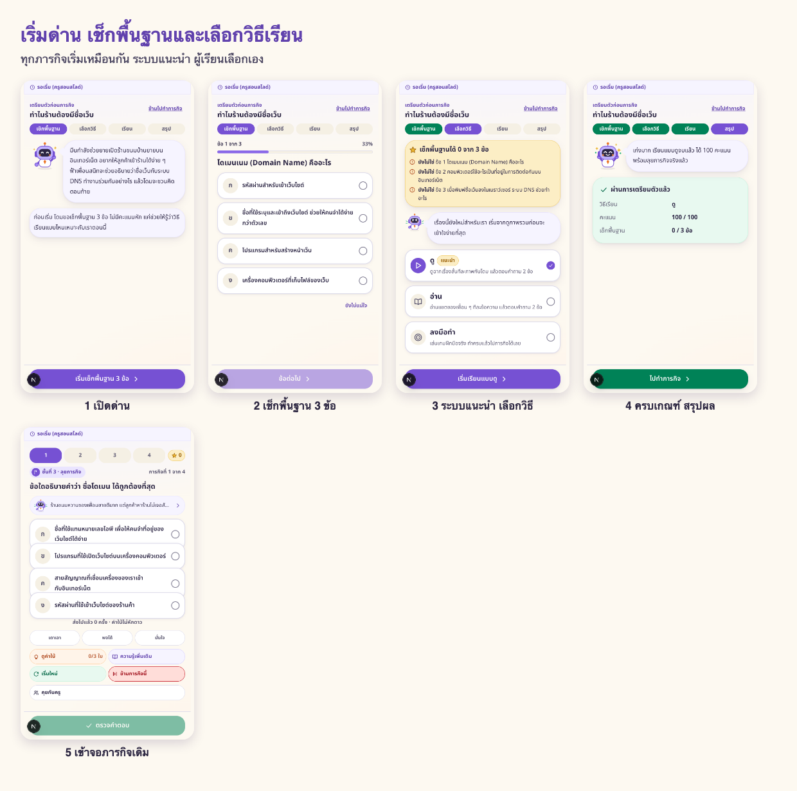
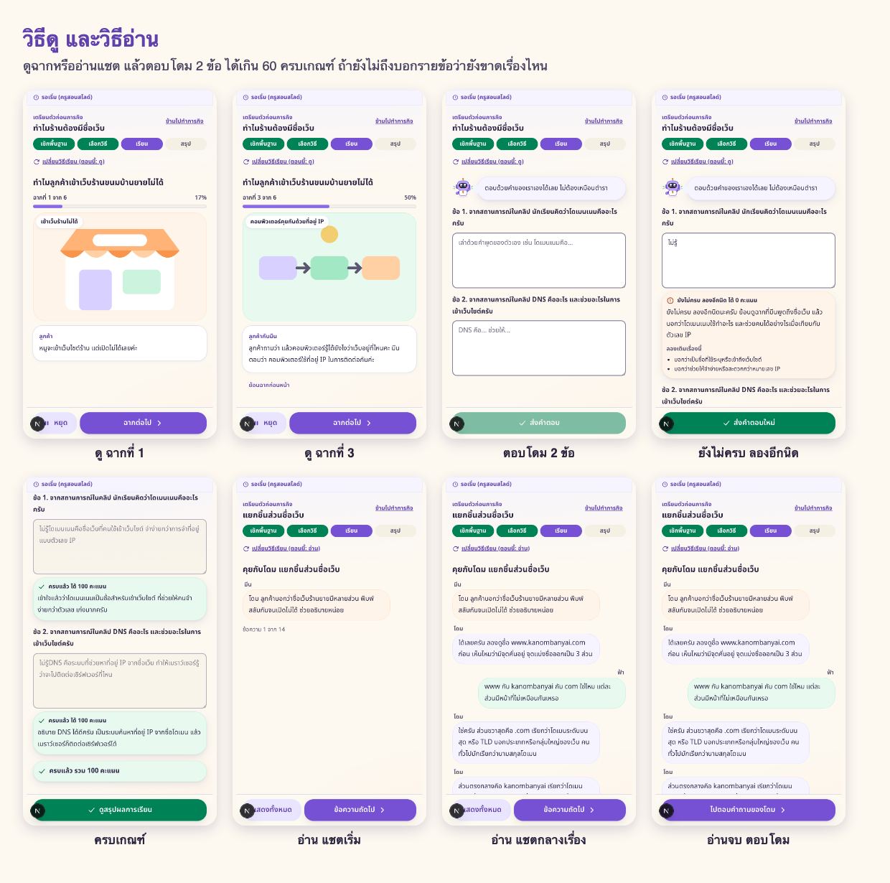
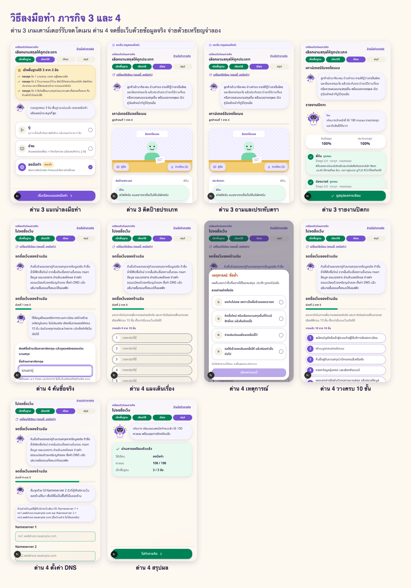
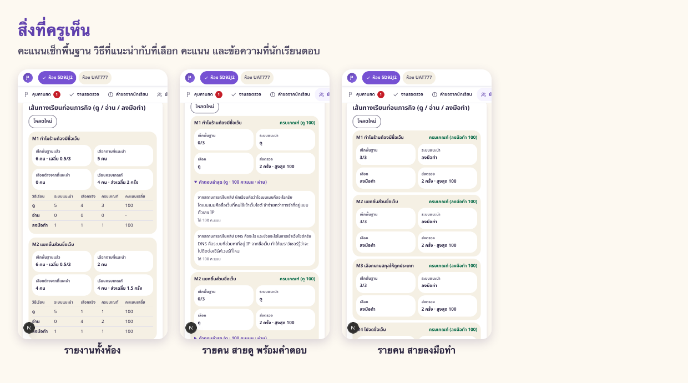
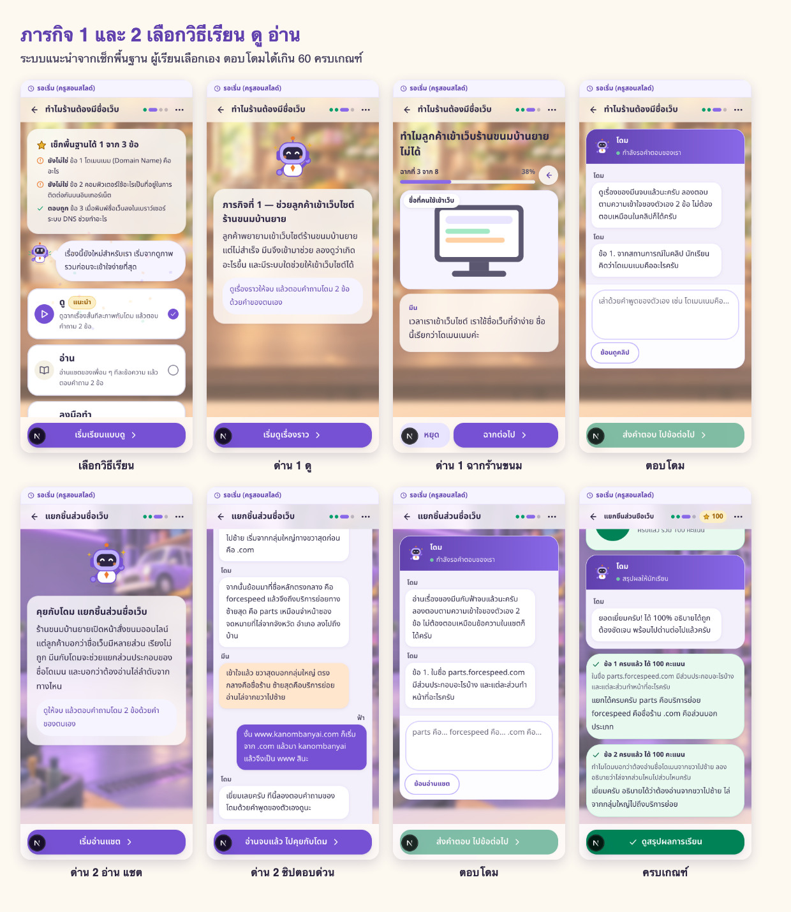
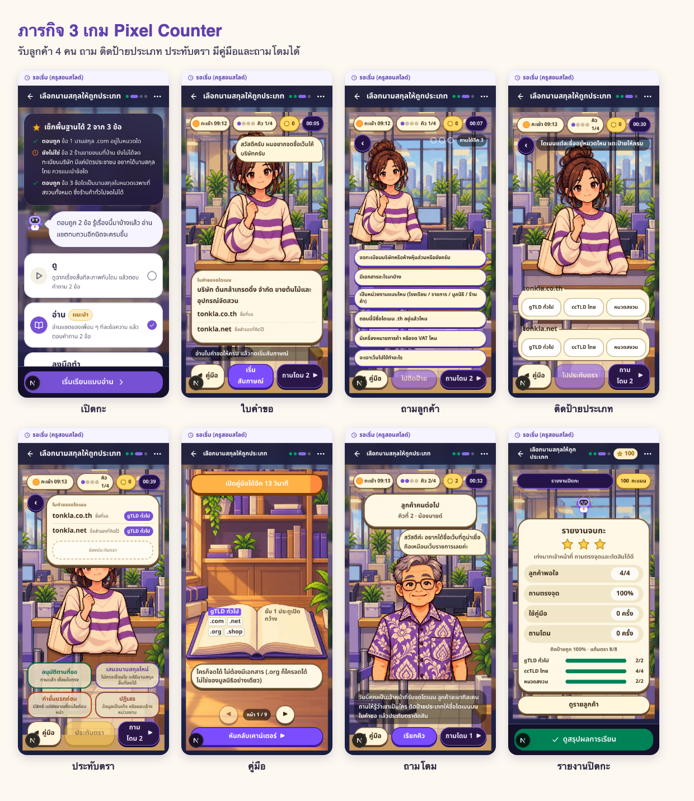
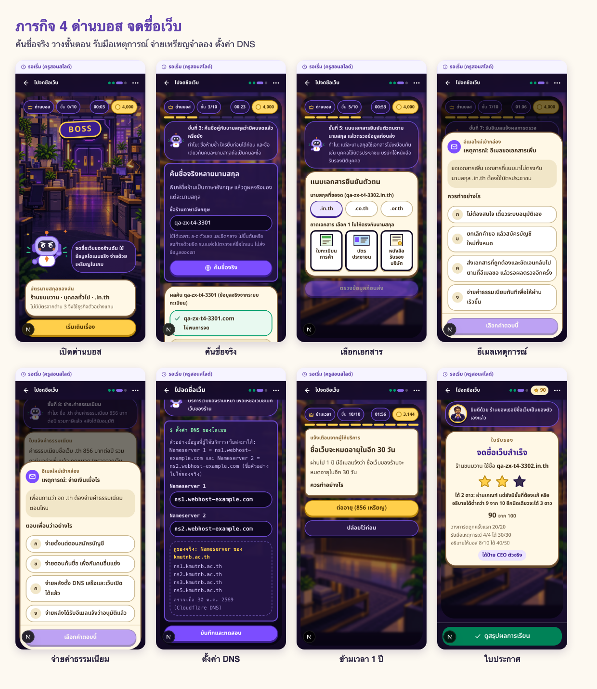
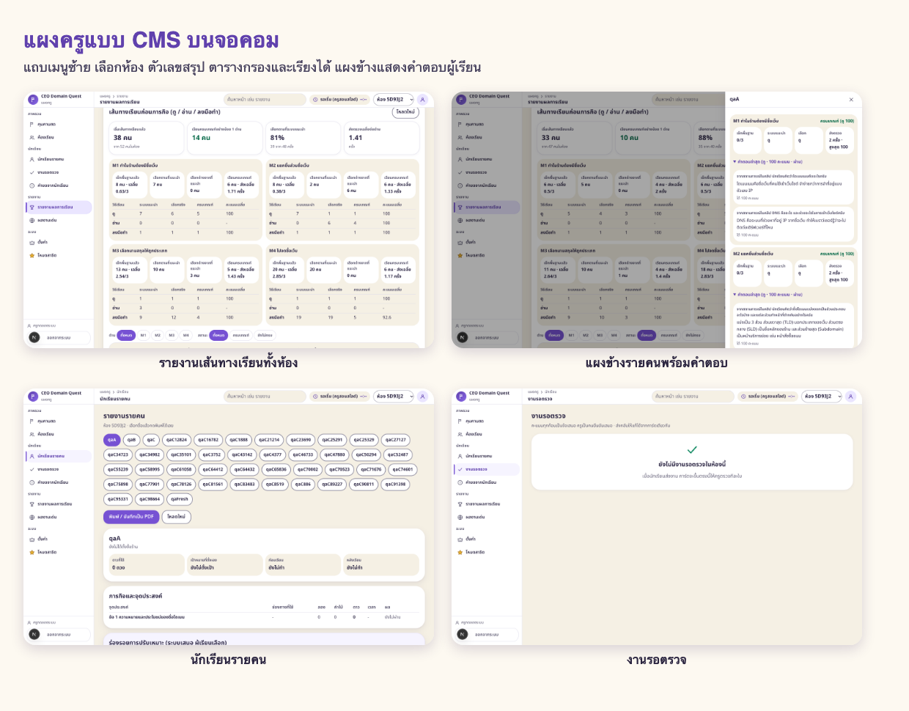

# เส้นทางเรียนก่อนเข้าภารกิจ ดู อ่าน ลงมือทำ (ภารกิจ 1 ถึง 4)

ทำเสร็จและทดสอบบนเครื่องพัฒนาเมื่อ 30 ตุลาคม 2569 ผลทดสอบใช้งานจริง 62 ขั้นตอน ผ่านทั้งหมด

ปรับรอบ 2 เมื่อ 1 พฤศจิกายน 2569 หน้าตาแบบแอปตามแบบของทีมทุกด่าน ด่าน 3 และ 4 เป็นเกม 8 บิต แผงครูเป็นแบบ CMS บนจอคอม เอาทางข้ามเส้นทางเรียนออก ทดสอบรอบสุดท้ายผ่านทั้งหมด เทสต์อัตโนมัติ 954 ข้อผ่าน

## 1. แนวคิด

ก่อนเข้าภารกิจแต่ละด่าน ผู้เรียนทำเช็กพื้นฐาน 3 ข้อ ระบบแนะนำวิธีเรียนที่น่าจะเหมาะ แต่ผู้เรียนเป็นคนเลือกเอง ทุกวิธีไปถึงเป้าหมายเดียวกัน คือคะแนนเกิน 60 แล้วเข้าจอภารกิจเดิม ครูเห็นผลทุกขั้นบนแผงครู

| คะแนนเช็กพื้นฐาน | ระบบแนะนำ | เหตุผลที่บอกผู้เรียน |
|---|---|---|
| 0 ถึง 1 ข้อ | ดู | เรื่องนี้ยังใหม่ เริ่มจากดูภาพรวมก่อน |
| 2 ข้อ | อ่าน | รู้มาบ้างแล้ว อ่านแชตทบทวนอีกนิด |
| 3 ข้อ | ลงมือทำ | พื้นฐานแน่นแล้ว ลองทำจริงเลย |

เปลี่ยนวิธีเรียนกลางทางได้ตลอด ไม่เสียดาว

## 2. สิ่งที่แต่ละวิธีให้ทำ

| ภารกิจ | ดู | อ่าน | ลงมือทำ |
|---|---|---|---|
| 1 ความหมายโดเมนเนมและ DNS | ฉากร้านขนมบ้านยาย 6 ฉาก แล้วตอบโดม 2 ข้อ (รองรับคลิปจริงเมื่อทีมผลิตส่งไฟล์มา) | แชตมีนกับฟ้า 16 ข้อความ แล้วตอบโดม 2 ข้อ | เกมจัดการ์ด โดเมนเนม กับ DNS ตามแบบของทีม |
| 2 ส่วนประกอบและลำดับชื่อโดเมน | 6 ฉาก แล้วตอบโดม 2 ข้อ | แชตกับโดม อ่านจากขวาไปซ้าย แล้วตอบ 2 ข้อ | เกมประกอบชื่อเว็บ |
| 3 จำแนกประเภทโดเมน | 6 ฉาก แล้วตอบโดม 2 ข้อ | โดมติวก่อนเข้ากะ แล้วตอบ 2 ข้อ | เกมเคาน์เตอร์รับจดโดเมน ลูกค้า 4 คน ติดป้ายประเภท ถามลูกค้า ประทับตรา มีคู่มือจับเวลา 15 วินาที และถามโดมได้ 2 ครั้ง |
| 4 ขั้นตอนการจดทะเบียน | 6 ฉาก แล้วตอบโดม 2 ข้อ | แชตมีน ฟ้า และโดม แล้วตอบ 2 ข้อ | เกมจดชื่อเว็บ ค้นชื่อจริงจากระบบทะเบียน (RDAP) วางขั้นตอน 10 ขั้น รับมือ 4 เหตุการณ์ จ่ายด้วยเหรียญจำลอง และตั้งค่า DNS |

## 3. เกณฑ์ผ่าน

- ดูและอ่าน ตอบโดม 2 ข้อ ระบบให้คะแนนตามประเด็นสำคัญที่ต้องพูดถึง ข้อละ 100 คิดค่าเฉลี่ย ผ่านเมื่อเกิน 60 ถ้ายังไม่ถึง บอกเป็นรายข้อว่ายังขาดประเด็นไหน แล้วตอบใหม่ได้
- ลงมือทำภารกิจ 1 จัดการ์ดถูกเกิน 60 ภารกิจ 2 ผ่านเมื่อเล่นเกมถูกครบ
- ไม่มีทางข้าม ต้องเช็กพื้นฐานแล้วเรียนวิธีที่เลือกจนครบเกณฑ์ก่อนเข้าภารกิจ
- ลงมือทำภารกิจ 3 ผ่านเมื่อคะแนนเกิน 60 และติดป้ายประเภทถูกอย่างน้อย 80 เปอร์เซ็นต์
- ลงมือทำภารกิจ 4 ผ่านเมื่อคะแนนเกิน 60 และรับมือเหตุการณ์ถูกอย่างน้อย 3 จาก 4
- บนจอไม่มีคำว่า ตก ไม่ผ่าน หรือล้มเหลว ใช้คำว่า ยังไม่ครบ ลองอีกนิด

## 4. สิ่งที่ครูเห็น

แผงครูเป็นแบบ CMS บนจอคอม มีแถบเมนูซ้าย เลือกห้องจากแถบบน ตัวเลขสรุป ตารางกรองและเรียงได้ กดชื่อนักเรียนเปิดแผงข้าง หน้ารายงานของห้องและหน้ารายคน แสดงต่อภารกิจ คะแนนเช็กพื้นฐาน วิธีที่ระบบแนะนำ วิธีที่ผู้เรียนเลือก (ทำตามคำแนะนำหรือไม่) คะแนนที่ได้ และข้อความที่ผู้เรียนพิมพ์ตอบโดม ครูเห็นเฉพาะนักเรียนในห้องของตัวเอง

## 5. ข้อมูลที่บันทึก

ทุกขั้นบันทึกในตาราง events ของระบบเดิม ไม่ได้แก้โครงสร้างฐานข้อมูล

| เหตุการณ์ | เก็บอะไร |
|---|---|
| learn-warmup | คะแนน 3 ข้อ วิธีที่แนะนำ เหตุผล คำตอบ |
| learn-choose | วิธีที่เลือก วิธีที่แนะนำ ทำตามคำแนะนำหรือไม่ |
| learn-answer | คำตอบที่พิมพ์ คะแนนรายข้อ |
| learn-do | ชนิดเกม คะแนน |
| learn-done | ผ่านด้วยวิธีไหน คะแนนเท่าไร |

## 6. ไฟล์สำหรับทีมพัฒนา

- สเปก docs/learn-path-spec.md
- เนื้อหา content/learn-paths.json (ไม่มีเฉลย) และ content/learn-paths-answers.json
- เกมด่าน 3 content/learn-counter.json, components/learn/counter-game.tsx, components/server/learn-counter.ts
- เกมด่าน 4 content/learn-registrar.json, components/learn/registrar-game.tsx, components/server/learn-registrar.ts, app/api/domain/rdap/route.ts
- หน้าจอผู้เรียน components/learn/learn-path-client.tsx และจุดเชื่อมใน app/mission/[id]/page.tsx
- ตัวตรวจและบันทึกผล components/server/learn-path.ts และ app/api/mission/[id]/learn/route.ts
- แผงครู components/server/learn-teacher.ts และ app/teacher/report/learn-results-panel.tsx

## 7. เรื่องที่ยังค้าง

1. คลิปจริงของภารกิจ 1 แบบดู ยังไม่มีไฟล์ วางที่ public/videos/m1-watch.mp4 แล้วใส่ช่อง video ในเนื้อหา ระหว่างนี้ใช้ฉากภาพนิ่ง
2. ภาพตัวละครมีนและฟ้าของทีมออกแบบ ยังไม่ได้นำมาใส่
3. เนื้อหาภารกิจ 2 แบบอ่านและลงมือทำ เขียนขึ้นตามภาพบน Padlet ควรให้เจ้าของด่านตรวจ
4. กำลังเพิ่ม AI Typhoon ช่วยตรวจคำตอบที่พิมพ์ ให้รับคำตอบที่เขียนต่างคำแต่ความหมายถูก โดยคะแนนไม่ต่ำกว่าการตรวจด้วยคำสำคัญ
5. การค้นชื่อ .shop บางครั้งได้ผล ไม่ทราบ เพราะผู้ดูแลทะเบียนจำกัดจำนวนครั้ง
6. กำลังเตรียมขึ้นเซิร์ฟเวอร์จริง

## 8. ภาพหน้าจอจากการทดสอบใช้งานจริง

ภาพทั้งหมดแคปจากแอปที่รันจริงบนเครื่องพัฒนา ด้วยห้องเรียนทดสอบและนักเรียนจำลอง 2 คน ภาพเดี่ยวครบ 26 ภาพอยู่ในโฟลเดอร์ screens

## 9. หน้าจอรอบ 2 แบบแอปและเกม

