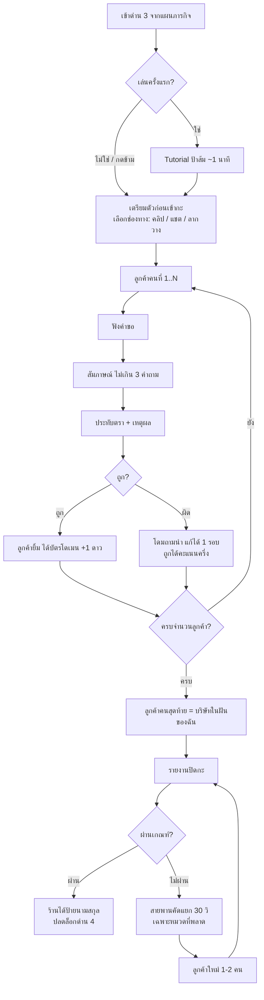
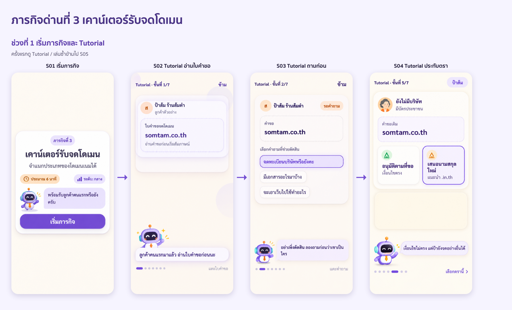
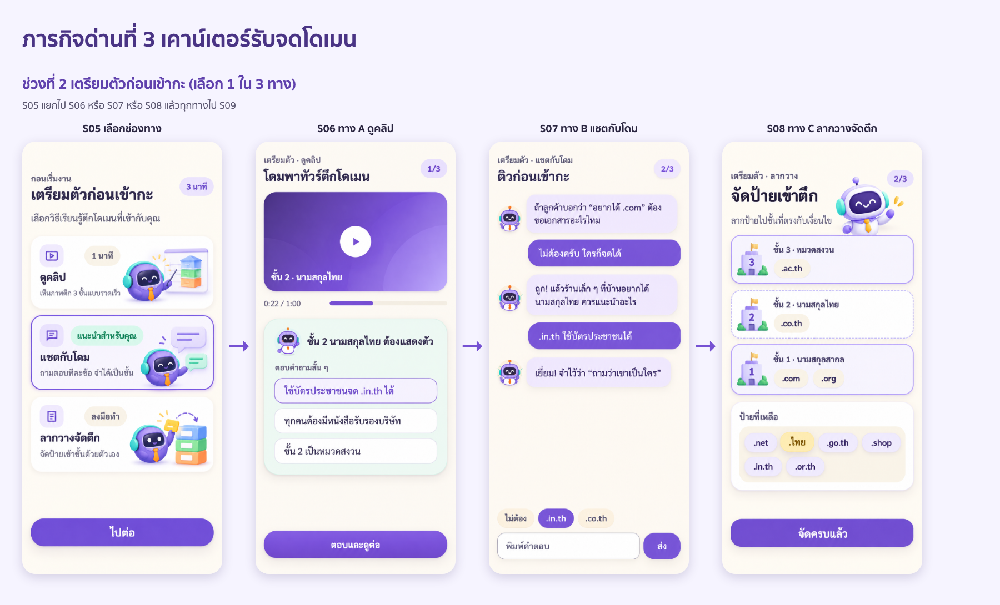
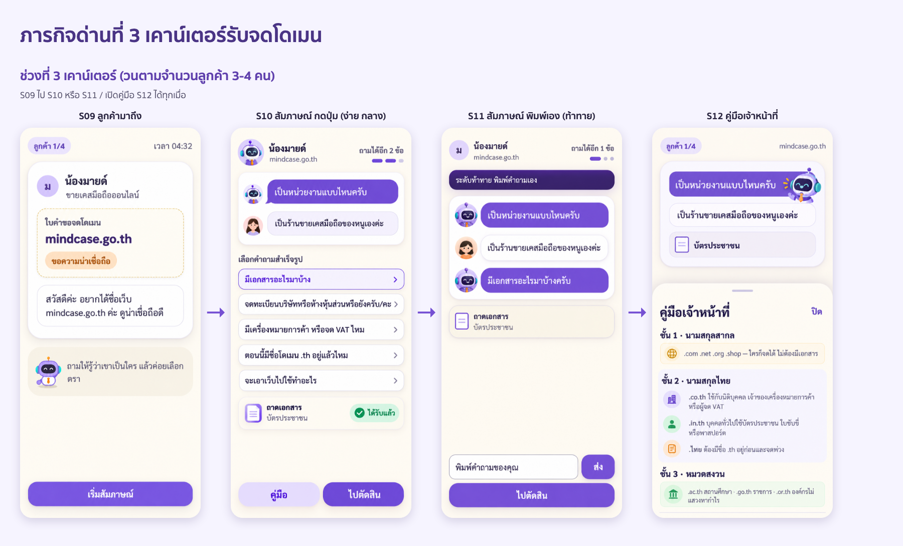
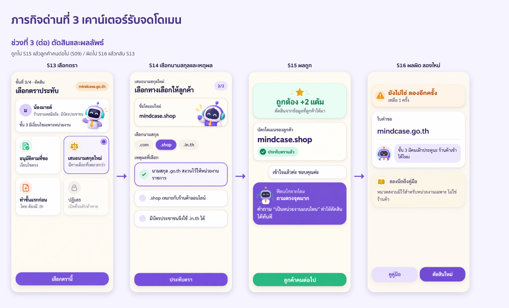
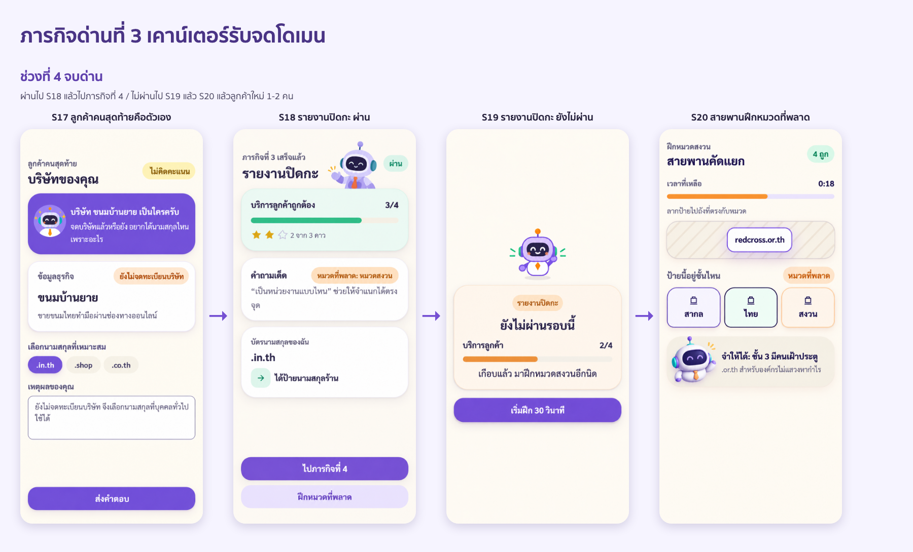
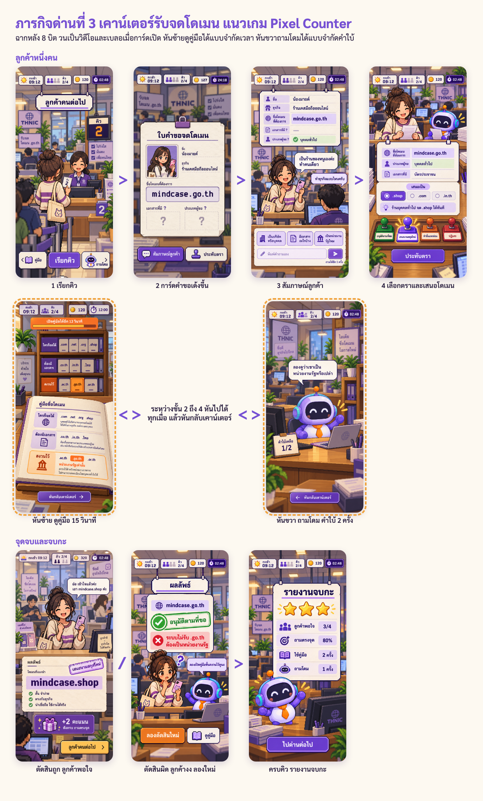
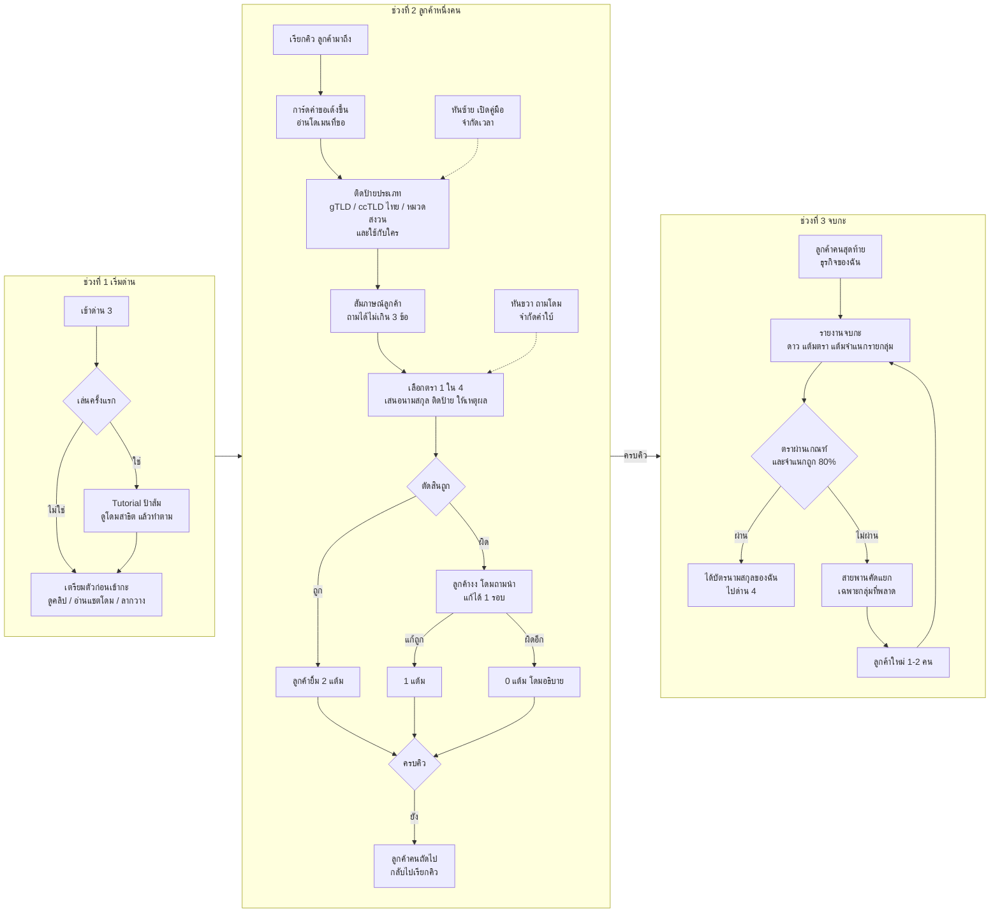
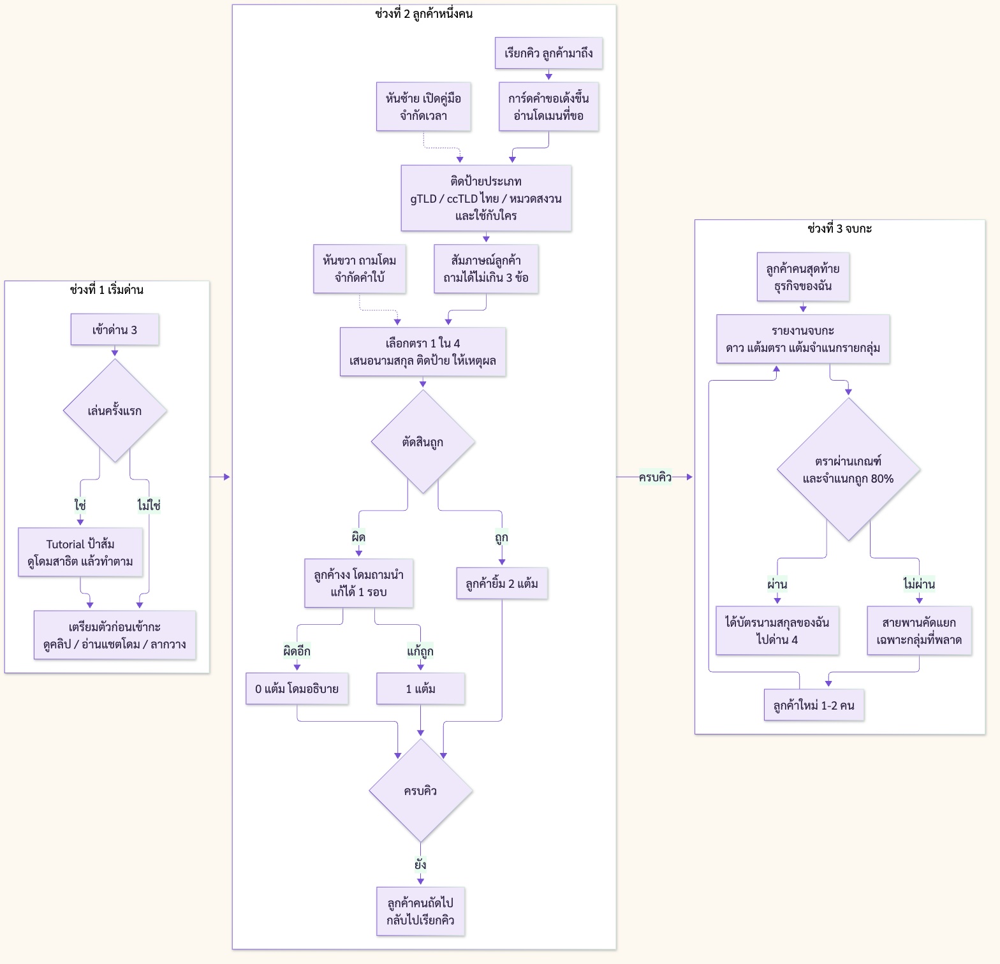

# ภารกิจด่านที่ 3 - เคาน์เตอร์รับจดโดเมน

> จุดประสงค์: **จำแนกประเภทของโดเมนเนมได้**
> ผู้รับผิดชอบด่าน: ณัฐกิตติ์ จินากูล (นัท)
> เวลาเล่น: ประมาณ 6 นาที (ไม่เกิน 7 นาที)
> ข้อเท็จจริงเรื่องนามสกุล .th อ้างอิงข้อมูลในโปรเจกต์ `content/tlds.json` และ m3 ใน `content/missions.json` ซึ่งตรวจกับ THNIC เมื่อ 29 กันยายน 2569 (thnic.or.th/general-policy, thnic.co.th/policy, thnic.co.th/idn)

---

## 1. แนวคิดของด่าน

ผู้เรียนสวมบทเป็น **เจ้าหน้าที่เคาน์เตอร์รับจดโดเมน** ลูกค้าเดินเข้ามาทีละคนพร้อมคำขอ ผู้เรียนต้อง **สัมภาษณ์ลูกค้าผ่านแชต** ว่าเป็นใคร มีเอกสารอะไร แล้วตัดสินใจ **ประทับตรา** ว่าจดได้ตามที่ขอ ต้องเปลี่ยนนามสกุล ต้องทำขั้นแรกก่อน หรือปฏิเสธ

### ทำไมเป็น Active Learning
| หลัก | ในด่านนี้ |
|---|---|
| ลงมือทำ ไม่ใช่ฟังอย่างเดียว | ผู้เรียนเป็นคนสัมภาษณ์ ตัดสิน และให้เหตุผลเอง |
| คิดขั้นสูง (ประยุกต์ / วิเคราะห์) | ต้องรู้ว่าต้องถามอะไรจึงจะจำแนกหมวดได้ ไม่ใช่แค่จำว่านามสกุลไหนอยู่หมวดไหน |
| ได้ผลป้อนกลับทันที | ลูกค้ามีปฏิกิริยาทันที โดมถามนำเมื่อพลาด ไม่เฉลยตรง ๆ |
| เชื่อมกับชีวิตจริง | ลูกค้าคนสุดท้ายคือ "บริษัทในฝัน" ของผู้เรียนเอง ต่อยอดไปด่านบอส |

### ทำไมเป็น Personalized Learning
| มิติ | ปรับอย่างไร |
|---|---|
| ช่องทางเรียน (VARK) | ช่วงเตรียมตัวก่อนเข้ากะ เลือกได้ 3 แบบ: ดูคลิป / แชตกับโดม / ลากวางจัดตึก (ข้อ 5) |
| ระดับความยาก | ง่าย / กลาง / ท้าทาย ต่างกันที่จำนวนลูกค้า วิธีถาม ตราที่เปิดใช้ และเคสหลอก (ข้อ 7) |
| เรื่องราว | ลูกค้าดึงจากสายธุรกิจที่ผู้เรียนบอกไว้ตอนต้นเกม และลูกค้าคนสุดท้ายคือธุรกิจของผู้เรียนเอง |
| ซ่อมจุดอ่อน | พลาดหมวดไหน ลูกค้าคนถัดไปจะเป็นหมวดนั้น ถ้ายังไม่ผ่านด่าน ได้มินิเกมสายพานเฉพาะหมวดที่พลาด |

---

## 2. เนื้อหาที่ต้องรู้ (คู่มือเจ้าหน้าที่ 3 ชั้น)

ใช้ภาพ **"ตึกโดเมน 3 ชั้น"** เป็นภาพจำตลอดด่าน

| ชั้น | หมวด | นามสกุล | ใครจดได้ |
|---|---|---|---|
| ชั้น 1 ประตูเปิดกว้าง | นามสกุลสากล (gTLD) | `.com` `.net` `.org` `.shop` | ใครก็จดได้ ไม่ต้องมีเอกสาร (`.org` คนมักเข้าใจว่าเป็นของมูลนิธิ แต่จริง ๆ ใครก็จดได้) |
| ชั้น 2 ต้องแสดงตัว | นามสกุลไทย (ccTLD) | `.co.th` | นิติบุคคลที่จดทะเบียนในไทย (บริษัท / ห้างหุ้นส่วน) หรือเจ้าของเครื่องหมายการค้า หรือผู้จดทะเบียนภาษีมูลค่าเพิ่ม ต้องยื่นเอกสาร |
| | | `.in.th` | กว้างที่สุด บุคคลทั่วไปใช้บัตรประชาชน ใบขับขี่ หรือพาสปอร์ต |
| | | `.ไทย` | จดเดี่ยวไม่ได้ ต้องถือชื่อ `.th` อยู่ก่อน แล้วจดพ่วง หมวดคู่กันเสมอ: `.in.th` คู่ `.ไทย` / `.co.th` คู่ `.ธุรกิจ.ไทย` ชื่อต้องเป็นอักษรไทย |
| ชั้น 3 มี รปภ. เฝ้า | หมวดเฉพาะที่สงวน | `.ac.th` | สถานศึกษา |
| | | `.go.th` | หน่วยงานราชการ |
| | | `.or.th` | องค์กรไม่แสวงหากำไร เช่น มูลนิธิ สมาคม |
| | | `.net.th` | ผู้ได้รับใบอนุญาตโทรคมนาคม |
| | | `.mi.th` | หน่วยงานทหาร |

**ประโยคหัวใจของด่าน:** "จะจดนามสกุลไหน ให้ถามว่า *เขาเป็นใคร* ไม่ใช่ถามว่า *เขาชอบอันไหน*"

---

## 3. ภาพรวม Flow



---

## 4. Tutorial - "กะแรกของเจ้าหน้าที่ใหม่" (~1 นาที)

ลูกค้าตัวอย่าง **ป้าส้ม ร้านส้มตำ** ไม่นับคะแนน มีไฮไลต์ชี้จุด (coach mark) ทีละขั้น พื้นหลังมืดลงยกเว้นจุดที่ชี้

| ขั้น | จอชี้ไปที่ | โดมพูด | ผู้เรียนทำ |
|---|---|---|---|
| 1 | ใบคำขอบนเคาน์เตอร์ | "ยินดีต้อนรับเจ้าหน้าที่ใหม่! ลูกค้าคนแรกมาแล้ว อ่านใบคำขอก่อนนะ" | แตะใบคำขอ เห็น `somtam.co.th` |
| 2 | ปุ่มคำถาม | "อย่าเพิ่งตัดสิน ลองถามก่อนว่าเขาเป็นใคร" | กดปุ่ม "จดทะเบียนบริษัทหรือยังคะ" |
| 3 | ฟองแชตของป้าส้ม | "ฟังคำตอบดี ๆ นี่คือข้อมูลที่ใช้ตัดสิน" | อ่าน: "ยังจ้า ขายหน้าบ้าน มีแค่บัตรประชาชน" |
| 4 | ปุ่ม "คู่มือเจ้าหน้าที่" | "ลืมเงื่อนไขเปิดคู่มือได้เสมอ ดูชั้น 2 สิ .co.th ต้องเป็นบริษัท" | เปิดคู่มือ ปิดคู่มือ |
| 5 | ถาดตรา 4 อัน | "เงื่อนไขไม่ตรง แต่ป้ายังจดอย่างอื่นได้ ใช้ตรานี้" | กดตรา เสนอนามสกุลใหม่ เลือก `.in.th` |
| 6 | เหตุผล | "บอกเหตุผลให้ลูกค้าเข้าใจด้วย" | เลือก "ยังไม่ได้จดทะเบียนบริษัท ใช้บัตรประชาชนจด .in.th ได้" |
| 7 | ป้าส้มยิ้ม ได้บัตรโดเมน | "เยี่ยม! จำไว้ 3 ขั้น: ฟัง ถาม ตัดสิน" | กด "เริ่มกะจริง" |

**การแสดง Tutorial**
- ระดับง่าย: บังคับดูครั้งแรก
- ระดับกลาง / ท้าทาย: มีปุ่ม "ข้าม"
- เล่นซ้ำ: ไม่แสดง แต่เปิดดูได้จากปุ่ม "?" มุมขวาบน

### ตราประทับ 4 แบบ (สอนใน Tutorial ผ่านคู่มือ)
| ตรา | ใช้เมื่อ | เปิดใช้ระดับ |
|---|---|---|
| อนุมัติตามที่ขอ | ถามแล้ว เงื่อนไขตรง | ทุกระดับ |
| เสนอนามสกุลใหม่ | ไม่ตรงเงื่อนไข แต่มีนามสกุลอื่นที่จดได้ | ทุกระดับ |
| ทำขั้นแรกก่อน | มีสิทธิ์ แต่ยังขาดเงื่อนไขก่อนหน้า (เช่น `.ไทย` ต้องมี `.th` ก่อน) | กลาง ท้าทาย |
| ปฏิเสธ | ข้อมูลเป็นเท็จ / แอบอ้างหน่วยงาน | ท้าทาย |

> ขอบเขต: ด่านนี้ **เสนอได้แค่ "นามสกุล"** เรื่องชื่อถูกจองแล้วต้องเปลี่ยน "ชื่อ" เป็นเนื้อหาด่าน 4 (ขั้นตอนการจดทะเบียน) และด่านบอส

---

## 5. เตรียมตัวก่อนเข้ากะ - 3 ช่องทางตามสไตล์ผู้เรียน

ทุกช่องทางพาไปถึงความรู้เดียวกัน (ตึก 3 ชั้น) แล้วเข้าเกมเคาน์เตอร์เหมือนกัน

### 5.1 Visual - คลิป "โดมพาทัวร์ตึกโดเมน" (ไม่เกิน 1 นาที)

| เวลา | ฉาก | ภาพ | บทพูดโดม |
|---|---|---|---|
| 0:00-0:08 | หน้าตึกโดเมน | ตึก 3 ชั้น ป้าย "สำนักงานรับจดโดเมน" โดมโบกมือ | "วันนี้เราจะเป็นเจ้าหน้าที่รับจดโดเมน ก่อนเข้ากะ มาทัวร์ตึกกัน!" |
| 0:08-0:22 | ชั้น 1 ประตูกระจกเปิดกว้าง | ป้าย .com .net .org .shop คนหลากหลายเดินเข้าออก | "ชั้นหนึ่ง นามสกุลสากล ใครก็จดได้ ไม่ต้องมีเอกสาร .org ก็เหมือนกันนะ ไม่ใช่ของมูลนิธิอย่างเดียว" |
| 0:22-0:42 | ชั้น 2 โต๊ะตรวจเอกสาร | ป้าย .co.th (คนถือหนังสือรับรองบริษัท) .in.th (คนถือบัตรประชาชน) .ไทย (ป้ายพ่วงห้อยกับ .th) | "ชั้นสอง นามสกุลไทย .co.th ต้องเป็นบริษัท เจ้าของเครื่องหมายการค้า หรือจด VAT .in.th ใช้บัตรประชาชนก็จดได้ ส่วน .ไทย ต้องมีชื่อ .th ก่อนแล้วจดพ่วง" |
| 0:42-0:55 | ชั้น 3 ประตูมี รปภ. | ป้าย .ac.th โรงเรียน .go.th ราชการ .or.th มูลนิธิ รปภ. ยกมือห้ามร้านค้า | "ชั้นสามสงวนไว้เฉพาะหน่วยงาน โรงเรียน ราชการ มูลนิธิ ร้านค้าเข้าไม่ได้นะ" |
| 0:55-1:00 | กลับหน้าเคาน์เตอร์ | โดมชี้ป้าย "ถามว่าเขาเป็นใคร" | "จำไว้ ถามว่าเขาเป็นใคร ไม่ใช่ถามว่าชอบอันไหน ไปเข้ากะกัน!" |

**ถามตอบกับโดมหลังคลิป (3 ข้อ ตอบผิดดูฉากนั้นซ้ำได้)**
1. ร้านขายของที่บ้าน ยังไม่จดบริษัท จด `.co.th` ได้ไหม? เฉลย: ไม่ได้ (ต้องเป็นนิติบุคคล / เครื่องหมายการค้า / VAT)
2. `.go.th` อยู่ชั้นไหน? เฉลย: ชั้น 3 หมวดสงวน สำหรับหน่วยงานราชการ
3. อยากได้ `.ไทย` ต้องมีอะไรก่อน? เฉลย: ชื่อโดเมน `.th` อยู่แล้ว

### 5.2 Text - แชตกับโดม "ติวก่อนเข้ากะ"

```
โดม: ก่อนเข้ากะ ขอทดสอบเจ้าหน้าที่ใหม่หน่อยนะ  ถ้าลูกค้าบอกว่า "อยากได้ .com" ต้องขอเอกสารอะไรไหม?
ผู้เรียน: (พิมพ์ / เลือก) ไม่ต้อง
โดม: ถูก! .com อยู่ชั้น 1 นามสกุลสากล ใครก็จดได้ แล้วถ้าลูกค้าเป็นร้านเล็ก ๆ ขายที่บ้าน อยากได้นามสกุลไทย ควรแนะนำอะไร?
ผู้เรียน: .in.th
โดม: ใช่เลย ใช้บัตรประชาชนก็จดได้ ส่วน .co.th ต้องมีอะไร?
ผู้เรียน: ต้องเป็นบริษัท
โดม: ถูกบางส่วน! นอกจากบริษัทแล้ว เจ้าของเครื่องหมายการค้า กับผู้จด VAT ก็ใช้ได้นะ
       ข้อสุดท้าย ร้านค้าอยากได้ .go.th เพราะดูน่าเชื่อถือ ให้ได้ไหม?
ผู้เรียน: ไม่ได้ เพราะเป็นของราชการ
โดม: เยี่ยม! ชั้น 3 สงวนไว้เฉพาะหน่วยงาน จำประโยคนี้ไว้: "ถามว่าเขาเป็นใคร" ไปเข้ากะกัน!
```
- ถ้าตอบผิด โดมไม่เฉลยทันที ถามนำ 1 ครั้งก่อน เช่น "ลองนึกถึงชั้น 2 ดูนะ ต้องแสดงตัวด้วยอะไร?"
- ถ้า AI ใช้ไม่ได้ ใช้บทสำเร็จรูปด้านบน และให้กดตัวเลือกแทนพิมพ์

### 5.3 Sim - ลากวาง "จัดป้ายเข้าตึก"
- ป้ายนามสกุล 9 ป้าย (`.com` `.net` `.org` `.shop` `.co.th` `.in.th` `.ไทย` `.ac.th` `.go.th` `.or.th`) ลากใส่ตึก 3 ชั้น
- วางถูก ป้ายติดผนังพร้อมการ์ดสั้น "ใครจดได้"
- วางผิด ป้ายเด้งกลับ โดมใบ้ 1 บรรทัด เช่น ".org คนมักเข้าใจผิด จริง ๆ ใครก็จดได้นะ"
- ครบทุกป้าย ตึกไฟสว่าง แล้วเข้ากะ

---

## 6. เกมหลัก - เคาน์เตอร์รับจดโดเมน

### 6.1 ลูกค้า 1 คน = 4 ขั้น (และขั้นติดป้ายประเภท ดูหัวข้อ 16)
1. **ลูกค้ามาถึง** - ตัวละครเดินเข้า วางใบคำขอบนเคาน์เตอร์ บอกชื่อโดเมนที่อยากได้ จากนั้นผู้เรียนติดป้ายประเภทให้โดเมนที่ขอ (gTLD ทั่วไป / ccTLD ไทย / หมวดสงวน และใช้กับใคร) ก่อนสัมภาษณ์
2. **สัมภาษณ์ (แชต)** - ถามได้ไม่เกิน **3 คำถาม** (มีตัวนับ (จุด 3 จุด)) AI สวมบทลูกค้า ตอบจาก "ข้อมูลลับ" ของลูกค้าเท่านั้น เอกสารที่ลูกค้ายื่นให้ระหว่างคุยจะไปอยู่ใน **ถาดเอกสาร**
3. **ตัดสิน** - เลือกตรา 1 ใน 4 ถ้าเป็นตรา เสนอนามสกุลใหม่ หรือ ทำขั้นแรกก่อน ต้องเลือกนามสกุลที่เสนอด้วย จากนั้นใส่เหตุผล (ง่าย/กลาง เลือก 3 ตัวเลือก, ท้าทาย พิมพ์เอง)
4. **ผลลัพธ์** - ลูกค้ามีปฏิกิริยา + โดมให้ฟีดแบ็ก

### 6.2 กติกาคะแนน
| ผล | คะแนน |
|---|---|
| ถูกตั้งแต่ครั้งแรก | 2 แต้ม |
| ผิด แล้วแก้ถูกหลังโดมถามนำ | 1 แต้ม |
| ผิดทั้ง 2 รอบ | 0 แต้ม โดมอธิบายเหตุผลสั้น ๆ แล้วไปลูกค้าคนต่อไป |
| โบนัส "ถามตรงจุด" | ถ้าใช้ "คำถามสำคัญ" ของลูกค้าคนนั้นได้ (ดูคลังลูกค้า) เก็บเป็นตัวชี้วัด ไม่บวกแต้ม แต่ใช้คิดดาว |

### 6.3 ปุ่มคำถามสำเร็จรูป (ระดับง่าย / กลาง และใช้เป็น fallback เมื่อ AI ล่ม)
1. "จดทะเบียนบริษัทหรือห้างหุ้นส่วนหรือยังครับ/คะ"
2. "มีเอกสารอะไรมาบ้าง"
3. "เป็นหน่วยงานแบบไหน (โรงเรียน / ราชการ / มูลนิธิ / ร้านค้า)"
4. "ตอนนี้มีชื่อโดเมน .th อยู่แล้วไหม"
5. "มีเครื่องหมายการค้า หรือจด VAT ไหม"
6. "จะเอาเว็บไปใช้ทำอะไร"

ข้อ 6 เป็น **คำถามที่ไม่ช่วยตัดสิน** (ตั้งใจใส่ไว้) เพื่อฝึกเลือกคำถามที่มีประโยชน์ ถ้าผู้เรียนเปลืองโควตาไปกับข้อนี้ โดมจะบอกตอนฟีดแบ็กว่า "คำถามนี้ไม่ได้ช่วยบอกว่าเขาเป็นใครนะ"

---

## 7. คลังลูกค้า (Customer Bank)

ทุกเคสมี: คำขอ / ข้อมูลลับ (ให้ AI ตอบจากนี้เท่านั้น) / คำถามสำคัญ / ตราที่ถูก / นามสกุลที่ยอมรับ / คำใบ้ของโดม

| id | ลูกค้า | คำขอ | ข้อมูลลับ | คำถามสำคัญ | ตราที่ถูก | ยอมรับ | ระดับ |
|---|---|---|---|---|---|---|---|
| c0 | ป้าส้ม ร้านส้มตำ (Tutorial) | `somtam.co.th` | ขายหน้าบ้าน ไม่ได้จดบริษัท ไม่มี VAT มีบัตรประชาชน | 1, 2 | | `.in.th` `.com` `.shop` | - |
| c1 | พี่ต้น บริษัท ต้นกล้าเทรดดิ้ง จำกัด | `tonkla.co.th` | จดทะเบียนบริษัทแล้ว มีหนังสือรับรองบริษัท | 1, 2 | | - | ง่าย |
| c2 | ครูแอน โรงเรียนบ้านหนองบัว | `nongbua.ac.th` | เป็นโรงเรียนจริง มีหนังสือจัดตั้งสถานศึกษา + หนังสือจาก ผอ. | 3, 2 | | - | ง่าย |
| c3 | น้องมายด์ ขายเคสมือถือออนไลน์ | `mindcase.go.th` | ร้านออนไลน์ส่วนตัว อยากให้ดูน่าเชื่อถือเหมือนราชการ มีบัตรประชาชน (ไม่ได้โกหก แค่ไม่รู้) | 3 | | `.com` `.shop` `.in.th` | ง่าย |
| c4 | มูลนิธิรักษ์หมา | `rakmha.com` | มูลนิธิที่จดทะเบียนแล้ว อยากใช้ .com เพราะคนจำง่าย | 3 | (กับดัก: .com ใครก็จดได้ ไม่ต้องบังคับไป .or.th) | - | กลาง |
| c5 | ลุงชัย ร้านเหลาไม้ | `ลุงชัย.ไทย` | บุคคลธรรมดา ยังไม่มีโดเมน .th เลย มีบัตรประชาชน | 4 | | จด `lungchai.in.th` ก่อน แล้วพ่วง `ลุงชัย.ไทย` | กลาง |
| c6 | คุณบี ร้านกาแฟบีคาเฟ่ | `beecafe.co.th` | ไม่ได้เป็นบริษัท แต่จดทะเบียนภาษีมูลค่าเพิ่มแล้ว มีใบ ภ.พ.20 | 1, 5 | | - | ท้าทาย |
| c7 | ชายใส่สูท "จากกระทรวง" | `moe-service.go.th` | ถามแล้วเป็นบริษัทเอกชนรับทำเว็บ ไม่มีหนังสือราชการ ตอบเลี่ยง ๆ | 3, 2 | | - | ท้าทาย |
| c8 | บริษัท สุขใจ จำกัด | `สุขใจ.ไทย` | มี `sukjai.co.th` อยู่แล้ว | 4 | | `สุขใจ.ธุรกิจ.ไทย` (หมวดคู่กับ .co.th) | ท้าทาย |

**การจัดลูกค้าตามระดับ (ไม่นับลูกค้าคนสุดท้าย = ตัวเอง)**
| ระดับ | ลูกค้า | วิธีถาม | ตราที่เปิด | เกณฑ์ผ่าน |
|---|---|---|---|---|
| ง่าย | 3 คน จาก c1-c3 | กดปุ่มคำถาม | | ถูก อย่างน้อย 2 ใน 3 |
| กลาง | 4 คน จาก c1-c5 | กดปุ่มหรือพิมพ์เอง | | ถูก อย่างน้อย 3 ใน 4 |
| ท้าทาย | 4 คน (มี c6-c8 อย่างน้อย 2) | พิมพ์เองอย่างเดียว | ทั้ง 4 | ถูก อย่างน้อย 3 ใน 4 |

**ปรับเรื่องราวตามธุรกิจผู้เรียน:** เปลี่ยนชื่อร้าน / สินค้าของลูกค้าให้อยู่สายเดียวกับธุรกิจที่ผู้เรียนเลือก (เช่น สายอาหาร: c1 เป็นบริษัทขนม, c3 เป็นร้านชานม) โดย **ข้อมูลลับที่ใช้ตัดสินหมวดคงเดิม** เพื่อให้เฉลยไม่เปลี่ยน

**ซ่อมจุดอ่อนระหว่างกะ:** พลาดหมวดไหน ลูกค้าคนถัดไปสุ่มจากเคสหมวดนั้นก่อน (เช่น พลาด c3 คนต่อไปเป็นเคสหมวดสงวนอีกเคส)

---

## 8. แชตบอตลูกค้า (AI Roleplay)

### 8.1 System prompt ต้นแบบ
```
คุณคือ "{customer.name}" ลูกค้าที่มาขอจดชื่อโดเมน "{customer.request}" ที่เคาน์เตอร์
ผู้คุยกับคุณคือนักเรียน ปวช. ที่สวมบทเจ้าหน้าที่รับจดโดเมน

ข้อมูลของคุณ (ตอบได้จากข้อมูลนี้เท่านั้น):
{customer.hiddenFacts}

กติกา:
- ตอบสั้น 1-2 ประโยค ภาษาพูดสุภาพ เป็นธรรมชาติตามบุคลิก: {customer.persona}
- ห้ามบอกเองว่าควรจดนามสกุลไหน ห้ามพูดคำว่า gTLD ccTLD หรือหมวด
- ถ้าถูกถามเรื่องที่ไม่มีในข้อมูล ให้ตอบว่า "ไม่แน่ใจเหมือนกัน" แบบสุภาพ ห้ามแต่งข้อเท็จจริงใหม่
- ถ้าถูกขอเอกสาร ให้บอกชื่อเอกสารที่มีจริงในข้อมูลเท่านั้น แล้วใส่แท็ก [DOC:ชื่อเอกสาร]
- {customer.trait} (เช่น c7: ตอบเลี่ยงเมื่อถูกถามเรื่องหนังสือราชการ แต่ถ้าถูกถามตรง ๆ ว่าเป็นหน่วยงานแบบไหน ให้ยอมรับว่าเป็นบริษัทเอกชน)
- ถ้านักเรียนพิมพ์ไม่สุภาพหรือนอกเรื่อง ให้ตอบว่า "ขอโทษนะคะ ช่วยถามเรื่องการจดโดเมนได้ไหม"
```
### 8.2 Guardrails
- ข้อความผู้เรียนผ่านตัวกรองเนื้อหาเดิมของระบบ (`content/content-filter.json`)
- คำตอบ AI ถูกตรวจว่าไม่หลุดเฉลย (ไม่มีคำว่า "ควรจด" + นามสกุล) ถ้าหลุด ใช้คำตอบสำเร็จรูปแทน
- **Fallback:** AI ใช้ไม่ได้ ให้สลับเป็นปุ่มคำถามสำเร็จรูป (6.3) ทุกปุ่มมีคำตอบเขียนไว้ล่วงหน้าต่อลูกค้า เกมเล่นต่อได้ครบ
- ตัวนับ 3 คำถามนับเฉพาะคำถามที่ส่งสำเร็จ

### 8.3 ตัวอย่างบทสนทนา (c3 น้องมายด์)
```
[ใบคำขอ] mindcase.go.th
มายด์: สวัสดีค่ะ อยากได้ชื่อเว็บ mindcase.go.th ค่ะ ดูน่าเชื่อถือดี
ผู้เรียน: เป็นหน่วยงานแบบไหนครับ
มายด์: เป็นร้านขายเคสมือถือออนไลน์ของหนูเองค่ะ ทำคนเดียว
ผู้เรียน: มีเอกสารอะไรมาบ้างครับ
มายด์: มีบัตรประชาชนค่ะ [DOC:บัตรประชาชน]
[ผู้เรียนเลือกตรา เสนอนามสกุลใหม่ เลือก .shop เหตุผล] ".go.th สงวนไว้ให้ราชการ ร้านค้าจดไม่ได้"
มายด์: อ๋อ เข้าใจแล้วค่ะ งั้นเอา mindcase.shop ค่ะ 
โดม: ถามตรงจุดมาก! คำถาม "เป็นหน่วยงานแบบไหน" ทำให้รู้ทันทีว่าชั้น 3 ไม่ใช่ของเขา
```

---

## 9. ฟีดแบ็กของโดม

| สถานการณ์ | ข้อความ |
|---|---|
| ถูก + ถามตรงจุด | "ถามตรงจุดมาก! คำถาม '{keyQuestion}' ทำให้ตัดสินได้ทันที" |
| ถูก แต่ไม่ได้ถามคำถามสำคัญ | "ตอบถูก! แต่ครั้งหน้าลองถาม '{keyQuestion}' ก่อนตัดสิน จะได้มั่นใจกว่านี้" |
| ผิด: อนุมัติ .co.th ให้คนไม่มีบริษัท | "ลองดูถาดเอกสารอีกที เขามีหนังสือรับรองบริษัทหรือเปล่า?" |
| ผิด: อนุมัติหมวดสงวนให้ร้านค้า | "ชั้น 3 มี รปภ. เฝ้านะ ร้านค้าเข้าได้ไหม?" |
| ผิด: บังคับมูลนิธิไป .or.th (c4) | "เขาขอ .com นะ ชั้น 1 มีเงื่อนไขอะไรไหม?" |
| ผิด: อนุมัติ .ไทย ทั้งที่ไม่มี .th (c5) | ".ไทย จดเดี่ยวได้หรือเปล่านะ ต้องมีอะไรก่อน?" |
| ผิด: เสนอ .ไทย ผิดหมวดคู่ (c8) | ".co.th คู่กับ .ไทย แบบไหนนะ ลองเปิดคู่มือชั้น 2 ดู" |
| เปลืองคำถามไม่ช่วยตัดสิน | "คำถามนี้ไม่ได้ช่วยบอกว่าเขาเป็นใครนะ" |
| ผิด 2 รอบ | "ไม่เป็นไร! เฉลยคือ {answer} เพราะ {reason} ลูกค้าคนต่อไปลองใหม่นะ" |

**ปฏิกิริยาลูกค้า:** ถูก: ยิ้ม รับบัตรโดเมน เดินออก / ผิด: ทำหน้างง "เอ๊ะ ไม่ใช่มั้งคะ" / ปฏิเสธ c7 ถูก: เดินหนีพร้อมเสียง "เอ่อ..."

---

## 10. ลูกค้าคนสุดท้าย - "บริษัทในฝันของฉัน"

- โดม **สลับบท** เป็นเจ้าหน้าที่ ผู้เรียนเป็นลูกค้า
- ดึงข้อมูลจากโปรไฟล์ตอนต้นเกม (ชื่อธุรกิจ, จดทะเบียนการค้าแล้วหรือยัง)
- โดมถาม: "บริษัท {businessName} ของคุณเป็นใคร? จดบริษัทแล้วหรือยัง? อยากได้นามสกุลไหน เพราะอะไร?"
- ผู้เรียนเลือกนามสกุล + พิมพ์เหตุผล ระบบตรวจกับเงื่อนไขใน `content/tlds.json`
- ได้ **"บัตรนามสกุลของฉัน"** เก็บไว้ใช้ต่อในด่านบอส (รูบริก C2 นามสกุลเหมาะกับธุรกิจ)
- ไม่นับเป็นเกณฑ์ผ่านด่าน แต่ถ้าเลือกนามสกุลที่ไม่มีสิทธิ์ โดมถามนำจนเลือกได้ถูก

---

## 11. จุดจบ - รายงานปิดกะ

**การ์ดรายงานปิดกะ แสดง**
- ลูกค้าที่บริการถูก เช่น 3/4 คน
- ดาว 1-3 ดวง
- "คำถามเด็ด" ที่ผู้เรียนใช้ได้ตรงจุด
- หมวดที่พลาด (ชิปสีส้ม) เช่น "หมวดสงวน"
- บัตรนามสกุลของฉัน

**ดาว**
| ดาว | เงื่อนไข |
|---|---|
| 3 ดาว | ถูกตั้งแต่ครั้งแรกทุกคน และใช้คำถามสำคัญได้ทุกคน |
| 2 ดาว | ผ่านเกณฑ์ |
| 1 ดาว | ผ่านหลังรอบซ่อม |

**ผ่าน**: ร้านบนหน้าจอได้ **ป้ายนามสกุลร้าน** (ภาพร้านสร้างเพิ่มตามแนวคิดเดิมของเกม) และปลดล็อกด่าน 4 จากนั้นโดมพูดว่า "เก่งมากเจ้าหน้าที่! ด่านต่อไปเราจะไปจดชื่อเว็บจริงกัน"

**ยังไม่ผ่าน**: โดมพูดว่า "เกือบแล้ว! มาฝึกหมวด {weakCategory} อีกนิด"
1. **สายพานคัดแยก 30 วินาที** - ป้ายโดเมนจริงไหลมา (เช่น `kmutnb.ac.th` `shopee.co.th` `redcross.or.th`) ลากลงถัง 3 ชั้น เน้นหมวดที่พลาด
2. ลูกค้าใหม่ 1-2 คนจากหมวดที่พลาด
3. กลับมารายงานปิดกะอีกครั้ง (ไม่จำกัดรอบ แต่หลังรอบที่ 2 ครูได้รับแจ้งที่แผงครู)

---

## 12. ข้อมูลที่ระบบเก็บ (ส่งแผงครู)

| ข้อมูล | ใช้ทำอะไร |
|---|---|
| ผลต่อลูกค้า (ตราที่เลือก, ถูกครั้งแรก/แก้/ผิด) | คะแนนความแม่นเรื่องที่ 3 (0-4) |
| คำถามที่ถาม + ตรงคำถามสำคัญไหม | วัดทักษะการสืบข้อมูลก่อนตัดสิน |
| หมวดที่พลาด (สากล / ไทย / สงวน / .ไทยพ่วง) | แผงครูแสดงว่าห้องอ่อนหมวดไหน + เลือกเคสซ่อม |
| เวลาต่อลูกค้า | ปรับระดับความยากครั้งต่อไป |
| เหตุผลที่พิมพ์ (ระดับท้าทาย) | ครูดูตัวอย่างคำตอบดี ๆ ไปสรุปหน้าห้อง |
| บัตรนามสกุลของฉัน | ส่งต่อด่านบอส |

---

## 13. สิ่งที่ต้องเตรียม (Assets)

**ตัวละคร (สไตล์เดียวกับโดม: claymorphism พาสเทล)**
- โดม (มีแล้ว) + ชุดเจ้าหน้าที่ / ป้ายชื่อ
- ลูกค้า 9 ตัว: ป้าส้ม, พี่ต้น, ครูแอน, น้องมายด์, ตัวแทนมูลนิธิรักษ์หมา, ลุงชัย, คุณบี, ชายใส่สูท, ตัวแทนบริษัทสุขใจ - แต่ละตัว 3 สีหน้า (ปกติ / ยิ้ม / งง)

**ฉาก**
- เคาน์เตอร์รับจดโดเมน (ฉากหลักของเกม)
- ตึกโดเมน 3 ชั้น (ใช้ในคลิป / ลากวาง / คู่มือ)

**ไอเท็ม UI**
- ใบคำขอ, ถาดเอกสาร, เอกสาร 6 แบบ (บัตรประชาชน, หนังสือรับรองบริษัท, หนังสือจัดตั้งสถานศึกษา, หนังสือจัดตั้งมูลนิธิ, ภ.พ.20, หนังสือจาก ผอ.)
- ตราประทับ 4 แบบ + แอนิเมชันประทับ
- บัตรโดเมน, ป้ายนามสกุล 10 ป้าย, ป้ายนามสกุลร้าน (รางวัล)

**เสียง**: กระดิ่งลูกค้าเข้า, เสียงประทับตรา, เสียงถูก/ผิด

**คลิป**: 1 คลิป ไม่เกิน 60 วินาที ตามสคริปต์ข้อ 5.1

---

## 14. หน้าจอและ Flow การเล่น (สำหรับ Dev)

หน้าจอมี 2 ชุดที่ตรงกันทุกจอ
- ภาพ UX/UI ฉบับสวย สร้างด้วย Codex (image generation) ใช้ดูหน้าตาจริงของแอป: `docs/mission-3/images/ui/S01-...png` ถึง `S20-...png`
- โครงหน้าจอ HTML/CSS ใช้ token สี ฟอนต์ และตัวโดมจากโปรเจกต์ (`app/globals.css`, `public/dome/*.svg`) ใช้เป็นสเปกให้ dev แปลงเป็น React component
- จุดที่ภาพ UI ต่างจาก HTML: จอ Tutorial (S02-S04) ในภาพไม่มีพื้นมืดรอบจุดที่ไฮไลต์ ให้ยึด HTML ที่มีพื้นมืด / ภาพ S04 มุมขวาบนเขียนว่า ป้าส้ม ควรเป็นปุ่ม ข้าม / ภาพ S10 และ S11 คำถามของผู้เรียนมีรูปโดมกำกับ ของจริงควรเป็นฝั่งผู้เรียน
- ไฟล์ HTML: `docs/mission-3/screens/S01-...html` ถึง `S20-...html` และ `screens.css`
- ภาพ PNG ของแต่ละจอ: `docs/mission-3/images/screens/`
- กระดาน flow รวมทุกจอ: `docs/mission-3/screens/index.html` และภาพ `docs/mission-3/images/flow-board.png` (แยกตามช่วงที่ `images/flow-phase-1.png` ถึง `flow-phase-5.png`)
- ขนาดจอ 390 x 844 (มือถือ) ทุกจอ

### ช่วงที่ 1 เริ่มภารกิจและ Tutorial
| จอ | ชื่อ | ผู้เรียนเห็นอะไร | ผู้เรียนทำอะไร | ไปจอไหนต่อ |
|---|---|---|---|---|
| S01 | เริ่มภารกิจ | การ์ดภารกิจที่ 3 จุดประสงค์ เวลา ระดับ และโดมทักทาย | กด "เริ่มภารกิจ" | ครั้งแรกไป S02 / เล่นซ้ำหรือกดข้ามไป S05 |
| S02 | Tutorial อ่านใบคำขอ | จอมืดลง ไฮไลต์ใบคำขอ somtam.co.th ของป้าส้ม | แตะใบคำขอ | S03 |
| S03 | Tutorial ถามก่อน | ไฮไลต์ปุ่มคำถาม "จดทะเบียนบริษัทหรือยังคะ" | กดปุ่มคำถาม อ่านคำตอบ | (ขั้น 3-4 เปิดคู่มือ) แล้วไป S04 |
| S04 | Tutorial ประทับตรา | ไฮไลต์ตรา "เสนอนามสกุลใหม่" | เลือกตรา เลือก .in.th และเหตุผล | ป้าส้มรับบัตรโดเมน แล้วไป S05 |

### ช่วงที่ 2 เตรียมตัวก่อนเข้ากะ (เลือกได้ 1 ใน 3 ทาง)
| จอ | ชื่อ | ผู้เรียนเห็นอะไร | ผู้เรียนทำอะไร | ไปจอไหนต่อ |
|---|---|---|---|---|
| S05 | เลือกช่องทาง | การ์ด 3 ทาง ดูคลิป / แชตกับโดม / ลากวางจัดตึก มีป้าย "แนะนำสำหรับคุณ" ตามสไตล์ผู้เรียน | เลือก 1 ทาง | S06 หรือ S07 หรือ S08 |
| S06 | ดูคลิป (Visual) | คลิป 1 นาที แล้วคำถาม 3 ข้อจากโดม | ดูคลิป ตอบคำถาม | S09 |
| S07 | แชตกับโดม (Text) | บทแชตติวตามข้อ 5.2 มีปุ่มคำตอบและช่องพิมพ์ | ตอบคำถามโดม | S09 |
| S08 | ลากวางจัดตึก (Sim) | ตึก 3 ชั้น และป้ายนามสกุลที่ต้องลากเข้าชั้น | ลากป้ายเข้าชั้นให้ครบ | S09 |

### ช่วงที่ 3 เคาน์เตอร์ (วนตามจำนวนลูกค้า 3-4 คน)
| จอ | ชื่อ | ผู้เรียนเห็นอะไร | ผู้เรียนทำอะไร | ไปจอไหนต่อ |
|---|---|---|---|---|
| S09 | ลูกค้ามาถึง | ลำดับลูกค้า เช่น 1/4 การ์ดลูกค้า ใบคำขอ และคำพูดลูกค้า | กด "เริ่มสัมภาษณ์" | ระดับง่ายและกลางไป S10 / ระดับท้าทายไป S11 |
| S10 | สัมภาษณ์แบบกดปุ่ม | แชตกับลูกค้า ตัวนับคำถาม ปุ่มคำถาม 6 ข้อ ถาดเอกสาร | กดคำถามได้ไม่เกิน 3 ข้อ | เปิดคู่มือไป S12 / กด "ไปตัดสิน" ไป S13 |
| S11 | สัมภาษณ์แบบพิมพ์เอง | เหมือน S10 แต่ไม่มีปุ่มคำถาม ต้องพิมพ์เอง | พิมพ์คำถามได้ไม่เกิน 3 ข้อ | S12 หรือ S13 |
| S12 | คู่มือเจ้าหน้าที่ | แผ่นเลื่อนขึ้นจากด้านล่าง แสดงเงื่อนไขตึก 3 ชั้น | อ่าน แล้วปิด | กลับจอเดิม |
| S13 | เลือกตรา | ตรา 4 แบบ ตราที่ยังไม่เปิดตามระดับจะล็อกไว้ | เลือกตรา | ตรา อนุมัติ หรือ ปฏิเสธ ไปยืนยันผลเลย / ตราอื่นไป S14 |
| S14 | เลือกนามสกุลและเหตุผล | ตัวเลือกนามสกุล และการ์ดเหตุผล 3 แบบ | เลือกนามสกุล เลือกเหตุผล กด "ประทับตรา" | ถูกไป S15 / ผิดไป S16 |
| S15 | ผลถูก | การ์ดสีเขียว แต้มที่ได้ ใบคำขอที่ประทับแล้ว คำขอบคุณจากลูกค้า และฟีดแบ็กโดม | กด "ลูกค้าคนต่อไป" | ยังไม่ครบไป S09 / ครบไป S17 |
| S16 | ผลผิด ลองใหม่ | การ์ดสีส้ม จำนวนครั้งที่เหลือ และคำถามนำจากโดม | ดูคู่มือ หรือกด "ตัดสินใหม่" | กลับ S13 (ผิดครั้งที่ 2 โดมเฉลย แล้วไปลูกค้าคนต่อไป) |

### ช่วงที่ 4 จบด่าน
| จอ | ชื่อ | ผู้เรียนเห็นอะไร | ผู้เรียนทำอะไร | ไปจอไหนต่อ |
|---|---|---|---|---|
| S17 | ลูกค้าคนสุดท้ายคือตัวเอง | การ์ดธุรกิจของผู้เรียน และโดมสวมบทเจ้าหน้าที่ | เลือกนามสกุลให้ธุรกิจตัวเอง พิมพ์เหตุผล | S18 หรือ S19 ตามผลรวม |
| S18 | รายงานปิดกะ (ผ่าน) | จำนวนลูกค้าที่ทำถูก ดาว คำถามเด็ด หมวดที่พลาด บัตรนามสกุลของฉัน รางวัลป้ายร้าน | กด "ไปภารกิจที่ 4" หรือ "ฝึกหมวดที่พลาด" | ภารกิจที่ 4 / S20 |
| S19 | รายงานปิดกะ (ยังไม่ผ่าน) | จำนวนลูกค้าที่ทำถูก ข้อความชวนฝึกหมวดที่พลาด | กด "เริ่มฝึก 30 วินาที" | S20 |
| S20 | สายพานคัดแยก | การ์ดชื่อโดเมนเลื่อนมาบนสายพาน และถัง 3 หมวด | ลากลงถังให้ถูกภายใน 30 วินาที | ลูกค้าใหม่ 1-2 คน (S09) แล้วกลับรายงานปิดกะ |

### ภาพ Flow แยกตามช่วง
ช่วงที่ 1 เริ่มภารกิจและ Tutorial


ช่วงที่ 2 เตรียมตัวก่อนเข้ากะ


ช่วงที่ 3 เคาน์เตอร์ สัมภาษณ์ลูกค้า


ช่วงที่ 3 (ต่อ) ตัดสินและผลลัพธ์


ช่วงที่ 4 จบด่าน


### เงื่อนไขสำคัญสำหรับ Dev
- ระดับง่ายใช้ S10 และเปิดตราแค่ อนุมัติ กับ เสนอนามสกุลใหม่ / ระดับกลางใช้ S10 และเปิดตรา ทำขั้นแรกก่อน เพิ่ม / ระดับท้าทายใช้ S11 และเปิดตราทั้ง 4 แบบ
- AI ล่มระหว่างอยู่ที่ S11 ให้สลับเป็น S10 อัตโนมัติ
- ทุกการกระทำบันทึกตามข้อ 12

> ภาพแนวคิดชุดแรก `images/01-tutorial.png` ถึง `04-shift-report.png` ทำด้วย AI สร้างภาพ ใช้ดูอารมณ์ภาพเท่านั้น ไม่ใช่สเปกสำหรับ dev ให้ยึดหน้าจอ S01-S20

### Design tokens ที่ใช้ (จาก `docs/design-system.md`)
- ม่วง `#7651D3` = โดม / ปุ่มหลัก / เขียว `#2FB983` = ผ่าน / ส้ม = ต้องทำต่อ / หมวดที่พลาด / ทอง = ดาว
- ฟอนต์ Noto Sans Thai เนื้อหา 17px ปุ่มสูง อย่างน้อย 48px จอมือถือกว้าง 390px

## 15. แนวภาพเกม Pixel Counter (ภาพชุดใหม่ G01-G09)

ภาพชุดนี้เป็นแนวทางหน้าตาเกมแบบเคาน์เตอร์ตรวจเอกสาร ใช้กติกา เนื้อหา และจุดจบเหมือนหัวข้อ 4 ถึง 11 ทุกอย่าง เปลี่ยนแค่วิธีแสดงผลให้รู้สึกเป็นเกมมากขึ้น ภาพชุด S01-S20 ในหัวข้อ 14 ยังใช้เป็นสเปกจอส่วนอื่น (Tutorial เตรียมตัว ฝึกซ้ำ) ได้ตามเดิม

### แนวคิดภาพ
- ผู้เรียนนั่งเป็นเจ้าหน้าที่หลังเคาน์เตอร์ ฉากหลังเป็นออฟฟิศรับจดโดเมนแบบภาพ 8 บิต มีคิวลูกค้ายืนรอ
- เมื่อการ์ดคำขอเปิดขึ้น ฉากหลังจะเบลอและมืดลงเล็กน้อย ให้สายตาอยู่ที่การ์ด
- หันซ้าย ไปที่ชั้นคู่มือ เปิดดูได้แบบจำกัดเวลา 15 วินาทีต่อครั้ง
- หันขวา ไปที่โต๊ะโดม ขอคำใบ้ได้ 2 ครั้งต่อกะ
- ตัดสินด้วยตรายาง 4 อัน ตรงกับ 4 จุดจบในหัวข้อ 4

### โครงสร้างชั้นภาพ (สำหรับ Dev)
| ชั้น | สิ่งที่อยู่ | วิธีทำ |
|---|---|---|
| 1 ฉากหลัง | ออฟฟิศ 8 บิต คิวลูกค้า นาฬิกา ป้ายคิว | วิดีโอวนสั้น หรือ sprite sheet วนลูป ใส่ CSS `filter: blur(6px) brightness(.9)` ตอนการ์ดเปิด |
| 2 ลูกค้า | ตัวลูกค้าแบบพิกเซล 3 สีหน้า ปกติ ยิ้ม งง | ภาพ PNG พื้นใส สลับตามสถานะ |
| 3 หน้าจอ | แถบบน การ์ดคำขอ แชต ปุ่ม ตรายาง | HTML และ CSS ปกติ ฟอนต์ Noto Sans Thai สีตาม design tokens |
| มุมมอง | เคาน์เตอร์ กลาง / คู่มือ ซ้าย / โดม ขวา | 3 แผงเรียงแนวนอน เลื่อนด้วยการปัดหรือกดแท็บข้างจอ ใช้ `transform: translateX` |

แถบบนทุกจอ: ช่วงกะและเวลา / คิวที่เท่าไรจากทั้งหมด / คะแนน / เวลาที่เหลือของลูกค้าคนนี้

### Flow ต่อลูกค้าหนึ่งคน (ตัวอย่าง น้องมายด์ ขอ mindcase.go.th)
| จอ | ผู้เรียนเห็น | ผู้เรียนทำ | ไปจอ |
|---|---|---|---|
| G01 เรียกคิว | ฉาก 8 บิตชัด ลูกค้าเดินมาที่เคาน์เตอร์ แท็บ คู่มือ ซ้าย และ ถามโดม ขวา | กด เรียกคิว | G02 |
| G02 การ์ดคำขอ | ฉากหลังเบลอ การ์ดเด้งขึ้น ชื่อ ธุรกิจ โดเมนที่ขอ ช่อง เอกสารที่มี และ ประเภทผู้ขอ ยังเป็นเครื่องหมายคำถาม | กด สัมภาษณ์ลูกค้า หรือ ประทับตรา | G03 หรือ G06 |
| G03 สัมภาษณ์ | การ์ดย่ออยู่บน ลูกค้าตอบในฟองแชต ช่องในการ์ดเติมเองเมื่อได้คำตอบ | กดปุ่มคำถาม หรือพิมพ์เอง ถามได้ไม่เกิน 3 ครั้ง | G06 |
| G04 หันซ้าย คู่มือ | ชั้นหนังสือ 3 ชั้น ใครก็จดได้ / ต้องมีเอกสาร / สงวนไว้ แถบนับถอยหลังสีส้ม | อ่าน แล้วกด หันกลับเคาน์เตอร์ หรือหมดเวลากลับเอง | จอที่มา |
| G05 หันขวา ถามโดม | โดมพูดคำใบ้แบบชวนคิด ไม่บอกคำตอบ ป้าย คำใบ้เหลือ | กด หันกลับเคาน์เตอร์ | จอที่มา |
| G06 ประทับตรา | การ์ดบนโต๊ะ ถาดตรายาง 4 อัน ช่อง เสนอเป็น และเหตุผล | เลือกตรา เลือกนามสกุลที่เสนอ กด ประทับตรา | G07 หรือ G08 |
| G07 ตัดสินถูก | ตราบนการ์ด โดเมนใหม่ ลูกค้ายิ้ม ได้คะแนน | กด ลูกค้าคนต่อไป | G01 คนถัดไป หรือ G09 |
| G08 ตัดสินผิด | ลูกค้างง แถบแดงบอกเหตุผลที่ระบบไม่รับ โดมแนะให้เปิดคู่มือชั้นที่เกี่ยว | กด ลองตัดสินใหม่ หรือ ดูคู่มือ | G06 หรือ G04 |
| G09 รายงานจบกะ | ดาว ลูกค้าพอใจ ถามตรงจุด ใช้คู่มือกี่ครั้ง ถามโดมกี่ครั้ง | กด ไปด่านต่อไป | ด่านถัดไป หรือสายพานฝึกซ้ำ (S20) |

G04 และ G05 เปิดได้ทุกเมื่อระหว่าง G02 ถึง G06 เวลาของลูกค้าเดินต่อระหว่างหันไปดู จึงต้องเลือกว่าจะใช้เวลากับอะไร

### ปรับตามผู้เรียน (Personalized)
- ระดับง่าย เวลาคู่มือ 20 วินาที คำใบ้โดม 3 ครั้ง / ระดับกลาง 15 วินาที 2 ครั้ง / ระดับท้าทาย 10 วินาที 1 ครั้ง
- ครั้งที่ผู้เรียนเปิดคู่มือและถามโดมเก็บลงข้อมูลตามข้อ 12 ใช้ดูว่าผู้เรียนพึ่งตัวช่วยมากแค่ไหน

### ภาพ
ภาพรวม Flow


ภาพรายจออยู่ที่ `images/game/G01-counter-queue.png` ถึง `G09-shift-report.png` (สร้างด้วย Codex image generation)

จุดที่ภาพยังไม่ตรงสเปก ให้ยึดข้อความในหัวข้อนี้: ตัวเลขแถบบนของ G02 G04 G07 ไม่ตรงกับจออื่น / G06 วาดลูกค้าถือเอกสารยิ้มอยู่ ของจริงลูกค้ายังรอผลอยู่หน้าเคาน์เตอร์

## 16. ตรวจความตรงกับวัตถุประสงค์ วิธีวัดผล และ ดู อ่าน ลงมือทำ

### 16.1 ตรงกับวัตถุประสงค์ "จำแนกประเภทของโดเมนเนมได้" ไหม
- ตรงในระดับนำไปใช้: ผู้เรียนต้องรู้ก่อนว่าโดเมนที่ลูกค้าขออยู่ประเภทไหน ถึงจะตัดสินได้ เช่น ต้องรู้ว่า .go.th เป็นหมวดสงวนของราชการ จึงจะไม่อนุมัติให้ร้านค้า
- จุดที่ยังขาดในแบบเดิม: เกมให้คะแนนที่ตราที่เลือก ไม่ได้ให้ผู้เรียนบอกประเภทออกมาตรง ๆ ผู้เรียนบางคนอาจเดาตราถูกโดยจำแนกไม่เป็น และเนื้อหาเรื่องเอกสารเป็นเรื่องของวัตถุประสงค์ "เงื่อนไขการจด" มากกว่า
- สิ่งที่เพิ่ม: ขั้น **ติดป้ายประเภท** ทันทีที่การ์ดคำขอเปิด ผู้เรียนลากป้าย 2 ใบลงการ์ด
  - ป้ายกลุ่ม: gTLD ทั่วไป / ccTLD ไทย / หมวดสงวน (ตรงกับ category ใน `content/tlds.json`)
  - ป้ายผู้ใช้: ธุรกิจทั่วไป / บริษัทนิติบุคคล / บุคคลทั่วไป / ราชการ / สถาบันการศึกษา / องค์กรไม่แสวงหากำไร / ด้านเครือข่าย
  - ติดถูกทั้ง 2 ใบได้ 1 แต้มจำแนก แยกจากแต้มตรา ติดผิดยังเล่นต่อได้ แต่โดมจะทักที่ผลลัพธ์
  - ตอนเสนอนามสกุลใหม่ (ตราเสนอนามสกุลใหม่) ผู้เรียนต้องติดป้ายให้นามสกุลที่เสนอด้วย จึงได้จำแนก 2 ครั้งต่อลูกค้า

### 16.2 เกมทดสอบผู้เรียนอย่างไร
ลูกค้าแต่ละคนเท่ากับแบบทดสอบเชิงปฏิบัติ 1 ข้อ ระบบเก็บหลักฐาน 5 อย่างจากการเล่น ไม่ต้องมีหน้าข้อสอบแยก

| สิ่งที่วัด | หลักฐานในเกม | ระดับการคิด |
|---|---|---|
| จำแนกประเภทโดเมน (วัตถุประสงค์หลัก) | ป้ายประเภทที่ติดให้โดเมนที่ขอและโดเมนที่เสนอ | เข้าใจ |
| ใช้ประเภทตัดสินกับสถานการณ์จริง | ตราที่เลือกและนามสกุลที่เสนอ | นำไปใช้ |
| หาข้อมูลก่อนตัดสิน | คำถามที่เลือกถาม ตรงคำถามสำคัญไหม | วิเคราะห์ |
| อธิบายเหตุผล | เหตุผลที่เลือกหรือพิมพ์ | ประเมิน |
| ถ่ายโอนไปใช้กับธุรกิจตัวเอง | ลูกค้าคนสุดท้าย = ธุรกิจของผู้เรียน | สร้างสรรค์ |

เกณฑ์ผ่านด่าน (เพิ่มจากข้อ 7): ตราถูกตามเกณฑ์ระดับเดิม **และ** ติดป้ายประเภทถูกอย่างน้อย 80% ระบบเก็บความแม่นแยกตามกลุ่ม (gTLD / ccTLD / สงวน) ถ้ากลุ่มไหนต่ำกว่า 80% สายพานฝึกซ้ำจะสุ่มเฉพาะกลุ่มนั้น ครูเห็นผลรายกลุ่มที่แผงครู และใช้ข้อสอบหลังเรียนเรื่องประเภทโดเมนยืนยันผลอีกชั้น

### 16.3 ดู อ่าน ลงมือทำ (Active Learning)
| ช่วง | ดู | อ่าน | ลงมือทำ |
|---|---|---|---|
| Tutorial ป้าส้ม (ทุกคน) | ดูโดมสาธิตลูกค้าคนแรกทีละขั้น | อ่านคำแนะนำบนจุดที่ไฮไลต์ | ทำตามทีละขั้นจนประทับตรา |
| เตรียมตัว (เลือกช่องทางตามสไตล์) | คลิปไม่เกิน 1 นาที | แชตกับโดม | ลากนามสกุลลงชั้นคู่มือ 3 ชั้น |
| เคาน์เตอร์ (ทุกคน) | ดูท่าทางและสีหน้าลูกค้าเมื่อตัดสินถูกหรือผิด | อ่านการ์ดคำขอ คำตอบลูกค้า และคู่มือที่หันไปเปิด | ติดป้ายประเภท สัมภาษณ์ ประทับตรา |
| จบกะและฝึกซ้ำ | ดูรายงานจบกะ | อ่านหมวดที่พลาด | สายพานคัดแยกเฉพาะหมวดที่พลาด |

ผู้เรียนทุกคนได้ครบทั้ง ดู อ่าน ลงมือทำ ในช่วง Tutorial และเคาน์เตอร์ ส่วนช่วงเตรียมตัวเลือกช่องทางหลักตามสไตล์ (Personalized) และเปิดช่องทางอื่นดูเพิ่มได้

เหตุที่เป็น Active Learning: ผู้เรียนไม่ได้รับเนื้อหาอย่างเดียว แต่ต้องถามลูกค้าเพื่อหาข้อมูล ตัดสินใจเอง เห็นผลที่ตามมาทันทีจากสีหน้าลูกค้าและคำแนะนำของโดม แล้วทบทวนตัวเองจากรายงานจบกะ และฝึกซ้ำเฉพาะจุดที่พลาด

### 16.4 Flowchart (Mermaid)



