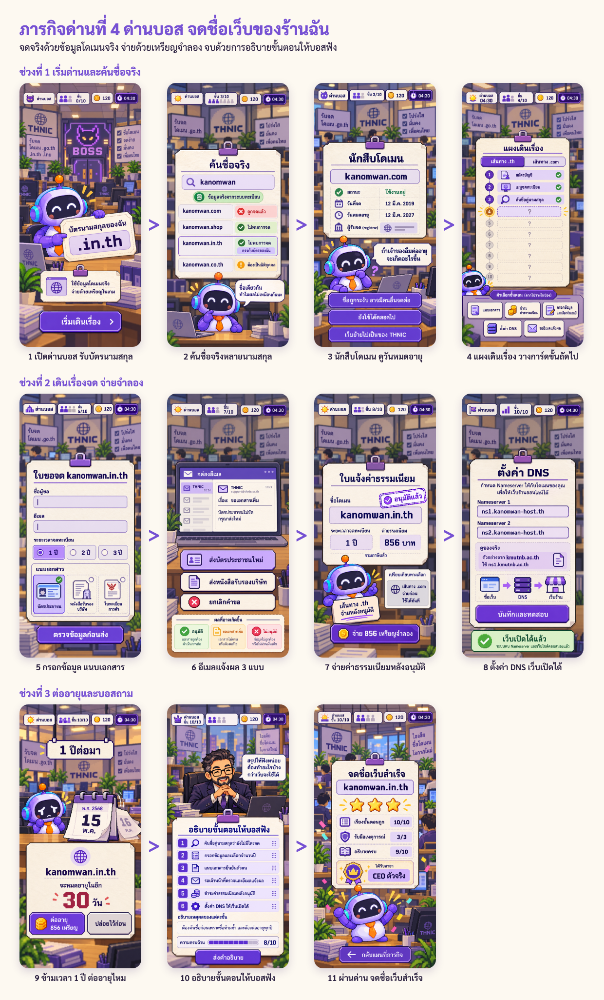
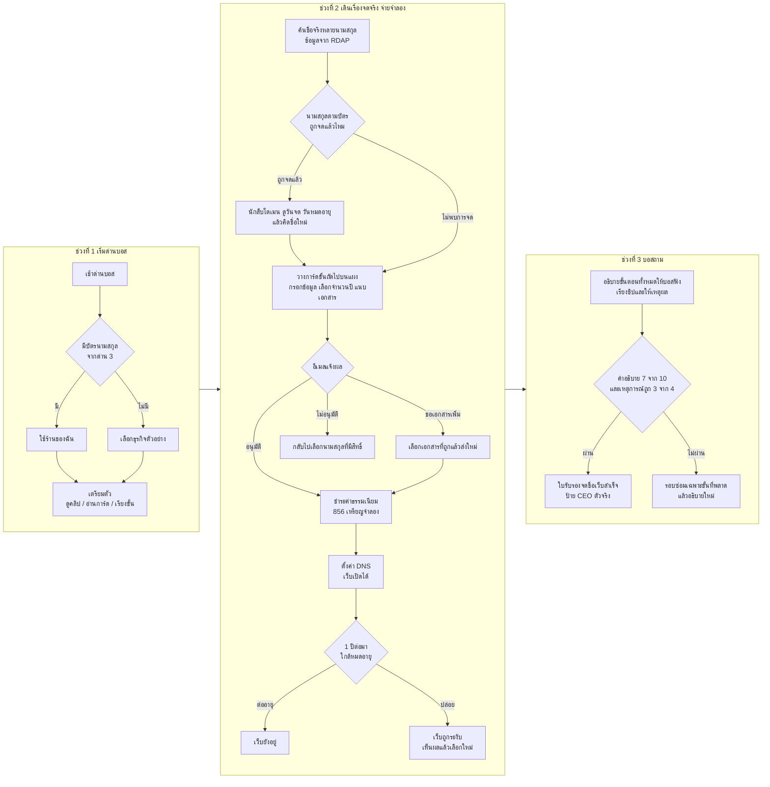
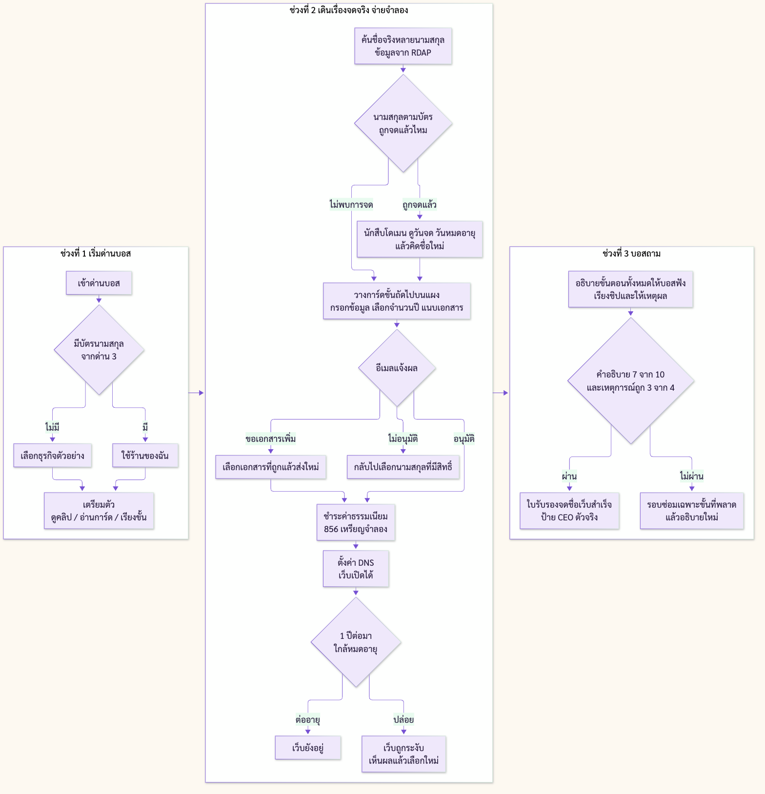

# ภารกิจด่านที่ 4 (ด่านบอส) - จดชื่อเว็บของร้านฉัน

> จุดประสงค์: **อธิบายขั้นตอนการจดทะเบียนโดเมนเนมได้**
> เป็นภาคต่อของด่านที่ 3 เคาน์เตอร์รับจดโดเมน (`docs/mission-3/mission-3-domain-counter.md`)
> เวลาเล่น: ประมาณ 7 นาที (ไม่เกิน 8 นาที)
> ข้อเท็จจริงขั้นตอนและค่าธรรมเนียม .th ตรวจกับเว็บ THNIC เมื่อ 15 ตุลาคม 2569 (thnic.co.th/article/register-domain-name-step-by-step, thnic.co.th/price) และตรงกับ m4 ใน `content/missions.json`

---

## 1. แนวคิดของด่าน

ด่านที่ 3 จบที่ผู้เรียนได้ **บัตรนามสกุลของฉัน** (นามสกุลที่ร้านตัวเองมีสิทธิ์จด) ด่านบอสนี้ให้ผู้เรียน **เดินเรื่องจดชื่อเว็บของร้านตัวเองจนใช้งานได้จริง** โดยใช้ **ข้อมูลโดเมนจริง** จากระบบทะเบียน แต่ **จ่ายเงินด้วยเหรียญจำลอง** ระหว่างทางมีเหตุการณ์ที่ต้องรับมือ และจบด้วยการ **อธิบายขั้นตอนทั้งหมดให้บอสฟัง**

แนวคิดหลัก: จดจริง (ข้อมูลจริง) จ่ายจำลอง (ไม่มีเงินจริง) อธิบายเอง (วัดตรงคำว่า อธิบาย)

### ทำไมตรงวัตถุประสงค์ "อธิบายขั้นตอนการจดทะเบียนโดเมนเนมได้"
- ผู้เรียน **เรียงขั้นตอนเอง** บนแผงเดินเรื่อง ไม่ใช่กดถัดไปเฉย ๆ
- ทุกขั้นมี **เหตุการณ์ที่บังคับให้เข้าใจเหตุผล** ของขั้นนั้น เช่น ชื่อซ้ำ ขอเอกสารเพิ่ม จ่ายเงินเมื่อไร หมดอายุ
- ตอนจบผู้เรียนต้อง **อธิบายเป็นคำพูดของตัวเอง** ให้บอสฟัง ว่าทำอะไรตามลำดับ และทำไม ระบบตรวจความครบและลำดับ
- ไม่ซ้ำกับด่านที่ 3: ด่าน 3 วัดการจำแนกประเภทและสิทธิ์ ด่านนี้วัดลำดับขั้นตอน เงื่อนไขระหว่างทาง และสิ่งที่ต้องทำหลังจด

### ทำไมเป็น Active Learning
| หลัก | ในด่านนี้ |
|---|---|
| ลงมือทำ | ค้นชื่อจริง กรอกฟอร์ม แนบเอกสาร อ่านอีเมล จ่ายเงินจำลอง ตั้ง DNS |
| ข้อมูลจริง ผลไม่ซ้ำกัน | ชื่อร้านของแต่ละคนให้ผลค้นไม่เหมือนกัน ต้องตัดสินใจเอง |
| ผลป้อนกลับทันที | ทำพลาดแล้วเห็นผล เช่น อีเมลขอเอกสารเพิ่ม ชื่อถูกระงับเมื่อไม่ต่ออายุ |
| คิดและอธิบาย | โดมถามให้คิดแทนการเฉลย และจบด้วยการอธิบายให้บอสฟัง |

### ทำไมเป็น Personalized Learning
| มิติ | ปรับอย่างไร |
|---|---|
| เรื่องราว | ใช้ชื่อร้านและบัตรนามสกุลของผู้เรียนเองจากด่าน 3 |
| ช่องทางเรียน | ช่วงเตรียมตัวเลือก ดูคลิป / อ่านการ์ด 6 ใบ / เกมเรียงขั้น (ของเดิมใน m4) |
| ระดับความยาก | ง่าย เรียง 7 ขั้น เส้นทาง .th อย่างเดียว เลือกคำอธิบายจากตัวเลือก / กลาง 10 ขั้น / ท้าทาย 10 ขั้น ทั้งเส้นทาง .th และ .com และพิมพ์อธิบายเอง |
| ซ่อมจุดอ่อน | ขั้นไหนวางผิดหรือเหตุการณ์ไหนพลาด บอสจะถามเจาะขั้นนั้น และรอบซ่อมเล่นเฉพาะเหตุการณ์นั้น |

---

## 2. เนื้อหาที่ต้องรู้

### 2.1 ขั้นตอนการจดทะเบียน .th (10 ขั้น ตามเว็บ THNIC)
| ขั้น | สิ่งที่ทำ | ทำไมต้องทำ |
|---|---|---|
| 1 | สมัครบัญชีหรือเข้าสู่ระบบกับผู้ให้บริการรับจดทะเบียน (บริษัท ที.เอช.นิค จำกัด หรือผู้ให้บริการที่ได้รับแต่งตั้ง) | ต้องมีตัวตนในระบบก่อนยื่นคำขอ |
| 2 | เข้าเมนูจดทะเบียนโดเมน | เริ่มคำขอใหม่ |
| 3 | ค้นชื่อคู่กับนามสกุลว่ายังว่างไหม | ชื่อห้ามซ้ำ ใครยื่นก่อนได้ก่อน ชื่อเดียวกันคนละนามสกุลคือคนละชื่อ |
| 4 | กรอกข้อมูลผู้ขอจด และเลือกจำนวนปี | ระบบต้องรู้ว่าใครเป็นเจ้าของและจดนานเท่าไร |
| 5 | แนบเอกสารยืนยันตัวตนตามนามสกุล แล้วตรวจข้อมูลก่อนส่ง | แต่ละนามสกุลใช้เอกสารไม่เหมือนกัน (บุคคลใช้บัตรประชาชน บริษัทใช้หนังสือรับรองนิติบุคคล) |
| 6 | เจ้าหน้าที่ตรวจคำขอและเอกสาร | ยืนยันว่ามีสิทธิ์จดนามสกุลนั้นจริง |
| 7 | รับอีเมลแจ้งผล: อนุมัติ / ขอเอกสารเพิ่ม / ไม่อนุมัติ | ต้องอ่านและทำตามผล |
| 8 | ชำระค่าธรรมเนียม (หลังอนุมัติ) | .th ราคา 856 บาทต่อปี รวมภาษีแล้ว ทุกหมวด |
| 9 | รับอีเมลยืนยันจดสำเร็จ | ชื่อเป็นของเราแล้ว |
| 10 | ตั้งค่า DNS ให้ชื่อชี้ไปที่เว็บ | ถ้าไม่ตั้ง ชื่อมีอยู่แต่เปิดเว็บไม่ได้ |

หลังจด: ต้องต่ออายุก่อนหมดอายุทุกครั้ง (ราคาเท่าเดิม 856 บาทต่อปี) ถ้าปล่อยหมดอายุ ชื่อถูกระงับ กู้คืนต้องจ่าย 1,712 บาท และอาจเสียชื่อให้คนอื่น

ระดับง่ายใช้ 7 ขั้นแบบรวม (ตาม m4 เกมเรียงขั้นเดิม): สมัครบัญชี / ค้นชื่อ / กรอกข้อมูลและจำนวนปี / แนบเอกสาร / รออีเมลแจ้งผล / ชำระเงิน / ตั้ง DNS

### 2.2 เทียบกับนามสกุลสากล (.com .shop) สำหรับระดับท้าทาย
| เรื่อง | .th | .com / .shop |
|---|---|---|
| เอกสาร | ต้องแนบตามนามสกุล | ไม่ต้องแนบ |
| ตรวจโดยเจ้าหน้าที่ | มี | ไม่มี |
| จ่ายเงิน | หลังอนุมัติ | จ่ายก่อน ใส่ตะกร้าแล้วชำระ |
| ใช้งานได้ | หลังจ่ายและตั้ง DNS | ทันทีหลังจ่าย แล้วตั้ง DNS |
| ต่ออายุ | ทุกปี | ทุกปี |
| ราคา | 856 บาทต่อปี (ตรวจ 15 ต.ค. 2569) | แล้วแต่ผู้ให้บริการ ในเกมใช้ราคาตัวอย่างและเขียนว่าราคาตัวอย่าง |

---

## 3. ภาพรวม Flow

ดู Flowchart แบบ Mermaid ในข้อ 10 และภาพ `images/flowchart-mission-4.png`

1. เข้าด่านบอส รับบัตรนามสกุลของฉันจากด่าน 3
2. เตรียมตัว (เลือกช่องทาง)
3. เดินเรื่อง 10 ขั้นบนแผงเดินเรื่อง แต่ละขั้นต้องวางการ์ดขั้นตอนถูกช่องก่อนจึงเล่นขั้นนั้นได้
4. เหตุการณ์ระหว่างทาง: ชื่อซ้ำ / นักสืบโดเมน / อีเมลขอเอกสารเพิ่ม / จ่ายเงินเมื่อไร / ตั้ง DNS
5. ข้ามเวลา 1 ปี: แจ้งเตือนหมดอายุ
6. บอสถาม: อธิบายขั้นตอนทั้งหมด
7. ผ่าน ได้ใบรับรองจดชื่อเว็บสำเร็จ / ไม่ผ่าน รอบซ่อมเฉพาะขั้นที่พลาด แล้วอธิบายใหม่

---

## 4. รายละเอียดแต่ละช่วง

### 4.1 เปิดด่านบอส (R01)
- โดมยื่นบัตรนามสกุลของฉันที่ได้จากด่าน 3 เช่น ร้านขนมวาน บุคคลทั่วไป ได้ .in.th
- ถ้าผู้เรียนไม่ได้บัตรจากด่าน 3 (ข้ามด่าน) ให้เลือกธุรกิจตัวอย่างแทน
- ข้อความ: "ด่านบอส จดชื่อเว็บของร้านฉัน ใช้ข้อมูลโดเมนจริง จ่ายด้วยเหรียญในเกม"

### 4.2 เตรียมตัว (ใช้ของเดิมใน m4)
- ดู: คลิป "เงื่อนไขและ 7 ขั้นตอน" ไม่เกิน 2 นาที
- อ่าน: การ์ด 6 ใบ เงื่อนไขที่ห้ามลืม
- ลงมือทำ: เกมเรียงขั้นตอน 7 ขั้น
- เลือกช่องทางหลักตามสไตล์ และเปิดช่องทางอื่นดูเพิ่มได้

### 4.3 ค้นชื่อจริง (R02) ขั้น 3
- ผู้เรียนพิมพ์ชื่อร้าน ระบบเช็กจริงพร้อมกันหลายนามสกุล .com .shop .in.th .co.th
- ผลแสดง: ถูกจดแล้ว (แดง) / ไม่พบการจด (เขียวหรือเทา) / ไม่มีสิทธิ์ตามบัตร (ส้ม)
- ใช้คำว่า "ไม่พบการจด" ไม่ใช้คำว่า "ว่าง" เพราะบางชื่อถูกสงวน
- โดมถาม: "ชื่อเดียวกัน ทำไมผลไม่เหมือนกัน" คำตอบที่ต้องการ: ชื่อดูคู่กับนามสกุล ใครยื่นก่อนได้ก่อน
- เหตุการณ์ชื่อซ้ำ: ถ้านามสกุลตามบัตรถูกจดแล้ว ผู้เรียนต้องคิดชื่อใหม่ แล้วค้นอีกครั้ง (ถ้าชื่อของผู้เรียนไม่ซ้ำเลย ระบบใส่ชื่อจำลองที่ซ้ำให้ 1 ครั้ง เพื่อให้ทุกคนได้เจอเหตุการณ์นี้)

### 4.4 นักสืบโดเมน (R03) ขั้น 3 ต่อ
- เปิดข้อมูลจริงของชื่อที่ถูกจดแล้ว: สถานะ วันที่จด วันหมดอายุ ผู้รับจด
- โดมถาม: "ถ้าเจ้าของลืมต่ออายุ จะเกิดอะไรขึ้น" 3 ตัวเลือก (ชื่อถูกระงับ อาจมีคนอื่นจดต่อ / ยังใช้ได้ตลอดไป / ชื่อกลายเป็นของ THNIC)

### 4.5 แผงเดินเรื่อง (R04)
- รางแนวตั้ง 10 ช่อง (ระดับง่าย 7 ช่อง) การ์ดขั้นตอนสลับอยู่ในถาด
- ทุกครั้งที่จะไปขั้นถัดไป ผู้เรียนต้องลากการ์ดที่ถูกลงช่องถัดไปก่อน
- วางผิด: การ์ดเด้งกลับ โดมถามนำ เช่น "จะจ่ายเงินได้ ต้องรู้ก่อนไหมว่าได้รับอนุมัติ"
- ระดับท้าทายมีแท็บ เส้นทาง .th และ เส้นทาง .com ให้เรียงทั้งสอง

### 4.6 กรอกฟอร์มและแนบเอกสาร (R05) ขั้น 4-5
- กรอกชื่อผู้ขอ อีเมล เลือกจำนวนปี
- ถาดเอกสาร 3 ใบ: บัตรประชาชน / หนังสือรับรองบริษัท / ใบทะเบียนการค้า ต้องเลือกให้ตรงกับนามสกุล
- กด ตรวจข้อมูลก่อนส่ง

### 4.7 กล่องอีเมล (R06) ขั้น 6-7
- ผลอีเมลขึ้นกับสิ่งที่ผู้เรียนทำ:
  - เอกสารถูก: อนุมัติ (แต่ระดับกลางและท้าทายได้ ขอเอกสารเพิ่ม 1 ครั้งเสมอ เพราะภาพบัตรไม่ชัด เพื่อให้เจอทุกผล)
  - เอกสารผิดประเภท: ขอเอกสารเพิ่ม และระบุว่าต้องใช้อะไร
  - นามสกุลไม่มีสิทธิ์: ไม่อนุมัติ พร้อมเหตุผล ให้กลับไปขั้น 3
- ผู้เรียนต้องเลือกว่าจะทำอะไรต่อ

### 4.8 ชำระค่าธรรมเนียม (R07) ขั้น 8-9
- ใบแจ้งค่าธรรมเนียม 856 บาทต่อปี รวมภาษีแล้ว จ่ายด้วยเหรียญจำลอง
- กล่องเทียบ: เส้นทาง .com จ่ายก่อน ใช้ได้ทันที
- โดมถาม (ท้าทาย): "ทำไม .th จ่ายหลังอนุมัติ"

### 4.9 ตั้งค่า DNS (R08) ขั้น 10
- กรอก Nameserver 2 ช่อง
- การ์ดอ้างอิงของจริง: ดู DNS จริงของเว็บที่รู้จัก เช่น kmutnb.ac.th
- กด บันทึกและทดสอบ แล้วเห็น เว็บเปิดได้แล้ว

### 4.10 ข้ามเวลา 1 ปี (R09)
- แจ้งเตือน "จะหมดอายุในอีก 30 วัน"
- ต่ออายุ: เสียเหรียญ 856 เว็บยังอยู่
- ปล่อยไว้: เห็นฉากเว็บถูกระงับ ค่ากู้คืน 1,712 แล้วให้เลือกใหม่ (ไม่ตัดคะแนนหนัก แต่บันทึกว่าพลาด)

### 4.11 อธิบายให้บอสฟัง (R10)
- บอส: "สรุปให้ฟังหน่อย ต้องทำอะไรบ้างกว่าเว็บจะใช้ได้"
- ระดับง่ายและกลาง: เรียงชิปขั้นตอน แล้วเลือกเหตุผลของแต่ละขั้นจากตัวเลือก
- ระดับท้าทาย: เรียงชิป แล้วพิมพ์อธิบายเอง AI ตรวจตามรูบริกข้อ 6
- มีมาตรวัด ความครบถ้วน ให้เห็นระหว่างเขียน
- บอสถามต่อ 1 ข้อเจาะขั้นที่ผู้เรียนพลาดระหว่างทาง

### 4.12 จบด่าน (R11)
- ใบรับรอง "จดชื่อเว็บสำเร็จ" พร้อมดาว และสรุปคะแนน 3 ส่วน
- ได้ป้าย CEO ตัวจริง กลับแผนที่ภารกิจ

---

## 5. ใช้ข้อมูลโดเมนจริง (สเปกสำหรับ Dev)

ทดสอบเรียกจริงแล้วเมื่อ 15 ตุลาคม 2569

| ใช้ทำอะไร | บริการ (ฟรี ไม่ต้องใช้คีย์) | ผลตอบกลับ |
|---|---|---|
| หา RDAP server ของแต่ละนามสกุล | IANA bootstrap `https://data.iana.org/rdap/dns.json` | .com .net = Verisign / .th .ไทย = `https://rdap.thains.co.th/` / .shop = GMO / .online .store = Radix |
| เช็กว่าชื่อถูกจดแล้วไหม | `GET {rdapBase}domain/{name}` | 200 = ถูกจดแล้ว / 404 = ไม่พบการจด |
| ข้อมูลนักสืบโดเมน | RDAP ช่อง `status`, `events` (registration, expiration), `nameservers` | ตัวอย่าง kmutnb.ac.th จด 23 ม.ค. 2008 หมดอายุ 22 ม.ค. 2028 |
| ดู DNS ของเว็บจริง | Cloudflare DNS over HTTPS `https://cloudflare-dns.com/dns-query?name=...&type=NS` (header `accept: application/dns-json`) | รายการ NS |

กติกา:
- เรียกผ่าน API route ของแอปเอง เช่น `GET /api/domain/check?name=kanomwan` ห้ามให้เบราว์เซอร์นักเรียนเรียก registry ตรง
- แคชผลต่อชื่อ 10 นาที และจำกัดจำนวนครั้งต่อห้อง กันโดน registry จำกัดการเรียกตอนทั้งห้องกดพร้อมกัน
- ส่งไปแค่ชื่อโดเมน ห้ามส่งข้อมูลนักเรียน และไม่แสดงข้อมูลส่วนตัวของเจ้าของโดเมนจริง (แสดงแค่สถานะ วันที่ ผู้รับจด)
- ตรวจชื่อก่อนเรียก: a-z 0-9 และขีดกลาง ยาวไม่เกิน 63 ตัว ไม่ขึ้นต้นหรือลงท้ายด้วยขีด
- ถ้า registry ล่มหรือช้าเกิน 4 วินาที ใช้ผลสำรองที่เตรียมไว้ และแสดงป้าย "ข้อมูลตัวอย่าง"
- 404 แสดงเป็น "ไม่พบการจด" เสมอ ไม่ใช้คำว่า "ว่าง"
- ราคาไม่มี API ฟรี ใช้ตารางราคาในแอป (.th 856 บาท ตรวจ 15 ต.ค. 2569) และ .com ระบุว่าเป็นราคาตัวอย่าง
- ไม่มีการซื้อจริง การจ่ายเงินทั้งหมดใช้เหรียญในเกม

---

## 6. วิธีวัดผล

ทุกการกระทำในด่านเป็นหลักฐาน ไม่ต้องมีหน้าข้อสอบแยก

| สิ่งที่วัด | หลักฐานในเกม | คะแนน |
|---|---|---|
| เรียงลำดับขั้นตอน | การ์ดที่วางบนแผงเดินเรื่อง วางถูกครั้งแรกกี่ช่อง | 10 คะแนน (ง่าย 7) |
| เข้าใจเงื่อนไขระหว่างทาง | รับมือเหตุการณ์ ชื่อซ้ำ / ขอเอกสารเพิ่ม / จ่ายเงินเมื่อไร / หมดอายุ | 4 เหตุการณ์ |
| อธิบายขั้นตอน (วัตถุประสงค์หลัก) | คำอธิบายให้บอส | รูบริกด้านล่าง 10 คะแนน |

รูบริกคำอธิบาย (10 คะแนน)
| เกณฑ์ | คะแนน |
|---|---|
| บอกขั้นตอนครบ (ค้นชื่อ / กรอกข้อมูล / แนบเอกสาร / รอผลตรวจ / ชำระเงิน / ตั้ง DNS) | 4 |
| เรียงลำดับถูก โดยเฉพาะ จ่ายเงินหลังอนุมัติ และ DNS เป็นขั้นท้าย | 2 |
| บอกเหตุผลอย่างน้อย 2 ขั้น เช่น ทำไมต้องค้นชื่อก่อน ทำไมต้องแนบเอกสาร | 2 |
| พูดถึงการต่ออายุและผลของการไม่ต่อ | 2 |

เกณฑ์ผ่านด่าน: คำอธิบายได้อย่างน้อย 7 จาก 10 และรับมือเหตุการณ์ถูกอย่างน้อย 3 จาก 4

ดาว
| ดาว | เงื่อนไข |
|---|---|
| 3 | เรียงถูกครั้งแรกทุกช่อง และคำอธิบาย 9 ขึ้นไป |
| 2 | ผ่านเกณฑ์ |
| 1 | ผ่านหลังรอบซ่อม |

ไม่ผ่าน: รอบซ่อมเล่นเฉพาะขั้นหรือเหตุการณ์ที่พลาด แล้วอธิบายให้บอสฟังใหม่

AI ตรวจคำอธิบาย (ระดับท้าทาย): ให้ AI ตรวจตามรูบริกและตอบเป็นคะแนนรายเกณฑ์ ถ้า AI ล่ม ใช้การตรวจคำสำคัญและลำดับของชิปแทน และครูดูคำตอบจริงได้ที่แผงครู

---

## 7. ดู อ่าน ลงมือทำ

| ช่วง | ดู | อ่าน | ลงมือทำ |
|---|---|---|---|
| เตรียมตัว (เลือกช่องทาง) | คลิปเงื่อนไขและขั้นตอน | การ์ด 6 ใบ | เกมเรียงขั้น 7 ขั้น |
| ค้นชื่อและนักสืบโดเมน (ทุกคน) | ผลค้นจริงที่ต่างกันในแต่ละนามสกุล | ข้อมูล RDAP วันจด วันหมดอายุ | พิมพ์ชื่อร้าน คิดชื่อใหม่เมื่อซ้ำ |
| เดินเรื่อง (ทุกคน) | การ์ดลูกค้าเลื่อนไปตามแผง อีเมลเด้งแจ้งผล | ฟอร์ม อีเมล ใบแจ้งค่าธรรมเนียม | วางการ์ดขั้นตอน แนบเอกสาร จ่ายเหรียญ ตั้ง DNS |
| ข้ามเวลาและบอส (ทุกคน) | ฉากเว็บถูกระงับเมื่อไม่ต่ออายุ | คำถามของบอส | อธิบายขั้นตอนด้วยคำพูดตัวเอง |

ผู้เรียนทุกคนได้ครบ ดู อ่าน ลงมือทำ ในช่วงเดินเรื่องและบอส ส่วนช่วงเตรียมตัวเลือกช่องทางหลักตามสไตล์

---

## 8. ข้อมูลที่ระบบเก็บ (ส่งแผงครู)

| ข้อมูล | ใช้ทำอะไร |
|---|---|
| การ์ดที่วางผิดและวางผิดที่ช่องไหน | ดูว่าห้องสับสนขั้นไหน เช่น จ่ายเงินก่อนอนุมัติ |
| ผลเหตุการณ์ 4 อย่าง | เลือกรอบซ่อม |
| คะแนนรูบริกคำอธิบายรายเกณฑ์ | วัดวัตถุประสงค์หลัก |
| คำอธิบายที่พิมพ์ (ท้าทาย) | ครูดูตัวอย่างไปสรุปหน้าห้อง |
| ชื่อโดเมนที่ค้น (ไม่เก็บข้อมูลส่วนตัว) | ดูว่าผู้เรียนลองคิดชื่อกี่แบบ |
| ต่ออายุหรือปล่อย | ดูความเข้าใจเรื่องอายุโดเมน |

---

## 9. หน้าจอและ Flow การเล่น (สำหรับ Dev)

ภาพแนวเกมเดียวกับด่าน 3 (ออฟฟิศ 8 บิต ฉากหลังเบลอเมื่อแผงเปิด หน้าจอเป็น HTML ปกติวางทับ) สร้างด้วย Codex image generation

| จอ | ผู้เรียนเห็น | ผู้เรียนทำ | ไปจอ |
|---|---|---|---|
| R01 เปิดด่านบอส | โดมยื่นบัตรนามสกุลของฉัน | กด เริ่มเดินเรื่อง | เตรียมตัว แล้ว R02 |
| R02 ค้นชื่อจริง | ผลค้นจริงหลายนามสกุล | พิมพ์ชื่อ ตอบคำถามโดม ถ้าซ้ำคิดชื่อใหม่ | R03 |
| R03 นักสืบโดเมน | ข้อมูลจริงของชื่อที่ถูกจดแล้ว | ตอบว่าลืมต่ออายุแล้วเกิดอะไร | R04 |
| R04 แผงเดินเรื่อง | ราง 10 ช่อง การ์ดในถาด | ลากการ์ดขั้นถัดไปลงช่อง | จอของขั้นนั้น |
| R05 ฟอร์มและเอกสาร | ใบขอจด ถาดเอกสาร | กรอก เลือกจำนวนปี แนบเอกสาร | R04 แล้ว R06 |
| R06 กล่องอีเมล | อีเมลแจ้งผล 3 แบบ | เลือกทำตามผล | R05 หรือ R04 แล้ว R07 |
| R07 ชำระเงิน | ใบแจ้งค่าธรรมเนียม | จ่ายเหรียญจำลอง | R04 แล้ว R08 |
| R08 ตั้ง DNS | ช่อง Nameserver ตัวอย่างของจริง | กรอกและทดสอบ | R09 |
| R09 ข้ามเวลา 1 ปี | แจ้งเตือนหมดอายุ | ต่ออายุหรือปล่อย | R10 |
| R10 อธิบายให้บอส | คำถามบอส ชิปขั้นตอน มาตรวัด | เรียงและอธิบาย | R11 หรือรอบซ่อม |
| R11 จบด่าน | ใบรับรอง ดาว คะแนน | กลับแผนที่ | - |

ภาพรวม Flow

จอรายจออยู่ที่ `images/game/R01-boss-intro.png` ถึง `R11-boss-clear.png`

จุดที่ภาพยังไม่ตรงสเปก ให้ยึดข้อความในเอกสารนี้: R03 วันที่ในภาพเป็นตัวอย่าง ของจริงดึงจาก RDAP / R09 ปฏิทินในภาพเขียน พ.ศ. 2568 ของจริงใช้วันที่ในเกม / R11 ภาพเขียนรับมือเหตุการณ์ 3/3 ของจริงมี 4 เหตุการณ์ / ตัวเลขขั้นบนแถบบนบางจอไม่ตรงกัน

---

## 10. Flowchart (Mermaid)

---

## 11. สิ่งที่ต้องเตรียม (Assets)
- ฉากออฟฟิศ 8 บิตชุดเดียวกับด่าน 3 และฉากโต๊ะบอส
- ตัวบอส (พิกเซล 3 สีหน้า ปกติ พอใจ สงสัย) และโดมแบบพิกเซล
- การ์ดขั้นตอน 10 ใบ (ระดับง่าย 7 ใบ) และการ์ดเส้นทาง .com
- เทมเพลตอีเมล 3 แบบ อนุมัติ / ขอเอกสารเพิ่ม / ไม่อนุมัติ
- ผลสำรองของการค้นชื่อและข้อมูล RDAP ตัวอย่าง สำหรับตอน registry ล่ม
- ใบรับรองจดชื่อเว็บสำเร็จ
