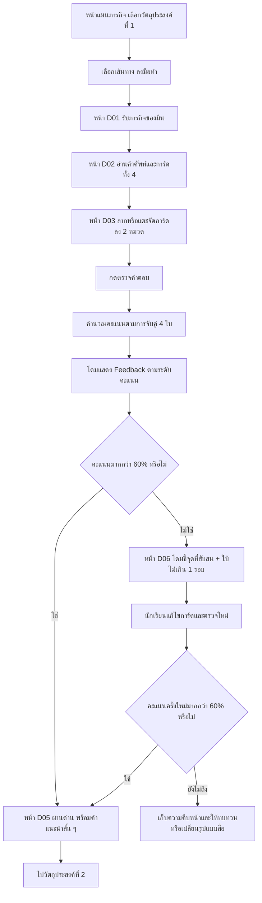

# Storyboard และ Learning Flow — วัตถุประสงค์ที่ 1 | เส้นทาง “ลงมือทำ” (Drag & Drop)

**สถานะ:** เอกสารออกแบบเนื้อหา กิจกรรม หน้าจอ และกติกาการประเมินสำหรับเว็บมือถือ  
**เรื่อง:** ระบบชื่อโดเมน  
**วัตถุประสงค์ที่ 1:** **บอกความหมายของโดเมนเนมและระบบแปลงชื่อโดเมน (DNS) ได้**  
**รูปแบบ:** เข้าด่าน → รับภารกิจ → จับคู่คำอธิบายกับคำศัพท์ด้วย Drag & Drop → ตรวจผล → โดมให้ Feedback ตามระดับ → **คะแนนมากกว่า 60% ผ่าน** → ไปวัตถุประสงค์ที่ 2  
**ตัวละคร:** มีนเป็นตัวละครประกอบโจทย์; **โดม** เป็นผู้ช่วย AI นอกเรื่องเล่าซึ่งปรากฏในหน้าคำแนะนำและ Feedback  
**ความแตกต่างจากเส้นทางอื่น:** ไม่มีวิดีโอ ไม่มีแชตบทสนทนายาวระหว่างเพื่อน และไม่ต้องตอบคำถามปลายเปิด 2 ข้อหลังจบกิจกรรม  

> **ข้อตกลงสำคัญ:** นักเรียนได้คะแนน **มากกว่า 60%** ให้ **ผ่านทันที** โดยไม่ต้องตอบแชตเพิ่มเพื่อปลดล็อกด่านถัดไป แต่ยังต้องมี Feedback บอกสิ่งที่ถูกต้องและสิ่งที่ควรเพิ่มเติมตามคะแนนจริง หากยังไม่ผ่านให้โดมช่วยเฉพาะจุดและมีโอกาสแก้ไข ไม่ถามวนไม่สิ้นสุด

---

## 1. ขอบเขตการเรียนรู้และหลักการออกแบบ

### 1.1 สิ่งที่ต้องบอกได้

1. **โดเมนเนม (Domain Name)** คือชื่อที่ใช้ระบุหรือเข้าถึงเว็บไซต์/บริการออนไลน์ ช่วยให้มนุษย์จดจำได้สะดวกกว่า IP Address
2. **DNS (Domain Name System)** คือระบบที่ช่วยค้นหาข้อมูลหมายเลข IP Address ที่สัมพันธ์กับชื่อโดเมน เพื่อให้เบราว์เซอร์ติดต่อปลายทางได้

นักเรียน **ไม่ต้อง** จำเลข IP จริง ชื่อโดเมนตัวอย่างหรือการสะกดภาษาอังกฤษ ไม่ต้องรู้ TLD, subdomain, DNS record หรือการตั้งค่า DNS เพราะเป็นเนื้อหานอกวัตถุประสงค์นี้

### 1.2 ทำไมเลือก Drag & Drop แบบจับคู่

- จุดประสงค์เป็นการ **บอกความหมาย** ไม่ใช่ปฏิบัติการตั้งค่าเว็บหรือแก้ระบบ DNS จริง
- ให้เลือกว่าคำอธิบายไหนเป็นของ **โดเมนเนม** และไหนเป็นของ **DNS**
- ใช้ **4 การ์ด** (คำอธิบายหลักอย่างละหนึ่ง + หน้าที่/ประโยชน์อย่างละหนึ่ง) เพื่อแยกความเข้าใจระดับต่าง ๆ ได้โดยยังใช้เวลาไม่นาน
- แต่ละการ์ดเป็น **ประโยคสั้นที่ใช้เป็นเนื้อหาความรู้ในตัว** เด็กไม่จำเป็นต้องดูคลิปก่อนจึงทำได้
- การให้คะแนนจับคู่เป็นกฎแน่นอน (rule-based) ส่วน **AI โดมใช้วิเคราะห์รูปแบบข้อผิดพลาดและเขียน Feedback สั้น ๆ** ไม่ต้องให้ AI ตัดสินตำแหน่งการ์ดหรือรับรองคะแนนเอง

### 1.3 เรื่องราวที่ใช้ประกอบ

**ชื่อภารกิจ:** “ช่วยมีนแยกคำศัพท์ก่อนเปิดร้านออนไลน์”  
**บริบท:** มีนเตรียมสื่ออธิบายเว็บไซต์ร้านขนมบ้านยายให้ยาย แต่การ์ดอธิบายคำศัพท์สองคำสลับปนกัน นักเรียนช่วยมีนนำคำอธิบายไปไว้ใต้หัวข้อที่ถูกต้อง

**ข้อความเปิดภารกิจที่นักเรียนเห็น:**

> “มีนกำลังเตรียมอธิบายเรื่องเว็บไซต์ให้ยายฟัง แต่การ์ดความหมายสลับกันหมดเลย ช่วยจัดให้ถูกหน่อยนะ!”

**ข้อความเสริมสั้น ๆ จากโดม (บนหน้าภารกิจ ไม่อยู่ในการ์ดคำศัพท์):**

> “ลากการ์ดข้อความไปวางใต้คำที่ตรงกับความหมาย หรือแตะการ์ดแล้วเลือกช่องก็ได้ครับ”

---

## 2. ภาพรวม Flow ของนักเรียน



### กฎควบคุมการไหล

1. เปิดการ์ดทั้ง 4 ใบและสองช่องตั้งแต่เริ่ม ไม่ต้องเปิดหน้าคำอธิบายยาว
2. ปุ่ม **ตรวจคำตอบ** กดได้เมื่อวางการ์ดครบทั้ง 4 ใบเท่านั้น
3. แต่ละการ์ดอยู่ได้เพียงช่องเดียว สามารถย้ายกลับ/เปลี่ยนช่องก่อนตรวจได้
4. หลังตรวจ ระบบคำนวณคะแนนทันที (ไม่ต้องรอให้ AI ประมวลผลจึงทราบว่าผ่านหรือไม่)
5. **มากกว่า 60% = ผ่านทันที** ไม่บังคับแก้คำตอบหรืออธิบายเหตุผลเพิ่มเติม
6. **60% หรือต่ำกว่า = ยังไม่ผ่าน** แสดง Feedback และเปิดให้แก้อีกหนึ่งรอบ; หลังจากนั้นเปิดทางทบทวน/เลือกดูหรืออ่าน/กลับภายหลัง
7. โดมอาจชวนตอบเหตุผลสั้น ๆ **เป็นตัวเลือกเสริม** เช่น “อยากลองเล่าความต่างของสองคำนี้ไหม?” แต่ **ห้ามใช้เป็นเงื่อนไขบังคับผ่าน** เพราะกิจกรรมต้องกระชับ
8. คำว่า “ผ่าน” หมายถึง **ผ่านเกณฑ์ที่กำหนดสำหรับกิจกรรมนี้** ไม่ควรอ้างว่าผู้เรียนเข้าใจทุกประเด็นครบ 100% เมื่อคะแนนยังมีจุดขาด

---

## 3. เนื้อหากิจกรรม Drag & Drop — ใช้ได้ทันที

### 3.1 หัวข้อสำหรับวาง (Drop Zones)

| รหัส | ชื่อแสดงบนหน้าจอ | คำอธิบายประกอบแบบสั้น |
|---|---|---|
| `ZONE_DOMAIN` | **โดเมนเนม (Domain Name)** | กลุ่มข้อความที่อธิบายความหมายหรือประโยชน์ของชื่อโดเมน |
| `ZONE_DNS` | **DNS** | กลุ่มข้อความที่อธิบายความหมายหรือหน้าที่ของระบบ DNS |

**ไม่ใส่ไอคอนที่เฉลยคำตอบอย่างโจ่งแจ้ง** เช่น วาด DNS เป็นเซิร์ฟเวอร์กำลังค้นหา IP อยู่ในช่อง ก่อนผู้เรียนได้ลองคิดเอง ใช้ไอคอนกลาง ๆ ได้ แต่ต้องไม่ใช้สีเพียงอย่างเดียวเป็นตัวบอกคำตอบ

### 3.2 การ์ดที่ลาก (4 ใบ) และเฉลยสำหรับระบบ

| ID | ข้อความบนการ์ด (แสดงจริง) | โซนที่ถูกต้อง | น้ำหนัก |
|---|---|---|---:|
| `C01` | **ชื่อที่ใช้ระบุและเข้าถึงเว็บไซต์** | `ZONE_DOMAIN` | 35 คะแนน |
| `C02` | **ช่วยให้คนจดจำชื่อเว็บไซต์ได้ง่ายกว่าหมายเลข IP** | `ZONE_DOMAIN` | 15 คะแนน |
| `C03` | **ระบบที่ช่วยค้นหาหมายเลข IP จากชื่อโดเมน** | `ZONE_DNS` | 35 คะแนน |
| `C04` | **ช่วยให้เบราว์เซอร์รู้ที่อยู่สำหรับติดต่อเว็บเซิร์ฟเวอร์** | `ZONE_DNS` | 15 คะแนน |

**หมายเหตุด้านเนื้อหา:** C04 หมายถึง **ผลของการที่ DNS ช่วยให้ได้ข้อมูลที่อยู่** ไม่ได้หมายความว่า DNS เป็นตัวเชื่อมต่อเว็บไซต์หรือเก็บเว็บไซต์ด้วยตัวเอง หากผู้เรียนเข้าใจผิดต้องให้ Feedback ชัดเจน

### 3.3 ลำดับการแสดงการ์ด

สุ่มลำดับ `C01–C04` เมื่อเข้ากิจกรรมแต่ละครั้ง เช่น `C03, C01, C04, C02` เพื่อไม่ให้จำตำแหน่งเฉลย โดยไม่เปลี่ยนข้อความหรือคำตอบที่ถูกต้อง

### 3.4 การออกแบบสำหรับมือถือ

- หน้าจอตั้ง: 360–430 px เป็นแนวคิดอ้างอิง; การ์ดและช่องวางต้องขยายตามความกว้าง
- หัวข้อโซน 2 กลุ่มเรียง **บน–ล่าง** ดีกว่าตั้ง 2 คอลัมน์แคบ ๆ
- การ์ดมีความสูงตามข้อความ (ประมาณ 2 บรรทัด) ขอบมนและเงาเบา
- รองรับทั้ง **ลากวาง** และ **แตะการ์ด → แตะโซน** เพื่อใช้งานบนมือถือได้ง่ายและเป็นทางเลือกการเข้าถึง
- มีปุ่ม “ย้ายกลับ” / “เริ่มใหม่” และแสดงจำนวนการ์ดที่จัดแล้ว เช่น **2/4**
- พื้นที่กดและไอคอนไม่ควรเล็ก; ข้อความเป็นภาษาไทยอ่านชัด
- ไม่บังคับให้ผู้เรียนลากเป๊ะเข้าแคบ ๆ ระบบสามารถดูดการ์ดเข้าช่องที่ใกล้เมื่อปล่อย
- ไม่ใช้การนับเวลาหรือจับเวลาถอยหลัง เพราะเป้าหมายเป็นความเข้าใจความหมาย

---

## 4. รายละเอียดหน้าจอทีละหน้า (Mobile UI)

### D01 — หน้ารับภารกิจ

**เป้าหมาย:** ให้รู้ว่าต้องช่วยใครและต้องทำอะไรใน 1 หน้าจอ

**องค์ประกอบ:**

- แถบด้านบน: `ด่านที่ 1` / `ลงมือทำ` / แถบความคืบหน้า
- ภาพมีนถือบัตรคำ 2–3 ใบอยู่ในร้านขนมบ้านยาย (ภาพประกอบ ไม่มีข้อความฝังในภาพ)
- ชื่อกิจกรรม: `ภารกิจจับคู่ความหมาย`
- คำอธิบาย: `ช่วยมีนนำคำอธิบายไปวางใต้คำศัพท์ที่ถูกต้อง`
- ป้ายข้อมูลสั้น: `มี 4 การ์ด • ไม่จับเวลา`
- ปุ่มหลัก: **เริ่มภารกิจ**
- ปุ่มรอง: **ย้อนกลับ**

**พฤติกรรม:** กดเริ่มแล้วเข้าสู่ D02 ไม่ต้องดูคลิปก่อน เพราะเส้นทางนี้เป็นทางเลือกลงมือทำโดยตรง

### D02 — หน้าสอนวิธีเล่นแบบสั้น (สามารถรวมกับ D03)

**ข้อความ:**

> “แตะหรือจับการ์ดแล้วนำไปวางในกลุ่ม โดเมนเนม หรือ DNS จนครบ 4 ใบครับ”

**องค์ประกอบ:** รูปตัวอย่างการ์ดเปล่าเคลื่อนเข้าสู่ช่องอย่างง่าย (ไม่มีเฉลย), ปุ่ม `เข้าใจแล้ว` หรือซ่อนเป็น Tooltip ครั้งแรก

**พฤติกรรม:** ผู้ใช้เดิมไม่จำเป็นต้องเห็นทุกครั้ง; ตั้ง `instruction_seen=true` หลังปิด

### D03 — หน้ากิจกรรมจับคู่ (หน้าหลัก)

**เลย์เอาต์จากบนลงล่าง:**

1. Header: `ด่านที่ 1 | ลงมือทำ` พร้อมปุ่มย้อนกลับ
2. หัวข้อ: `จับคู่ความหมายให้ถูกต้อง`
3. ข้อความช่วย: `ลากการ์ดหรือแตะเพื่อเลือกกลุ่ม`
4. **ZONE_DOMAIN** — `โดเมนเนม (Domain Name)` พร้อมจำนวนการ์ดที่ใส่
5. **ZONE_DNS** — `DNS` พร้อมจำนวนการ์ดที่ใส่
6. **ถาดการ์ดที่ยังไม่จัด** — การ์ด 4 ใบสุ่มลำดับ
7. Progress: `จัดแล้ว X/4 ใบ`
8. ปุ่มรอง: `เริ่มใหม่`
9. ปุ่มหลัก: `ตรวจคำตอบ` (disabled ถ้ายังจัดไม่ครบ)

**สถานะการ์ด:** `unplaced`, `selected`, `placed_in_domain`, `placed_in_dns`.  
**เหตุการณ์สำคัญ:** เมื่อการ์ดถูกวาง ระบบปรับสถานะและจำนวนทันที แต่ **ยังไม่แสดงว่าถูก/ผิด** ระหว่างจัด เพื่อให้นักเรียนตัดสินใจเอง

**ตัวอย่างภาพร่างเชิงข้อความ (ไม่ใช่ภาพ UI จริง):**

```text
┌────────────────────────────────┐
│ ← ด่านที่ 1          ลงมือทำ  │
│ จับคู่ความหมายให้ถูกต้อง       │
│                                │
│ ┌ โดเมนเนม (Domain Name) ────┐ │
│ │ การ์ดที่นักเรียนนำมาวาง     │ │
│ └────────────────────────────┘ │
│ ┌ DNS ──────────────────────┐ │
│ │ การ์ดที่นักเรียนนำมาวาง     │ │
│ └────────────────────────────┘ │
│                                │
│ การ์ดรอจัด                     │
│ ┌ ข้อความการ์ด A ───────────┐ │
│ └────────────────────────────┘ │
│ ┌ ข้อความการ์ด B ───────────┐ │
│ └────────────────────────────┘ │
│           จัดแล้ว 2/4         │
│        [ ตรวจคำตอบ ]          │
└────────────────────────────────┘
```

### D04 — ตรวจคำตอบและรอ Feedback

**สิ่งที่เกิดขึ้นเมื่อกดตรวจ:**

1. อ่านการจัดการ์ดทั้ง 4 ใบและเทียบเฉลยภายในระบบ
2. ให้คะแนนแบบถ่วงน้ำหนัก (สูตรในหัวข้อ 5)
3. บันทึกว่าข้อไหนถูก/ผิด โดยยังไม่เผยเฉลยครบทุกใบให้เด็กที่ยังไม่ผ่าน
4. ส่งคะแนนและรูปแบบข้อผิดพลาดให้โดมเพื่อเขียน Feedback ที่ตรงจุด
5. แสดงผลในหน้า D05 ถ้าผ่าน หรือ D06 ถ้ายังไม่ผ่าน

**ข้อความระหว่างโหลดสั้น ๆ (ถ้าจำเป็น):** `โดมกำลังสรุปคำแนะนำ...`  
**ข้อควรระวัง:** ถ้า AI ตอบช้า ระบบต้องแสดงคะแนน/ผ่านไม่ผ่านจากการตรวจแบบกำหนดกฎได้ทันที แล้วค่อยเสริม Feedback; ห้ามล็อกการผ่านรอ AI อย่างไม่จำกัด

### D05 — ผ่านกิจกรรม + Feedback

**องค์ประกอบ:**

- ไอคอน `ผ่านภารกิจ` และคะแนนที่ได้ เช่น `70%`
- ข้อความ Feedback จากโดม (ไม่เกิน 2–3 ประโยค)
- การ์ดสรุปสั้น ๆ อย่างมาก 2 บรรทัด: `โดเมนเนม = ชื่อที่ใช้ระบุ/เข้าเว็บไซต์` และ `DNS = ระบบช่วยค้นหาที่อยู่ IP จากชื่อโดเมน`
- ปุ่มหลัก: **ไปวัตถุประสงค์ที่ 2**
- ปุ่มรอง: `ดูการจับคู่และคำแนะนำ` (ไม่บังคับ)

**ข้อความระบบ:** `ได้คะแนนมากกว่า 60% จึงผ่านกิจกรรมนี้แล้ว`  
**กติกา:** กดไปต่อได้ทันที ไม่ต้องทำแบบทดสอบเพิ่ม ไม่ต้องตอบแชตอีกข้อหนึ่ง

### D06 — ยังไม่ผ่าน + โดมช่วยเฉพาะจุด

**องค์ประกอบ:**

- คะแนน เช่น `50%` และสถานะ `ยังไม่ผ่าน`
- โดมให้ Feedback ว่าเข้าใจหมวดใดแล้ว และส่วนใดที่อาจสับสน
- ไฮไลต์การ์ดที่ยังผิด **โดยไม่จำเป็นต้องโชว์ตำแหน่งที่ถูกทันที**
- คำใบ้สั้น ๆ แค่ 1 ประเด็น เช่น `คำไหนเป็นชื่อที่เราใช้เรียกเว็บไซต์ ส่วนคำไหนเป็นระบบค้นหาที่อยู่?`
- ปุ่มหลัก: **แก้การจับคู่**
- ปุ่มรอง: **ขอคำใบ้** (ไม่เกิน 1 ชุดคำใบ้ต่อรอบ)

**ถ้ายังไม่ผ่านเมื่อแก้แล้วหนึ่งรอบ:**

- แสดงข้อความ `ยังมีบางจุดที่ควรทบทวนครับ`
- ปุ่ม `กลับไปทบทวนเรื่องนี้` / `ลองเส้นทางดูหรืออ่าน` / `บันทึกไว้เรียนต่อ`
- ไม่วนบังคับตอบคำถามใหม่เรื่อย ๆ

### D07 — เข้าสู่วัตถุประสงค์ถัดไป

ระบบบันทึก `objective_id=OBJ01`, `learning_path=do`, `passed=true`, คะแนนที่ดีที่สุด และชุดการ์ดที่ยังสับสน แล้วไปยัง **วัตถุประสงค์ที่ 2 — ส่วนประกอบและลำดับของชื่อโดเมน** โดยใช้เส้นทางที่ระบบ Adaptive Learning เลือกสำหรับวัตถุประสงค์ถัดไป (ไม่ต้องบังคับเป็น D&D ต่อ)

---

## 5. ระบบให้คะแนน: กำหนดแน่นอนและเกิน 60% ผ่าน

### 5.1 สูตร

```text
คะแนนรวม (0–100) = ผลรวมคะแนนของการ์ดที่วางในโซนถูกต้อง
C01 ถูก = 35, ผิด = 0
C02 ถูก = 15, ผิด = 0
C03 ถูก = 35, ผิด = 0
C04 ถูก = 15, ผิด = 0
ผ่านเมื่อ score > 60
```

**เหตุผลการถ่วงน้ำหนัก:** การ์ดนิยามหลัก `C01` และ `C03` มีน้ำหนักมากกว่าการ์ดประโยชน์/ผลของระบบ เพื่อให้น้ำหนักสอดคล้องกับคำกริยา **“บอกความหมาย”** ในวัตถุประสงค์

**ข้อสังเกต:** คะแนนจาก D&D มีค่าที่เป็นไปได้เป็นบางระดับ ไม่จำเป็นต้องเกิดทุกจำนวนเต็มระหว่าง 0–100 แต่สามารถแบ่งเป็นช่วง Feedback ได้เหมือนเส้นทางดูและอ่าน

### 5.2 ตัวอย่างผลลัพธ์ที่คำนวณได้

| การ์ดที่จับคู่ถูกต้อง | คะแนน | ผล |
|---|---:|---|
| `C01` + `C03` | 70% | ผ่าน; ตอบความหมายหลักได้ แต่ประโยชน์/ผลลัพธ์ยังสับสน |
| `C01` + `C02` + `C04` | 65% | ผ่าน; ยังสับสนความหมายหลักของ DNS |
| `C01` + `C02` + `C03` | 85% | ผ่าน; ควรทบทวนผลของการค้นหาที่อยู่ผ่าน DNS |
| `C01` + `C02` | 50% | ยังไม่ผ่าน; เข้าใจโดเมนเนม แต่คำอธิบาย DNS ยังวางไม่ถูก |
| `C01` + `C02` + `C03` + `C04` | 100% | ผ่าน; ถูกทุกการ์ด |

**อย่าให้ AI เปลี่ยนคะแนนด้วยความเห็นส่วนตัว:** คะแนน D&D เป็นผลตรวจจากตำแหน่งของการ์ดเท่านั้น

### 5.3 ระดับ Feedback ตรงกับเส้นทางดูและอ่าน

| คะแนนรวม | สถานะ | Feedback ที่ต้องมี |
|---|---|---|
| 0–30% | ยังไม่ผ่าน | ให้คำอธิบายพื้นฐาน 1 จุด + วิธีลองใหม่แบบสั้น |
| มากกว่า 30–60% | ยังไม่ผ่าน | ชี้สิ่งที่วางถูกแล้ว + ชวนทบทวนจุดสับสน |
| มากกว่า 60–79% | ผ่าน | ระบุเรื่องที่ทำได้ + เสริมสิ่งที่ยังวางผิด โดยไม่บังคับแก้ |
| 80–89% | ผ่าน | ยืนยันความเข้าใจหลัก + หมายเหตุจุดที่ยังพลาดเล็กน้อย |
| 90–100% | ผ่าน | ชื่นชมตามหลักฐานว่าเข้าใจครบหรือเกือบครบ + อนุญาตไปต่อ |

### 5.4 ตัวอย่าง Feedback ที่ผูกกับหลักฐานการ์ดจริง

**70% (`C01` และ `C03` ถูกเท่านั้น):**

> “ผ่านแล้วครับ! นักเรียนจับคู่ความหมายหลักของโดเมนเนมและ DNS ได้ถูกต้องทั้งสองใบ ส่วนคำอธิบายเรื่องประโยชน์ยังสลับกันอยู่ ลองจำว่าโดเมนช่วยให้คนจำชื่อเว็บง่าย ส่วน DNS ช่วยค้นหาที่อยู่ IP นะครับ”

**65% (`C01`, `C02`, `C04` ถูก):**

> “ผ่านแล้วครับ! นักเรียนเข้าใจว่าโดเมนเนมเป็นชื่อเว็บไซต์และมีประโยชน์ต่อการจดจำ ลองทบทวนเพิ่มนิดหนึ่งว่า DNS เป็น **ระบบค้นหาที่อยู่ IP จากชื่อโดเมน** ไม่ใช่ตัวเว็บไซต์เองครับ”

**85% (`C01`, `C02`, `C03` ถูก):**

> “ทำได้ดีครับ! จับคู่ความหมายหลักของทั้งสองคำถูกต้องแล้ว อีกเรื่องที่เสริมได้คือข้อมูล IP จาก DNS ช่วยให้เบราว์เซอร์รู้ปลายทางที่จะติดต่อครับ ผ่านและไปต่อได้เลย”

**100% (ถูกทุกใบ):**

> “ยอดเยี่ยมครับ! จับคู่ความหมายและหน้าที่ของโดเมนเนมกับ DNS ได้ครบทุกใบ พร้อมไปเรียนเรื่องโครงสร้างชื่อโดเมนต่อแล้วครับ”

**50% (`C01`, `C02` ถูก):**

> “นักเรียนจับคู่เรื่องโดเมนเนมได้ถูกต้องแล้วครับ แต่ยังสับสนส่วน DNS อยู่ ลองมองหาการ์ดที่พูดถึงระบบค้นหาหมายเลข IP จากชื่อโดเมน แล้วลองจัดใหม่อีกครั้งนะครับ”

**ห้าม:** ใช้ข้อความว่า “ถูกต้องครบทุกข้อ” เมื่อคะแนนไม่เท่ากับ 100 หรือสร้างเหตุผลจากคำตอบที่ไม่ได้อยู่ใน log

---

## 6. บทบาทของโดม AI และการถามเพิ่มเติมแบบไม่ถ่วงเวลา

### 6.1 ก่อนเริ่มกิจกรรม

> “พร้อมช่วยมีนจัดการ์ดไหมครับ? ลากหรือแตะจัดคำอธิบายให้ตรงกับโดเมนเนมและ DNS ได้เลย”

### 6.2 ขณะกำลังจับคู่

- ปกติ **โดมไม่พูดแทรกทุกการ์ด** เพื่อไม่ให้รบกวนการคิด
- เปิดปุ่ม `ขอคำใบ้` เล็ก ๆ หากนักเรียนต้องการ
- ตัวอย่างคำใบ้ระดับแรก: “ลองดูว่าการ์ดไหนพูดถึง **ชื่อ** และใบไหนพูดถึง **ระบบค้นหาที่อยู่** ครับ”
- หลีกเลี่ยงการบอกว่า `C01` ต้องอยู่ช่องใดก่อนตรวจ

### 6.3 หลังตรวจคำตอบ

- รับ **ข้อมูลจากระบบ**: คะแนน, รหัสการ์ดถูก/ผิด, ความพยายามครั้งที่เท่าไร
- ให้ Feedback 2–3 ประโยค ชี้ถูกและผิดจริง ไม่เดาเจตนานักเรียน
- ถ้า **ผ่าน**: ยินดีแบบพอดี สรุปข้อควรเสริม และเปิดไปต่อทันที
- ถ้า **ไม่ผ่าน**: ชี้จุดที่ยังสับสนและให้แก้รอบเดียว โดยไม่บังคับคุยยาว

### 6.4 คำถามเหตุผลแบบสั้น (ทางเลือก ไม่ใช่เงื่อนไขผ่าน)

เพื่อรองรับแนวคิดเดิมที่อยากให้ AI วิเคราะห์เชิงความเข้าใจ สามารถมีปุ่ม **“ลองอธิบายให้โดมฟัง”** หลังผลตรวจ โดยหากนักเรียนเลือก โดมถามเพียงข้อเดียว:

> “โดเมนเนมกับ DNS ต่างกันอย่างไรครับ? ตอบสั้น ๆ ตามที่เข้าใจได้เลย”

AI วิเคราะห์คำตอบเพื่อเก็บข้อมูลการเข้าใจรายบุคคลและเสนอคำแนะนำ แต่ **ไม่เปลี่ยนคะแนน Drag & Drop และไม่ใช้เป็นข้อบังคับให้ผ่าน** ตามเกณฑ์มากกว่า 60% ที่ตกลงกัน หากต้องการใช้คำตอบนี้เป็นคะแนนจริงในอนาคต ต้องกำหนด Rubric และแจ้งนักเรียนใหม่อย่างชัดเจน

---

## 7. ข้อความ UI สำเร็จรูป

| ตำแหน่ง | ข้อความ |
|---|---|
| หัวข้อด่าน | `ด่านที่ 1: รู้จักโดเมนเนมและ DNS` |
| ชื่อเส้นทาง | `ลงมือทำ` |
| หัวข้อกิจกรรม | `ภารกิจจับคู่ความหมาย` |
| คำอธิบาย | `ช่วยมีนนำคำอธิบายไปวางใต้คำศัพท์ที่ถูกต้อง` |
| Tooltip | `ลากการ์ด หรือแตะการ์ดแล้วเลือกกลุ่ม` |
| สถานะจัดการ์ด | `จัดแล้ว {count}/4 ใบ` |
| ปุ่มเริ่ม | `เริ่มภารกิจ` |
| ปุ่มตรวจ | `ตรวจคำตอบ` |
| ปุ่มแก้ | `แก้การจับคู่` |
| ปุ่มใบ้ | `ขอคำใบ้` |
| ปุ่มรีเซ็ต | `เริ่มใหม่` |
| คะแนน | `คะแนนของฉัน {score}%` |
| ผ่าน | `ผ่านภารกิจแล้ว` |
| ไม่ผ่าน | `ยังไม่ผ่าน ลองอีกครั้งนะ` |
| ปุ่มต่อ | `ไปวัตถุประสงค์ที่ 2` |
| ปุ่มทางเลือก | `ลองอธิบายให้โดมฟัง` |

---

## 8. ข้อมูลระบบขั้นต่ำสำหรับทีมพัฒนา

### 8.1 แบบข้อมูลการ์ด (ตัวอย่าง)

```json
{
  "objective_id": "OBJ01",
  "learning_path": "do",
  "activity_id": "OBJ01_DND_01",
  "pass_threshold_exclusive": 60,
  "drop_zones": [
    { "id": "ZONE_DOMAIN", "title": "โดเมนเนม (Domain Name)" },
    { "id": "ZONE_DNS", "title": "DNS" }
  ],
  "cards": [
    { "id": "C01", "text": "ชื่อที่ใช้ระบุและเข้าถึงเว็บไซต์", "correct_zone": "ZONE_DOMAIN", "points": 35 },
    { "id": "C02", "text": "ช่วยให้คนจดจำชื่อเว็บไซต์ได้ง่ายกว่าหมายเลข IP", "correct_zone": "ZONE_DOMAIN", "points": 15 },
    { "id": "C03", "text": "ระบบที่ช่วยค้นหาหมายเลข IP จากชื่อโดเมน", "correct_zone": "ZONE_DNS", "points": 35 },
    { "id": "C04", "text": "ช่วยให้เบราว์เซอร์รู้ที่อยู่สำหรับติดต่อเว็บเซิร์ฟเวอร์", "correct_zone": "ZONE_DNS", "points": 15 }
  ]
}
```

> `correct_zone` และ `points` ต้องเก็บฝั่งเซิร์ฟเวอร์ ไม่ส่งให้ UI ของนักเรียนโดยไม่จำเป็น เพื่อไม่ให้เห็นเฉลยจากข้อมูลหน้าบ้าน

### 8.2 ตัวอย่างผลส่งเข้าระบบ Feedback

```json
{
  "objective_id": "OBJ01",
  "learning_path": "do",
  "activity_id": "OBJ01_DND_01",
  "attempt": 1,
  "score": 70,
  "passed": true,
  "correct_card_ids": ["C01", "C03"],
  "incorrect_card_ids": ["C02", "C04"],
  "feedback_tier": "pass_developing",
  "next_objective_id": "OBJ02"
}
```

### 8.3 ตัวอย่างกฎตรวจคะแนน (Pseudocode)

```javascript
function evaluateDnd(cards, placements) {
  const score = cards.reduce((sum, card) =>
    sum + (placements[card.id] === card.correct_zone ? card.points : 0), 0);
  return { score, passed: score > 60 };
}
```

**ข้อควรระวัง:** การตรวจคะแนนเป็น deterministic; ไม่ควรใช้ LLM ตรวจการจับคู่เพื่อเลี่ยงผลไม่สม่ำเสมอ และต้องทดสอบฝั่งเซิร์ฟเวอร์ด้วย

---

## 9. Prompt ระบบสำหรับโดม (เส้นทางลงมือทำ)

```text
บทบาท: คุณคือ “โดม” ผู้ช่วย AI ของนักเรียน ปวช.1 ในสื่อ Adaptive Learning เรื่องโดเมนเนม
เส้นทาง: ลงมือทำด้วย Drag & Drop
วัตถุประสงค์: บอกความหมายของโดเมนเนมและระบบแปลงชื่อโดเมน (DNS) ได้

หลักการ:
1. เนื้อหาในเกมมี 2 หมวด: โดเมนเนมและ DNS โดยนักเรียนจับคู่การ์ด 4 ใบ
2. ระบบเกมเป็นผู้คำนวณคะแนนจากตำแหน่งการ์ดตามเฉลยและน้ำหนักที่กำหนด
3. คุณได้รับ score, passed, correct_card_ids, incorrect_card_ids, attempt จากระบบ
4. ห้ามเปลี่ยนคะแนนหรือสถานะผ่าน/ไม่ผ่านที่ระบบส่งมา
5. ถ้า score > 60 ให้ Feedback 2–3 ประโยคตามสิ่งที่ถูกและผิด พร้อมปลดล็อก OBJ02 ทันที
6. ถ้า score <= 60 ให้ Feedback เฉพาะจุด และแนะนำให้แก้การ์ดรอบเดียว ไม่ถามยาว
7. อย่าใช้คำชมที่เกินหลักฐาน: คะแนนไม่เต็มห้ามกล่าวว่า “ถูกครบทุกใบ”
8. ห้ามอ้างว่านักเรียนให้เหตุผลอะไร หากยังไม่มีข้อความเหตุผลจากนักเรียนจริง
9. หากนักเรียนเลือกปุ่ม “ลองอธิบายให้โดมฟัง” จึงถามคำถามปลายเปิดหนึ่งข้อเกี่ยวกับความแตกต่างของสองคำ
10. การตอบคำถามเสริมเป็นทางเลือก ไม่เปลี่ยน score จาก D&D และไม่เป็นเงื่อนไขผ่าน
11. ไม่ถามหมายเลข IP จริง ชื่อเว็บที่ต้องจำ รายละเอียด DNS record หรือเทคนิคเครือข่าย
12. ใช้ภาษาไทยสั้น เข้าใจง่าย เหมาะกับ ปวช.1
13. เมื่อผ่านแล้วให้แนะนำข้อที่ยังอ่อนอย่างสั้นและอนุญาตให้ไปต่อ ไม่บังคับทำซ้ำ
14. หากข้อมูลถูก/ผิดไม่ครบ อย่าแต่งข้อผิดพลาดเอง ให้ใช้ Feedback กลาง ๆ อย่างโปร่งใส
```

### ป้องกันความสับสนด้านการวัดผล

**AI วิเคราะห์จากพฤติกรรมการจับคู่** เช่น นักเรียนสลับความหมายของสองคำ แต่ไม่อาจยืนยันด้วยตัวเองว่านักเรียน “เข้าใจลึก” จากการกดลากเพียงอย่างเดียว จึงควรบันทึกผลเป็น `dnd_match_mastery` และใช้คำถามเหตุผลแบบสมัครใจเป็นข้อมูลเสริม ไม่ใช้แทนหลักฐานที่ไม่มีอยู่

---

## 10. สื่อ/Assets ที่ต้องผลิต

| ID | รายการ | รายละเอียด | รูปแบบ/หมายเหตุ |
|---|---|---|---|
| `ASSET_D01` | ภาพมีนถือบัตรคำ | มีนอยู่ในร้านขนมบ้านยาย มองการ์ดสองสามใบอย่างสงสัย | PNG/WebP พื้นหลังโปร่งใสได้; ไม่มีคำศัพท์ฝังในภาพ |
| `ASSET_D02` | ไอคอนโดเมน | ไอคอนกลาง ๆ สำหรับหัวข้อโดเมนเนม | SVG/PNG |
| `ASSET_D03` | ไอคอน DNS | ไอคอนกลาง ๆ สำหรับหัวข้อ DNS | SVG/PNG |
| `ASSET_D04` | รูปไอคอนโดม | โดมผู้ช่วย AI สีม่วง ใส่หูฟังเขียว เนกไทส้ม | PNG โปร่งใส |
| `UI_D01` | การ์ดคำอธิบาย 4 ใบ | ข้อความต้องเป็น HTML จริงเพื่อให้อ่านคมชัด | ไม่ใช้ภาพที่ AI สร้างตัวหนังสือ |
| `UI_D02` | ช่องวาง 2 ช่อง | กรอบมุมมน เส้นขอบเมื่อเลือก/วางสำเร็จ | HTML/CSS + JS |
| `UI_D03` | สถานะและ Feedback | คะแนน การ์ดที่ผิด คำใบ้ ปุ่มไปต่อ | HTML/CSS + AI text |

**การออกแบบสี:** ครีม/ขาวเป็นพื้นหลัง, เขียวอมฟ้าในกิจกรรม, ม่วงสำหรับโดม, ส้มสำหรับองค์ประกอบรางวัล; ใช้ข้อความสีเข้มอ่านชัด ไม่พึ่งสีเพียงอย่างเดียว

**สิ่งที่ไม่ต้องทำ:** วิดีโอใหม่, โมเดล 3D, DNS เชื่อมต่ออินเทอร์เน็ตจริง, การลากการ์ดซับซ้อนหลายหน้า, ระบบแชตบังคับตอบเหตุผลยาว ๆ

---

## 11. Checklist ก่อนเปิดใช้จริง

- [ ] ผู้เรียนเข้า D&D ได้ทันทีจากเส้นทาง “ลงมือทำ”
- [ ] คำอธิบายการ์ด `C01–C04` สะกดภาษาไทยถูกต้อง
- [ ] มี 2 โซน `โดเมนเนม` และ `DNS` พร้อมข้อความชัดเจน
- [ ] ลากวางได้ทั้งมือถือและคอมพิวเตอร์
- [ ] มีทางเลือกแตะการ์ดและเลือกโซน สำหรับอุปกรณ์ที่ลากไม่สะดวก
- [ ] สามารถแก้ตำแหน่งและย้ายการ์ดกลับก่อนตรวจได้
- [ ] ปุ่มตรวจยังใช้ไม่ได้หากวางการ์ดไม่ครบ 4 ใบ
- [ ] ระบบตรวจผล 4 ใบแบบตรงตามเฉลยจากเซิร์ฟเวอร์
- [ ] คะแนนรวมได้จากน้ำหนัก `35 + 15 + 35 + 15 = 100`
- [ ] ตรวจสอบเคส 60% เท่ากับไม่ผ่าน และคะแนนมากกว่า 60% ผ่าน
- [ ] มี Feedback 5 ระดับที่อ้างอิงการ์ดถูก/ผิดจริง
- [ ] นักเรียนผ่านแล้วไป `OBJ02` ได้ทันที ไม่ต้องตอบคำถามซ้ำ
- [ ] นักเรียนที่ไม่ผ่านได้รับคำใบ้เฉพาะจุด และมีทางแก้ไขรอบเดียว
- [ ] ไม่มีการแสดงเฉลยทุกใบอัตโนมัติระหว่างลองครั้งแรก
- [ ] ไม่เผยข้อมูลเฉลยจาก API ไปยัง frontend สำหรับนักเรียน
- [ ] แสดงคำแนะนำโดยโดม แต่ไม่ให้โดมเข้าไปเป็นตัวละครในเหตุการณ์ร้าน
- [ ] บันทึกคะแนนสูงสุด จำนวนครั้ง การ์ดที่ผิด และสถานะผ่าน
- [ ] มีการทดสอบ VoiceOver/TalkBack หรือคีย์บอร์ดสำหรับผู้ใช้ที่ลากไม่ได้

---

## 12. สรุปสำหรับทีมพัฒนา

**งานฝั่งสื่อ:** ภาพมีน 1 ภาพ + ไอคอน 2 หมวด + ไอคอนโดม (ใช้ของเดิมได้)  
**งานฝั่งเว็บ:** หน้ารับภารกิจ, การ์ดข้อความ 4 ใบ, ช่องวาง 2 ช่อง, ระบบตรวจคะแนน, หน้า Feedback, ปุ่มต่อด่าน  
**งานฝั่ง AI:** รับผลถูก/ผิดจากระบบ → สรุป Feedback ตามคะแนน → ช่วยเฉพาะจุดเมื่อยังไม่ผ่าน → ไม่เพิ่มคำถามบังคับ  
**เกณฑ์จบ:** จับคู่ได้คะแนน **มากกว่า 60%** → ผ่านพร้อม Feedback → ไป **วัตถุประสงค์ที่ 2**

**สถานะ:** เอกสารนี้เป็นข้อกำหนดและเนื้อหา พร้อมใช้เป็นต้นแบบในการพัฒนา ไม่ใช่ไฟล์เว็บที่ทำงานแล้ว

