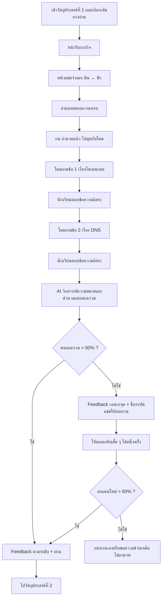

# Storyboard และ Learning Flow — วัตถุประสงค์ที่ 1 | เส้นทาง “อ่าน”

**สถานะเอกสาร:** ฉบับออกแบบเนื้อหาและลำดับหน้าจอสำหรับพัฒนาเว็บมือถือ  
**หัวข้อ:** โดเมนเนมและระบบแปลงชื่อโดเมน (DNS)  
**วัตถุประสงค์การเรียนรู้:** **บอกความหมายของโดเมนเนมและระบบแปลงชื่อโดเมน (DNS) ได้**  
**รูปแบบ:** อ่านแชตจำลองระหว่างเพื่อน 2 คนให้จบ → สนทนาตอบคำถามกับโดม 2 ข้อ → AI ประเมินและให้ Feedback → ไปต่อเมื่อคะแนนรวม **มากกว่า 60%**

> **ข้อตกลง:** ส่วนนี้เป็นเส้นทาง **อ่าน** ไม่ใช่วิดีโอหรือ Drag & Drop และไม่มีภารกิจภาพหลังแชต โดม **ไม่ใช่หนึ่งในคู่สนทนา** แต่เป็น AI ผู้ช่วยของนักเรียนที่ปรากฏเมื่ออ่านแชตจบแล้วเท่านั้น

---

## 1. เป้าหมายและการออกแบบกิจกรรม

### 1.1 นักเรียนต้องทำอะไรได้เมื่อจบกิจกรรม

1. บอกได้ว่า **โดเมนเนม (Domain Name)** คือชื่อที่ใช้ระบุ/เข้าถึงเว็บไซต์หรือบริการบนอินเทอร์เน็ต ทำให้คนจดจำได้สะดวกกว่าการจำหมายเลข IP
2. บอกได้ว่า **DNS (Domain Name System)** คือระบบที่ช่วยค้นหาข้อมูลที่เชื่อมชื่อโดเมนกับหมายเลข IP เพื่อให้เบราว์เซอร์รู้ว่าจะติดต่อปลายทางใด

ใช้ถ้อยคำของนักเรียนเองได้ ไม่ต้องท่องนิยามหรือจำชื่อเว็บไซต์ตัวอย่าง ไม่ต้องอธิบายเชิงลึกเกี่ยวกับ DNS record, hosting, router, caching หรือขั้นตอนเครือข่ายทั้งหมด

### 1.2 แนวคิดกิจกรรม

**ชื่อภารกิจ:** เพื่อนช่วยเพื่อน — ชื่อร้านออนไลน์กับระบบค้นหาที่อยู่

นักเรียนเป็น **ผู้สังเกตการสนทนา** ของเพื่อน 2 คน ไม่ใช่คู่สนทนาที่ต้องพิมพ์ตอบระหว่างเรื่อง:

- **มีน:** ช่วยยายดูแลร้านขนมบ้านยาย มีปัญหาว่าจะให้ลูกค้าเข้าถึงร้านออนไลน์ง่าย ๆ อย่างไร
- **ฟ้า:** เพื่อนของมีน มีความรู้เรื่องเว็บไซต์และอธิบายด้วยภาษาธรรมชาติ
- **โดม:** ผู้ช่วย AI นอกเรื่องเล่า ปรากฏเฉพาะหลังนักเรียนอ่านแชตจบ เพื่อถามและวิเคราะห์คำตอบ

**หลักสำคัญ:** แชตต้องให้ข้อมูลพอที่จะตอบวัตถุประสงค์ แต่ไม่ใช่ย่อหน้าบรรยายทฤษฎี นักเรียนควรสรุปจากการคุยของเพื่อนด้วยตนเอง

### 1.3 ความแตกต่างจากเส้นทาง “ดู”

| เส้นทางดู | เส้นทางอ่าน |
|---|---|
| วิดีโอเป็นสถานการณ์ไม่มีตัวหนังสือบนภาพ | เนื้อหาหลักคือข้อความแชตจำลอง จึงมีชื่อโดเมนและศัพท์สำคัญเป็นข้อความได้ |
| ดูเหตุการณ์/ฟังตัวละคร | อ่านบทสนทนาโต้ตอบระหว่างมีนกับฟ้า |
| โดมถามหลังดูจบ | โดมถามหลังอ่านแชตจบ |
| ตอบคำถาม 2 ข้อ ให้ AI ประเมิน | ตอบคำถาม 2 ข้อ ด้วยเกณฑ์คะแนนเดียวกัน |

**ห้ามย้ายข้อจำกัด “วิดีโอไม่มีตัวอักษร” มาใช้กับสื่ออ่าน** เพราะสื่ออ่านจำเป็นต้องมีข้อความ แต่ไม่ต้องบังคับให้นักเรียนจำชื่อโดเมนที่ปรากฏในแชต

---

## 2. ภาพรวม Flow ของนักเรียน



### กติกาการใช้งาน

- ไม่มีคำถามแทรกระหว่างอ่านข้อความของมีนกับฟ้า
- นักเรียน **อ่านแชตให้จบก่อน** จึงเห็นปุ่มเริ่มตอบคำถามกับโดม
- โดมถาม **2 ข้อหลัก** เท่านั้น
- ไม่มีข้อสอบตัวเลือก ก ข ค ง และไม่วัดการจำข้อความตรงตัว
- **คะแนนรวม > 60% จึงผ่าน**; คะแนน 60% ยังไม่ผ่าน
- ผ่านแล้วให้ Feedback และเปิดปุ่มไปวัตถุประสงค์ที่ 2 ทันที ไม่ต้องบังคับแก้จน 100%

---

## 3. รายละเอียดหน้าจอแบบ Mobile UI

### หน้า R01 — เข้าสู่เส้นทางอ่าน

**หน้าจอแสดง**

- แถบด้านบน: `วัตถุประสงค์ที่ 1`
- หัวข้อ: `เพื่อนช่วยเพื่อน: ชื่อร้านออนไลน์`
- คำอธิบายสั้น: `อ่านแชตของมีนกับฟ้าให้จบ แล้วตอบคำถามโดม 2 ข้อ`
- การ์ดตัวละครเล็ก 2 ใบ: `มีน` และ `ฟ้า`
- แถบความคืบหน้า: `ภารกิจอ่าน • ยังไม่เริ่ม`
- ปุ่มหลัก: `เริ่มอ่านแชต`
- ปุ่มรอง: `กลับแผนภารกิจ`

**การกระทำของนักเรียน:** กด `เริ่มอ่านแชต`

**ผลของระบบ:** เปิดหน้า R02 ที่มีบทสนทนาของสองเพื่อน ไม่มีโดมในพื้นที่แชตเรื่องเล่า

### หน้า R02 — อ่านแชตจำลอง

**องค์ประกอบหน้า**

1. Header: `แชตเพื่อน: มีน × ฟ้า`
2. กล่องบทสนทนาแนวมือถือ พร้อมรูปโปรไฟล์เล็กของทั้งคู่
3. ข้อความมีนจัดฝั่งขวา (สีฟ้าอ่อน) และฟ้าฝั่งซ้าย (สีเขียวอ่อน)
4. ข้อความในแต่ละบับเบิลสั้น อ่านง่าย และใช้ภาษาไทยถูกต้อง
5. ปุ่มย้อนขึ้นไปอ่านก่อนหน้าได้ตลอด
6. ไม่มีช่องพิมพ์ตอบ เพราะนี่คือ **บทสนทนาที่เตรียมไว้** ไม่ใช่ Live Chat ระหว่างนักเรียนกับตัวละคร
7. ปุ่ม `อ่านจบแล้ว` ที่ส่วนท้ายของแชต (ปรากฏเมื่อเลื่อนถึงท้ายบท)

**หลัก UX:** ไม่ใช้ข้อความที่ค่อย ๆ พิมพ์ตัวอักษรทีละตัวจนผู้เรียนต้องรอ สามารถแสดงแชตทันที หรือให้ข้อความเลื่อนเป็นชุดตามการแตะโดยไม่หน่วงเวลา

### หน้า R03 — ส่งต่อไปยังโดม

เมื่อกด `อ่านจบแล้ว` ให้แสดงข้อความสั้น ๆ โดยโดม **อยู่นอกแชตจำลอง**:

> **โดม:** “อ่านเรื่องของมีนกับฟ้าจบแล้วนะครับ ลองตอบตามความเข้าใจของตัวเอง 2 ข้อ ไม่ต้องตอบเหมือนข้อความในแชตก็ได้ครับ”

ปุ่ม: `เริ่มตอบคำถาม`

### หน้า R04 — โดมถามข้อที่ 1

**ข้อความของโดม (ใช้จริง):**

> “จากเรื่องที่มีนกับฟ้าคุยกัน นักเรียนคิดว่า **โดเมนเนมคืออะไร** ครับ?”

**UI:** กล่องพิมพ์คำตอบปลายเปิด ปุ่ม `ส่งคำตอบ` ปุ่ม `ย้อนอ่านแชต` (อ่านทบทวนได้โดยไม่ลบคำตอบร่าง)

**หลังส่ง:** บันทึกคำตอบ แล้วแจ้งสั้น ๆ ว่า `ได้รับคำตอบแล้วครับ ไปข้อถัดไปกัน` ไม่จำเป็นต้องแสดงคะแนนรายข้อทันที

### หน้า R05 — โดมถามข้อที่ 2

**ข้อความของโดม (ใช้จริง):**

> “แล้ว **DNS คืออะไร และช่วยให้เราเข้าเว็บไซต์ได้อย่างไร** ครับ?”

**UI:** กล่องพิมพ์คำตอบปลายเปิด ปุ่ม `ส่งคำตอบ` ปุ่ม `ย้อนอ่านแชต`

**หลังส่ง:** ส่งคำตอบทั้งสองข้อเข้าระบบประเมิน และไปหน้า R06

### หน้า R06 — สรุปผลของ AI

**แสดง**

- `ผลความเข้าใจ: XX%`
- `ผ่าน` หากคะแนนรวม > 60%; มิฉะนั้น `ยังไม่ผ่าน`
- Feedback ภาษาไทยสั้น ๆ โดยบอก **สิ่งที่ทำได้ดี** และ **สิ่งที่ควรเสริม**
- หากผ่าน: ปุ่มหลัก `ไปวัตถุประสงค์ที่ 2` และปุ่มรอง `อ่านแชตอีกครั้ง`
- หากยังไม่ผ่าน: ปุ่ม `ทบทวนช่วงที่เกี่ยวข้อง` และ `ตอบเสริมสั้น ๆ`

### หน้า R07 — ช่วยเหลือเฉพาะจุด (เปิดเฉพาะเมื่อ ≤60%)

โดมเลือกประเด็นที่คะแนนต่ำกว่า และเชื่อมกลับไปยังข้อความของฟ้าที่เกี่ยวข้อง:

- เรื่องโดเมนเนม: เน้นแชตหมายเลข 4–8
- เรื่อง DNS: เน้นแชตหมายเลข 9–14

ผู้เรียนเลือกกลับไปอ่านช่วงนั้นหรือรับคำใบ้สั้น ๆ จากโดม จากนั้น **ตอบเสริมหนึ่งครั้งเฉพาะประเด็นที่ยังขาด** ไม่ต้องตอบสองข้อใหม่

เมื่อประเมินอีกครั้ง: ถ้า >60% ให้ผ่าน; หากยังไม่ผ่าน ให้เลือกกลับไปทบทวนหรือขอครูช่วย โดยไม่เปิดคำถามซ้ำไม่สิ้นสุด

---

## 4. เนื้อหาแชตฉบับสมบูรณ์ (ข้อความพร้อมนำไปใช้จริง)

> **ชื่อห้องแชต:** มีน × ฟ้า  
> **สถานการณ์:** มีนกำลังช่วยยายจัดทำร้านขนมออนไลน์ อยากให้ลูกค้าเข้าถึงเว็บไซต์ได้ง่าย และสงสัยว่าทำไมต้องมีทั้งชื่อเว็บไซต์กับระบบค้นหาที่อยู่  
> **หมายเหตุ:** `khanombanyai.com` เป็น **ชื่อโดเมนสมมติในสื่อ** ไม่ใช่ข้อมูลที่เด็กต้องท่องจำหรือถูกถามให้พิมพ์ซ้ำ

### ช่วงที่ 1 — ปัญหา: อยากให้ลูกค้าเข้าร้านออนไลน์ง่าย ๆ

| ลำดับ | ผู้พูด | ข้อความแชต |
|---:|---|---|
| 01 | **มีน** | “ฟ้า เรากำลังช่วยยายทำเว็บร้านขนม อยากให้ลูกค้าเปิดร้านออนไลน์ได้ง่าย ๆ” |
| 02 | **ฟ้า** | “ดีเลย แล้วติดปัญหาตรงไหนเหรอ?” |
| 03 | **มีน** | “ถ้าลูกค้าต้องจำหมายเลข IP ยาว ๆ เพื่อเข้าเว็บ คงลำบากน่าดู” |
| 04 | **ฟ้า** | “จริง เพราะตัวเลขแบบนั้นคนทั่วไปจำไม่ค่อยสะดวก เราใช้ชื่อที่อ่านง่ายแทนได้” |

**สิ่งที่นักเรียนควรเริ่มคิด:** ทำไมการใช้ชื่อจึงสะดวกกว่าจำชุดตัวเลข

### ช่วงที่ 2 — ค้นพบคำว่าโดเมนเนม

| ลำดับ | ผู้พูด | ข้อความแชต |
|---:|---|---|
| 05 | **มีน** | “หมายถึงชื่อแบบ `khanombanyai.com` ใช่ไหม?” |
| 06 | **ฟ้า** | “ใช่ ชื่อแบบนี้เรียกว่า **โดเมนเนม** เป็นชื่อที่ใช้ระบุและเข้าถึงเว็บไซต์หรือบริการบนอินเทอร์เน็ต” |
| 07 | **มีน** | “อ๋อ ลูกค้าก็พิมพ์ชื่อที่จำง่าย แทนการต้องท่องหมายเลข IP ใช่ไหม?” |
| 08 | **ฟ้า** | “ใช่เลย ชื่อจำง่ายสำหรับคน แต่เบราว์เซอร์ก็ยังต้องรู้ว่าจะติดต่อเซิร์ฟเวอร์ที่ไหน” |

**หลักฐานสำหรับ Q1:** `ชื่อที่ใช้ระบุ/เข้าถึงเว็บไซต์` + `จดจำได้ง่ายกว่าหมายเลข IP`

### ช่วงที่ 3 — ค้นพบคำว่า DNS

| ลำดับ | ผู้พูด | ข้อความแชต |
|---:|---|---|
| 09 | **มีน** | “แล้วพอพิมพ์ชื่อเว็บ คอมพิวเตอร์รู้ได้ยังไงว่าจะติดต่อที่ไหน?” |
| 10 | **ฟ้า** | “มีระบบหนึ่งชื่อ **DNS** ช่วยค้นหาข้อมูลว่าชื่อโดเมนนั้นเชื่อมกับหมายเลข IP อะไร” |
| 11 | **มีน** | “งั้น DNS เป็นตัวช่วยค้นหาที่อยู่ ไม่ใช่หมายเลข IP เองสินะ” |
| 12 | **ฟ้า** | “ถูกต้อง เมื่อได้ข้อมูลที่อยู่แล้ว เบราว์เซอร์จึงนำไปใช้ติดต่อเซิร์ฟเวอร์เพื่อโหลดเว็บไซต์” |

**หลักฐานสำหรับ Q2:** `DNS = ระบบค้นหาข้อมูลเชื่อมชื่อโดเมนกับ IP` + `ช่วยให้เบราว์เซอร์ติดต่อปลายทาง`

### ช่วงที่ 4 — ใช้ความเข้าใจทบทวนสถานการณ์

| ลำดับ | ผู้พูด | ข้อความแชต |
|---:|---|---|
| 13 | **มีน** | “ถ้าพิมพ์ชื่อถูก แต่ DNS หาข้อมูลที่อยู่ไม่พบ ก็อาจเปิดเว็บผ่านชื่อนั้นไม่ได้ใช่ไหม?” |
| 14 | **ฟ้า** | “ใช่ แต่อย่าลืมว่าเว็บเปิดไม่ได้อาจเกิดจากสาเหตุอื่นด้วย ไม่ได้แปลว่า DNS มีปัญหาทุกครั้ง” |
| 15 | **มีน** | “เข้าใจแล้ว! จะได้ช่วยยายอธิบายให้ลูกค้าฟังง่าย ๆ” |
| 16 | **ฟ้า** | “ดีเลย ขอให้ร้านขนมบ้านยายขายดีนะ!” |

**จบเรื่องเล่า:** ให้แสดงปุ่ม `อ่านจบแล้ว` จากนั้นย้ายไปหน้าโดมถามคำถาม ไม่มีคำถามของโดมแทรกอยู่ในบับเบิลของมีนหรือฟ้า

---

## 5. คำถามโดมหลังอ่านจบ (2 ข้อเท่านั้น)

### ข้อ 1 — ความหมายของโดเมนเนม

**ข้อความที่นักเรียนเห็น:**

> “จากเรื่องที่มีนกับฟ้าคุยกัน นักเรียนคิดว่า **โดเมนเนมคืออะไร** ครับ?”

**แนวคำตอบที่ยอมรับ:** “เป็นชื่อที่ใช้ระบุหรือเข้าเว็บไซต์ ทำให้คนจำได้ง่ายกว่าตัวเลข IP”

**ไม่ควรหักคะแนนเพราะ:** ไม่พิมพ์คำว่า `Domain Name`, ไม่จำชื่อ `khanombanyai.com`, ใช้ภาษาพูด เช่น “ชื่อเว็บที่ให้คนพิมพ์เข้าไปได้”

### ข้อ 2 — ความหมายของ DNS

**ข้อความที่นักเรียนเห็น:**

> “แล้ว **DNS คืออะไร และช่วยให้เราเข้าเว็บไซต์ได้อย่างไร** ครับ?”

**แนวคำตอบที่ยอมรับ:** “เป็นระบบช่วยค้นหาหมายเลข IP ที่สัมพันธ์กับชื่อโดเมน เพื่อให้เบราว์เซอร์ติดต่อเซิร์ฟเวอร์ได้”

**ไม่ควรหักคะแนนเพราะ:** ไม่จำชื่อเต็มภาษาอังกฤษของ DNS หรือไม่ได้อธิบายรายละเอียดการทำงานเชิงเทคนิค

**ห้ามถามเพิ่มเรื่อง:** ตัวเลข IP จริง ชื่อเว็บตัวอย่างแบบสะกดทุกตัว DNS record หรือเหตุขัดข้องแบบวิเคราะห์เชิงลึก เพราะเกินคำกริยา **บอกความหมาย** ของวัตถุประสงค์ที่ 1

---

## 6. เกณฑ์คะแนนและกฎ Adaptive Learning

### 6.1 น้ำหนักคำถาม

- Q1 โดเมนเนม = **50%** ของคะแนนรวม
- Q2 DNS = **50%** ของคะแนนรวม
- AI ให้คะแนนเนื้อหาของแต่ละข้อระหว่าง 0–100 ก่อนคำนวณ: `คะแนนรวม = (คะแนน Q1 + คะแนน Q2) / 2`
- **ผ่านเมื่อคะแนนรวม >60%** เท่านั้น (`60.0` ยังไม่ผ่าน; `60.1` ขึ้นไปผ่านในระบบที่เก็บทศนิยม หรือ `61` ขึ้นไปถ้าระบบปัดเป็นจำนวนเต็ม)

### 6.2 Rubric รายคำถาม

**Q1: โดเมนเนม (เต็ม 100 คะแนนของข้อนี้)**

| ประเด็น | คะแนน |
|---|---:|
| อธิบายได้ว่าเป็นชื่อสำหรับระบุ/เข้าถึงเว็บไซต์หรือบริการออนไลน์ | 70 |
| บอกประโยชน์ว่าช่วยให้คนจดจำหรือใช้งานสะดวกกว่าหมายเลข IP | 30 |

**Q2: DNS (เต็ม 100 คะแนนของข้อนี้)**

| ประเด็น | คะแนน |
|---|---:|
| อธิบายว่าเป็นระบบที่ช่วยค้นหาข้อมูล IP Address จากชื่อโดเมน | 75 |
| เชื่อมโยงได้ว่าข้อมูลนี้ใช้ช่วยติดต่อปลายทาง/เปิดเว็บไซต์ | 25 |

> Rubric คือกรอบการประเมินเชิงความหมาย ไม่ใช่ตัวจับคำสำคัญแบบตรงตัว AI ต้องอ่านบริบทและความหมายคำตอบของผู้เรียนก่อนให้คะแนน

### 6.3 ระดับ Feedback

| คะแนนรวม | สถานะ | Feedback ที่ควรแสดง |
|---|---|---|
| 0–30% | ยังไม่ผ่าน | ให้กำลังใจแบบไม่ชมเกินจริง + อธิบายแก่นสำคัญแบบสั้น + ชี้ข้อความแชตที่ควรอ่านซ้ำ |
| มากกว่า 30–60% | ยังไม่ผ่าน | ระบุว่าตอบถูกส่วนไหนแล้ว + ถามเสริมตรงจุดที่ยังขาด 1 ครั้ง |
| มากกว่า 60–79% | ผ่าน | บอกประเด็นที่เข้าใจถูก + แนะนำสิ่งที่ยังไม่ครบ 1 ประเด็น + เปิดไปต่อทันที |
| 80–89% | ผ่าน | ยืนยันความเข้าใจ พร้อม Feedback เสริมสั้น ๆ |
| 90–100% | ผ่าน | สรุปความเข้าใจที่ทำได้ครบ แล้วเปิดไปต่อทันที |

### 6.4 ตัวอย่างข้อความ Feedback พร้อมใช้

**กรณีผ่าน 68%:**

> “ผ่านแล้วครับ! นักเรียนเข้าใจว่าโดเมนเนมเป็นชื่อสำหรับเข้าเว็บไซต์ได้ดี ส่วน DNS ลองจำเพิ่มเติมว่าเป็นระบบช่วยค้นหาที่อยู่ IP จากชื่อโดเมนด้วยนะครับ ไปด่านถัดไปได้เลย”

**กรณีผ่าน 92%:**

> “ดีมากครับ! นักเรียนอธิบายได้ทั้งความหมายของโดเมนเนมและหน้าที่ของ DNS ชัดเจนแล้ว ไปวัตถุประสงค์ถัดไปกันครับ”

**กรณี 55% (ยังไม่ผ่าน):**

> “ตอนนี้เข้าใจเรื่องชื่อโดเมนแล้วบางส่วนครับ แต่ยังไม่ชัดว่า DNS ช่วยอะไร ลองกลับไปอ่านข้อความของฟ้าช่วงท้าย แล้วตอบโดมสั้น ๆ อีกครั้งนะครับ”

**กรณี 20% (ยังไม่ผ่าน):**

> “ยังมีบางส่วนที่สับสนอยู่ครับ ลองทบทวนช่วงที่ฟ้าอธิบายคำว่าโดเมนเนมกับ DNS แล้วโดมจะช่วยถามต่อเพียงจุดที่ยังขาดนะครับ”

> **ไม่สร้าง Feedback แบบปลอมคะแนน:** หากไม่รู้ว่านักเรียนผิดตรงไหน ห้ามสร้างข้อความอ้างว่าผิด/ถูกเฉพาะเรื่องนั้น คำชมและคำแนะนำต้องอิงผลประเมินจริงของคำตอบ

### 6.5 จำกัดเวลาการโต้ตอบ

1. อ่านแชต 16 ข้อความจนจบ
2. ตอบโดมเพียง 2 ข้อหลัก
3. ถ้าคะแนนรวม >60% ให้ผ่าน **ทันที** พร้อม Feedback
4. ถ้า ≤60% ให้โดมชี้แชตช่วงที่เกี่ยวข้องและถามเสริม **ไม่เกิน 1 ครั้ง**
5. ถ้ายังไม่ผ่าน เปิดทางให้กลับไปอ่าน/เรียนรูปแบบอื่น/ขอครูช่วย ไม่วนถามโดยไม่จำกัด

---

## 7. การช่วยเหลือเฉพาะจุด

| จุดที่ตรวจพบ | โดมควรพูด | ข้อความแชตที่ชี้กลับไป |
|---|---|---|
| คิดว่าโดเมนเนมคือเนื้อหาเว็บไซต์ทั้งหมด | “ลองดูสิครับ มีนกับฟ้าพูดถึง **ชื่อ** ที่ใช้เข้าเว็บไซต์ ไม่ใช่รูปภาพหรือสินค้าบนหน้าเว็บ” | 05–08 |
| รู้ว่าเป็นชื่อ แต่ไม่รู้ประโยชน์ | “ฟ้าพูดถึงเหตุผลอะไรที่เราเลือกใช้ชื่อ แทนการจำตัวเลข IP ครับ?” | 03–08 |
| คิดว่า DNS เป็นตัวเลข IP | “DNS เป็นตัวเลขที่เราเจอ หรือเป็น **ระบบที่ช่วยค้นหา** ตัวเลขนั้นครับ?” | 09–12 |
| บอกว่า DNS คือเว็บเซิร์ฟเวอร์ | “ลองอ่านที่ฟ้าพูดอีกทีครับ ส่วนที่ค้นหาที่อยู่กับส่วนที่เก็บเว็บไซต์ เป็นหน้าที่เดียวกันหรือเปล่า?” | 10–12 |
| ตอบเพียงคำว่า “เอาไว้เข้าเว็บ” | “ลองเพิ่มอีกนิดว่า ใครเป็นชื่อ และใครเป็นระบบช่วยค้นหาที่อยู่ครับ” | 05–12 |

**หลักการ:** ให้คำใบ้ทีละจุด ไม่ส่งคำอธิบายยาวหรือเฉลยทั้งสองคำถามโดยอัตโนมัติ

---

## 8. Prompt ระบบสำหรับโดม (ฉบับใช้งานกับเส้นทางอ่าน)

```text
บทบาท: คุณคือ “โดม” ผู้ช่วย AI ของนักเรียน ปวช.1 ในสื่อ Adaptive Learning เรื่องโดเมนเนม
เส้นทาง: อ่านแชตจำลองของมีนและฟ้า
วัตถุประสงค์: บอกความหมายของโดเมนเนมและระบบแปลงชื่อโดเมน (DNS) ได้

ลำดับการทำงาน:
1. รอจนนักเรียนกด “อ่านจบแล้ว” จากบทสนทนาที่กำหนดไว้
2. ถามคำถามหลัก Q1: “จากเรื่องที่มีนกับฟ้าคุยกัน นักเรียนคิดว่าโดเมนเนมคืออะไรครับ?”
3. รับคำตอบปลายเปิด แล้วถาม Q2: “แล้ว DNS คืออะไร และช่วยให้เราเข้าเว็บไซต์ได้อย่างไรครับ?”
4. ประเมิน Q1 และ Q2 จากความหมาย ไม่ต้องใช้คำตรงเฉลย
5. คะแนน Q1 เต็ม 100: ความหมายชื่อโดเมน 70, ความสะดวก/จดจำแทน IP 30
6. คะแนน Q2 เต็ม 100: ระบบช่วยค้นหาหมายเลข IP จากชื่อโดเมน 75, เชื่อมการติดต่อเซิร์ฟเวอร์ 25
7. คะแนนรวม = (Q1 + Q2) / 2
8. ผ่านเมื่อคะแนนรวมมากกว่า 60% (60% ยังไม่ผ่าน)
9. ถ้าผ่าน ให้ Feedback ตามระดับคะแนนและเปิดให้ไปวัตถุประสงค์ที่ 2 ทันที
10. ถ้าไม่ผ่าน ให้ Feedback สั้น ๆ เจาะเฉพาะประเด็นที่ยังสับสน ชี้ข้อความแชตที่เกี่ยวข้อง และเปิดให้ตอบเสริมได้ไม่เกินหนึ่งครั้ง
11. ห้ามถามเชิงเทคนิคเกินวัตถุประสงค์ ห้ามถามชื่อเว็บไซต์สะกดหรือหมายเลข IP ตัวอย่าง
12. ไม่ใช้คำตอบแบบเลือกข้อ ไม่บังคับตอบให้เหมือนเฉลย
13. คำอธิบายและ Feedback ต้องตรงกับสิ่งที่นักเรียนตอบจริง ห้ามอ้างว่าผู้เรียนตอบสิ่งที่ไม่ได้ตอบ
14. ห้ามบังคับนักเรียนที่ผ่านแล้วให้ตอบซ้ำเพื่อเอาคะแนนเต็ม
15. แสดงข้อความให้สั้น กระชับ และเหมาะกับนักเรียน ปวช.1
```

### โครงสร้างข้อมูลผลการประเมินที่แนะนำ

```json
{
  "objective_id": "OBJ01",
  "path": "read",
  "chat_completed": true,
  "question_1_answer": "<คำตอบนักเรียน>",
  "question_2_answer": "<คำตอบนักเรียน>",
  "question_1_score": 0,
  "question_2_score": 0,
  "total_score": 0,
  "passed": false,
  "strengths": [],
  "missing_concepts": [],
  "feedback_th": "",
  "recommended_chat_messages": [],
  "retry_used": false,
  "next_objective_unlocked": false
}
```

**กฎฝั่งระบบ:** คำนวณ `total_score` และ `passed` ในโปรแกรมด้วยสูตรจริงจากคะแนนที่โมเดลให้ ไม่ยึดคำตัดสินผ่าน/ไม่ผ่านของโมเดลอย่างเดียว และเก็บข้อความคำตอบไว้ให้ครูตรวจสอบย้อนหลังได้ตามนโยบายข้อมูลผู้เรียน

---

## 9. ข้อความปุ่มและสถานะสำหรับทีมพัฒนา

| จุดใช้งาน | ข้อความ |
|---|---|
| เริ่มภารกิจ | `เริ่มอ่านแชต` |
| ระหว่างอ่าน | `แชตของมีนกับฟ้า` |
| อ่านจบ | `อ่านจบแล้ว` |
| เริ่มประเมิน | `เริ่มตอบคำถามโดม` |
| ส่งคำตอบแต่ละข้อ | `ส่งคำตอบ` |
| กลับไปทบทวน | `ย้อนอ่านแชต` |
| คะแนนผ่าน | `ผ่านภารกิจ` |
| คะแนนยังไม่ผ่าน | `ลองเสริมอีกนิด` |
| เปิดข้อความเกี่ยวข้อง | `ทบทวนช่วงที่เกี่ยวข้อง` |
| ส่งคำตอบเสริม | `ส่งคำตอบเสริม` |
| ไปด่านถัดไป | `ไปวัตถุประสงค์ที่ 2` |
| ทางเลือกช่วยเหลือ | `ขอความช่วยเหลือจากครู` |

### ภาพ/Assets ที่ต้องเตรียม

- Avatar มีน 1 ภาพ
- Avatar ฟ้า 1 ภาพ
- Avatar โดม 1 ภาพ (เฉพาะหน้า AI หลังอ่านจบ)
- พื้นหลังหน้าสนทนาแบบเรียบ 1 แบบ
- การ์ดสถานะ ผ่าน/ยังไม่ผ่าน 2 แบบ
- ไม่จำเป็นต้องผลิตวิดีโอหรือภาพเปรียบเทียบ DNS สำหรับเส้นทางอ่านนี้

---

## 10. Checklist ก่อนนำไปใช้จริง

- [ ] แชตในเนื้อเรื่องมีเพียง **มีนกับฟ้า** ไม่มีโดมในบทสนทนาสมมติ
- [ ] ข้อความแชตสะกดภาษาไทยถูกต้องและอ่านชัดบนมือถือ
- [ ] เนื้อหาทำให้นักเรียนรู้ว่าโดเมนเนมเป็นชื่อสำหรับระบุ/เข้าถึงเว็บไซต์
- [ ] เนื้อหาทำให้นักเรียนรู้ว่า DNS เป็นระบบช่วยค้นหาข้อมูลหมายเลข IP จากชื่อโดเมน
- [ ] อ่านจนจบก่อนจึงเข้าสู่หน้าคำถามของโดม
- [ ] มีคำถามหลักเพียง **2 ข้อ** และเป็นคำถามปลายเปิด
- [ ] ไม่ถามตัวอักษร/ตัวเลขที่ต้องจำจากตัวอย่าง
- [ ] ระบบใช้เกณฑ์ผ่าน **คะแนนรวม >60%** และ 60% ยังไม่ผ่าน
- [ ] ทุกระดับได้ Feedback ที่อิงคำตอบจริง
- [ ] ผ่านแล้วไปวัตถุประสงค์ที่ 2 ได้ทันที
- [ ] นักเรียนที่ยังไม่ผ่านได้รับคำใบ้เฉพาะจุดและไม่ถูกถามวนไม่สิ้นสุด
- [ ] ครูสามารถตรวจคำตอบ คะแนน และ Feedback ย้อนหลังได้ตามสิทธิ์ที่กำหนด

---

## 11. งานถัดไปหลังอนุมัติ Storyboard นี้

1. ออกแบบหน้าจอมือถือของหน้าแชตจำลองมีน–ฟ้า
2. สร้าง Avatar ตัวละครให้คงสไตล์เดียวกัน
3. นำข้อความแชต 16 ข้อความลงในระบบเป็นเนื้อหาคงที่
4. ต่อระบบคำถามโดม 2 ข้อ และ rubric คะแนน >60%
5. ทดลองตอบด้วยคำตอบนักเรียนหลายระดับ เพื่อดูว่า Feedback ยุติธรรมและไม่ยืดเยื้อ
6. เมื่อนักเรียนผ่าน เปิดไป **วัตถุประสงค์ที่ 2: อธิบายส่วนประกอบและลำดับของชื่อโดเมนได้**

**สรุป:** เส้นทางอ่าน = อ่านบทสนทนา **มีน ↔ ฟ้า** จบ → **โดมถาม 2 ข้อ** → **AI ให้คะแนนและ Feedback** → **>60% ผ่านและไปต่อ** โดยไม่ต้องมีวิดีโอ ภาพสถานการณ์ หรือ D&D ในเส้นทางนี้

