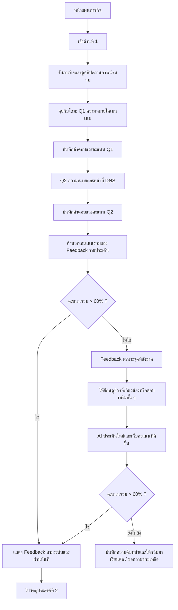

# แผนการเรียนรู้ วัตถุประสงค์ที่ 1 — เส้นทาง “ดูวิดีโอ” (ฉบับปรับแก้)

> **สถานะ:** ฉบับปรับเกณฑ์ผ่านและ Feedback — 15 ตุลาคม 2569  
> **เรื่อง:** ระบบชื่อโดเมน  
> **วัตถุประสงค์ที่ 1:** **บอกความหมายของโดเมนเนมและระบบแปลงชื่อโดเมน (DNS) ได้**  
> **เส้นทาง:** เข้าด่าน → รับภารกิจ → ดูคลิปสถานการณ์ → ตอบโดม 2 คำถาม → AI คำนวณคะแนนและให้ Feedback ตามระดับ → **คะแนนรวมมากกว่า 60% ผ่านทันที** → ไปวัตถุประสงค์ที่ 2  
> **ตัดออก:** ภารกิจภาพหลังคลิป และ D&D ในเส้นทาง “ดู” ของวัตถุประสงค์นี้

## 0. ข้อตกลงเรื่องคลิปที่ต้องยึดเป็นหลัก

**วิดีโอที่นักเรียนดูจริงจะไม่มีตัวอักษรหรือตัวเลขใด ๆ บนภาพเลย** ไม่ใช่แค่ห้าม AI สร้างข้อความผิดเท่านั้น แต่ **ไม่ต้องนำตัวอักษรหรือเลขมาใส่ทับในขั้นตัดต่อด้วย** ตามแนวทางที่ผู้ผลิตกำหนด

- ไม่มีคำว่า `Domain Name`, `DNS`, `IP Address` แสดงบนจอ
- ไม่มีชื่อเว็บไซต์ เช่น `khanombanyai.com` และไม่มีหมายเลข IP ปรากฏบนจอ
- ไม่มีป้ายร้านที่มีตัวหนังสือ ไม่มีข้อความบนโทรศัพท์/คอมพิวเตอร์ ไม่มีซับไตเติล ไม่มีกราฟิกตัวอักษรหรือเลข
- มีเพียง **ตัวละคร ภาพสถานการณ์ ภาพจำลองกระบวนการที่ใช้อุปกรณ์/ไอคอน/ลูกศร และบทพูดภาษาไทย (เสียง)**
- ในคลิป **ไม่มีโดม**; โดมเป็นผู้ช่วย AI บนหน้าระบบหลังดูคลิปเท่านั้น
- ผู้ผลิตเป็นผู้ตัดต่อคลิปเอง จึงสามารถใช้ภาพแอนิเมชันจาก Google Flow มาประกอบเสียงและลำดับเหตุการณ์ โดยไม่จำเป็นต้องพึ่งข้อความในวิดีโอ
- **ห้ามให้โดมถามว่าตัวละครพิมพ์ชื่อเว็บไซต์ว่าอะไร หมายเลข IP คือเลขอะไร ป้ายเขียนว่าอะไร หรือเห็นคำว่า DNS ตรงไหน** เพราะนักเรียนไม่เคยเห็นข้อมูลเหล่านั้นในวิดีโอ

**หมายเหตุด้านความถูกต้อง:** แม้สามารถเริ่มเล่าเรื่องโดยให้มีนพูดถึง “ที่อยู่ IP” ก่อน แล้วค่อยพูดถึง “DNS” และการเปิดหน้าเว็บได้ แต่เมื่อแสดงการทำงานด้วยภาพ ต้องสื่อทิศทางให้ถูกต้องว่า **ชื่อเว็บไซต์ → ระบบ DNS ช่วยค้นหาที่อยู่ IP → เบราว์เซอร์ติดต่อเว็บเซิร์ฟเวอร์ → หน้าเว็บปรากฏ** (ใช้ไอคอนแทนตัวอักษรทั้งหมด)

## 1. เป้าหมายของการเรียนรู้

เมื่อนักเรียนดูคลิปและตอบโดมเสร็จ ต้องทำได้เพียงสองเรื่องตามวัตถุประสงค์ ไม่ต้องอธิบายรายละเอียดเครือข่ายเชิงลึก

| ตัวชี้วัด | สิ่งที่นักเรียนบอกได้ | ยังไม่ต้องวัดในด่านนี้ |
|---|---|---|
| OBJ1-A — โดเมนเนม | เป็น **ชื่อที่ใช้เรียก/ระบุและเข้าถึงเว็บไซต์** ช่วยให้คนจดจำสะดวก | ชื่อโดเมนตัวอย่าง ลำดับส่วนประกอบ TLD โครงสร้าง URL |
| OBJ1-B — DNS | เป็น **ระบบที่ช่วยค้นหาที่อยู่ IP ที่สัมพันธ์กับชื่อโดเมน** เพื่อให้เปิด/ติดต่อเว็บไซต์ได้ | หมายเลข IP จริง, DNS record, DNS resolver, query protocol, การแก้ปัญหาเครือข่ายเชิงลึก |

เกณฑ์ต้องพิจารณา **ความหมาย** ไม่ใช่บังคับให้ใช้ถ้อยคำตามนิยามเป๊ะ ๆ นักเรียนอาจพูดว่า “ชื่อสำหรับเข้าเว็บ” หรือ “ระบบที่ช่วยหาที่อยู่ของเว็บจากชื่อ” ก็สามารถเป็นหลักฐานความเข้าใจได้ **การผ่านใช้คะแนนรวมมากกว่า 60%** จึงไม่บังคับให้คำตอบสมบูรณ์ทุกประเด็น แต่ต้องให้ Feedback ชัดเจนในส่วนที่ยังขาด

## 2. ภาพรวมการไหลของผู้เรียน



**กฎสำคัญของ Flow**

- มี **2 คำถามหลัก** เท่านั้น (โดเมนเนม 1 ข้อ และ DNS 1 ข้อ) นักเรียนไม่ต้องตอบคำถามเชิงเทคนิคเพิ่ม
- นักเรียน **ตอบ Q1 แล้วไป Q2 ได้เลย** แม้ Q1 จะได้คะแนนบางส่วน ไม่บังคับให้แก้ Q1 จนสมบูรณ์ก่อน
- ระบบให้คะแนนแต่ละข้อ 0–100 และคำนวณรวมโดยให้น้ำหนักเท่ากัน: **คะแนนรวม = (คะแนน Q1 + คะแนน Q2) ÷ 2**
- **คะแนนรวม > 60% = ผ่าน** (เช่น 61% ผ่าน, **60% ยังไม่ผ่าน**) ตามเกณฑ์ที่กำหนด
- เมื่อผ่านแล้ว ให้ Feedback ตามระดับความถูกต้องและปลดล็อกการเรียนต่อทันที **ไม่ต้องตอบซ้ำเพื่อเก็บ 100%**
- ถ้าคะแนนยังไม่เกิน 60% ให้โดมช่วยเฉพาะเรื่องที่ขาด โดยเริ่มจากคำใบ้สั้น ๆ หรือแนะนำช่วงคลิปที่ควรทบทวน ก่อนให้ตอบเสริมสั้น ๆ; หลีกเลี่ยงการถามซ้ำวนไม่จบ


## 3. รายละเอียดหน้าจอในเส้นทางมือถือ

### หน้าจอ 0 — แผนภารกิจ

**สิ่งที่แสดง:** ชื่อหน่วย `ระบบชื่อโดเมน` การ์ด `ด่านที่ 1: ชื่อเว็บไซต์กับ DNS` รูปแบบการเรียนรู้ `ดูวิดีโอ` สถานะ `ยังไม่เริ่ม/กำลังเรียน/ผ่านแล้ว` และปุ่ม `เข้าสู่ด่าน`

**นักเรียนทำ:** แตะ `เข้าสู่ด่าน` → หน้ารับภารกิจ

### หน้าจอ 1 — รับภารกิจ ก่อนดูคลิป

**องค์ประกอบ:**

- หัวข้อ: **ภารกิจที่ 1 — ช่วยลูกค้าเข้าเว็บไซต์ร้านขนมบ้านยาย**
- ภาพปกนิ่ง: มีนกับลูกค้าในร้านขนม (ภาพปกใน UI ใช้ข้อความได้ตามการออกแบบเว็บ แต่ไม่ใช่ข้อความในคลิป)
- สถานการณ์: **“ลูกค้าพยายามเข้าเว็บไซต์ร้านขนมบ้านยายแต่ไม่สำเร็จ มีนจึงเข้ามาช่วย ลองดูว่าเกิดอะไรขึ้น และมีระบบใดช่วยให้เข้าเว็บไซต์ได้”**
- คำแนะนำแบบง่าย: **“ดูเรื่องราวให้จบ แล้วตอบคำถามโดม 2 ข้อด้วยคำของตนเอง”**
- ปุ่มหลัก: `เริ่มดูวิดีโอ`
- ปุ่มรอง: `กลับแผนภารกิจ`

**ข้อควรระวัง:** ไม่เกริ่นว่าต้องจำชื่อเว็บหรือหมายเลข IP ใด ๆ เพราะข้อมูลประเภทนั้นไม่ได้ปรากฏบนหน้าวิดีโอ

### หน้าจอ 2 — ดูคลิปสถานการณ์

**องค์ประกอบเว็บ:** วิดีโอแนวนอน 16:9, ปุ่มเล่น/หยุด, เล่นซ้ำ, ย้อนดู, ระดับเสียง, ตัวบอกความคืบหน้า *ใน UI เว็บภายนอกตัวคลิป*, ปุ่ม `คุยกับโดม` ซึ่งปลดล็อกเมื่อรับชมครบ

**คลิปเอง:** แสดงภาพล้วน ๆ พร้อมเสียงบทสนทนา ไม่มีข้อความหรือตัวเลขในเฟรม ไม่ใส่ซับในวิดีโอ ไม่ใส่ชื่อเว็บไซต์หรือ IP ในกราฟิก

**สิ่งที่นักเรียนทำ:** ดูเหตุการณ์ → อาจย้อนดูเอง → เมื่อดูจบแตะ `คุยกับโดม`

#### 3.2.1 เหตุการณ์ของคลิป (ฉบับเล่าเรื่องง่าย)

> ใช้ **มีน ลูกค้า และยายเท่าที่จำเป็น**; ห้ามมีโดมในคลิป **บทพูดทั้งหมดเป็นเสียงพูด ไม่แสดงเป็นข้อความในภาพ**

| ช่วง/ฉาก | ภาพที่เห็น (ไม่มีตัวอักษรหรือตัวเลข) | บทพูดตัวอย่าง / เนื้อหาที่ได้ยิน | สิ่งที่นักเรียนควรเข้าใจ |
|---|---|---|---|
| 1. เกิดปัญหา | ลูกค้าถือมือถือ เข้าเว็บไม่สำเร็จ แสดงไอคอนโหลดไม่สำเร็จอย่างเรียบง่าย | ลูกค้า: **“หนูจะเข้าเว็บไซต์ร้าน แต่เปิดไม่ได้เลยค่ะ”** | มีปัญหาเรื่องการเข้าถึงเว็บไซต์ |
| 2. มีนเข้ามาช่วย | มีนและลูกค้าดูโทรศัพท์ร่วมกัน มีนลองเปิดเว็บในโน้ตบุ๊ก ช่องเบราว์เซอร์ว่าง ไม่มีอักษร | มีน: **“ลองให้มีนดูนะคะ ว่าเกิดอะไรขึ้น”** | มีนกำลังตรวจเส้นทางการเข้าเว็บ |
| 3. ชื่อที่คนใช้ | ลูกค้าชี้ไปยังสัญลักษณ์รูปโลก/หน้าเว็บ มีนชี้ไอคอนชื่อเว็บแบบไม่มีข้อความ | มีน: **“เวลาเราเข้าเว็บไซต์ เราใช้ชื่อเว็บที่จำง่าย ชื่อนี้เรียกว่าโดเมนเนมค่ะ”** | โดเมนเนมเป็นชื่อที่ช่วยให้คนเข้าถึงเว็บ |
| 4. ที่อยู่ของคอมพิวเตอร์ | ภาพเปรียบเทียบไอคอนชื่อเว็บ กับสัญลักษณ์ที่อยู่เครือข่ายและเซิร์ฟเวอร์ ไม่มีเลขใด ๆ | ลูกค้า: **“แล้วคอมพิวเตอร์รู้ได้ยังไงว่าเว็บอยู่ที่ไหนคะ?”** มีน: **“คอมพิวเตอร์ใช้ที่อยู่ IP ในการติดต่อกันค่ะ”** | มีที่อยู่ IP สำหรับติดต่อปลายทาง โดยไม่ต้องเห็นเลขจริง |
| 5. ระบบช่วยค้นหาที่อยู่ | ภาพไอคอนชื่อเว็บ → ไอคอนระบบค้นหา/สมุดที่อยู่ → ไอคอนเซิร์ฟเวอร์ พร้อมลูกศร ไม่ใส่ตัวอักษร | มีน: **“ระบบ DNS จะช่วยค้นหาที่อยู่ IP จากชื่อโดเมนที่เราใช้ค่ะ”** | DNS เป็นระบบค้นหาที่อยู่ที่สัมพันธ์กับชื่อโดเมน |
| 6. ไปถึงเว็บเซิร์ฟเวอร์ | ลูกศรจากไอคอนค้นหาที่อยู่ไปยังเซิร์ฟเวอร์ มีสัญญาณตอบกลับมาที่โน้ตบุ๊ก | ลูกค้า: **“แปลว่าพอรู้ที่อยู่ ก็ไปหาเว็บได้ใช่ไหมคะ?”** มีน: **“ใช่ค่ะ”** | หลังค้นหาที่อยู่ได้ เบราว์เซอร์ติดต่อเซิร์ฟเวอร์ |
| 7. เว็บไซต์เปิดได้ | หน้าร้านออนไลน์ที่มีภาพขนม/รูปสินค้าแบบ **ไม่มีตัวหนังสือ** ปรากฏบนโน้ตบุ๊ก | ลูกค้า: **“เข้าได้แล้วค่ะ!”** | เว็บไซต์โหลดและแสดงผลสำเร็จ |
| 8. จบเรื่อง | มีนกับลูกค้ายิ้ม ยายอยู่ในร้าน ฉากจบเปิดพื้นที่ชวนคิดโดยไม่เพิ่มข้อความ | มีน: **“ทีนี้ก็รู้แล้วนะคะว่าชื่อเว็บกับระบบช่วยหาที่อยู่ทำงานร่วมกันยังไง”** | พร้อมเล่าความเข้าใจของตนเองให้โดมฟัง |

**สำคัญ:** ถ้าสร้างวิดีโอคลิปสั้นด้วย Google Flow แยกฉาก ให้คงความต่อเนื่องของรูปลักษณ์ตัวละคร ฉาก เสียง และลำดับภาพ โดยผู้ผลิตเป็นผู้ตัดต่อให้เป็นเรื่องเดียวกัน บทด้านบนเป็นต้นแบบแก้ไขได้ตามความยาวคลิปจริง

**ตรวจความถูกต้อง:** หากแสดงลูกศรการค้นหา ต้องสื่อว่าระบบ DNS ค้นหา **ที่อยู่จากชื่อโดเมน** จากนั้นจึงติดต่อเซิร์ฟเวอร์ ไม่แสดงให้เข้าใจผิดว่า IP ต้องถูกส่งไปให้ DNS แปลงเป็นชื่อเพื่อเปิดเว็บ

### หน้าจอ 3 — สนทนากับโดม: คำถามที่ 1

**คำถามหลักบนหน้าแชท:**

> **โดม:** “จากสถานการณ์ในคลิป นักเรียนคิดว่า **โดเมนเนมคืออะไร** ครับ?”

**สิ่งที่นักเรียนทำ:** พิมพ์หรือพูดคำตอบอิสระ แล้วกด `ส่งคำตอบ`

**AI วิเคราะห์:** ผู้เรียนสื่อได้หรือไม่ว่าโดเมนเนมเป็น **ชื่อที่ใช้เรียก/ระบุหรือเข้าถึงเว็บไซต์** และช่วยให้คนจำสะดวกขึ้น โดยไม่ต้องจำตัวเลขที่อยู่

**ตัวอย่างคำตอบที่รับได้:**

> “โดเมนเนมคือชื่อเว็บที่คนใช้เข้าเว็บไซต์ จำง่ายกว่าการจำที่อยู่แบบตัวเลข”

**ตัวอย่างคำตอบที่ยังไม่ครบ:**

> “เป็นชื่อเว็บ” — ถือเป็นคำตอบที่มีสาระถูกต้องบางส่วน **ให้คะแนนตามเกณฑ์** ไม่ปัดเป็นศูนย์และไม่บังคับแก้ทันที

**หลังส่ง Q1:** ระบบบันทึกคำตอบและคะแนน Q1 ไว้ภายใน อาจให้ข้อความยืนยันสั้น ๆ เช่น **“โดมได้รับคำตอบแล้วครับ ไปคำถามต่อไปกันเลย”** จากนั้นเปิด Q2 ทันที เพื่อไม่ให้กระบวนการตอบยืดเยื้อ

**ความช่วยเหลือที่พร้อมใช้ภายหลัง:** `ย้อนดูช่วงมีนพูดถึงชื่อเว็บไซต์` (ฉาก 3) เมื่อภาพรวมคะแนนต่ำหรือคำตอบ Q1 ขาดสาระสำคัญ


### หน้าจอ 4 — สนทนากับโดม: คำถามที่ 2

**คำถามหลักบนหน้าแชท:**

> **โดม:** “จากสถานการณ์ในคลิป **DNS คืออะไร และช่วยอะไรในการเข้าเว็บไซต์** ครับ?”

**AI วิเคราะห์:** นักเรียนสื่อได้หรือไม่ว่า DNS เป็น **ระบบที่ช่วยค้นหา/แปลงชื่อโดเมนให้ได้ที่อยู่ IP** เพื่อช่วยให้เบราว์เซอร์เชื่อมต่อเว็บเซิร์ฟเวอร์ได้

**ตัวอย่างคำตอบที่รับได้:**

> “DNS คือระบบที่ช่วยหาที่อยู่ IP จากชื่อเว็บ ทำให้คอมพิวเตอร์รู้ว่าจะไปติดต่อที่ไหน”

**ตัวอย่างคำตอบที่ถูกบางส่วน:**

> “DNS ช่วยให้เข้าเว็บไซต์ได้” — มีความเกี่ยวข้องแต่ยังไม่แสดงบทบาทในการค้นหาที่อยู่ จึงให้ **คะแนนบางส่วน** พร้อม Feedback แนะนำคำที่ขาด

**หลังส่ง Q2:** AI คำนวณคะแนนรวมจาก Q1 และ Q2 แล้ว **ให้ Feedback เพียงรอบเดียวเป็นหลัก** โดยใช้ผลรายประเด็นประกอบ

- ถ้ารวม **มากกว่า 60%** → แสดงผล `ผ่าน` + Feedback ตามระดับ แล้วปลดล็อกวัตถุประสงค์ที่ 2 **ทันที**
- ถ้ารวม **60% หรือต่ำกว่า** → แสดงผล `ยังไม่ผ่าน` + Feedback เฉพาะจุดอ่อน และเสนอให้ย้อนดูช่วงที่เกี่ยวข้องหรือตอบเสริมสั้น ๆ
- ห้ามใช้การจำชื่อเว็บไซต์ เลข IP หรือการจำตัวอักษรในคลิปเป็นเกณฑ์ให้คะแนน เพราะคลิปไม่มีสิ่งเหล่านั้น


### หน้าจอ 5 — สถานะช่วยเหลือแบบ Adaptive (เมื่อคะแนนรวมยังไม่เกิน 60%)

แนวทางช่วยนักเรียนแบบ **สั้น กระชับ และไม่เพิ่มภาระเกินจำเป็น**

1. **บอกสิ่งที่เข้าใจถูกแล้วก่อน** เช่น “นักเรียนเข้าใจว่าโดเมนเนมเป็นชื่อเว็บแล้วครับ”
2. **ระบุสิ่งที่ยังขาดเพียง 1 ประเด็นที่สำคัญที่สุด** เช่น “แต่ยังไม่เห็นว่า DNS ช่วยค้นหาอะไรจากชื่อเว็บ”
3. **ให้คำใบ้สั้น ๆ หรือปุ่มย้อนดูช่วงเกี่ยวข้อง** — Q1: ฉาก 3 / Q2: ฉาก 4–6
4. **เปิดโอกาสตอบเสริมเฉพาะประเด็นนั้นหนึ่งครั้ง** โดยไม่ต้องตอบคำถามหลักทั้งสองข้อใหม่ จากนั้นประเมินคำตอบที่ดีที่สุดของแต่ละประเด็นอีกครั้ง
5. ถ้ายังไม่เกิน 60% ให้บันทึกความคืบหน้า พร้อมตัวเลือก `ย้อนดูคลิป`, `ลองอีกครั้งภายหลัง` หรือ `ขอความช่วยเหลือจากครู` โดยไม่ถามวนไม่จบ

**ตัวอย่างเมื่อได้คะแนนรวม 55%:**

> โดม: “นักเรียนอธิบายเรื่องชื่อเว็บไซต์ได้ดีแล้วครับ แต่เรื่อง DNS ยังขาดว่าระบบช่วยค้นหาที่อยู่ของเว็บไซต์อย่างไร ลองย้อนดูช่วงที่มีนอธิบายระบบค้นหาที่อยู่ แล้วตอบเสริมสั้น ๆ อีกครั้งนะครับ”

**หมายเหตุ:** สำหรับผู้เรียนที่ได้ **61% ขึ้นไป** ไม่ใช้ขั้นตอนนี้เป็นข้อบังคับ สามารถเลือกทบทวนเพิ่มเติมได้ด้วยตนเอง แต่ **ต้องปลดล็อกให้ไปต่อทันที**


### หน้าจอ 6 — หน้าสรุปคะแนนและ Feedback

**เงื่อนไขผ่าน:** **คะแนนรวมมากกว่า 60%** จากคำถาม Q1 และ Q2 ไม่จำเป็นต้องตอบครบทุกสาระย่อยจึงจะผ่าน

**องค์ประกอบที่แสดงในหน้า UI:** คะแนนรวม (เปอร์เซ็นต์), สถานะผ่าน/ยังไม่ผ่าน, สิ่งที่ทำได้ดี 1 ข้อ, สิ่งที่ควรเสริม 1 ข้อ (ถ้ามี), ข้อความให้กำลังใจแบบจริงใจ และปุ่มดำเนินการต่อ

**ตัวอย่างผู้เรียนได้ 70%:**

> **โดม:** “ผ่านภารกิจแล้วครับ! ได้ 70% นักเรียนเข้าใจว่าโดเมนเนมเป็นชื่อที่ใช้เข้าเว็บไซต์แล้ว ส่วน DNS ลองจำเพิ่มอีกนิดว่าเป็นระบบที่ช่วยหาที่อยู่ IP จากชื่อโดเมนนะครับ พร้อมไปด่านต่อไปได้เลย”

**ตัวอย่างผู้เรียนได้ 95%:**

> **โดม:** “ยอดเยี่ยมครับ! ได้ 95% อธิบายความหมายของโดเมนเนมและ DNS ได้ถูกต้องชัดเจน พร้อมไปด่านต่อไปแล้วครับ”

**ตัวอย่างผู้เรียนได้ 60%:**

> **โดม:** “ตอนนี้ได้ 60% ครับ เหลืออีกนิดเดียว ลองทบทวนส่วนที่ยังไม่ชัด แล้วตอบเสริมสั้น ๆ อีกครั้งนะครับ”

**ปุ่มเมื่อผ่าน:** `ไปวัตถุประสงค์ที่ 2` (ปุ่มหลัก), `ทบทวนด้วยตนเอง` (ปุ่มรอง), `กลับแผนภารกิจ`

**ปุ่มเมื่อยังไม่ผ่าน:** `ทบทวนเฉพาะจุด`, `ลองตอบเสริม`, `กลับแผนภารกิจ`


### หน้าจอ 7 — ไปวัตถุประสงค์ที่ 2

เมื่อกด `ไปวัตถุประสงค์ที่ 2` ระบบเปิดหน้าเริ่มเรียนหัวข้อ **“อธิบายส่วนประกอบและลำดับของชื่อโดเมนได้”** และเลือกเส้นทางเริ่มต้นตามกฎ Adaptive ของผู้เรียน ไม่ต้องทำภารกิจภาพหรือ D&D เพิ่มในเส้นทางดูของ OBJ1

## 4. วิธีให้คะแนนและ Feedback ตามระดับความถูกต้อง

### 4.1 คำถามและน้ำหนัก

มีคำถามหลักเพียง **2 ข้อ** และคิดคะแนนอย่างละ **50% ของคะแนนรวม**

| ข้อ | สิ่งที่ AI พิจารณา | คะแนนภายในข้อ |
|---|---|---:|
| **Q1: โดเมนเนมคืออะไร** | บอกได้ว่าเป็นชื่อที่ใช้ระบุ/เรียก/เข้าถึงเว็บไซต์ | 70 |
|  | บอกประโยชน์ว่าจำได้ง่ายหรือสะดวกกว่าการจำที่อยู่เป็นตัวเลข | 30 |
| **Q2: DNS คืออะไรและช่วยอย่างไร** | บอกได้ว่าเป็นระบบที่ช่วยค้นหา/แปลงชื่อโดเมนให้ได้ที่อยู่ IP ของเว็บไซต์ | 80 |
|  | เชื่อมโยงได้ว่าช่วยให้เบราว์เซอร์ติดต่อเซิร์ฟเวอร์หรือเข้าถึงเว็บไซต์ | 20 |

- **สูตร:** `คะแนนรวม (%) = (คะแนน Q1 + คะแนน Q2) / 2`
- **กฎผ่าน:** `คะแนนรวม > 60` (60 ยังไม่ผ่าน; 61 ผ่าน)
- ให้คะแนน **ตามใจความ** ไม่จำเป็นต้องใช้คำศัพท์เหมือนเฉลย; คำว่า “ที่อยู่ของเว็บไซต์” อาจใช้แทน “หมายเลข IP” ได้เมื่อบริบทชัดเจน
- หากคำตอบมีเพียงส่วนของเกณฑ์ย่อย ให้คะแนนเฉพาะส่วนนั้น ไม่ตัดสินเป็นผิดทั้งข้อ
- ถ้าผู้เรียนให้คำตอบขัดแย้งกับความหมายหลัก เช่น DNS เป็นตัวเว็บไซต์เอง AI ต้องลดคะแนนส่วนที่เกี่ยวข้อง พร้อมระบุความเข้าใจคลาดเคลื่อน
- **ไม่ใช้เปอร์เซ็นต์ความมั่นใจของโมเดลแทนคะแนนความถูกต้องของผู้เรียน** ควรใช้เกณฑ์คงที่เพื่อให้ตรวจสอบได้

**ตัวอย่างการรวมคะแนน:**

| คะแนน Q1 | คะแนน Q2 | รวม | ผล |
|---:|---:|---:|---|
| 100 | 40 | 70% | ผ่าน + Feedback เรื่อง DNS |
| 70 | 60 | 65% | ผ่าน + Feedback จุดที่ขาด |
| 70 | 50 | 60% | ยังไม่ผ่าน + ตอบเสริมสั้น ๆ |
| 100 | 100 | 100% | ผ่าน + Feedback ชื่นชม |

> ตัวอย่างเป็นกรณีสาธิตวิธีรวมคะแนน ไม่ใช่คะแนนตายตัวของคำตอบทุกแบบ

### 4.2 ระดับ Feedback ตามคะแนนรวม

| คะแนนรวม | สถานะ | วิธีที่โดมให้ Feedback | ไปต่อได้หรือไม่ |
|---|---|---|---|
| **0–30%** | ยังไม่ผ่าน | บอกจุดเริ่มต้นที่เข้าใจถูก (ถ้ามี) อธิบายอย่างง่าย 1 ประเด็น และชวนดูช่วงที่เกี่ยวข้อง | ยังไม่ปลดล็อก |
| **มากกว่า 30–60%** | ยังไม่ผ่าน | ชี้ว่าใกล้ผ่านแล้ว เน้นสิ่งที่ยังขาด และให้คำใบ้/ตอบเสริมสั้น ๆ | ยังไม่ปลดล็อก |
| **มากกว่า 60–ต่ำกว่า 80%** | **ผ่าน** | ชมส่วนที่เข้าใจถูก + ชี้ประเด็นที่ยังไม่ครบอย่างกระชับ | **ปลดล็อกทันที** |
| **80–ต่ำกว่า 90%** | **ผ่าน** | ยืนยันความเข้าใจ + เสนอข้อปรับปรุงเล็กน้อยถ้ามี | **ปลดล็อกทันที** |
| **90–100%** | **ผ่าน** | ชื่นชมความถูกต้องชัดเจน + สรุปสิ่งที่ทำได้ดี | **ปลดล็อกทันที** |

**แนวข้อความ Feedback ต้องเป็นการเฉพาะบุคคล:** อ้างจากสาระที่ผู้เรียนตอบจริง เช่น หาก Q1 ถูก แต่ Q2 ไม่ได้กล่าวถึง IP ต้องบอกว่า “เข้าใจส่วนชื่อโดเมนแล้ว แต่ยังขาดบทบาท DNS ในการค้นหาที่อยู่” ไม่ใช้ข้อความกว้าง ๆ แบบเดียวกันทุกคน

**หลักลดเวลาการตอบ:** ถ้าคะแนนรวมมากกว่า 60% แม้ยังมีบางส่วนไม่ครบ ให้ผ่านก่อน พร้อม Feedback และปุ่มทบทวนแบบเลือกได้เอง โดยไม่ต้องถามใหม่เพื่อให้คะแนนเป็น 100%

### 4.3 ข้อความกำกับพฤติกรรม AI (พร้อมนำไปตั้งค่า)

```text
คุณคือ “โดม” ผู้ช่วย AI ของสื่อ Adaptive Learning เรื่องโดเมนเนม
วัตถุประสงค์: ให้ผู้เรียนบอกความหมายของโดเมนเนมและ DNS ได้
วิดีโอไม่มีอักษร เลข ชื่อโดเมน หรือเลข IP ปรากฏ มีเพียงภาพเหตุการณ์และเสียงสนทนา
ในคลิปไม่มีโดม

ถามคำถามหลักเพียง 2 ข้อ:
Q1 “จากสถานการณ์ในคลิป นักเรียนคิดว่าโดเมนเนมคืออะไรครับ?”
Q2 “จากสถานการณ์ในคลิป DNS คืออะไร และช่วยอะไรในการเข้าเว็บไซต์ครับ?”

หลังตอบ Q1 ให้บันทึกคะแนนแล้วไป Q2 ทันที ไม่ให้ผู้เรียนตอบซ้ำจนได้เต็มก่อน
เมื่อจบ Q2 ให้คำนวณคะแนนรวม (Q1 + Q2) / 2

เกณฑ์ Q1 เต็ม 100:
- เป็นชื่อที่ใช้ระบุหรือเข้าถึงเว็บไซต์ 70 คะแนน
- ช่วยให้จดจำง่ายหรือสะดวกกว่าจำหมายเลข IP 30 คะแนน
เกณฑ์ Q2 เต็ม 100:
- DNS เป็นระบบค้นหาหรือแปลงชื่อโดเมนให้ได้ที่อยู่ IP 80 คะแนน
- ช่วยให้ติดต่อเว็บเซิร์ฟเวอร์หรือเข้าถึงเว็บไซต์ได้ 20 คะแนน
ให้คะแนนตามความหมายของคำตอบ ไม่ยึดการสะกดหรือท่องคำนิยาม

ถ้าคะแนนรวม > 60% ให้ผ่านทันที พร้อม Feedback ตามคะแนนรวม
61–79%: ผ่าน + ชมส่วนที่ถูก + บอกจุดที่ยังขาด 1 ประเด็น
80–89%: ผ่าน + ยืนยันสิ่งที่ทำได้ดี + ข้อปรับปรุงเล็กน้อย
90–100%: ผ่าน + ชื่นชมพร้อมสรุปความเข้าใจ
ถ้าคะแนนรวม <= 60%: Feedback สั้น ๆ แล้วให้คำใบ้หรือย้อนดูช่วงที่เกี่ยวข้อง
และเปิดโอกาสให้ตอบเสริมเฉพาะส่วนที่ขาดโดยไม่ถามข้อหลักทั้งสองใหม่
หากยังไม่ผ่าน ให้บันทึกความคืบหน้าและให้กลับมาทบทวนได้ ไม่ถามวนไม่จบ

ห้ามถามชื่อเว็บไซต์ เลข IP หรือข้อความที่ไม่มีในคลิป
ห้ามนำเรื่องส่วนประกอบ ประเภท หรือการจดทะเบียนโดเมนมาประเมินในด่านนี้
แยก “คะแนนความถูกต้อง” จาก “ความมั่นใจของ AI”
Feedback ต้องอิงจุดที่นักเรียนเข้าใจถูก/ยังขาดจากคำตอบจริง
```


## 5. รายการชิ้นงานที่ต้องมี

| ชิ้นงาน | สิ่งที่เตรียม | หมายเหตุ |
|---|---|---|
| วิดีโอ 1 เรื่อง | ภาพเหตุการณ์ร้านขนมบ้านยาย ตัดต่อจากฉากย่อย | **ในเฟรมไม่มีตัวอักษร/เลข/ซับเลย** |
| เสียงตัวละคร | เสียงมีน ลูกค้า (และยายหากมี) | มีคำพูด “โดเมนเนม” และ “DNS” แบบเข้าใจง่าย |
| ภาพเคลื่อนไหวกระบวนการ | ไอคอนชื่อเว็บ ระบบค้นหาที่อยู่ IP เซิร์ฟเวอร์ และหน้าเว็บ | ใช้รูปร่าง สี ไอคอน และลูกศรเท่านั้น |
| หน้า UI รับภารกิจ | ชื่อด่าน เรื่องย่อ ปุ่มเริ่ม | ตัวอักษร **ใน UI เว็บ** ทำได้ตามปกติ |
| หน้าเล่นวิดีโอ | เครื่องเล่นและปุ่มดูซ้ำ | ข้อความส่วนควบคุมอยู่ **นอกเฟรมคลิป** |
| หน้าแชทโดม | คำถามสองข้อ ช่องตอบอิสระ คำใบ้ และระบบให้คะแนนภายใน | ไม่มีตัวเลือกคำตอบตายตัว |
| หน้าสรุปผล | คะแนนรวม ระดับ Feedback จุดแข็ง/จุดที่ควรเสริม สถานะผ่าน และปุ่มไปต่อ | ผ่านทันทีเมื่อคะแนนรวม >60% |

## 6. Checklist ตรวจรับก่อนใช้งานจริง

- [ ] วิดีโอไม่มีอักษรไทย อังกฤษ ตัวเลข ชื่อโดเมน IP ซับไตเติล ป้ายเขียน หรืออักษรเพี้ยนทุกชนิด
- [ ] ตัวละครในคลิปมีเฉพาะมีน ลูกค้า และยายตามที่จำเป็น ไม่มีโดม
- [ ] คลิปเล่าเรื่องจากปัญหาเข้าเว็บไซต์ไม่ได้ ไปสู่การค้นหาที่อยู่ และเว็บไซต์เปิดสำเร็จ
- [ ] คำว่า “โดเมนเนม” และ “DNS” **ได้ยินในเสียงพูด** พร้อมคำอธิบายระดับพื้นฐาน
- [ ] ภาพสื่อทิศทางทางเทคนิคถูกต้อง: ชื่อโดเมน → DNS หา IP → ติดต่อเซิร์ฟเวอร์ → หน้าเว็บ
- [ ] นักเรียนดูคลิปจบแล้วมีคำถามหลัก **2 ข้อเท่านั้น**
- [ ] ไม่มีคำถามเกี่ยวกับการจำชื่อเว็บไซต์ เลข IP หรืออ่านตัวอักษรในคลิป
- [ ] Q1 วัดว่าบอกความหมายโดเมนเนมได้จริง
- [ ] Q2 วัดว่าบอกความหมายและหน้าที่พื้นฐานของ DNS ได้จริง
- [ ] ระบบคำนวณ `Q1 50% + Q2 50%` และใช้เกณฑ์ **คะแนนรวม >60%** (60 ยังไม่ผ่าน)
- [ ] นักเรียนไป Q2 ได้ทันทีหลังตอบ Q1 โดยไม่บังคับให้ Q1 สมบูรณ์ก่อน
- [ ] Feedback ปรับตามระดับคะแนนและจุดที่นักเรียนขาดจริง แม้ผ่านก็ยังมีข้อแนะนำ
- [ ] ผู้เรียนที่ผ่านไม่ต้องตอบซ้ำเพื่อเพิ่มคะแนน แต่เลือกทบทวนเองได้
- [ ] หากไม่ผ่าน AI ถามนำจากเหตุการณ์/บทพูดในคลิป ให้ตอบเสริมเฉพาะจุด ไม่ถามวนไม่จบ
- [ ] หากคะแนนรวมมากกว่า 60% ไปวัตถุประสงค์ที่ 2 ได้ โดยไม่มีภารกิจภาพต่อท้าย

## 7. สรุปหนึ่งบรรทัด

**เข้าด่าน → รับภารกิจ → ดูคลิปสถานการณ์ (ภาพและเสียงเท่านั้น) → ตอบโดม 2 ข้อ → AI คิดคะแนนรวมและ Feedback ตามระดับ → >60% ผ่านทันที → ไปวัตถุประสงค์ที่ 2; ถ้า ≤60% ให้คำใบ้และทบทวนเฉพาะจุด**

---

### บันทึกสิ่งที่เปลี่ยนจากเอกสารฉบับก่อน

1. **ยกเลิกข้อกำหนดให้ใส่ `Domain Name`, `DNS`, `IP Address`, ชื่อเว็บไซต์ และหมายเลข IP เป็นข้อความทับคลิป**
2. **ยกเลิกการถามข้อมูลเฉพาะเจาะจงที่ไม่ปรากฏในคลิป** เช่น ชื่อที่พิมพ์ หรือหมายเลข IP
3. **ปรับคำถามหลักให้สั้นและตรงวัตถุประสงค์** ไม่ถามกระบวนการเทคนิคเชิงลึก
4. **ใช้เสียงพูดตัวละครและภาพสถานการณ์เป็นแหล่งความรู้** โดยคำศัพท์จำเป็นสามารถพูดออกเสียงได้ แต่ไม่แสดงเป็นตัวอักษร
5. **คงผู้ช่วย AI โดมไว้ใน UI หลังดูคลิปเท่านั้น** และคงเส้นทางดูให้จบด้วย 2 คำถาม โดยไม่มีภารกิจภาพ

6. **เพิ่มเกณฑ์ผ่านแบบคะแนน:** คะแนนรวมมากกว่า 60% ผ่านทันที ไม่ต้องตอบสมบูรณ์ทั้งสองข้อ และมี Feedback ไล่ตามระดับความถูกต้อง
7. **ปรับเส้นทาง AI ให้สั้นลง:** ไม่บังคับแก้ Q1 ก่อนเข้า Q2 และไม่ต้องตอบซ้ำเมื่อผ่านแล้ว

